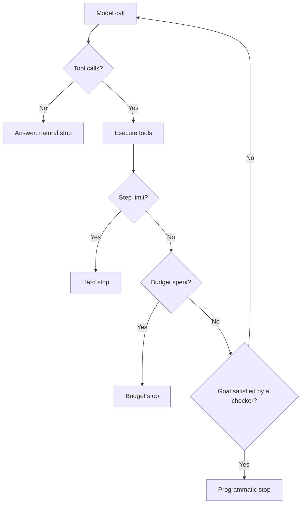

# Agent আসলে কী, আর কখন একাধিক Agent লাগে {#ch-what-an-agent-actually-is}

> Agent loop-টা পড়তে শিখুন, চারটি থামার শর্ত দিয়ে সেটাকে বেঁধে দিন, আর কয়েকটি agent-এ ভাগ করুন শুধু তখনই, যখন ভাগ করে কী পাচ্ছেন তা নাম ধরে বলতে পারেন।

**এই অধ্যায়ে:** loop আর তার চারটি থামার শর্ত · খরচ কেন step-এর চেয়ে দ্রুত বাড়ে · workflow নাকি agent · orchestrator আর worker · handoff-এ কী হারিয়ে যায়

## 💡 মূল ধারণা

Agent হলো **এমন একটি `while` loop, যার branch condition একটি language model।** Model conversation পড়ে একটি tool
বাছে। আপনার code tool-টা চালায়, আর ফলাফল conversation-এ জুড়ে দেয়। তারপর model আবার দেখে। Loop শেষ হয় যখন model
tool call না করে উত্তর দেয়, কিংবা যখন আপনি থামিয়ে দেন।

Script আর agent-এর পার্থক্য শুধু এক জায়গায়: **agent-এ step-গুলোর ক্রম কোথাও লেখা থাকে না।** আপনি tool আর লক্ষ্য দেন,
আর runtime-এ model পথ বেছে নেয়। এটাই ক্ষমতা, আবার পুরো ঝুঁকিও এটাই।

> Flowchart আগে থেকে আঁকতে পারলে flowchart-টাই লিখুন। Agent হলো সেটা, যা আঁকতে না পারলে হাতে নেন।

কয়েকটি agent-কে প্রায়ই org chart-এর মতো আঁকা হয়: একজন planner, একজন researcher, একজন writer, একজন reviewer।
মানুষের team একই অফিসে বসে, একই স্মৃতি ভাগ করে, একে অন্যকে প্রশ্ন করতে পারে। **Agent-রা ভাগ করে শুধু একটি string।**
ভাগ করলে ঠিক দুটি জিনিস পাওয়া যায়: **context isolation** (প্রতিটি worker পায় পরিষ্কার একটি window) আর **parallelism**
(স্বাধীন subtask একসঙ্গে চলে)। শুরু করুন একটি agent দিয়ে, আর ভাগ করুন শুধু এই দুটির কোনো একটি কারণে।

## কীভাবে কাজ করে

### Loop

**কোনো framework ছাড়া পুরো ব্যবস্থাটা**

```typescript
async function run(goal: string, tools: ToolSet, maxSteps = 10): Promise<string> {
  const messages: Message[] = [{ role: 'user', content: goal }];

  for (let step = 0; step < maxSteps; step++) {
    const res = await model.generate({ messages, tools });
    messages.push(res.message);

    if (res.toolCalls.length === 0) return res.text;      // the model chose to answer: done

    for (const call of res.toolCalls) {
      const output = await dispatch(call);                 // validate, authorise, execute
      messages.push({ role: 'tool', toolCallId: call.id, content: output });
    }
  }
  throw new StepLimitReached(messages);                    // stop, and say so honestly
}
```

Memory, durability আর multi-agent orchestration, সবই এই পনেরো লাইনের ওপর বদল। Framework এগুলো দেয়। কিন্তু loop-টা
জানা থাকলেই আপনি framework debug করতে পারবেন।

### চারটি থামার শর্ত



**শুধু প্রথম থামাটাই model-এর সিদ্ধান্ত। বাকি তিনটি আপনার, আর production-এ সবগুলোই লাগে।**

| থামা | কী সীমিত করে | কোথা থেকে ঠিক হয় |
| --- | --- | --- |
| **Natural** | কিছুই না | Model নিজে ঠিক করে যে কাজ শেষ |
| **Step limit** | লাগামছাড়া loop | ভালো একটি run যত step নেয়, তার দ্বিগুণ |
| **Budget** | খরচ | প্রতি task-এ token বা টাকার অঙ্ক |
| **Programmatic** | সঠিকতা | এমন checker, যা লক্ষ্য পূরণ হয়েছে কি না যাচাই করে — test pass করে, file আছে |

নির্ভরযোগ্য agent আর demo-র পার্থক্য গড়ে দেয় programmatic থামা। "Model বলেছে কাজ শেষ" আর "কাজটা হয়ে গেছে" দুটি
আলাদা দাবি, আর যাচাই করা যায় শুধু দ্বিতীয়টা।

### খরচ step-এর চেয়ে দ্রুত বাড়ে

প্রতিটি step পুরো conversation আবার পাঠায়, এখন পর্যন্ত পাওয়া সব tool result-সহ। তাই দশ step-এর run-এর খরচ একটি
call-এর দশ গুণ নয়, বরং বাড়তে থাকা context-এর যোগফল। Step-এর সংখ্যার তুলনায় এটা মোটামুটি quadratic: এক step-এ প্রায়
2k input token, দশ step-এ 110k, আর বিশ step-এ 420k।

তাই step limit শুধু নিরাপত্তার জাল নয়, খরচ নিয়ন্ত্রণের উপায়ও। এ কারণেই history থেকে সবার আগে সরাতে হয় ভারী tool
output। দেখুন [Chapter ?? — Memory, State ও দীর্ঘ সময়ের কাজ](#ch-durability-and-long-running-work)।

### Workflow নাকি agent

Workflow-এর পথ নির্দিষ্ট, stack trace আছে, খরচও জানা। Agent-এর পথ runtime-এ বাছা হয়, থাকে সিদ্ধান্তের একটি trace,
আর খরচ বড়জোর সীমার মধ্যে থাকে। Ship হওয়া বেশিরভাগ "agent"-এর আসলে workflow হওয়া উচিত। Documentation assistant-এর
স্বাভাবিক পথ হলো আগে retrieve, তারপর উত্তর। ক্রমটা জানা, তাই সেটা code হিসেবে লিখুন। Agent তার দাম তুলে আনে "এখানে
docs আর code মিলছে না কেন?" ধরনের প্রশ্নে, যেখানে কী খুঁজে পাওয়া যাচ্ছে, তার ওপর step নির্ভর করে।

> ⚠️ স্বাধীনতা একটি খরচ, feature নয়। Model-এর হাতে যে সিদ্ধান্তই দেন, পরের run-এ সেটা অন্যরকম হতে পারে, আর প্রতিটি
> সিদ্ধান্ত ধরে নিলে চলবে না, যাচাই করতে হবে।

### Agent কেন loop-এ আটকে যায়

ভালো model এর কোনোটাই সারায় না।

| লক্ষণ | কারণ | সমাধান |
| --- | --- | --- |
| একই tool, একই argument, বারবার | খালি ফলাফলকে সাময়িক ব্যর্থতা বলে মনে হয় | স্পষ্ট করে "no match" আর একটি ইঙ্গিত ফেরত দিন |
| দুটি tool-এর মধ্যে পালা করে ঘোরা | বর্ণনা একটি আরেকটির ওপর পড়ে | দুটিকে এক করুন, কিংবা সীমানা ধারালো করুন |
| প্রতিবার step limit পর্যন্ত চলে | পূরণ করা যায় এমন কোনো থামার শর্ত নেই | লক্ষ্যেই বলে দিন "শেষ" দেখতে কেমন |

প্রথম row-টাই agent-এর সবচেয়ে সাধারণ bug। খালি array দেখতে হুবহু ভাঙা tool-এর মতো, তাই বুদ্ধিমান model আবার চেষ্টা
করে। [Chapter ?? — Tool Calling ও Tool Surface](#ch-tool-calling)-এর বড় অংশই এটা ঠেকানো নিয়ে।

### Orchestrator আর worker

ভাগ করা যুক্তিসঙ্গত হলে বাস্তবে এই pattern-টাই কাজ করে। একটি orchestrator লক্ষ্যটাকে কয়েকটি subtask-এ ভাঙে। Worker-রা
সেগুলো parallel-এ চালায়, প্রত্যেকে পরিষ্কার একটি window নিয়ে। তারপর orchestrator ফলগুলো জোড়া দেয়।

**Documentation assistant একসঙ্গে docs, code আর ticket যাচাই করছে**

```typescript
async function orchestrate(goal: string): Promise<string> {
  const plan = await planner.decompose(goal);          // structured output: a list of subtasks
  const findings = await Promise.all(
    plan.subtasks.map((t) => runWorker(t, { tools: toolsFor(t.kind), maxSteps: 6 })),
  );
  return synthesiser.answer(goal, findings);            // orchestrator sees summaries, not raw output
}
```

দুটি গুণে এটা কাজ করে। Worker-রা **স্বাধীন**, তাই design করার মতো কোনো coordination protocol নেই। আর পুরো ছবিটা
আছে শুধু orchestrator-এর কাছে, তাই উত্তর ভুল হলে দেখার জায়গাও একটিই। Worker-রা ফেরত দেয় **সারাংশ**, transcript নয়।
কাঁচা output ফেরত পাঠালে সেই বিশাল একক window আবার তৈরি হয়, যা এড়াতেই ভাগ করা হয়েছিল।

### ভাগ করার দাম

Worker যা জানে, তার সবটাই এঁটে যেতে হবে সেই string-এ, যা তার parent পড়ে। অনিশ্চয়তা, খালি search, আর কোনো পথ কেন বাদ
দেওয়া হলো, এসব খুব কমই টিকে থাকে। ফলে orchestrator দ্বিধা মেশানো কোনো ফলকে তথ্য বলে ধরে নেয়, কিংবা একই জায়গায় আরেকটি
worker পাঠায়। অস্পষ্ট একটি requirement-এর ওপর তিন ধাপের সারাংশ দেয় তিনটি বিশ্বাসযোগ্য ব্যাখ্যা। তিনটি worker আর একটি
orchestrator একটি agent-এর তুলনায় **তিন থেকে পাঁচ গুণ token** খরচ করে। Trace হয়ে যায় একটি tree, আর প্রতিটি ধাপের
নিজস্ব eval লাগে। Parallel-এর লাভকে এই সবকিছুর দাম মেটাতে হবে।

> ⚠️ একই model আর context নিয়ে বানানো "reviewer agent" লেখকের অন্ধ জায়গাগুলোই ভাগ করে নেয়, সায় দেয়, আর খরচ দ্বিগুণ
> করে। আসল যাচাই চালায় এমন কিছু, যা model বানিয়ে দিতে পারে না: একটি test, একটি schema, একটি নির্ভরযোগ্য উৎস।

## কখন ব্যবহার করবেন

| পরিস্থিতি | কী ব্যবহার করবেন |
| --- | --- |
| Step-গুলো আগে থেকেই জানা | ভেতরে model call আছে এমন একটি workflow |
| একটি model call আর retrieval দিয়েই উত্তর হয় | কোনোটাই নয় — শুধু model call করুন |
| কী পাওয়া যাচ্ছে তার ওপর step-এর সংখ্যা নির্ভর করে | একটি agent, চারটি থামাসহ |
| যা ফেরানো যায় না এমন যেকোনো কিছু | একটি approval gate, কিংবা workflow |
| আলাদা উৎসের ওপর স্বাধীন subtask | Orchestrator আর worker |
| Output যাচাই করতে হবে | একটি verification step, critic agent নয় |
| বিভিন্ন আচরণের মধ্যে routing | ছোট model-এর একটি call, যা একটি enum ফেরত দেয় |
| Worker-দের একে অন্যের output লাগে | ভাগ করবেন না — ওটা একটি distributed system |

## সাধারণ ভুল

**❌ নির্দিষ্ট pipeline-এর জন্য agent বানানো**

> খরচ বেশি, চলে ধীরে, আর এমন branch নিতে পারে, যা আপনি চাননি। Pipeline-টাই লিখুন।

**❌ Model "কাজ শেষ" বললেই বিশ্বাস করা**

> "I have updated the file" হলো generate করা text। File-টা দেখুন।

**❌ প্রতিটি agent-এর আলাদা step limit, কিন্তু সব মিলিয়ে কোনো সীমা নেই**

> তিনটি worker, প্রত্যেকে দশ step, মানে সব জোড়া লাগানোর আগেই ত্রিশটি model call। পুরো run জুড়ে একটি budget বয়ে নিয়ে
> চলুন, আর সেটা ফুরোলে পুরো tree থামিয়ে দিন।

**✅ প্রতিটি step log করুন, সব worker জুড়ে একটি trace id দিয়ে**

> Agent-এর ব্যর্থতা মানে সিদ্ধান্তের ব্যর্থতা, আর trace ছাড়া সেটা পড়াই যায় না। Handoff-এর সারাংশগুলোও log করুন। সূক্ষ্মভাবে
> ভুল উত্তরের পেছনে সাধারণত থাকে দুই ধাপ ওপরের সূক্ষ্মভাবে ভুল একটি সারাংশ।

## 🔑 মূল শিক্ষা

- Agent হলো এমন loop, যার branch condition একটি model। Tool আর লক্ষ্য আপনার, কিন্তু পথটা আপনার নয়।
- খরচ step-এর সংখ্যার চেয়ে দ্রুত বাড়ে, কারণ প্রতিটি step পুরো conversation আবার পাঠায়।
- Production agent-এর চারটি থামার শর্ত লাগে, আর নির্ভরযোগ্য করে তোলে programmatic শর্তটা।
- Flowchart আগে থেকে আঁকতে পারলে flowchart-টাই লিখুন। বেশিরভাগ "agent"-এর workflow হওয়া উচিত।
- কয়েকটি agent-এ ভাগ করুন শুধু context isolation বা parallelism-এর জন্য, আর তিন থেকে পাঁচ গুণ token খরচের জন্য তৈরি থাকুন।

## Interview-এর প্রশ্ন

**Q: কখন এর বদলে workflow বানাবেন?**

যখনই ক্রমটা আঁকতে পারি। Classify, retrieve, draft — এটা code। এটা deterministic, test করা যায়, সস্তা, আর আমার
অনিচ্ছার কোনো branch নিতে পারে না। Agent তার দাম তুলে আনে তখন, যখন পথটা নির্ভর করে কী পাওয়া যাচ্ছে তার ওপর, যেমন
কয়েকটি উৎস জুড়ে triage।

**Q: আপনার agent প্রতিটি task-এ step limit পর্যন্ত চলে যায়। কী হচ্ছে?**

আগে trace পড়ব। যদি একই argument দিয়ে একই call বারবার করে, তাহলে কোনো tool খালি ফলাফল দিচ্ছে, যা ব্যর্থতার মতো
দেখায়। যদি দুটি tool-এর মধ্যে পালা করে ঘোরে, তাদের বর্ণনা একটি আরেকটির ওপর পড়ছে। যদি শুধু চলতেই থাকে, তাহলে লক্ষ্যে
কখনো বলা হয়নি "শেষ" দেখতে কেমন। নতুন model এর কোনোটাই সারায় না।

**Q: কখন তিনটি agent-এর চেয়ে একটি ভালো?**

শুরুতে প্রায় সবসময়, আর ভাগ করার আগে আমি মাপা একটি কারণ চাই। ভাগ করলে পাওয়া যায় context isolation আর parallelism।
দাম হলো তিন থেকে পাঁচ গুণ token, tree-আকারের trace, প্রতিটি ধাপের eval, আর নতুন এক ধরনের ব্যর্থতা, যেখানে worker
আত্মবিশ্বাসের সঙ্গে খালি সারাংশ ফেরত দেয়। Subtask-গুলো যদি পরপর চলে আর context ভাগ করে, তাহলে দুটি লাভের কোনোটাই
মেলে না।

**Q: Reviewer agent কি ভালো বুদ্ধি?**

যেভাবে সাধারণত বলা হয়, সেভাবে নয়। একই model আর context থাকলে এটা generator-এর অন্ধ জায়গাগুলোই পায়, আর সায় দেওয়ার
দিকে ঝোঁকে। ফলে খরচ দ্বিগুণ হয়, কিন্তু কিছুই মাপা হয় না। আমি চাই এমন check, যা স্বাধীনভাবে fail করতে পারে: test, একটি
schema, কিংবা নির্ভরযোগ্য উৎসের সঙ্গে মিলিয়ে দেখা।

**Q: কয়েকটি agent জুড়ে খরচ কীভাবে সীমিত রাখবেন?**

Run-এর স্তরে, কারণ প্রতিটি agent-এর আলাদা limit গুণ হয়ে যায়। তিনটি worker, প্রত্যেকে দশ step, মানে জোড়া লাগানোর আগেই
ত্রিশটি call। আমি পুরো run জুড়ে একটি shared budget বয়ে নিয়ে যাব, step শেষ হওয়ার সঙ্গে সঙ্গে সেখান থেকে খরচ কাটব, আর
budget ফুরোলে পুরো tree থামিয়ে দেব। Plan-টারও সীমা বেঁধে দেব, কারণ তিনটির বদলে বারোটি subtask হলে পরের সবকিছু গুণ হয়ে যায়।

## এরপর কী পড়বেন

- [Chapter ?? — Tool Calling ও Tool Surface](#ch-tool-calling) — এই loop যে একক step বারবার করে, আর agent-এর quality-র বেশিরভাগটা যেখানে থাকে
- [Chapter ?? — Memory, State ও দীর্ঘ সময়ের কাজ](#ch-durability-and-long-running-work) — conversation বাড়লে, আর restart পেরিয়ে, কী টিকে থাকে
- [Chapter ?? — Observability ও Cost Engineering](#ch-observability) — tree-আকারের trace পড়া আর একটি run-এর দাম হিসাব করা
