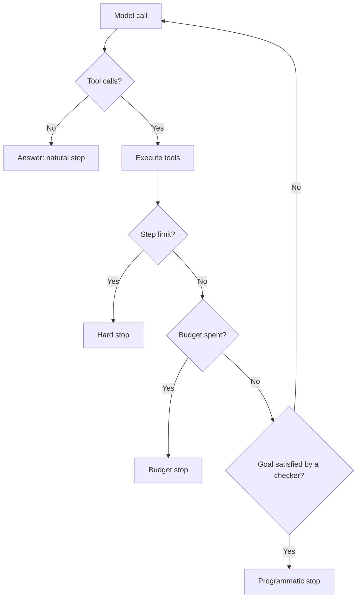

# Agent আসলে কী, আর কখন একাধিক Agent লাগে {#ch-what-an-agent-actually-is}

> Agent loop পড়তে শিখুন, চারটি stop condition দিয়ে সেটাকে সীমায় বাঁধুন, আর একাধিক agent-এ ভাগ করুন কেবল তখনই, যখন ভাগ করে কী পাচ্ছেন তা নাম ধরে বলতে পারেন।

**এই অধ্যায়ে:** loop আর তার চারটি stop condition · খরচ কেন step-এর চেয়ে দ্রুত বাড়ে · workflow নাকি agent · orchestrator আর worker · handoff-এ কী হারিয়ে যায়

## 💡 মূল ধারণা

Agent হলো **একটি `while` loop, যার branch condition একটি language model।** Model conversation পড়ে আর একটি tool
বাছে। আপনার code tool-টি চালায় আর result-টি conversation-এ যোগ করে। তারপর model আবার দেখে। Loop শেষ হয় যখন model
tool call না করে উত্তর দেয়, অথবা যখন আপনি থামান।

Script আর agent-এর পার্থক্য একটাই: **agent-এ step-গুলোর ক্রম কোথাও লেখা থাকে না।** আপনি tool আর লক্ষ্য দেন, আর
model runtime-এ পথ বেছে নেয়। এটাই ক্ষমতা, আর এটাই পুরো ঝুঁকিও।

> Flowchart যদি আগে থেকে আঁকতে পারেন, flowchart-টাই লিখুন। Agent হলো সেই জিনিস, যেটা আপনি তখনই নেন যখন তা
> পারেন না।

একাধিক agent-কে প্রায়ই একটি org chart হিসেবে আঁকা হয়: একজন planner, একজন researcher, একজন writer, একজন reviewer।
মানুষের একটি team একই office আর একই স্মৃতি ভাগ করে, আর একে অপরকে প্রশ্ন করতে পারে। **Agent-রা ভাগ করে একটি
string।** ভাগ করলে ঠিক দুটো জিনিস পাওয়া যায়: **context isolation** (প্রতিটি worker একটি পরিষ্কার window পায়) আর
**parallelism** (স্বাধীন subtask একসাথে চলে)। একটি agent দিয়ে শুরু করুন, আর ভাগ করুন কেবল এই দুটোর কোনো একটি
কারণে।

## কীভাবে কাজ করে

### Loop

**কোনো framework-এর আগে, পুরো mechanism**

```typescript
async function run(goal: string, tools: ToolSet, maxSteps = 10): Promise<string> {
  const messages: Message[] = [{ role: 'user', content: goal }];

  for (let step = 0; step < maxSteps; step++) {
    const res = await model.generate({ messages, tools });
    messages.push(res.message);

    if (res.toolCalls.length === 0) return res.text;      // the model chose to answer: done

    for (const call of res.toolCalls) {
      const output = await dispatch(call);                 // validate, authorise, execute
      messages.push({ role: 'tool', toolCallId: call.id, content: output });
    }
  }
  throw new StepLimitReached(messages);                    // stop, and say so honestly
}
```

Memory, durability আর multi-agent orchestration — সবই এই পনেরো line-এর পরিবর্তন। Framework এগুলো দেয়। Loop-টা
জানা থাকলেই আপনি একটি framework debug করতে পারেন।

### চারটি stop condition



**শুধু প্রথম stop-টি model-এর সিদ্ধান্ত। বাকি তিনটি আপনার, আর production-এ সবগুলোই লাগে।**

| Stop | যা সীমায় রাখে | যা থেকে ঠিক হয় |
| --- | --- | --- |
| **Natural** | কিছুই না | Model ঠিক করে যে সে শেষ করেছে |
| **Step limit** | নিয়ন্ত্রণহীন loop | একটি ভালো run যত step নেয়, তার দ্বিগুণ |
| **Budget** | খরচ | প্রতি task-এ token বা টাকা |
| **Programmatic** | সঠিকতা | একটি checker যেটা লক্ষ্য যাচাই করে — test pass করে, file আছে |

Programmatic stop-ই একটি নির্ভরযোগ্য agent-কে একটি demo থেকে আলাদা করে। "Model বলল সে শেষ করেছে" আর "কাজটা
হয়ে গেছে" দুটো আলাদা দাবি, আর শুধু দ্বিতীয়টাই যাচাই করা যায়।

### খরচ step-এর চেয়ে দ্রুত বাড়ে

প্রতিটি step পুরো conversation আবার পাঠায়, এ পর্যন্ত আসা প্রতিটি tool result-সহ। তাই দশ step-এর একটি run-এর
খরচ একটি call-এর দশগুণ নয়, বরং বাড়তে থাকা context-এর যোগফল। Step-এর সংখ্যার সাপেক্ষে এটা মোটামুটি quadratic:
এক step-এ প্রায় 2k input token, দশ step-এ 110k, আর বিশ step-এ 420k।

তাই step limit শুধু একটি safety net নয়, একটি cost control-ও। এই কারণেই history থেকে প্রথমে সরাতে হয় ভারী tool
output। দেখুন [Chapter ?? — Memory, State ও দীর্ঘ সময়ের কাজ](#ch-durability-and-long-running-work)।

### Workflow নাকি agent

Workflow-এর একটি নির্দিষ্ট পথ, একটি stack trace আর জানা খরচ থাকে। Agent-এর পথ runtime-এ বাছা হয়, থাকে
সিদ্ধান্তের একটি trace, আর খরচ বড়জোর সীমাবদ্ধ। Ship করা বেশিরভাগ "agent"-এর আসলে workflow হওয়া উচিত।
Documentation assistant-এর স্বাভাবিক পথ হলো retrieve, তারপর উত্তর। এটা একটি জানা ক্রম, তাই code হিসেবে লিখুন।
একটি agent তার খরচের যোগ্য হয় "এখানে docs আর code মিলছে না কেন?" ধরনের প্রশ্নে, যেখানে step-গুলো নির্ভর করে
সে কী খুঁজে পায় তার ওপর।

> ⚠️ Autonomy একটি খরচ, feature নয়। Model-এর হাতে দেওয়া প্রতিটি সিদ্ধান্ত পরের run-এ অন্যরকম হতে পারে, আর
> প্রতিটিকেই ধরে না নিয়ে যাচাই করতে হয়।

### Agent কেন loop-এ আটকে যায়

ভালো model এর কোনোটাই সারায় না।

| লক্ষণ | কারণ | সমাধান |
| --- | --- | --- |
| একই tool, একই argument, বারবার | খালি result-কে একটি সাময়িক failure মনে হয় | স্পষ্ট "no match" আর একটি hint ফেরত দিন |
| দুটো tool-এর মধ্যে আসা-যাওয়া | Description একে অপরের ওপর পড়ে | দুটো মিলিয়ে দিন, বা সীমানা ধারালো করুন |
| প্রতিবার step limit পর্যন্ত চলে | এমন কোনো stop condition নেই যেটা সে পূরণ করতে পারে | লক্ষ্যে বলে দিন "শেষ" দেখতে কেমন |

প্রথম row-টিই agent-এর সবচেয়ে সাধারণ bug। একটি খালি array দেখতে ঠিক একটি ভাঙা tool-এর মতো, তাই একটি বুদ্ধিমান
model আবার চেষ্টা করে। [Chapter ?? — Tool Calling ও Tool Surface](#ch-tool-calling)-এর বড় অংশই এটা ঠেকানো
নিয়ে।

### Orchestrator আর worker

ভাগ করা যখন যুক্তিসঙ্গত, তখন বাস্তবে এই pattern-টাই কাজ করে। একটি orchestrator লক্ষ্যকে subtask-এ ভাঙে। Worker-রা
সেগুলো parallel-এ চালায়, প্রত্যেকে একটি পরিষ্কার window নিয়ে। তারপর orchestrator result-গুলো জোড়া লাগায়।

**Documentation assistant একসাথে docs, code আর ticket যাচাই করছে**

```typescript
async function orchestrate(goal: string): Promise<string> {
  const plan = await planner.decompose(goal);          // structured output: a list of subtasks
  const findings = await Promise.all(
    plan.subtasks.map((t) => runWorker(t, { tools: toolsFor(t.kind), maxSteps: 6 })),
  );
  return synthesiser.answer(goal, findings);            // orchestrator sees summaries, not raw output
}
```

দুটো বৈশিষ্ট্য এটাকে কাজ করায়। Worker-রা **স্বাধীন**, তাই কোনো coordination protocol design করতে হয় না। আর পুরো
ছবিটা শুধু orchestrator-এর কাছে থাকে, তাই উত্তর ভুল হলে দেখার জায়গা একটাই। Worker-রা transcript নয়, **summary**
ফেরত দেয়। Raw output ফেরত পাঠালে সেই বিশাল window আবার তৈরি হয়, যেটা এড়াতেই ভাগ করা হয়েছিল।

### ভাগ করার খরচ

একটি worker যা জানে, তার সবকিছু সেই string-এ আঁটতে হবে যেটা তার parent পড়ে। অনিশ্চয়তা, খালি search আর কোনো পথ
বাদ দেওয়ার কারণ খুব কমই টিকে থাকে। তাই orchestrator একটি দ্বিধাগ্রস্ত finding-কে সত্য হিসেবে ধরে, অথবা একই জায়গায়
আরেকটি worker পাঠায়। একটি অস্পষ্ট requirement-এর ওপর তিন ধাপের summary তিনটি বিশ্বাসযোগ্য ব্যাখ্যা দেয়। তিনটি
worker আর একটি orchestrator একটি agent-এর চেয়ে **তিন থেকে পাঁচগুণ token**-ও খরচ করে। Trace একটি tree হয়ে যায়, আর
প্রতিটি ধাপের নিজস্ব eval লাগে। Parallel-এর লাভকে এই সবকিছুর দাম মেটাতে হবে।

> ⚠️ একই model আর context-এর একটি "reviewer agent" লেখকের অন্ধ জায়গাগুলোই ভাগ করে, একমত হয়, আর খরচ দ্বিগুণ
> করে। আসল যাচাই এমন কিছু চালায় যেটা model নকল করতে পারে না: একটি test, একটি schema, সত্যের একটি উৎস।

## কখন ব্যবহার করবেন

| পরিস্থিতি | কী ব্যবহার করবেন |
| --- | --- |
| Step-গুলো আগে থেকে জানা | ভেতরে model call-সহ একটি workflow |
| একটি model call আর retrieval দিয়েই উত্তর হয় | কোনোটাই না — শুধু model call করুন |
| Step-এর সংখ্যা নির্ভর করে কী পাওয়া গেল তার ওপর | একটি agent, চারটি stop-সহ |
| যেকোনো অপরিবর্তনীয় কাজ | একটি approval gate, অথবা একটি workflow |
| আলাদা আলাদা source-এর ওপর স্বাধীন subtask | Orchestrator আর worker |
| Output যাচাই করা দরকার | একটি verification step, critic agent নয় |
| ভিন্ন আচরণের মধ্যে routing | একটি enum ফেরত দেওয়া একটি small-model call |
| Worker-দের একে অপরের output লাগে | ভাগ করবেন না — সেটা একটি distributed system |

## সাধারণ ভুল

**❌ একটি নির্দিষ্ট pipeline-এর জন্য agent বানানো**

> এতে খরচ বেশি, চলে ধীরে, আর এমন branch বেছে নিতে পারে যেটা আপনি চাননি। Pipeline-টাই লিখুন।

**❌ Model-এর "শেষ করেছি" দাবি বিশ্বাস করা**

> "I have updated the file" একটি generate করা text। File-টা যাচাই করুন।

**❌ প্রতি agent-এ step limit, কিন্তু কোনো global সীমা নেই**

> দশ step করে তিনটি worker মানে synthesis-এর আগেই ত্রিশটি model call। পুরো run জুড়ে একটি budget বয়ে নিন, আর
> সেটা ফুরোলে পুরো tree থামিয়ে দিন।

**✅ প্রতিটি step log করুন, সব worker জুড়ে একটি trace id দিয়ে**

> Agent-এর failure হলো সিদ্ধান্তের failure, আর trace ছাড়া সেটা পড়া যায় না। Handoff summary-গুলোও log করুন।
> সূক্ষ্মভাবে ভুল একটি উত্তর সাধারণত দুই ধাপ ওপরের সূক্ষ্মভাবে ভুল একটি summary।

## 🔑 মূল শিক্ষা

- Agent এমন একটি loop, যার branch condition একটি model। Tool আর লক্ষ্য আপনার, কিন্তু পথ আপনার নয়।
- খরচ step-এর সংখ্যার চেয়ে দ্রুত বাড়ে, কারণ প্রতিটি step পুরো conversation আবার পাঠায়।
- Production agent-এর চারটি stop condition লাগে, আর programmatic-টাই এদের নির্ভরযোগ্য করে।
- Flowchart আগে থেকে আঁকতে পারলে flowchart-টাই লিখুন। বেশিরভাগ "agent"-এর workflow হওয়া উচিত।
- একাধিক agent-এ ভাগ করুন শুধু context isolation বা parallelism-এর জন্য, আর তিন থেকে পাঁচগুণ token খরচের জন্য তৈরি থাকুন।

## Interview-এর প্রশ্ন

**Q: কখন আপনি এর বদলে একটি workflow বানাবেন?**

যখনই ক্রমটা আঁকতে পারি। Classify, retrieve, draft — এটা code। এটা deterministic, test করা যায়, সস্তা, আর এমন
branch নিতে পারে না যেটা আমি চাইনি। একটি agent তার খরচের যোগ্য হয় যখন পথ নির্ভর করে সে কী খুঁজে পায় তার ওপর,
যেমন কয়েকটি source জুড়ে triage।

**Q: আপনার agent প্রতিটি task-এ step limit পর্যন্ত চলে। কী হচ্ছে?**

আমি প্রথমে trace পড়ব। যদি একই argument দিয়ে একটি call বারবার করে, তাহলে কোনো tool এমন খালি result দিচ্ছে যেটা
failure-এর মতো দেখায়। যদি দুটো tool-এর মধ্যে আসা-যাওয়া করে, তাদের description একে অপরের ওপর পড়ছে। যদি শুধু
চলতেই থাকে, তাহলে লক্ষ্যে কখনো বলা হয়নি "শেষ" দেখতে কেমন। নতুন model এর কোনোটাই সারায় না।

**Q: কখন তিনটি agent-এর চেয়ে একটি ভালো?**

শুরুতে প্রায় সবসময়, আর ভাগ করার আগে আমি একটি মাপা কারণ চাই। ভাগ করলে context isolation আর parallelism পাওয়া যায়।
খরচ হয় তিন থেকে পাঁচগুণ token, একটি tree-আকৃতির trace, প্রতি ধাপে eval, আর একটি নতুন failure, যেখানে একটি
worker আত্মবিশ্বাসী কিন্তু খালি summary ফেরত দেয়। Subtask-গুলো যদি পরপর চলে আর context ভাগ করে, তাহলে কোনো
লাভই পাওয়া যায় না।

**Q: Reviewer agent কি ভালো বুদ্ধি?**

যেভাবে বলা হয় সেভাবে, সাধারণত না। একই model আর context থাকলে এটা generator-এর অন্ধ জায়গাগুলোই পায়, আর একমত
হওয়ার দিকে ঝোঁকে। তাই এটা খরচ দ্বিগুণ করে, কিন্তু কিছুই মাপে না। আমি এমন একটি যাচাই চাই যেটা স্বাধীনভাবে ব্যর্থ হতে
পারে: test, একটি schema, অথবা সত্যের একটি উৎসের সাথে মিলিয়ে দেখা।

**Q: কয়েকটি agent জুড়ে খরচ কীভাবে সীমায় রাখবেন?**

Run-এর স্তরে, কারণ প্রতি agent-এর limit গুণ হয়ে যায়। দশ step করে তিনটি worker মানে synthesis-এর আগেই ত্রিশটি
call। আমি পুরো run জুড়ে একটি shared budget বয়ে নেব, step শেষ হলে সেখান থেকে খরচ কাটব, আর ফুরিয়ে গেলে পুরো tree
থামিয়ে দেব। Plan-টারও একটি সীমা দেব, কারণ তিনটির বদলে বারোটি subtask পরের সবকিছু গুণ করে দেয়।

## এরপর কী পড়বেন

- [Chapter ?? — Tool Calling ও Tool Surface](#ch-tool-calling) — যে একটি step এই loop বারবার করে, আর agent-এর মানের বেশিরভাগ যেখানে থাকে
- [Chapter ?? — Memory, State ও দীর্ঘ সময়ের কাজ](#ch-durability-and-long-running-work) — conversation বাড়ার সাথে আর restart পেরিয়ে কী টিকে থাকে
- [Chapter ?? — Observability ও Cost Engineering](#ch-observability) — একটি tree-আকৃতির trace পড়া আর একটি run-এর দাম হিসাব করা
