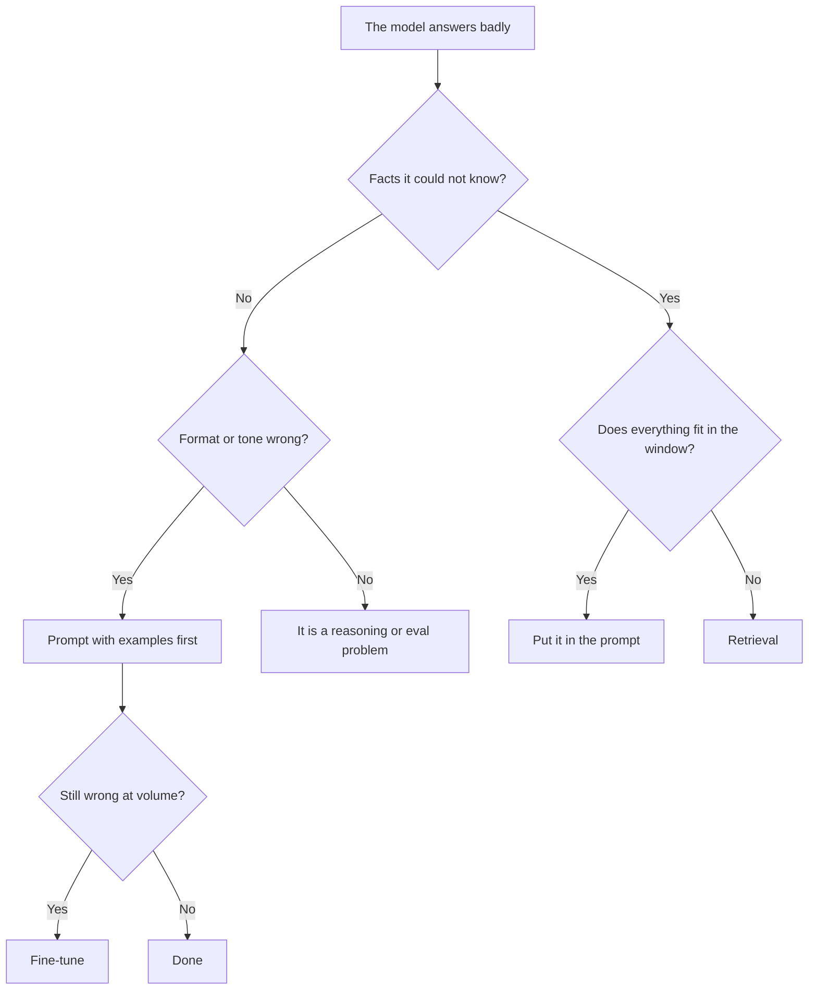

# কখন RAG, কখন Fine-Tune, কখন কোনোটাই নয় {#ch-when-rag-when-fine-tune-when-neither}

> লোকে যে দুটি সমস্যা গুলিয়ে ফেলে, তথ্যের অভাব আর ভুল ধরন, সেগুলো আলাদা করে চিনুন, আর আপনার সমস্যাটার সবচেয়ে সস্তা সমাধান বেছে নিন।

**এই অধ্যায়ে:** তথ্য বনাম ধরন · খরচ অনুযায়ী সাজানো চারটি উপায় · fine-tuning আসলে কী দেয় · "কোনোটাই নয়" কেন আশার চেয়ে বেশি জেতে · দুটি মিলিয়ে ব্যবহারের case

## 💡 মূল ধারণা

"আমাদের কি fine-tune করা উচিত?" এই আলোচনার প্রায় সবটাই আসলে দুটি প্রশ্ন, একসঙ্গে মেশানো।

**Retrieval তথ্য জোগায়। Fine-tuning আচরণ গড়ে।** Model যদি আপনার refund policy না জানে, তাহলে সমস্যাটা জ্ঞানের।
আপনার লেখার ঢং দিয়ে যত train-ই করুন, সেটা মিটবে না। আবার model যদি ঠিক উত্তরই দেয়, কিন্তু ছয় অনুচ্ছেদ ধরে
এলোমেলো বকে, তাহলে সমস্যাটা ধরনের। Window-এ আরও document ঠেসে দিলে সেটাও মিটবে না।

এই ভাগটা ঠিকমতো করতে পারলে সিদ্ধান্ত সাধারণত নিজে থেকেই হয়ে যায়। ভুল করলে এক মাস ধরে এমন একটি model fine-tune
করবেন, যা গত মঙ্গলবার policy-তে কী বদলেছে, তখনো জানবে না।

> Data বদলালে যদি উত্তর বদলায়, তাহলে retrieve করুন। আপনার রুচি বদলালে যদি উত্তর বদলায়, তাহলে train করুন।
> আর অনেক বেশি ক্ষেত্রে শুধু prompt লিখলেই চলে।

## কীভাবে কাজ করে

### চারটি উপায়, সবচেয়ে সস্তাটা আগে

| উপায় | কী সমাধান করে | বানানোর খরচ | বদলানোর খরচ |
| --- | --- | --- | --- |
| **শুধু prompt** | ধরন, সহজ আচরণ, অল্প আর স্থির জ্ঞান | কয়েক ঘণ্টা | একটি string edit |
| **Prompt + window-এ context** | তথ্য, যখন corpus ছোট | কয়েক ঘণ্টা | File বদলানো |
| **Retrieval (RAG)** | তথ্য, যখন corpus বড় বা বদলায় | কয়েক সপ্তাহ | Re-index |
| **Fine-tuning** | ধরন, format, domain-এর ভাষা, বড় পরিসরে latency আর খরচ | কয়েক সপ্তাহ, সঙ্গে data | Retrain |

তালিকাটা ওপর থেকে নিচে নামুন, আর যে row-এ সমস্যা মেটে, সেখানেই থামুন। বেশিরভাগ team শুরু করে তিন row নিচ থেকে।
কারণ prompt লেখার চেয়ে retrieval বানানো বেশি মজার।

### সিদ্ধান্ত

**দুটি প্রশ্নেই প্রায় সব case-এর সিদ্ধান্ত হয়ে যায়। বেশিরভাগ team যে শাখাটা বাদ দেয়, সেটা ডানদিকেরটা।**

### যে window ছোট corpus গিলে ফেলেছে

কয়েকশো page-এর corpus বড় একটি context window-এ এঁটে যায়। আপনার পুরো knowledge base যদি হয় একটি handbook, কিছু
API docs আর একটি changelog, তাহলে **হয়তো কোনো retrieval system বানানোরই দরকার নেই।** Document-গুলো prompt-এ রাখুন,
শুরুর স্থির অংশটা (prefix) cache করুন, আর উত্তর দিন।

এটা সত্যিকারের একটি architecture, শর্টকাট নয়। এর এমন কিছু গুণ আছে, যা retrieval-এর নেই। কোনো retriever ঠিক
passage-টা হারাতে পারে না, তাজা রাখার মতো কোনো index নেই, আর prompt caching বারবারের খরচ কম রাখে। তিন অবস্থায় এটা
আর কাজ করে না: corpus window-এর চেয়ে বড় হয়ে গেলে, বানানোর খরচের চেয়ে প্রতি request-এর খরচ বেশি গুরুত্বপূর্ণ হলে,
কিংবা অপ্রাসঙ্গিক জিনিস accuracy-র ক্ষতি করতে শুরু করলে। Context বেশি হলেই কেন ভালো নয়, তা দেখুন
[Chapter ?? — Context Engineering](#ch-context-engineering)-এ।

### Fine-tuning আসলে কী দেয়

এখানে নিখুঁত হওয়া দরকার, কারণ লোকে সাধারণত যা আশা করে, তা ভুল।

| ✅ Fine-tuning যাতে ভালো | ❌ Fine-tuning যাতে খারাপ |
| --- | --- |
| একই রকম output format বজায় রাখা | নির্ভরযোগ্যভাবে নতুন তথ্য শেখানো |
| Domain-এর ভাষা বা প্রতিষ্ঠানের নিজস্ব ঢং | যে তথ্য বদলায় |
| লম্বা prompt ছাড়াই জটিল নির্দেশের সেট মেনে চলা | Audit করার সুযোগ — weight-কে cite করা যায় না |
| একটি সরু কাজে ছোট model-কে বড় model-এর মতো আচরণ করানো | এই সপ্তাহেই update করতে হবে এমন যেকোনো কিছু |

শেষ row-টার গুরুত্ব লোকে কম বোঝে। একটি সরু কাজের জন্য frontier (সবচেয়ে উঁচু স্তরের) model-এর output দিয়ে একটি
ছোট model fine-tune করুন। Quality ধরে রেখেই সেটা খরচ আর latency কয়েক গুণ কমিয়ে দিতে পারে। এটা খরচ কমানোর এমন
চাল, যার লাভ সত্যিই উঠে আসে। "Model-কে আমাদের domain শেখাব" বলার চেয়ে fine-tune করার এটা অনেক ভালো কারণ।

> ⚠️ তথ্যের ওপর fine-tune করলে পাওয়া যায় আত্মবিশ্বাসী, উৎসহীন, বাসি উত্তর। Model বলতে পারে না কোথা থেকে কিছু
> শিখেছে, আর আরেক দফা training ছাড়া model-টাকে শোধরানো যায় না।

### যে খরচ কেউ budget-এ রাখে না

Retrieval-ও সস্তা নয়। সৎ তুলনায় model-এর বাইরের অংশগুলোও ধরতে হয়।

| Retrieval যা নিয়ে আসে | Fine-tuning যা নিয়ে আসে |
| --- | --- |
| চালু রাখতে হবে এমন একটি ingestion pipeline | বাছাই করা, label দেওয়া একটি dataset |
| তাজা রাখতে হবে এমন index, schema বদলালে আবার re-index | প্রতিটি iteration-এ একবার training আর evaluation run |
| একটি retrieval eval suite, নইলে আপনি আন্দাজে চলছেন | Eval suite এখানেও লাগবে |
| প্রতি request-এ বেশি token, চিরকাল | Host আর track করার মতো একটি model version |
| Document public না হলে permission filtering | Permission নিয়ে কিছুই নেই — সব weight-এ মিশে যায়, যা আরও খারাপ |

শেষ লাইনটা সত্যিকারের একটি বাধা। আলাদা আলাদা user যদি আলাদা document দেখতে পান, retrieval প্রতিটি user-এর জন্য
filter করতে পারে। কিন্তু fine-tune করা model যা দিয়ে train হয়েছে, তা আর ভুলতে পারে না।

## কখন ব্যবহার করবেন

| পরিস্থিতি | বাছুন | কারণ |
| --- | --- | --- |
| উত্তরে উৎস cite করতেই হবে | Retrieval | Weight-এর কোনো citation নেই |
| তথ্য প্রতি সপ্তাহে বদলায় | Retrieval | Re-index করুন, retrain নয় |
| Corpus কয়েকশো page, স্থির | পুরো corpus window-এ | চালানোর মতো কোনো pipeline নেই |
| বেশি volume-এ output format এলোমেলো | আগে prompt-এ উদাহরণ, তারপর fine-tune | সবচেয়ে সস্তাটা আগে |
| একটি সরু কাজে প্রতি request-এর খরচই আসল | ছোট model fine-tune করুন | সত্যিকারের লাভ, মাপা যায় |
| আলাদা user আলাদা document দেখেন | Retrieval, filter সহ | Training permission মানাতে পারে না |
| তথ্য window-এ ছিল, তবু উত্তর ভুল | কোনোটাই নয় | সমস্যাটা prompt বা eval-এর |

## সাধারণ ভুল

**❌ Model-কে আপনার product শেখাতে fine-tune করা**

> এতে এমন system তৈরি হয়, যা audit বা update করা যায় না, আর যা আত্মবিশ্বাসের সঙ্গে ভুল বলে। তথ্যের জায়গা store-এ।

**❌ পুরো corpus window-এ এঁটে যায়, তবু retrieval বানানো**

> একটি ingestion pipeline, একটি index আর একটি retriever, সবই এমন সমস্যার জন্য, যা একটি cache করা prompt আগেই মিটিয়ে দিয়েছিল।

**❌ রোগ না ধরেই সিদ্ধান্ত নেওয়া**

> "উত্তর ভুল ছিল"-এর অন্তত চারটি কারণ থাকতে পারে: তথ্যটা ছিলই না, তথ্য retrieve হয়েছিল কিন্তু model উপেক্ষা
> করেছে, format ভুল ছিল, কিংবা প্রশ্নটাই অস্পষ্ট ছিল। চারটির সমাধান চার রকম।

**✅ Architecture বাছার আগে দশটি ব্যর্থ উদাহরণ লিখুন**

> এগুলো বলে দেয় চারটি কারণের কোনটা আসলে আপনার, আর এগুলোই হয়ে যায় সেই golden set-এর প্রথম row, যা আপনার
> এমনিতেও লাগবে।

## 🔑 মূল শিক্ষা

- Retrieval তথ্য জোগায়, fine-tuning ধরন গড়ে। Architecture নিয়ে বেশিরভাগ তর্ক আসলে এই ভাগটাই, শুধু মুখে বলা হয় না।
- Prompting দিয়ে শুরু করে ধাপে ধাপে ওপরে উঠুন। অনেক "RAG project" আসলে ছোট একটি corpus, যা cache করা window-এ এঁটে যায়।
- তথ্যের ওপর fine-tune করলে আসে আত্মবিশ্বাসী, বাসি, উৎসহীন উত্তর, যা তাড়াতাড়ি শোধরানো যায় না।
- Fine-tuning-এর পক্ষে সবচেয়ে জোরালো যুক্তি খরচ: একটি সরু কাজে ছোট model-কে বড় model-এর সমান করে তোলা।
- Retrieval প্রতিটি user-এর জন্য document filter করতে পারে। Fine-tune করা model যা দিয়ে train হয়েছে, তা ভুলতে পারে না।

## Interview-এর প্রশ্ন

**Q: Retrieval-এর বদলে কখন fine-tune করবেন?**

যখন সমস্যাটা জ্ঞানের নয়, আচরণের। মানে কড়া একটি output format, domain-এর নিজস্ব ভাষা (কোনো ক্ষেত্রের ঢং, যেমন আইনের
ভাষা), কিংবা এমন লম্বা নির্দেশের সেট, যার দাম আমি প্রতিটি request-এ দিতে চাই না। সবচেয়ে জোরালো যুক্তি খরচ: একটি
সরু কাজে ছোট model fine-tune করে frontier model-এর quality-তে পৌঁছানো, আর তাতে সাশ্রয় মাপা যায়। তথ্য শেখাতে আমি
fine-tune করব না। ফলাফল কোনো উৎস cite করতে পারে না, retrain ছাড়া বদলায় না, আর নিজে থেকেই বাসি হয়ে যায়।

**Q: আপনার কোম্পানির 400 page-এর internal documentation আছে। Assistant-টা design করুন।**

কিছু design করার আগে দেখব, এটা window-এ এঁটে যায় কি না। 400 page খুব সম্ভবত এঁটে যায়। এঁটে গেলে design সহজ:
corpus জোগাড় করুন, prompt-এর স্থির অংশে রাখুন যাতে cache হয়, আর উত্তর দিন। কোনো ingestion pipeline নেই, তাজা
রাখার মতো index নেই, ঠিক passage হারানোর মতো কোনো retriever-ও নেই। Retrieval-এ যাব তখন, যখন corpus window-এর
চেয়ে বড় হয়ে যাবে, বানানোর খরচের চেয়ে প্রতি request-এর খরচ বেশি গুরুত্বপূর্ণ হবে, কিংবা বাড়তি জিনিস accuracy-র
ক্ষতি করতে শুরু করবে।

**Q: উত্তর হিসেবে "কোনোটাই নয়" দেখতে কেমন?**

লোকে যতটা ভাবে, তার চেয়ে বেশিবার এটাই ঠিক উত্তর। ঠিক তথ্যগুলো window-এ থাকার পরেও যদি উত্তর ভুল হয়, retrieval
সাহায্য করবে না। সমস্যাটা prompt-এর গঠনে, অস্পষ্ট প্রশ্নে, কিংবা model বাছাইয়ে। ধরতে হলে request-এ আসলে কী গিয়েছিল,
তা print করুন। Passage যদি সেখানে থেকেই থাকে, তাহলে retrieval-এর কোনো কাজ এটা মেটাবে না। তখন pipeline বানানো
মানে দামি অকাজের ব্যস্ততা, যা আসল সমস্যাটা এড়িয়ে যায়।

**Q: Permission এই সিদ্ধান্তে কীভাবে প্রভাব ফেলে?**

পুরো সিদ্ধান্তটাই ঠিক করে দিতে পারে। আলাদা user যদি আলাদা document দেখতে পান, retrieval query-র সময় প্রতিটি
user-এর access rule index-এর ওপর খাটিয়ে filter করতে পারে। Fine-tune করা model তার সব training data শুষে নিয়েছে,
আর user ধরে সেটা সীমিত করার কোনো উপায় নেই। ফলে training-এ যে document-ই গেছে, সেটা সবার জন্য খোলা। Regulated
বা multi-tenant পরিবেশে এ কারণে জ্ঞানের জন্য fine-tuning পুরোপুরি বাদ।

**Q: দুটিই কি একসঙ্গে ব্যবহার করা যায়?**

হ্যাঁ, আর ভাগটা পরিষ্কার: তথ্যের জন্য retrieval, ধরনের জন্য fine-tuning। একটি support assistant হয়তো বর্তমান
policy retrieve করবে, আর কম খরচে উত্তরগুলো কড়া একটি নিজস্ব format-এ রাখতে fine-tune করা ছোট model ব্যবহার করবে।
যেটা এড়াব, তা হলো শুরু থেকেই দুটি চালানো। প্রতিটির নিজস্ব pipeline আর eval-এর কাজ আছে, আর একসঙ্গে করলে কোনোটাকেই
আলাদা করে মাপা যায় না।

## এরপর কী পড়বেন

- [Chapter ?? — Ingestion ও Chunking](#ch-ingestion-and-chunking) — retrieval pipeline যেখান থেকে শুরু হয়
- [Chapter ?? — Context Engineering](#ch-context-engineering) — window ভরানো কেন বিনামূল্যে নয়
- [Chapter ?? — Eval, Retrieval Metric ও Error Analysis](#ch-evals) — যে মাপজোখ এই তর্কের মীমাংসা করে
