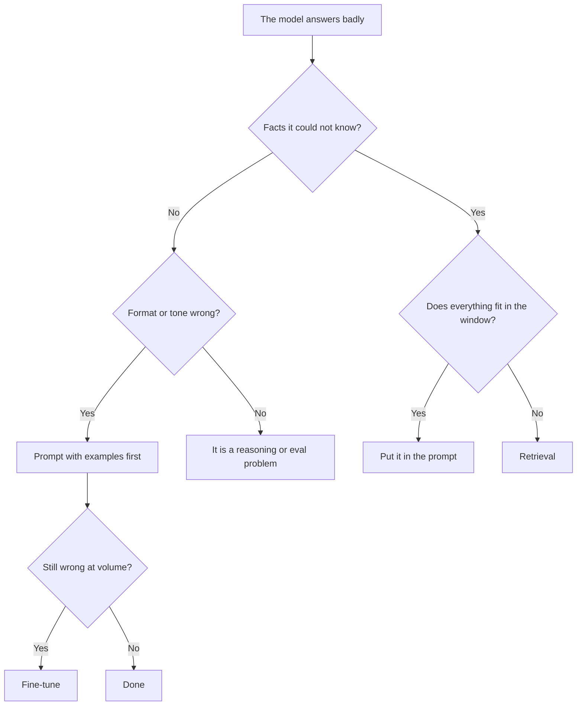

# কখন RAG, কখন Fine-Tune, কখন কোনোটাই নয় {#ch-when-rag-when-fine-tune-when-neither}

> লোকে যে দুটি সমস্যা গুলিয়ে ফেলে, তথ্যের অভাব আর ভুল style, সেগুলো আলাদা করে চিনুন, আর আপনার যেটা আছে তার সবচেয়ে সস্তা সমাধান বাছুন।

**এই অধ্যায়ে:** তথ্য বনাম রূপ · খরচ অনুযায়ী সাজানো চারটি option · fine-tuning আসলে কী দেয় · কেন "কোনোটাই নয়" আশার চেয়ে বেশিবার জেতে · hybrid ক্ষেত্র

## 💡 মূল ধারণা

"আমাদের কি fine-tune করা উচিত?" — এমন প্রায় প্রতিটি আলোচনা আসলে একসঙ্গে মেশানো দুটি প্রশ্ন।

**Retrieval তথ্য জোগায়। Fine-tuning আচরণ গড়ে।** যে model আপনার refund policy জানে না, তার সমস্যা জ্ঞানের।
আপনার tone-এ যত training-ই দিন, সেটা ঠিক হবে না। যে model ঠিক উত্তর দেয়, কিন্তু ছয়টি এলোমেলো paragraph-এ,
তার সমস্যা রূপের। Window-এ আরও document ঠেসে দিলেও সেটা ঠিক হয় না।

এই ভাগটা ঠিক ধরলে সিদ্ধান্ত সাধারণত নিজে থেকেই হয়ে যায়। ভুল ধরলে আপনি এক মাস খরচ করবেন এমন একটি model
fine-tune করতে, যেটা তবুও জানবে না গত মঙ্গলবার policy-তে কী বদলেছে।

> Data বদলালে যদি উত্তর বদলায়, retrieve করুন। আপনার রুচি বদলালে যদি উত্তর বদলায়, train করুন। আর অনেক
> বেশিবার, শুধু prompt করুন।

## কীভাবে কাজ করে

### চারটি option, সবচেয়ে সস্তাটা আগে

| Option | কী সমাধান করে | বানানোর খরচ | বদলানোর খরচ |
| --- | --- | --- | --- |
| **শুধু prompt** | রূপ, সহজ আচরণ, ছোট ও স্থির জ্ঞান | কয়েক ঘণ্টা | একটি string edit করা |
| **Prompt + window-এ context** | তথ্য, যখন corpus ছোট | কয়েক ঘণ্টা | File বদলানো |
| **Retrieval (RAG)** | তথ্য, যখন corpus বড় বা বদলায় | কয়েক সপ্তাহ | Re-index |
| **Fine-tuning** | রূপ, format, domain register, scale-এ latency আর খরচ | কয়েক সপ্তাহ, সঙ্গে data | Retrain |

এই তালিকা ধরে নিচে নামুন, আর যে প্রথম সারি সমস্যার সমাধান করে, সেখানে থামুন। বেশিরভাগ team তিন সারি নিচ থেকে
শুরু করে, কারণ একটি prompt লেখার চেয়ে retrieval বানানো বেশি মজার।

### সিদ্ধান্ত

**দুটি প্রশ্ন প্রায় প্রতিটি ক্ষেত্রের সিদ্ধান্ত নেয়। বেশিরভাগ team যে শাখা বাদ দেয়, সেটা ডান দিকেরটা।**

### যে window ছোট corpus-কে গিলে ফেলেছে

কয়েকশো page-এর একটি corpus একটি বড় context window-এ এঁটে যায়। যদি আপনার পুরো knowledge base হয় একটি
handbook, এক সেট API docs আর একটি changelog, তাহলে **হয়তো কোনো retrieval system বানানোরই দরকার নেই।**
Document-গুলো prompt-এ দিন, সেই স্থির শুরুর অংশটা (prefix) cache করুন, আর উত্তর দিন।

এটা সত্যিকারের একটি architecture, shortcut নয়। এর এমন কিছু বৈশিষ্ট্য আছে, যা retrieval-এর নেই। কোনো
retriever ঠিক passage-টি মিস করতে পারে না, fresh রাখার মতো কোনো index নেই, আর prompt caching বারবারের খরচ ছোট
রাখে। তিনটি ক্ষেত্রে এটা কাজ করা বন্ধ করে: corpus window-এর চেয়ে বড় হয়ে যায়, বানানোর খরচের চেয়ে প্রতি request-এর
খরচ বেশি গুরুত্বপূর্ণ হয়, বা অপ্রাসঙ্গিক material accuracy-র ক্ষতি করতে শুরু করে। বেশি context কেন ভালো নয়, তা
জানতে [Chapter ?? — Context Engineering](#ch-context-engineering) দেখুন।

### Fine-tuning আসলে কী দেয়

এখানে নিখুঁত হওয়া দরকার, কারণ প্রচলিত ধারণাটা ভুল।

| ✅ Fine-tuning যাতে ভালো | ❌ Fine-tuning যাতে খারাপ |
| --- | --- |
| একটি consistent output format | ভরসাযোগ্যভাবে নতুন তথ্য শেখানো |
| একটি domain register বা house style | যে তথ্য বদলায় |
| লম্বা prompt ছাড়াই একটি জটিল instruction set মেনে চলা | Audit করা যায় এমন হওয়া — একটি weight cite করা যায় না |
| একটি সরু কাজে একটি ছোট model-কে বড় model-এর মতো আচরণ করানো | এই সপ্তাহেই update করতে হবে এমন যেকোনো কিছু |

শেষ সারিটাই কম মূল্য পায়। একটি সরু কাজের জন্য একটি frontier (শীর্ষ স্তরের) model-এর output দিয়ে একটি ছোট
model fine-tune করুন, তাহলে এটা quality ধরে রেখে খরচ আর latency কয়েক গুণ কমাতে পারে। এটা সত্যিকারের লাভসহ
খরচ কমানোর একটি চাল, আর "আমাদের domain শেখানো"-র চেয়ে fine-tune করার অনেক ভালো কারণ।

> ⚠️ তথ্যের ওপর fine-tuning আত্মবিশ্বাসী, উৎসহীন, পুরোনো উত্তর তৈরি করে। Model বলতে পারে না সে কোথা থেকে
> কিছু শিখেছে, আর আরেকটি training run ছাড়া তাকে সংশোধন করা যায় না।

### যে খরচ কেউ budget-এ ধরে না

Retrieval-ও সস্তা নয়। একটি সৎ তুলনায় সেই অংশগুলোও থাকে, যেগুলো model নয়।

| Retrieval যা নিয়ে আসে | Fine-tuning যা নিয়ে আসে |
| --- | --- |
| চালু রাখার মতো একটি ingestion pipeline | একটি labelled dataset, বাছাই করা |
| Fresh রাখার মতো একটি index, আর schema বদলালে re-index | প্রতি iteration-এ একটি training আর evaluation run |
| একটি retrieval eval suite, নইলে আপনি আন্দাজ করছেন | যেভাবেই হোক একটি eval suite |
| প্রতি request-এ বেশি token, চিরকাল | Host আর track করার মতো একটি model version |
| Permission filtering, যদি document public না হয় | Permission নিয়ে কিছুই না — সব ভেতরে মিশে যায়, যা আরও খারাপ |

শেষ লাইনটা সত্যিকারের একটি সীমাবদ্ধতা। যদি ভিন্ন user ভিন্ন document দেখতে পারেন, retrieval প্রতি user-এর
জন্য filter করতে পারে। একটি fine-tuned model যা দিয়ে train হয়েছে, তা ভুলে যেতে পারে না।

## কখন ব্যবহার করবেন

| পরিস্থিতি | বাছুন | কারণ |
| --- | --- | --- |
| উত্তরে একটি উৎস cite করতেই হবে | Retrieval | Weight-এর কোনো citation নেই |
| তথ্য প্রতি সপ্তাহে বদলায় | Retrieval | Re-index করুন, retrain নয় |
| Corpus কয়েকশো page, স্থির | পুরো corpus window-এ | চালানোর মতো কোনো pipeline নেই |
| বেশি volume-এ output format অসংগত | Prompt-এ উদাহরণ, তারপর fine-tune | সবচেয়ে সস্তাটা আগে |
| একটি সরু কাজে প্রতি request-এর খরচই প্রধান | একটি ছোট model fine-tune করুন | সত্যিকারের লাভ, মাপা যায় |
| ভিন্ন user ভিন্ন document দেখেন | Retrieval, filter করা | Training permission বলবৎ করতে পারে না |
| উত্তর ভুল, কিন্তু তথ্য উপস্থিত ছিল | কোনোটাই নয় | এটা prompt বা eval-এর সমস্যা |

## সাধারণ ভুল

**❌ Model-কে আপনার product শেখাতে fine-tuning**

> এতে এমন একটি system তৈরি হয়, যেটা audit বা update করা যায় না, আর সেটা আত্মবিশ্বাসের সঙ্গে ভুল বলে। তথ্যের
> জায়গা একটি store-এ।

**❌ পুরো corpus window-এ এঁটে গেলেও retrieval বানানো**

> একটি ingestion pipeline, একটি index আর একটি retriever — সবই এমন একটি সমস্যার জন্য, যার সমাধান একটি cached
> prompt আগেই করে দিয়েছিল।

**❌ রোগ নির্ণয়ের আগে বাছাই করা**

> "উত্তর ভুল ছিল"-র অন্তত চারটি কারণ থাকে: তথ্যটা ছিল না, তথ্য retrieve হয়েছিল কিন্তু উপেক্ষিত হয়েছে, format
> ভুল ছিল, বা প্রশ্নটা অস্পষ্ট ছিল। এদের চারটি আলাদা সমাধান।

**✅ Architecture বাছার আগে fail করা দশটি উদাহরণ লিখুন**

> এগুলো বলে দেয় চারটি কারণের কোনটা আসলে আপনার আছে, আর এগুলোই সেই golden set-এর প্রথম সারি হয়ে যায়, যেটা
> আপনার যেভাবেই হোক লাগবে।

## 🔑 মূল শিক্ষা

- Retrieval তথ্য জোগায়, আর fine-tuning রূপ গড়ে। বেশিরভাগ architecture-তর্ক আসলে এই ভাগ, মুখে না বলা।
- Prompting থেকে শুরু করে ওপরে উঠুন। অনেক "RAG project" আসলে একটি ছোট corpus, যা একটি cached window-এ এঁটে যায়।
- তথ্যের ওপর fine-tuning আত্মবিশ্বাসী, পুরোনো, উৎসহীন উত্তর দেয়, যা দ্রুত সংশোধন করা যায় না।
- Fine-tuning-এর পক্ষে সবচেয়ে জোরালো যুক্তি হলো খরচ: একটি সরু কাজে একটি ছোট model-এর একটি বড় model-এর সমান হওয়া।
- Retrieval প্রতি user-এর জন্য document filter করতে পারে। একটি fine-tuned model যা দিয়ে train হয়েছে, তা ভুলতে পারে না।

## Interview-এর প্রশ্ন

**Q: কখন retrieval ব্যবহার না করে fine-tune করবেন?**

যখন সমস্যাটা আচরণের, জ্ঞানের নয়। মানে একটি কড়া output format, একটি domain register (একটি ক্ষেত্রের tone,
যেমন আইনি), বা এমন একটি লম্বা instruction set, যার দাম আমি প্রতি request-এ দিতে চাই না। সবচেয়ে জোরালো যুক্তি
খরচ: একটি সরু কাজে একটি ছোট model fine-tune করে একটি frontier model-এর quality-র সমান করুন, তাহলে সাশ্রয়টা
মাপা যায়। তথ্য শেখাতে আমি fine-tune করতাম না। ফলাফল কোনো উৎস cite করতে পারে না, retrain ছাড়া বদলাতে পারে না,
আর নিজে থেকেই পুরোনো হয়ে যায়।

**Q: আপনার company-র 400 page internal documentation আছে। Assistant-টি design করুন।**

কিছু design করার আগে আমি দেখতাম এটা window-এ এঁটে যায় কি না। 400 page খুব সম্ভবত এঁটে যায়। এঁটে গেলে design
সহজ: corpus জড়ো করুন, prompt-এর স্থির অংশে রাখুন যাতে cache হয়, আর উত্তর দিন। কোনো ingestion pipeline নেই,
fresh রাখার মতো index নেই, ঠিক passage মিস করার মতো retriever নেই। আমি retrieval-এ যেতাম যখন corpus window-এর
চেয়ে বড় হয়ে যায়, যখন বানানোর খরচের চেয়ে প্রতি request-এর খরচ বেশি গুরুত্বপূর্ণ হয়, বা যখন বাড়তি material
accuracy-র ক্ষতি করতে শুরু করে।

**Q: উত্তর হিসেবে "কোনোটাই নয়" দেখতে কেমন?**

লোকে যতটা ভাবে, তার চেয়ে বেশিবার এটাই ঠিক উত্তর। যদি ঠিক তথ্যগুলো window-এ থাকে আর উত্তর তবুও ভুল হয়,
retrieval সাহায্য করবে না। সমস্যা prompt-এর গঠন, একটি অস্পষ্ট প্রশ্ন, বা model বাছাই। জানতে হলে request-এ আসলে কী
গিয়েছিল, তা print করুন। Passage সেখানে থাকলে কোনো retrieval-এর কাজ এটা ঠিক করবে না, আর একটি pipeline বানানো
হলো দামি অকাজ, যা আসল সমস্যা এড়িয়ে যায়।

**Q: Permission এই সিদ্ধান্তে কীভাবে প্রভাব ফেলে?**

এগুলো সরাসরি সিদ্ধান্তটা নিয়ে নিতে পারে। যদি ভিন্ন user ভিন্ন document দেখতে পারেন, retrieval query-র সময়
index-এ প্রতিটি user-এর access rule প্রয়োগ করে filter করতে পারে। একটি fine-tuned model তার সব training data
শুষে নিয়েছে, প্রতি user-এ সেটা সীমিত করার কোনো উপায় নেই। তাই training-এ যাওয়া যেকোনো document সবার জন্য খোলা।
একটি regulated বা multi-tenant পরিবেশে, এটা জ্ঞানের জন্য fine-tuning-কে পুরোপুরি বাদ দেয়।

**Q: দুটোই কি ব্যবহার করা যায়?**

হ্যাঁ, আর ভাগটা পরিষ্কার: তথ্যের জন্য retrieval, রূপের জন্য fine-tuning। একটি support assistant বর্তমান
policy retrieve করতে পারে, আর কম খরচে উত্তরগুলো একটি কড়া house format-এ রাখতে একটি fine-tuned ছোট model ব্যবহার
করতে পারে। যেটা আমি এড়াতাম, তা হলো শুরু থেকেই দুটো ব্যবহার করা। প্রতিটি নিজের pipeline আর eval-এর কাজ নিয়ে আসে,
আর দুটো একসঙ্গে করলে কোনোটাকেই আলাদাভাবে মাপা যায় না।

## এরপর কী পড়বেন

- [Chapter ?? — Ingestion ও Chunking](#ch-ingestion-and-chunking) — যেখানে একটি retrieval pipeline শুরু হয়
- [Chapter ?? — Context Engineering](#ch-context-engineering) — কেন window ভরা বিনা খরচে হয় না
- [Chapter ?? — Eval, Retrieval Metric ও Error Analysis](#ch-evals) — যে মাপজোখ এই তর্কের নিষ্পত্তি করে
