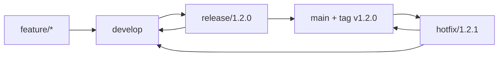
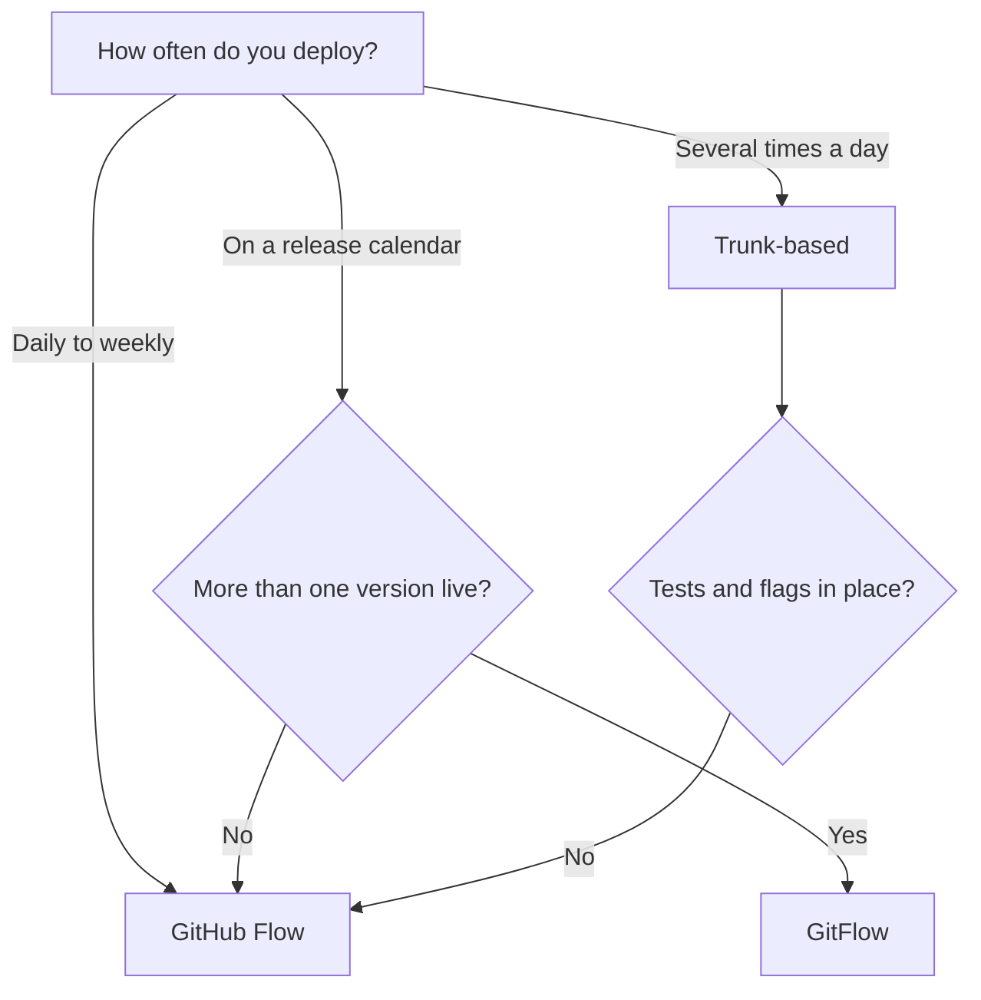

# Branching, Review ও Repository Strategy {#ch-branching-and-review-workflow}

> আপনার team কত ঘনঘন deploy করে, তা দেখে branching model বাছুন। যে commit আর pull request-এর নিয়মে model-টা কাজ করে, সেগুলো ঠিক করুন। আর repository-র সীমানা টানুন সেখানে, যেখানে change-গুলো আর একে অপরের সঙ্গে বাঁধা নয়।

**এই অধ্যায়ে:** GitHub Flow, GitFlow আর trunk-based · commit message আর pull request-এর আকার · merge method আর branch protection · monorepo না polyrepo

## 💡 মূল ধারণা

Branching model আসলে একটি queue-র নিয়ম। প্রতিটি branch হলো এমন কাজ, যা `main`-এ ঢোকার অপেক্ষায় আছে। যত বেশি
অপেক্ষা, ততই `main` তার নিচ থেকে সরে যায়। Merge-এর যন্ত্রণা Git-এর দোষে হয় না। হয় branch করা আর merge করার মাঝের
সময়টার জন্য। এই অধ্যায়ের প্রতিটি model একটি প্রশ্নেরই উত্তর দেয়: **একটি branch কতদিন বাঁচতে পারবে?**

বাকি সব এই উত্তর থেকেই ঠিক হয়। Branch যদি কয়েক ঘণ্টা বাঁচে, তাহলে ceremony (process আর sign-off-এর ধাপ) লাগে অল্প,
কিন্তু automated test লাগে অনেক। কয়েক সপ্তাহ বাঁচলে লাগে release branch, আর এমন একজন, যিনি merge-এর দায়িত্ব নেবেন।
আপনার team বাস্তবে যে ব্যবধান মেনে চলতে পারে, তার সঙ্গে মানানসই ceremony বেছে নিন।

Repository-র সীমানাও একই ধারণা, শুধু এক ধাপ ওপরে। একটি repository-র ভেতরে shared code-এর change আর তার caller-দের
change একটিই commit। দুটি repository-তে ভাগ হলে সেই change হয়ে যায় একটি version number, আর প্রতিটি consumer নিজের
সময়মতো সেটায় upgrade করে।

## কীভাবে কাজ করে

আপনি যে team-এই যোগ দিন, প্রায় সবখানে এই তিনটি model-এর একটি পাবেন।

| Model           | স্থায়ী branch        | Branch কতদিন বাঁচে | যে team deploy করে        |
| --------------- | ------------------ | ---------------- | ------------------------ |
| **Trunk-based** | `main`             | কয়েক ঘণ্টা        | দিনে অনেকবার              |
| **GitHub Flow** | `main`             | 1–3 দিন           | প্রতিদিন থেকে সপ্তাহে একবার |
| **GitFlow**     | `main` + `develop` | কয়েক দিন থেকে কয়েক সপ্তাহ | Release-এর calendar মেনে |

### GitHub Flow

একটি স্থায়ী branch আর একটি নিয়ম: `main` সবসময় deploy করার মতো অবস্থায় থাকবে। Branch করুন, pull request খুলুন,
review নিন, merge করুন, deploy করুন। এটা default হওয়ার কারণ আছে। Production-এ product-এর একটিই version চলে, তাই
দ্বিতীয় কোনো স্থায়ী branch-এর ধরে রাখার মতো কিছু নেই।

### GitFlow

দুটি স্থায়ী branch, আর তিন ধরনের অস্থায়ী branch। `develop`-এ জমা হয় শেষ হওয়া feature। `release/*` একটি version
স্থির করে। `hotfix/*` branch করে `main` থেকে, কারণ `develop`-এ এমন কাজ আছে যা এখনো ship করার মতো হয়নি।

**GitFlow-এ branch-এর পথগুলো:**



**যে পথ `main`-এ merge হয়, সেটা `develop`-এও ফিরে merge হয়।** দ্বিতীয় merge-টা ভুলে গেলে hotfix হারিয়ে যায়।
তারপর পরের release-এ regression হয়ে ফিরে আসে।

GitFlow-এর খরচ পোষায় দুটি ক্ষেত্রে। হয় আপনি সত্যিই production-এ একাধিক version support করেন, নয়তো release-এর
এমন sign-off gate লাগে, যাতে কয়েক দিন যায়। এ ছাড়া দ্বিতীয় স্থায়ী branch এমন একটি queue, যা কেউ চায়নি।

### Trunk-Based Development

সবাই দিনে অন্তত একবার `main`-এ merge করেন, আর branch-এর বয়স কয়েক ঘণ্টা। অসমাপ্ত কাজও ship হয়, তবে feature flag
(runtime-এ চালু-বন্ধ করার switch)-এর পেছনে বন্ধ অবস্থায়। তিন সপ্তাহের একটি branch-এর চেয়ে `main`-এ একটি অসমাপ্ত
feature-এর খরচ কম।

এটা কাজ করে, কারণ deploy আর release দুটি আলাদা ঘটনা। নতুন component `main`-এ আছে, production-এও আছে। কিন্তু দেখতে
পান শুধু সেই user-রা, যাঁদের জন্য flag চালু।

Trunk-based-এর একটি কঠিন পূর্বশর্ত আছে। ভরসা করার মতো test আর বন্ধ করা যায় এমন flag না থাকলে দিনে কয়েকবার `main`-এ
commit করা কোনো strategy নয়। সেটা outage-এর সময়সূচি।

## কখন ব্যবহার করবেন

**Branching model বাছাই:**



**কোন model, তা ঠিক করে deploy-এর হার। আর সবচেয়ে দ্রুতটা বাতিল করার ক্ষমতা রাখে test coverage।**

## Commit আর Pull Request

Queue-টা কেমন হবে, তা model ঠিক করে। আর তার ভেতরের কিছু আদৌ review করা যাবে কি না, সেটা ঠিক করে এই নিয়মগুলো।

### Conventional Commits

মানুষের পড়ার মতো subject-এর সামনে machine-এর পড়ার মতো একটি prefix। খরচ কিছুই নেই। বদলে পাবেন generate করা
changelog, নিজে থেকে version bump, আর এমন history যা filter করা যায়।

**Commit message-এর গড়ন:**

```text
<type>(<scope>): <subject>

<body — why, not what>

<footer — issue refs, BREAKING CHANGE:>
```

চালু type-গুলো হলো `feat`, `fix`, `refactor`, `perf`, `test`, `docs`, `chore` আর `ci`, যেমন
`fix(auth): stop redirect loop on expiry`। Semantic version নড়ে শুধু `feat`, `fix` আর `BREAKING CHANGE` footer-এ।
Subject বলে কী বদলেছে, মোটামুটি পঞ্চাশ অক্ষরে। Body বলে **কেন**। এক বছর পরে diff দেখে এটা কেউ আর বের করতে পারবে না।

> ⚠️ Conventional commit চাপিয়ে দেওয়ার মানে আছে শুধু তখনই, যখন কিছু একটা এগুলো পড়ে। পেছনে changelog generator না
> থাকলে commit lint নিছক ceremony।

### Branch-এর নাম আর টাটকা থাকা

`<type>/<ticket>-<short-description>` ধাঁচে নাম দিন, যেমন `feat/PLAT-412-oauth-callback`। তাহলে branch-এর তালিকা
পড়লেই কাজের তালিকা পাওয়া যায়। নাম যা-ই হোক, এক সপ্তাহের বেশি পুরনো branch বিপদের সংকেত। প্রতিদিন `origin/main`-এর
ওপর rebase করুন, আর `--force-with-lease` দিয়ে push করুন। তাহলে conflict আসে একটি একটি করে।

### Pull Request-এর আকার

Reviewer স্বীকার করার অনেক আগেই review-এর মান পড়ে যায়। মোটামুটি 400 line বদলের পর comment আর design নিয়ে থাকে না,
typo নিয়ে হতে শুরু করে।

| কত line বদলেছে | Reviewer আসলে যা করেন                 |
| ------------- | ----------------------------------- |
| 200-এর কম      | ✅ প্রতিটি line পড়েন, design নিয়ে প্রশ্ন তোলেন |
| 200–400       | মাঝখানটা চোখ বুলিয়ে যান               |
| 400-এর বেশি    | ❌ ভরসা করে approve করে দেন           |

**Review চাওয়ার আগে:**

```bash
git diff origin/main...HEAD   # Read your own diff first — you will find something
pnpm lint && pnpm test        # Never make CI the first reader
git rebase origin/main        # Review the change against current main, not last week's
```

Pull request-এর description-এ থাকবে *এখনই কেন*, ticket-এর link, আর প্রমাণ। যেমন UI change হলে screenshot, fix হলে
test-এর নাম। শুধু diff দেখে reviewer উদ্দেশ্য আন্দাজ করতে পারেন না।

### Merge Method

| Method           | `main`-এ কী ঢোকে                         | কখন বাছবেন                                         |
| ---------------- | --------------------------------------- | ------------------------------------------------ |
| **Squash**       | প্রতিটি pull request-এ একটি commit         | Branch-এ অসমাপ্ত কাজের commit থাকে                 |
| **Rebase merge** | প্রতিটি commit, আবার চালিয়ে, merge commit ছাড়া | Branch-এর commit-গুলো আলাদাভাবেও অর্থবহ            |
| **Merge commit** | প্রতিটি commit, সঙ্গে একটি merge commit     | Branch-এর গঠন রেখে দিতে চান                        |

Squash দেয় সবচেয়ে পরিষ্কার `main` আর সবচেয়ে সস্তা `git bisect`, কারণ `main`-এর প্রতিটি commit একটি review করা change।
মাঝের commit-গুলো হারায়। সেগুলো ভালো হলে তবেই এটা সত্যিকারের ক্ষতি।

### Branch Protection

নিয়ম চাপাতে হবে platform-কে। মানুষের সদিচ্ছায় হবে না। প্রতিটি host-এ একই কয়েকটি setting আছে, শুধু নাম আলাদা।

- ✅ Pull request বাধ্যতামূলক করুন, অন্তত একটি approve করা review-সহ
- ✅ Status check pass করা, আর branch-কে `main`-এর সঙ্গে up to date থাকা বাধ্যতামূলক করুন
- ✅ নতুন commit এলে পুরনো approval বাতিল করুন
- ❌ `main`-এ force push বা branch মোছার অনুমতি দেবেন না

Code owners file প্রতিটি review পাঠায় তাঁর কাছে, যিনি ওই অংশটা চেনেন। একটি repository-তে একাধিক team কাজ শুরু করলে
approval-এর সংখ্যার চেয়ে এটাই বেশি গুরুত্বপূর্ণ।

## Monorepo না Polyrepo

প্রশ্নটা কখনো "একটি repository না অনেকগুলো" নয়। প্রশ্ন হলো, **"এই দুটি জিনিস কি একটি commit-এ একসঙ্গে বদলানো
যাওয়া উচিত?"** যে উত্তরই দিন, খরচ অন্য কোথাও সরে যায়।

| খরচ                | Monorepo                                  | Polyrepo                                  |
| ------------------ | ----------------------------------------- | ----------------------------------------- |
| **Atomic change**  | একটি commit-এ provider আর caller সব update | আগে publish, তারপর প্রতি consumer-এ একটি pull request |
| **Versioning**     | ভেতরে কিছু নেই: একটি lockfile, কোনো drift নেই | প্রতিটি shared package-এর একটি version     |
| **CI-র পরিধি**      | কাজের যোগ্য থাকতে affected-only build লাগে | স্বাভাবিকভাবেই একটি project-এ সীমিত          |
| **Ownership**      | Directory ধরে code owner; read access হয় সব, নয় কিছুই না | Repository ধরে permission  |

Monorepo-র লাভ হলো atomic change। Shared API client-এ একটি field-এর নাম বদলান, আর তিনটি consumer-ই ঠিক করুন একটি
pull request-এ। একবার CI চালালেই জানা যায় নাম বদলানো পুরোপুরি শেষ হয়েছে কি না। Polyrepo-তে একই কাজ মানে একটি major
version, তিনটি upgrade pull request, আর এমন একটি সময়, যখন consumer-রা একে অপরের সঙ্গে মেলে না।

দাম দিতে হয় CI-তে। "Test চালান" মানে এখন 40টি package, আর প্রতিটি push-এ তার জন্য কেউ বসে থাকবে না। Monorepo-তে
এমন build system লাগে, যা dependency graph পড়ে বদল না হওয়া কাজ বাদ দেয়। সঙ্গে লাগে একটি shared remote cache।
Tool-গুলো (pnpm workspaces, Turborepo, Nx, Changesets) আছে [Chapter ?? — Monorepo](#ch-monorepos)-এ।

Polyrepo দিয়ে সত্যিকারের স্বাধীনতা কেনা যায়। Web team কী করছে না জেনেই billing team মঙ্গলবার ship করে। Billing-এর
repository এমনভাবে আটকে রাখা যায়, যা একটি directory দিয়ে সম্ভব নয়। খরচটা হলো সমন্বয়। Shared package-এ breaking change
হলে সেটা হয়ে যায় একটি migration, যার পেছনে পুরনো version-এর লম্বা লেজ ঝুলে থাকে।

| পরিস্থিতি                                              | বাছুন     | কারণ                                            |
| --------------------------------------------------- | -------- | ---------------------------------------------- |
| একই product-এর frontend, backend আর shared type     | Monorepo | Contract বদলালে একটি commit, একটি review         |
| Design system আর তার consumer app-গুলো               | Monorepo | না হলে প্রতিটি token change একেকটি release       |
| আলাদা roadmap আর on-call-এর দুটি product             | Polyrepo | Shared CI থেকে কারও কোনো লাভ নেই                 |
| বাইরের consumer-ওয়ালা open-source library            | Polyrepo | বাইরের user-দের সত্যিকারের semantic version লাগে  |
| নিয়ন্ত্রিত service, যা বেশিরভাগ engineer-এর পড়া বারণ   | Polyrepo | Git permission repository-তেই থেমে যায়          |

বেশিরভাগ প্রতিষ্ঠান শেষ পর্যন্ত কয়েকটি monorepo রাখে, এক ধরনের একটি নয়। সীমানা পড়ে সেখানে, যেখানে change-গুলো আর
একে অপরের সঙ্গে বাঁধা নয়। এটা কোনো আপস নয়।

## সাধারণ ভুল

❌ **দীর্ঘদিন বেঁচে থাকা integration branch, যা কেউ deploy করে না।** `develop` কখনো deploy না হলে সেটা নিছক একটি queue।
Integration-এর ব্যর্থতা release পর্যন্ত লুকিয়ে রাখে।
✅ `main` থেকে branch করুন, আর flag-এর পেছনে ship করুন। Calendar ধরে release-এর জন্য GitFlow জেনেশুনেই এই খরচ নেয়।
Calendar না থাকলে খরচটা দেন, কিন্তু লাভ কিছুই পান না।

❌ **Refactor আর feature একই pull request-এ**: "extract query builder + add profile endpoint", 1,400 line। কোন line-গুলো
behaviour বদলানোর জন্য, reviewer তা বুঝতে পারেন না। ফলে কোনো অর্ধেকই ঠিকমতো check হয় না।
✅ দুটি pull request, আগে refactor। তাহলে দ্বিতীয় review শুধু feature নিয়ে।

❌ **একটিমাত্র pipeline-ওয়ালা monorepo**, যা প্রতিটি push-এ সব test চালায়। Team-গুলো "monorepo scale করে না" বলে
সিদ্ধান্তে পৌঁছায় মূলত এই কারণেই। সমস্যা কখনো layout ছিল না। সমস্যা ছিল অসম্পর্কিত test চালানো।
✅ Affected-only build আর remote cache দিয়ে CI-কে change-এর মধ্যে সীমিত রাখুন।

❌ **Copy করে code ভাগ করা polyrepo।** Copy করা code-এর কোনো version নেই, তাই কোনো consumer জানে না তার কাছে fix হওয়া
copy-টা আছে কি না। এতে দুই model-এরই খরচ আছে, কিন্তু কোনোটারই লাভ নেই।
✅ Shared code publish করে version দিন, অথবা দুটি project-কেই একটি repository-তে নিয়ে আসুন।

## 🔑 মূল শিক্ষা

- আসল চলক হলো branch কতদিন বাঁচে। Branching model মানে branch কতদিন বাঁচতে পারবে, তার নিয়ম।
- GitHub Flow হলো default। Trunk-based-এ লাগে ভরসা করার মতো test আর flag। GitFlow-এ লাগে সত্যিকারের release calendar, কিংবা একাধিক চালু version।
- মোটামুটি 400 line বদলের পর reviewer ভরসা করে approve করে দেন, তাই তার বদলে pull request ভাগ করুন।
- Squash merge `main`-এর প্রতিটি commit-এ একটি review করা change রাখে। এজন্যই `git bisect` সস্তা হয়।
- Repository-র সীমানা আসলে সমন্বয়ের সীমানা। Monorepo version drift-এর বদলে এমন CI চায়, যা dependency graph বোঝে।

## Interview-এর প্রশ্ন

**Q: নতুন একটি team-এর জন্য branching strategy কীভাবে বাছবেন?**

শুরু করুন deploy-এর হার আর production-এ কয়টি version চলে, তা দিয়ে। দিনে কয়েকবার deploy, সঙ্গে ভালো test আর flag থাকলে
trunk-based। একটি version আর মোটামুটি প্রতিদিন deploy হলে GitHub Flow। GitFlow-এর দ্বিতীয় স্থায়ী branch-এর যুক্তি আছে
শুধু release calendar বা একাধিক support করা version থাকলে।

**Q: Squash, rebase, নাকি merge commit: কোনটা, আর কেন?**

Default হিসেবে squash। এতে `main`-এর প্রতিটি commit-এ একটি review করা change থাকে, তাই `git bisect` অর্থবহ কোনো জায়গায়
গিয়ে থামে। আলাদা আলাদা commit যদি পড়ার জন্যই লেখা হয়ে থাকে, তাহলে rebase merge। আর branch-এর গঠনটাই যদি রেখে দেওয়ার
মতো তথ্য হয়, তাহলে merge commit।

**Q: Pull request-কে review করার মতো রাখেন কীভাবে?**

কয়েকশো line-এর মধ্যে রাখুন। Behaviour change আর refactor আলাদা করুন, যাতে প্রতিটি review একটি প্রশ্নের উত্তর দেয়।
আগে `main`-এর ওপর rebase করুন, যাতে reviewer বর্তমান code-এর সঙ্গে মিলিয়ে change-টা দেখেন। অন্য কেউ দেখার আগে নিজের
diff নিজে পড়ুন।

**Q: একটি web app, একটি admin app আর একটি shared design system-ওয়ালা product-এর জন্য monorepo না polyrepo?**

Monorepo। এই তিনটি সারাক্ষণ একসঙ্গে বদলায়, তাই token change আর তার consumer-দের জায়গা একটি review-এ। এর দায় হলো
affected-only CI আর build cache-এর দায়িত্ব নেওয়া। পুরো graph-এর ওপর একটিমাত্র pipeline চালালে কয়েক মাসের মধ্যেই
repository-টা ধীর মনে হবে।

**Q: Polyrepo-তে shared library-তে breaking change কীভাবে করবেন?**

প্রথমে এটা ship করুন যোগ হিসেবে, যাতে পুরনো আর নতুন দুটি গড়নই কাজ করে। সেটা minor version হিসেবে publish করুন।
Consumer-দের একে একে migrate করুন, তারপর major version-এ পুরনো গড়ন সরিয়ে দিন। সবাই মিলে একটি "flag day"-তে একটিমাত্র
breaking release দিতে হলে সব team-কে একই সময়ে ফাঁকা থাকতে হয়, আর সেটা কদাচিৎ হয়।

**Q: কখন monorepo-র পরামর্শ দেবেন না?**

তিনটি ক্ষেত্রে। Team-গুলোর যদি সত্যিই স্বাধীন release-এর সময়সূচি লাগে, code-এর কোনো অংশে access সীমিত রাখতে হয়, কিংবা
build tooling-এর দায়িত্ব কেউ না নেন। বাস্তবে শেষটাই সিদ্ধান্ত ঠিক করে দেয়। Cache আর affected-only CI ছাড়া monorepo
ঠিকমতো করা দুটি বিকল্পের যেকোনোটার চেয়ে খারাপ।

## এরপর কী পড়বেন

- [Chapter ?? — CI/CD-র মূল কথা](#ch-cicd-fundamentals) — প্রতিটি branching model তার জন্য বানানো pipeline-কে কীভাবে
  গড়ে দেয়
- [Chapter ?? — Deployment Strategy, Rollback ও Feature Flag](#ch-deployment-strategies) — যে feature flag-এর
  ওপর trunk-based development নির্ভর করে
- [Chapter ?? — Monorepo](#ch-monorepos) — monorepo-র যে workspace, task-graph আর caching tool লাগে
