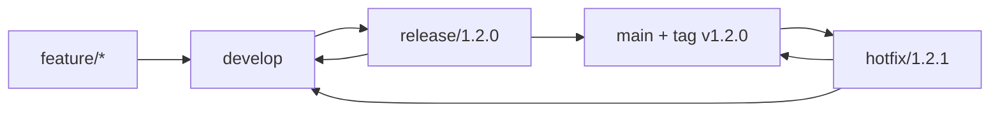
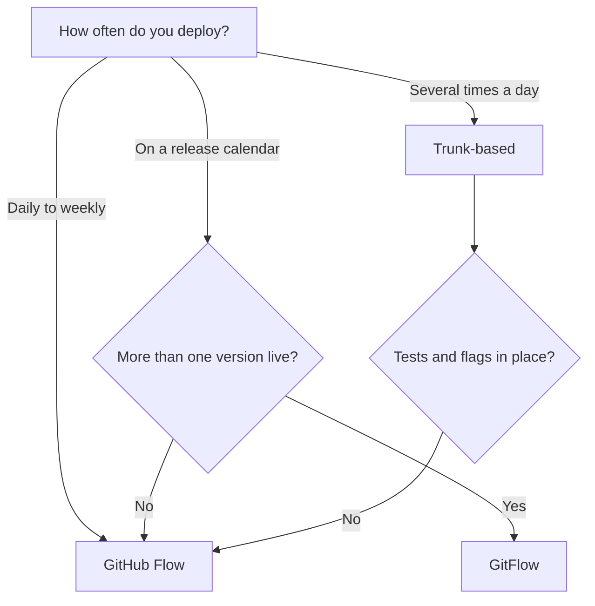

# Branching, Review ও Repository Strategy {#ch-branching-and-review-workflow}

> আপনার team কত ঘন ঘন deploy করে তা দেখে একটি branching model বেছে নিন, সেটা চালু রাখার জন্য commit আর pull request-এর নিয়ম ঠিক করুন, আর repository-র সীমা টানুন সেখানে, যেখানে change-গুলো আর একে অপরের সঙ্গে বাঁধা থাকে না।

**এই অধ্যায়ে:** GitHub Flow, GitFlow আর trunk-based · commit message আর pull request-এর আকার · merge method আর branch protection · monorepo নাকি polyrepo

## 💡 মূল ধারণা

একটি branching model হলো একটি queue policy। প্রতিটি branch হলো `main`-এ যোগ দেওয়ার অপেক্ষায় থাকা কাজ। যত বেশি
অপেক্ষা, তার নিচে `main` তত বেশি সরে যায়। Merge-এর যন্ত্রণা Git-এর কারণে হয় না। হয় branch করা আর merge করার
মাঝের সময়ের কারণে। এই অধ্যায়ের প্রতিটি model একটি প্রশ্নের উত্তর দেয়: **একটি branch কতদিন বাঁচতে পারে?**

বাকি সব ঠিক হয় এই উত্তর থেকে। Branch যদি কয়েক ঘণ্টা বাঁচে, আপনার আনুষ্ঠানিকতা (process আর sign-off-এর ধাপ)
কম লাগে, আর অনেক automated test লাগে। যদি কয়েক সপ্তাহ বাঁচে, আপনার release branch লাগে, আর এমন কেউ লাগে যিনি
merge-এর দায়িত্ব নেন। আপনার team সত্যিই যে ব্যবধান মেনে চলতে পারে, তার সঙ্গে মানানসই আনুষ্ঠানিকতা বেছে নিন।

Repository-র সীমা একই ধারণা, এক ধাপ ওপরে। একটি repository-র ভেতরে shared code-এর একটি change আর তার caller-দের
change একটিই commit। দুটি repository জুড়ে সেই একই change হয়ে যায় একটি version number, যেটা প্রতিটি consumer
নিজের সময়সূচিতে upgrade করে।

## কীভাবে কাজ করে

আপনি যে team-এই যোগ দিন, প্রায় সবগুলোকেই এই তিনটি model ঢেকে দেয়।

| Model           | স্থায়ী branch      | Branch-এর আয়ু    | যে team-এর সঙ্গে মানায়, যারা deploy করে |
| --------------- | ------------------ | --------------- | ------------------------ |
| **Trunk-based** | `main`             | কয়েক ঘণ্টা       | দিনে অনেকবার              |
| **GitHub Flow** | `main`             | 1–3 দিন          | প্রতিদিন থেকে প্রতি সপ্তাহে   |
| **GitFlow**     | `main` + `develop` | কয়েক দিন থেকে কয়েক সপ্তাহ | একটি release calendar ধরে |

### GitHub Flow

একটি স্থায়ী branch আর একটি নিয়ম: `main` সবসময় deploy করার মতো অবস্থায় থাকে। Branch করুন, একটি pull request
খুলুন, review নিন, merge করুন, deploy করুন। এটা default হওয়ার একটি কারণ আছে। Production-এ product-এর শুধু একটি
version চলে, তাই দ্বিতীয় একটি স্থায়ী branch-এর ধরে রাখার মতো কিছু নেই।

### GitFlow

দুটি স্থায়ী branch আর তিন ধরনের অস্থায়ী branch। `develop` শেষ হওয়া feature-গুলো জমা করে। `release/*` একটি
version-কে স্থিতিশীল করে। `hotfix/*` branch করে `main` থেকে, কারণ `develop`-এ এমন কাজ আছে যেটা ship করার জন্য
তৈরি নয়।

**GitFlow-এর branch path-গুলো:**



**যে path `main`-এ merge হয়, সেটা `develop`-এও ফিরে merge হয়।** দ্বিতীয় merge-টি ভুলে গেলে hotfix-টি হারিয়ে যায়,
তারপর পরের release-এ একটি regression হিসেবে ফিরে আসে।

GitFlow দুটি ক্ষেত্রে তার খরচের যোগ্য। আপনি সত্যিই production-এ একাধিক version support করেন, অথবা একটি release-এর
এমন sign-off gate দরকার যেটায় কয়েক দিন লাগে। নইলে দ্বিতীয় স্থায়ী branch-টি এমন একটি queue, যেটা কেউ চায়নি।

### Trunk-Based Development

সবাই অন্তত দিনে একবার `main`-এ merge করেন, আর branch-গুলোর বয়স কয়েক ঘণ্টা। অসম্পূর্ণ কাজও ship হয়, একটি feature
flag (runtime-এর একটি switch)-এর পেছনে বন্ধ অবস্থায়। `main`-এ একটি অসম্পূর্ণ feature-এর খরচ তিন সপ্তাহের একটি
branch-এর চেয়ে কম।

এটা কাজ করে কারণ deploy আর release দুটি আলাদা ঘটনা। নতুন component-টি `main`-এ আর production-এ বসে থাকে, কিন্তু
যাঁদের জন্য flag চালু, শুধু সেই user-রাই সেটা দেখতে পান।

Trunk-based-এর একটি কঠিন পূর্বশর্ত আছে। যে test-এ ভরসা করেন আর যে flag বন্ধ করতে পারেন — এগুলো ছাড়া দিনে কয়েকবার
`main`-এ commit করা কোনো strategy নয়। এটা outage-এর একটি সময়সূচি।

## কখন ব্যবহার করবেন

**একটি branching model বেছে নেওয়া:**



**Deploy-এর frequency model বেছে নেয়; test coverage সবচেয়ে দ্রুতটায় veto দেয়।**

## Commit আর Pull Request

Model queue-এর আকার ঠিক করে। এই নিয়মগুলো ঠিক করে, তার ভেতরের কোনো কিছু আদৌ review করা যায় কি না।

### Conventional Commits

মানুষের পড়ার মতো একটি subject-এর ওপর, machine-এর পড়ার মতো একটি prefix। এর কোনো খরচ নেই। বদলে আপনি পান generate
করা changelog, স্বয়ংক্রিয় version bump, আর এমন একটি history, যেটা filter করা যায়।

**Commit message-এর আকার:**

```text
<type>(<scope>): <subject>

<body — why, not what>

<footer — issue refs, BREAKING CHANGE:>
```

সাধারণ type-গুলো হলো `feat`, `fix`, `refactor`, `perf`, `test`, `docs`, `chore` আর `ci`, যেমন
`fix(auth): stop redirect loop on expiry`। শুধু `feat`, `fix` আর একটি `BREAKING CHANGE` footer একটি semantic
version সরায়। Subject বলে কী বদলেছে, মোটামুটি পঞ্চাশ character-এ। Body বলে **কেন**। এক বছর পরে diff থেকে কেউ
সেটা আবার গড়ে তুলতে পারবেন না।

> ⚠️ Conventional commit চাপিয়ে দেওয়া তখনই লাভজনক, যদি কিছু সেগুলো পড়ে। পেছনে কোনো changelog generator ছাড়া
> একটি commit lint নিছক আনুষ্ঠানিকতা।

### Branch-এর নাম আর সতেজতা

`<type>/<ticket>-<short-description>` ব্যবহার করুন, যেমন `feat/PLAT-412-oauth-callback`, যাতে branch-এর তালিকা কাজের
তালিকার মতো পড়া যায়। এক সপ্তাহের বেশি পুরোনো branch একটি সতর্কসংকেত, নাম যা-ই হোক। প্রতিদিন `origin/main`-এর
ওপর rebase করুন আর `--force-with-lease` দিয়ে push করুন। তাহলে conflict আসে একবারে একটি করে।

### Pull Request-এর আকার

Reviewer-রা স্বীকার করার অনেক আগেই review-এর quality পড়ে যায়। মোটামুটি 400টি বদলানো line পেরোলে comment-গুলো
design নিয়ে না হয়ে typo নিয়ে হতে শুরু করে।

| বদলানো line    | Reviewer-রা আসলে যা করেন             |
| ------------- | ----------------------------------- |
| 200-এর কম     | ✅ প্রতিটি line পড়েন, design নিয়ে প্রশ্ন করেন |
| 200–400       | মাঝখানটা চোখ বুলিয়ে যান              |
| 400-এর বেশি   | ❌ ভরসার ওপর approve করেন             |

**Review চাওয়ার আগে:**

```bash
git diff origin/main...HEAD   # Read your own diff first — you will find something
pnpm lint && pnpm test        # Never make CI the first reader
git rebase origin/main        # Review the change against current main, not last week's
```

একটি pull request-এর description-এ বলা উচিত *এখনই কেন*, ticket-এর link থাকা উচিত, আর প্রমাণ দেখানো উচিত। যেমন,
একটি UI change-এর জন্য একটি screenshot, বা একটি fix-এর জন্য একটি test-এর নাম যোগ করুন। Reviewer-রা একটি diff থেকে
উদ্দেশ্য আন্দাজ করতে পারেন না।

### Merge Method

| Method           | `main`-এ কী পৌঁছায়                        | কখন বেছে নেবেন                                   |
| ---------------- | --------------------------------------- | ------------------------------------------------ |
| **Squash**       | প্রতিটি pull request-এ একটি commit         | Branch-এ work-in-progress commit থাকে             |
| **Rebase merge** | প্রতিটি commit, replay করা, কোনো merge commit নেই | Branch-এর commit-গুলো নিজেরাই অর্থবহ          |
| **Merge commit** | প্রতিটি commit, সঙ্গে একটি merge commit     | আপনি branch-এর topology রেখে দিতে চান             |

Squash সবচেয়ে পরিষ্কার `main` আর সবচেয়ে সস্তা `git bisect` দেয়, কারণ `main`-এর প্রতিটি commit একটি review করা
change। এতে মাঝের commit-গুলো হারিয়ে যায়। সেগুলো ভালো হলে তবেই এটা সত্যিকারের খরচ।

### Branch Protection

Policy চাপিয়ে দিতে হবে platform-কে। সদিচ্ছা দিয়ে হবে না। প্রতিটি host-এ একই কয়েকটি setting আছে, আলাদা আলাদা নামে।

- ✅ একটি pull request বাধ্যতামূলক করুন, অন্তত একটি approve করা review সহ
- ✅ Status check pass করা, আর branch-টি `main`-এর সঙ্গে হালনাগাদ থাকা বাধ্যতামূলক করুন
- ✅ নতুন commit এলে পুরোনো approval বাতিল করুন
- ❌ `main`-এ force push বা branch delete করতে দেবেন না

একটি code owners file প্রতিটি review পাঠায় তাঁর কাছে, যিনি ওই অংশটা জানেন। একটি repository-তে একাধিক team থাকলে,
approval-এর সংখ্যার চেয়ে এটা বেশি গুরুত্বপূর্ণ।

## Monorepo নাকি Polyrepo

প্রশ্নটা কখনো "একটি repository নাকি অনেকগুলো" নয়। প্রশ্নটা হলো **"এই দুটি জিনিস কি একটি commit-এ বদলাতে পারা
উচিত?"** প্রতিটি উত্তর একটি খরচকে অন্য কোথাও সরিয়ে দেয়।

| খরচ                | Monorepo                                  | Polyrepo                                  |
| ------------------ | ----------------------------------------- | ----------------------------------------- |
| **Atomic change**  | একটি commit provider আর caller-দের update করে | Publish, তারপর প্রতিটি consumer-এর জন্য একটি pull request |
| **Versioning**     | ভেতরে নেই — একটি lockfile, কোনো drift নেই   | প্রতিটি shared package-এর একটি version আছে   |
| **CI-র পরিধি**     | ব্যবহারযোগ্য থাকতে affected-only build লাগে  | স্বাভাবিকভাবেই একটি project-এ সীমিত          |
| **মালিকানা**       | Directory অনুযায়ী code owner; read access হয় সব নয়তো কিছুই না | Repository অনুযায়ী permission  |

একটি monorepo-র লাভ হলো atomic change। একটি shared API client-এর একটি field-এর নাম বদলান, আর তিনটি consumer-কেই
একটি pull request-এ ঠিক করুন। একটি CI run বলে দেয় নাম বদলানো সম্পূর্ণ হয়েছে কি না। Polyrepo-তে সেই একই নাম বদল
হয়ে যায় একটি major version, তিনটি upgrade pull request, আর এমন একটি সময়, যখন consumer-রা একমত নন।

দামটা হলো CI। "Test চালাও" এখন মানে 40টি package, আর প্রতিটি push-এ কেউ সেটার জন্য অপেক্ষা করবেন না। একটি
monorepo-র এমন একটি build system লাগে, যেটা dependency graph পড়ে আর না বদলানো কাজ skip করে। একটি shared remote
cache-ও লাগে। Tool-গুলো (pnpm workspaces, Turborepo, Nx, Changesets) আলোচনা করা হয়েছে
[Chapter ?? — Monorepo](#ch-monorepos)-এ।

একটি polyrepo সত্যিকারের স্বাধীনতা কিনে দেয়। Web team কী করছে না জেনেই billing team মঙ্গলবার ship করে। Billing
repository-কে এমনভাবে বন্ধ করেও রাখা যায়, যেভাবে একটি directory-কে যায় না। খরচ হলো সমন্বয়। একটি shared package-এ
একটি breaking change হয়ে যায় একটি migration, যার পেছনে পুরোনো version-এর একটি লম্বা লেজ থাকে।

| পরিস্থিতি                                            | বেছে নিন | কারণ                                           |
| --------------------------------------------------- | -------- | ---------------------------------------------- |
| একটি product-এর frontend, backend আর shared type     | Monorepo | Contract change হয় একটি commit আর একটি review |
| Design system, আর যে app-গুলো সেটা ব্যবহার করে        | Monorepo | নইলে প্রতিটি token change একটি release          |
| আলাদা roadmap আর on-call সহ দুটি product              | Polyrepo | Shared CI থেকে কিছুই লাভ হয় না                  |
| বাইরের consumer সহ একটি open-source library          | Polyrepo | বাইরের user-দের সত্যিকারের semantic version লাগে |
| একটি regulated service, যেটা বেশিরভাগ engineer-এর পড়া নিষেধ | Polyrepo | Git permission repository-তেই থেমে যায়  |

বেশিরভাগ প্রতিষ্ঠান শেষমেশ কয়েকটি monorepo নিয়ে থাকে, কোনো একটি ধরনের একটি নয়। সীমা বসে সেখানে, যেখানে
change-গুলো আর একে অপরের সঙ্গে বাঁধা থাকে না, আর সেটা কোনো আপস নয়।

## সাধারণ ভুল

❌ **একটি দীর্ঘজীবী integration branch, যেটা কেউ deploy করে না।** `develop` যদি কখনো deploy না হয়, সেটা একটি
queue। Release পর্যন্ত এটা integration failure লুকিয়ে রাখে।
✅ `main` থেকে branch করুন, আর একটি flag-এর পেছনে ship করুন। Calendar ধরে release-এর জন্য GitFlow জেনেশুনে সেই
খরচ মেনে নেয়। Calendar ছাড়া আপনি খরচটা দেন, কিন্তু কোনো লাভ পান না।

❌ **একটি refactor আর একটি feature-এর জন্য একটি pull request** — "extract query builder + add profile endpoint"-এর
1,400 line। Reviewer বলতে পারেন না কোন line-গুলো behaviour বদলানোর জন্য ছিল, তাই কোনো অর্ধেকই ঠিকমতো যাচাই হয় না।
✅ দুটি pull request, আগে refactor, যাতে দ্বিতীয় review শুধু feature নিয়ে হয়।

❌ **একটি pipeline-ওয়ালা একটি monorepo**, যেটা প্রতিটি push-এ প্রতিটি test চালায়। Team-গুলো "monorepo scale করে
না" সিদ্ধান্তে পৌঁছানোর সবচেয়ে সাধারণ কারণ এটাই। Layout কখনো সমস্যা ছিল না। সমস্যা ছিল অসম্পর্কিত test চালানো।
✅ Affected-only build আর একটি remote cache দিয়ে CI-কে change-এর মধ্যে সীমিত রাখুন।

❌ **এমন একটি polyrepo, যেটা copy করে code share করে।** Copy করা code-এর কোনো version নেই, তাই কোনো consumer জানে
না তার কাছে ঠিক করা copy-টি আছে কি না। এটা দুটি model-এরই খরচ নেয়, আর কোনোটারই লাভ নয়।
✅ Shared code publish আর version করুন, অথবা দুটি project-কে একটি repository-তে নিয়ে আসুন।

## 🔑 মূল শিক্ষা

- যে variable-টি গুরুত্বপূর্ণ, সেটা branch-এর আয়ু। একটি branching model হলো একটি branch কতদিন বাঁচতে পারে, তার policy।
- GitHub Flow হলো default, trunk-based-এর ভরসাযোগ্য test আর flag লাগে, আর GitFlow-এর লাগে একটি সত্যিকারের release calendar, বা একাধিক live version।
- মোটামুটি 400টি বদলানো line পেরোলে reviewer-রা ভরসার ওপর approve করেন, তাই তার বদলে pull request ভাগ করুন।
- Squash merge `main`-এ প্রতিটি commit-এ একটি review করা change রাখে, আর এটাই `git bisect`-কে সস্তা করে।
- Repository-র সীমা হলো সমন্বয়ের সীমা। একটি monorepo version drift-এর বদলে এমন CI নেয়, যেটাকে dependency graph বুঝতে হয়।

## Interview-এর প্রশ্ন

**Q: একটি নতুন team-এর জন্য আপনি কীভাবে branching strategy বেছে নেবেন?**

শুরু করুন deploy-এর frequency আর production-এ কয়টি version আছে তা দিয়ে। দিনে কয়েকবার deploy, ভালো test আর flag
সহ, মানে trunk-based। একটি version আর মোটামুটি প্রতিদিনের ছন্দ মানে GitHub Flow। শুধু একটি release calendar বা
কয়েকটি support করা version-ই GitFlow-এর দ্বিতীয় স্থায়ী branch-কে যুক্তিসঙ্গত করে।

**Q: Squash, rebase, নাকি merge commit — কোনটা, আর কেন?**

Default হিসেবে squash। এটা `main`-এ প্রতিটি commit-এ একটি review করা change রাখে, তাই `git bisect` অর্থবহ কিছুতে
গিয়ে থামে। Rebase merge, যখন আলাদা আলাদা commit-গুলো পড়ার জন্যই লেখা হয়েছিল। Merge commit, যখন branch-এর
topology নিজেই রেখে দেওয়ার মতো তথ্য।

**Q: Pull request-গুলো review করার উপযোগী রাখেন কীভাবে?**

কয়েকশো line-এর মধ্যে রাখুন, আর behaviour change-কে refactor থেকে আলাদা করুন, যাতে প্রতিটি review একটি প্রশ্নের
উত্তর দেয়। আগে `main`-এর ওপর rebase করুন, যাতে reviewer বর্তমান code-এর সাপেক্ষে change-টি দেখেন। অন্য কেউ পড়ার
আগে নিজের diff নিজে পড়ুন।

**Q: একটি web app, একটি admin app আর একটি shared design system-ওয়ালা product-এর জন্য monorepo নাকি polyrepo?**

Monorepo। ওই তিনটি সবসময় একসঙ্গে বদলায়, তাই একটি token change আর তার consumer-রা একটি review-এ থাকা উচিত। দায়টা
হলো affected-only CI আর একটি build cache-এর মালিকানা নেওয়া। পুরো graph-এর ওপর একটিমাত্র pipeline কয়েক মাসের
মধ্যেই repository-টিকে ধীর মনে করাবে।

**Q: একটি polyrepo-তে একটি shared library-তে breaking change কীভাবে করবেন?**

প্রথমে এটাকে একটি সংযোজন হিসেবে ship করুন, যাতে দুটি আকারই কাজ করে, আর সেটা একটি minor version হিসেবে publish
করুন। Consumer-দের একে একে migrate করুন, তারপর একটি major version-এ পুরোনো আকারটি সরিয়ে দিন। একটি shared "flag
day"-তে একটিমাত্র breaking release-এর জন্য প্রতিটি team-কে একই সময়ে ফাঁকা থাকতে হয়, আর সেটা খুব কমই সত্যি হয়।

**Q: কখন আপনি monorepo-র পরামর্শ দেবেন না?**

তিনটি ক্ষেত্রে। Team-গুলোর সত্যিই স্বাধীন release সময়সূচি দরকার, code-এর একটি অংশে access সীমিত রাখতে হবে,
অথবা build tooling-এর দায়িত্ব কেউ নেবেন না। বাস্তবে শেষটাই সিদ্ধান্ত নেয়। Cache আর affected-only CI ছাড়া একটি
monorepo ঠিকমতো করা যেকোনো option-এর চেয়ে খারাপ।

## এরপর কী পড়বেন

- [Chapter ?? — CI/CD-র মূল কথা](#ch-cicd-fundamentals) — প্রতিটি branching model কীভাবে তার সেবায় থাকা pipeline-কে
  আকার দেয়
- [Chapter ?? — Deployment Strategy, Rollback ও Feature Flag](#ch-deployment-strategies) — যে feature flag-এর ওপর
  trunk-based development নির্ভর করে
- [Chapter ?? — Monorepo](#ch-monorepos) — একটি monorepo-র যে workspace, task-graph আর caching tool লাগে
