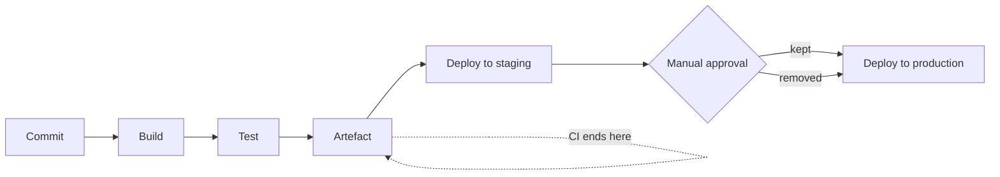

# CI/CD-র মূল কথা {#ch-cicd-fundamentals}

> Integration, delivery আর deployment-কে এক বাক্যে আলাদা করুন, তারপর এমন একটি pipeline design করুন, যেটা artefact একবার build করে আর দশ মিনিটের মধ্যে বলে দেয় সেটা নিরাপদ কি না।

**এই অধ্যায়ে:** তিনটি term · একবার build, বহুবার promote · stage সাজানো, যাতে failure সস্তায় আসে · quality gate · DORA metrics

## 💡 মূল ধারণা

Pipeline হলো এমন একটি machine, যেটা একটি commit-কে promote করার মতো একটি artefact-এ পরিণত করে। তারপর বাকি সময়টা
সে প্রমাণ করার চেষ্টা করে যে artefact-টি অনিরাপদ। দুটো অর্ধেকই গুরুত্বপূর্ণ। যদি এটা প্রতিটি environment-এর জন্য
আলাদা artefact build করে, তাহলে আপনি যেটা test করেছেন সেটা আর যেটা ship করেছেন সেটা এক নয়। যদি উত্তর দিতে চল্লিশ
মিনিট লাগে, developer-রা commit জমিয়ে একসঙ্গে পাঠান আর result পড়া বন্ধ করে দেন। সেটা pipeline না থাকারই সমান,
শুধু আরও দামি।

## কীভাবে কাজ করে

Interviewer-রা তিনটি term দিয়ে শুরু করেন, যাচাই করতে যে আপনি এদের গুলিয়ে ফেলেন না।

| Term | কী automate করে | কোথায় থামে |
| ---- | ----------------- | -------------- |
| **Continuous Integration** | প্রতিটি commit-এ build আর test | একটি test করা artefact তৈরি করে |
| **Continuous Delivery** | Deploy পর্যন্ত সবকিছু | Production deploy-এর জন্য **manual approval** লাগে |
| **Continuous Deployment** | Deploy-সহ | প্রতিটি green build স্বয়ংক্রিয়ভাবে production-এ পৌঁছায় |



**তিনটি term একই pipeline, শুধু approval gate আলাদা আলাদা জায়গায়।**

> **Continuous Delivery** মানে আপনি যেকোনো সময় deploy _করতে পারেন_। **Continuous Deployment** মানে আপনি প্রতিটি
> merge-এ সত্যিই deploy _করেন_। বেশিরভাগ enterprise team Continuous Delivery চালায়: সবকিছু automated, production-এর
> আগে একজন মানুষের gate সহ।

### CI-র চুক্তি

CI-র আগে team-গুলো কয়েক সপ্তাহের কাজ একবারে merge করত, আর ফলাফলকে বলত integration hell। CI এর বদলে একটি নিয়ম আনে:
ছোট change ঘন ঘন merge করুন, আর সেগুলো কাজ করে কি না তা স্বয়ংক্রিয়ভাবে প্রমাণ করুন।

- প্রতিটি commit একটি build চালু করে।
- Build প্রতিটি machine-এ একইভাবে চলে।
- Red build merge আটকে দেয়।
- Main branch সবসময় release করার মতো অবস্থায় থাকে।

❌ একটি nightly build, যেটা এমন একটি report email করে যেটা কেউ পড়ে না।
✅ প্রতিটি pull request test চালায়, আর failure হলে merge আটকে যায়।

## একবার Build, বহুবার Promote

এই অধ্যায়ের সবচেয়ে গুরুত্বপূর্ণ নীতি এটাই, আর এখানকার সবচেয়ে সাধারণ interview প্রশ্নও।

❌ **প্রতিটি environment-এর জন্য আবার build — প্রতিবার আলাদা bytes:**

```yaml
deploy-staging:
  script:
    - docker build -t app:staging .   # build #1
deploy-prod:
  script:
    - docker build -t app:prod .      # build #2 — a different image
```

দুটো build-এর মাঝে transitive dependency, base image আর build tool — সবই সরে যায়। Staging-এ আপনি যে image validate
করেছেন, user-দের যে image serve করছে সেটা সেটা নয়।

✅ **একবার build, তারপর promote:**

```yaml
build:
  script:
    - docker build -t $REGISTRY/app:$GIT_SHA .
    - docker push $REGISTRY/app:$GIT_SHA     # built exactly once
deploy-staging:
  script: [deploy $REGISTRY/app:$GIT_SHA]    # same bytes
deploy-prod:
  script: [deploy $REGISTRY/app:$GIT_SHA]    # same bytes, already tested
```

**Artefact** হলো build-এর package করা output, যেমন একটি container image, একটি zip করা function bundle বা একটি
compile করা frontend। Commit SHA দিয়ে এটাকে tag করুন। একটি পড়ার মতো release tag যোগ করুন, যেটা একই digest (image-এর
content hash)-এর দিকে point করে। কখনো `latest` deploy করবেন না।

> Production-এ কী চলছে সেটা দেখিয়ে একটি commit পর্যন্ত trace করতে না পারলে, আপনার কোনো pipeline নেই। আপনার আছে
> একটি build script।

⚠️ Registry-তে **tag immutability** চালু করুন। এটা ছাড়া, গত সপ্তাহে আপনি যে tag deploy করেছিলেন, সেটা আজ অন্য
একটি image-এর দিকে point করানো যায়, আর আপনার audit trail-এর কোথাও সেটা দেখা যাবে না।

## Stage সাজানো, যাতে Failure সস্তায় আসে

Stage-গুলো সবচেয়ে সস্তা থেকে সবচেয়ে দামি ক্রমে সাজান। যে সবচেয়ে সস্তা check fail করতে পারে, সেটা সবার আগে fail
করা উচিত।

| ক্রম | Stage | সাধারণত | কী ধরে |
| ----- | ----- | ------- | ------- |
| 1 | Lint আর type-check | ~20s | Typo, অব্যবহৃত code, type error |
| 2 | Unit test | ~90s | Logic-এর error |
| 3 | Artefact build | ~2m | Compile আর packaging-এর error |
| 4 | Integration test | ~4m | Wiring, SQL, serialisation |
| 5 | Security scan | ~2m | CVE, ফাঁস হওয়া secret, misconfiguration |
| 6 | Staging-এ deploy | ~2m | Config আর infrastructure drift |
| 7 | Smoke test | ~5m | ভাঙা critical flow |

Stage 4 আর 5 একে অপরের ওপর নির্ভর করে না, তাই এরা parallel-এ চলে। তখন stage 1 থেকে 5 পর্যন্ত মোটামুটি আট মিনিট
লাগে। **লক্ষ্য হলো একটি pull request-এ দশ মিনিটের কম সময়ে feedback।** এর বেশি হলে developer-রা change জমিয়ে
পাঠান, আর pipeline-কে পাশ কাটিয়ে যান।

**কোন tier কোথায় চলে, সেটা pipeline-এর সিদ্ধান্ত, testing-এর নয়:**

| Tier | সংখ্যা | কখন চলে |
| ---- | ----- | ------- |
| Unit | কয়েকশো থেকে কয়েক হাজার | প্রতিটি commit-এ |
| Integration | কয়েক ডজন থেকে কয়েকশো | প্রতিটি commit-এ |
| End-to-end | 10–30টি critical flow | `main`-এ merge হলে, একটি deploy করা environment-এর বিরুদ্ধে |

কোন tier-এ কী থাকা উচিত, তার পুরো যুক্তি [Chapter ?? — Testing Strategy](#ch-testing-strategy)-এ। Pipeline যা যোগ
করে, তা হলো ক্রম আর অবস্থান।

⚠️ উল্টো pyramid (বেশিরভাগই end-to-end test) ধীর আর flaky। এর failure function-এর নাম না বলে বলে *"checkout
broke"*। Coverage নিচের tier-গুলোর দিকে ঠেলে দিন, তাহলে একই bug diagnose করতে এক ঘণ্টার বদলে কয়েক সেকেন্ড লাগে।

## Quality Gate

মাপা যায় এমন একটি threshold পূরণ না হলে gate build-টিকে fail করে। এমন gate বেছে নিন, যা নিয়ে তর্কের কোনো জায়গা নেই।

| Gate | যুক্তিসঙ্গত threshold |
| ---- | -------------------- |
| **বদলানো** line-এর coverage | 80% — repository নয়, diff মাপুন |
| মোট coverage | কমতে পারবে না |
| High বা critical vulnerability | নতুন একটিও নয় |
| Type error | শূন্য |
| Performance budget | Bundle size বা p99 সীমার মধ্যে |

⚠️ **Coverage একটি ন্যূনতম সীমা, লক্ষ্য নয়।** 100%-এর পেছনে ছোটা একটি team এমন test লেখে, যেগুলো implementation-এর
খুঁটিনাটি assert করে আর প্রতিটি refactor-এ ভেঙে যায়। Diff মাপলে test ছাড়া নতুন code ধরা পড়ে, আর যে legacy file কেউ
বদলাচ্ছেন না সেগুলোতে জোর করে test চাপাতে হয় না।

## কখন ব্যবহার করবেন

| পরিস্থিতি | বেছে নিন | কেন |
| --------- | ------ | --- |
| Regulated domain, release window | Continuous Delivery | Gate-টিই audit record |
| শক্ত test, দ্রুত rollback, ভালো metrics | Continuous Deployment | Gate নিরাপত্তা নয়, শুধু দেরি যোগ করে |
| অসম্পূর্ণ কাজ, যেটা তবু merge করতে চান | Feature flag, বন্ধ অবস্থায় deploy | Branch ছোট রাখে |
| এমন pipeline, যেটায় কেউ ভরসা করে না | আগে flaky-গুলো ঠিক করুন | Red pipeline-এ নতুন gate উপেক্ষিত হয় |

## সাধারণ ভুল

❌ **একটি flaky test-কে কাজের স্বাভাবিক খরচ হিসেবে ধরা।** একই code-এ যে test কখনো pass আর কখনো fail করে, সেটা
কোনো test না থাকার চেয়েও খারাপ। এটা team-কে শেখায় red build না পড়েই আবার চালাতে।
✅ প্রতিটি test-এর pass আর fail-এর history রাখুন। Flaky-টিকে একটি ticket আর একটি deadline সহ non-blocking suite-এ
quarantine করুন, আর কেউ দায়িত্ব না নিলে delete করে দিন। সাধারণ কারণগুলো হলো timezone-এর ওপর নির্ভরতা, test-এর
ক্রমের ওপর নির্ভরতা, সত্যিকারের network call, আর asynchronous UI-তে race।

❌ **ঢালাও retry।** Assertion failure-এ `retry: 3` একটি race condition লুকিয়ে রাখে। তারপর সেটা production-এ দেখা দেয়।
✅ শুধু infrastructure failure retry করুন, যেমন একটি runner মরে যাওয়া বা একটি registry-র timeout। কিছু CI platform,
যেমন GitLab CI, কোন ধরনের failure retry-র যোগ্য তা নির্দিষ্ট করে দিতে দেয়।

❌ **একটি UI-তে click করে করে pipeline configure করা।** কেউ সেটা দেখতে বা review করতে পারেন না, আর CI server মরে গেলে
সেটা হারিয়ে যায়।
✅ Pipeline as code, repository-তে, যা build করে তার পাশে। Change review-এর মধ্য দিয়ে যায়, আর একটি পুরোনো commit
এখনো পুরোনো পদ্ধতিতেই build হয়।

❌ **এমন একটি staging environment, যেটা production-এর সঙ্গে কিছুই share করে না।** অন্য একটি load balancer-এর পেছনে
একটি ছোট instance load-এর মধ্যে behaviour সম্পর্কে কিছুই বলে না।
✅ একই infrastructure-এর আকার আর একই config mechanism। শুধু value আর data আলাদা।

## DORA Metrics

Delivery performance-এর চারটি industry-standard মাপ। অন্তত একটি প্রশ্ন আশা করুন।

| Metric | কী মাপে | Elite |
| ------ | ---------------- | ----- |
| **Deployment frequency** | Production-এ কত ঘন ঘন ship করেন | চাহিদামতো, দিনে একাধিকবার |
| **Lead time for changes** | Commit থেকে production-এ চলা পর্যন্ত | এক ঘণ্টার কম |
| **Change failure rate** | কত শতাংশ deploy incident ঘটায় | 15%-এর কম |
| **Time to restore** | কত দ্রুত recover করেন | এক ঘণ্টার কম |

> গতি আর স্থিতিশীলতা কোনো trade-off নয়। যে team বেশি ঘন ঘন deploy করে, তারা কম fail-ও করে, কারণ ছোট change
> review, test আর roll back করা সহজ।

CI সবচেয়ে ভালো কাজ করে প্রতিদিন merge হওয়া স্বল্পায়ু branch-এর সঙ্গে। কাজ শেষ না হলে feature flag সেটা সম্ভব করে।
প্রতিটি branching model একটি pipeline-এর কাছে কী চায়, সেটা আলোচনা করা হয়েছে
[Chapter ?? — Branching, Review ও Repository Strategy](#ch-branching-and-review-workflow)-এ।

## 🔑 মূল শিক্ষা

- Continuous Delivery মানে আপনি চাহিদামতো deploy করতে পারেন। Continuous Deployment মানে প্রতিটি green build সত্যিই deploy হয়।
- Artefact একবার build করুন, commit SHA দিয়ে tag করুন, আর একই bytes প্রতিটি environment-এর মধ্য দিয়ে promote করুন।
- Stage-গুলো সস্তা-আগে ক্রমে সাজান আর pull request-এর feedback দশ মিনিটের নিচে রাখুন, নইলে pipeline-কে পাশ কাটানো হবে।
- Diff-এর ওপর gate করুন: বদলানো line-এর coverage, নতুন কোনো high-severity finding নয়, শূন্য type error।
- একটি flaky test হলো pipeline-এর একটি ত্রুটি। Retry করে পার হয়ে না গিয়ে একটি deadline সহ সেটাকে quarantine করুন।

## Interview-এর প্রশ্ন

**Q: Continuous Delivery আর Continuous Deployment-এর মধ্যে পার্থক্য কী?**

দুটোই pipeline-কে deploy করার মতো অবস্থা পর্যন্ত automate করে। Continuous Delivery-তে production deploy-এর জন্য
একটি manual approval লাগে। প্রক্রিয়া পুরোপুরি automated হলেও, কখন release হবে তা team বেছে নেয়। Continuous
Deployment সেই gate সরিয়ে দেয়, তাই যে commit সব stage pass করে সেটাই ship হয়। এর জন্য অনেক বেশি শক্ত automated
testing, monitoring আর automatic rollback লাগে, কারণ user-দের আগে কোনো মানুষ change-টি দেখেন না। বেশিরভাগ
enterprise আর regulated team Continuous Delivery বেছে নেয়।

**Q: একটি artefact কেন শুধু একবারই build করা উচিত?**

কারণ প্রতিটি environment-এর জন্য আবার build করলে আলাদা bytes তৈরি হয়। দুটো build-এর মাঝে transitive dependency,
base image আর build tool সরে যায়, তাই staging-এ test করা artefact আর production-এরটা এক নয়। একবার build করুন, আর
commit SHA দিয়ে tag করা একটি immutable artefact promote করুন। তাহলে test যা ship হয় তার ওপরই খাটে, আর একটি চলমান
container থেকে একটি commit পর্যন্ত একটি পরিষ্কার trail পাওয়া যায়। এটা দ্রুতও, কারণ build-এর দাম প্রতিটি
environment-এ নয়, একবারই দিতে হয়।

**Q: Test মুছে না দিয়ে একটি CI pipeline দ্রুত রাখেন কীভাবে?**

Stage-গুলো সস্তা-আগে ক্রমে সাজান, যাতে failure আগে ধরা পড়ে, আর স্বাধীন job-গুলো একটার পর একটা না চালিয়ে parallel-এ
চালান। Lockfile-কে key করে dependency আর build layer cache করুন। বড় suite-গুলো কয়েকটি runner-এ shard করুন। সত্যিই
দামি suite-গুলো pull request-এর path থেকে সরিয়ে দিন, যেমন প্রতিটি push-এ নয়, `main`-এ merge হলে পুরো end-to-end।
একই branch-এর পুরোনো run-গুলো cancel করুন। যে সংখ্যাটা রক্ষা করতে হবে, সেটা হলো pull request-এর feedback-এ দশ
মিনিট। এর বেশি হলে pipeline আর কারো আচরণ বদলায় না।

**Q: Code coverage কি একটি কাজের quality gate?**

ন্যূনতম সীমা হিসেবে কাজের, লক্ষ্য হিসেবে বিভ্রান্তিকর। বেশি coverage প্রমাণ করে line-গুলো চলেছে, behaviour যাচাই
হয়েছে তা নয়। যে team-কে 100%-এর দিকে ঠেলে দেওয়া হয়, তারা implementation-এর খুঁটিনাটির সঙ্গে বাঁধা test লেখে, আর
সেগুলো প্রতিটি refactor-এ ভেঙে যায়। রাখার মতো রূপটা হলো diff-এর coverage: বদলানো line-গুলো 80%-এর মতো একটি
threshold পূরণ করে, আর মোট coverage কমতে পারে না। এর সঙ্গে এমন gate জুড়ুন, যা নিয়ে তর্কের জায়গা নেই: শূন্য type
error, নতুন কোনো high-severity vulnerability নয়, একটি bundle size budget।

**Q: কখন আপনি pipeline-এ আরেকটি gate যোগ করবেন না?**

যখন pipeline ইতিমধ্যেই flaky। Gate তখনই কাজ করে, যখন একটি red build-এর কোনো মানে থাকে। মানুষ ইতিমধ্যেই এই
pipeline না পড়েই আবার চালায়, তাই ষষ্ঠ একটি check সংকেতকে আরও খারাপ করে, ভালো নয়। ক্রমটা হলো: failure-কে
ভরসাযোগ্য করুন, feedback দশ মিনিটের নিচে আনুন, তারপর gate যোগ করুন। যে gate নিয়ে কেউ কিছু করতে পারে না, তার
ক্ষেত্রেও একই কথা। এমন একটি low-severity finding ধরুন, যার fix upstream-এ: এটা team-কে পুরো category-টাই click করে
পার হয়ে যেতে শেখায়।

## এরপর কী পড়বেন

- [Chapter ?? — GitHub Actions ও Pipeline Security](#ch-github-actions) — বেশিরভাগ team যে tool ব্যবহার করে তাতে একই নীতিগুলো, আর credential কীভাবে তাতে জমা না থেকেও পৌঁছায়
- [Chapter ?? — Deployment Strategy, Rollback ও Feature Flag](#ch-deployment-strategies) — production deploy আসলে artefact নিয়ে কী করে
- [Chapter ?? — Container Image: Build ও Hardening](#ch-docker-fundamentals) — pipeline যে artefact build করে, আর কেন তার layer-এর ক্রম build-এর সময় ঠিক করে
