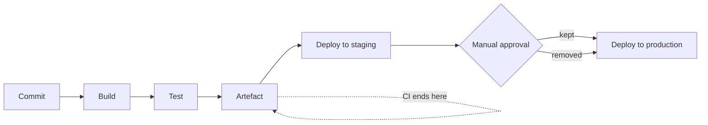

# CI/CD-র মূল কথা {#ch-cicd-fundamentals}

> Integration, delivery আর deployment-এর পার্থক্য এক বাক্যে বলুন। তারপর এমন pipeline design করুন, যা artefact একবারই build করে, আর দশ মিনিটের মধ্যে জানিয়ে দেয় সেটা নিরাপদ কি না।

**এই অধ্যায়ে:** তিনটি term · একবার build, বারবার promote · stage সাজানো, যাতে ব্যর্থতা সস্তায় ধরা পড়ে · quality gate · DORA metrics

## 💡 মূল ধারণা

Pipeline এমন একটি যন্ত্র, যা একটি commit থেকে promote করার মতো একটিই artefact বানায়। তারপর বাকি সময়টা চেষ্টা করে
প্রমাণ করতে যে artefact-টা অনিরাপদ। দুটি অংশই জরুরি। প্রতিটি environment-এর জন্য আলাদা artefact build হলে যা test
করেছেন আর যা ship করেছেন, দুটি এক জিনিস নয়। আবার উত্তর দিতে চল্লিশ মিনিট লাগলে developer-রা কয়েকটি commit জমিয়ে
একসঙ্গে পাঠান, আর ফলাফল পড়া ছেড়ে দেন। সেটা pipeline না থাকারই সমান, শুধু খরচ বেশি।

## কীভাবে কাজ করে

Interviewer-রা শুরুতেই তিনটি term জিজ্ঞেস করেন, দেখতে যে আপনি এগুলো গুলিয়ে ফেলেন কি না।

| Term | কী automate করে | কোথায় থামে |
| ---- | -------------- | ---------- |
| **Continuous Integration** | প্রতিটি commit-এ build আর test | একটি test করা artefact দেয় |
| **Continuous Delivery** | Deploy-এর আগ পর্যন্ত সব | Production deploy-এ লাগে **manual approval** |
| **Continuous Deployment** | Deploy-সহ | প্রতিটি green build নিজে থেকেই production-এ পৌঁছায় |



**তিনটি term আসলে একই pipeline, শুধু approval gate আলাদা জায়গায়।**

> **Continuous Delivery** মানে আপনি যেকোনো সময় deploy _করতে পারেন_। **Continuous Deployment** মানে প্রতিটি merge-এ
> আপনি _করেনই_। বেশিরভাগ enterprise team চালায় Continuous Delivery: সব automated, শুধু production-এর আগে একজন মানুষের gate।

### CI-র চুক্তি

CI আসার আগে team-গুলো কয়েক সপ্তাহের কাজ একসঙ্গে merge করত, আর ফলাফলের নাম দিয়েছিল integration hell। CI তার জায়গায়
একটি নিয়ম আনে: ছোট change ঘনঘন merge করুন, আর সেগুলো যে কাজ করে তা automated উপায়ে প্রমাণ করুন।

- প্রতিটি commit-এ build চলে।
- প্রতিটি machine-এ build একইভাবে চলে।
- Red build merge আটকে দেয়।
- Main branch সবসময় release করার মতো অবস্থায় থাকে।

❌ রাতে একবার build, আর তার report email-এ যায়, যা কেউ পড়ে না।
✅ প্রতিটি pull request-এ test চলে, আর fail করলে merge আটকে যায়।

## একবার Build, বারবার Promote

এই অধ্যায়ের সবচেয়ে গুরুত্বপূর্ণ নীতি এটাই, আর interview-এ এখান থেকেই সবচেয়ে বেশি প্রশ্ন আসে।

❌ **প্রতিটি environment-এর জন্য আবার build, প্রতিবার আলাদা byte:**

```yaml
deploy-staging:
  script:
    - docker build -t app:staging .   # build #1
deploy-prod:
  script:
    - docker build -t app:prod .      # build #2 — a different image
```

দুটি build-এর মাঝে transitive dependency, base image আর build tool সবই বদলে যেতে পারে। Staging-এ যে image যাচাই
করেছেন, user-দের সেটা serve করছে না।

✅ **একবার build, তারপর promote:**

```yaml
build:
  script:
    - docker build -t $REGISTRY/app:$GIT_SHA .
    - docker push $REGISTRY/app:$GIT_SHA     # built exactly once
deploy-staging:
  script: [deploy $REGISTRY/app:$GIT_SHA]    # same bytes
deploy-prod:
  script: [deploy $REGISTRY/app:$GIT_SHA]    # same bytes, already tested
```

**Artefact** হলো build-এর package করা output, যেমন container image, zip করা function bundle, কিংবা compile করা
frontend। Commit SHA দিয়ে এর tag দিন। পড়ার মতো একটি release tag-ও যোগ করুন, যা একই digest (image-এর content hash)
দেখায়। কখনো `latest` deploy করবেন না।

> Production-এ কী চলছে আঙুল দিয়ে দেখিয়ে সেটা কোন commit থেকে এসেছে বলতে না পারলে আপনার pipeline নেই। আছে একটি
> build script।

⚠️ Registry-তে **tag immutability** চালু করুন। না করলে গত সপ্তাহে যে tag deploy করেছেন, আজ সেটা অন্য image-এর দিকে
ঘুরিয়ে দেওয়া যায়, আর আপনার audit trail-এ তার কোনো চিহ্ন থাকে না।

## Stage সাজানো, যাতে ব্যর্থতা সস্তায় ধরা পড়ে

Stage সাজান সবচেয়ে সস্তা থেকে সবচেয়ে দামি ক্রমে। যে সবচেয়ে সস্তা check fail করতে পারে, সেটাই আগে fail করুক।

| ক্রম | Stage | সাধারণত | যা ধরে |
| --- | ----- | ------ | ----- |
| 1 | Lint আর type-check | ~20s | Typo, অব্যবহৃত code, type error |
| 2 | Unit test | ~90s | Logic-এর ভুল |
| 3 | Artefact build | ~2m | Compile আর packaging-এর error |
| 4 | Integration test | ~4m | Wiring, SQL, serialisation |
| 5 | Security scan | ~2m | CVE, ফাঁস হওয়া secret, ভুল configuration |
| 6 | Staging-এ deploy | ~2m | Config আর infrastructure-এর drift |
| 7 | Smoke test | ~5m | ভাঙা critical flow |

Stage 4 আর 5 একে অপরের ওপর নির্ভর করে না, তাই parallel-এ চলে। তাহলে stage 1 থেকে 5 পর্যন্ত লাগে মোটামুটি আট মিনিট।
**লক্ষ্য হলো pull request-এ দশ মিনিটের কম সময়ে feedback।** এর বেশি হলে developer-রা change জমিয়ে পাঠান, আর pipeline-কে
পাশ কাটানোর পথ খোঁজেন।

**কোন স্তরের test কোথায় চলবে, সেটা pipeline-এর সিদ্ধান্ত, testing-এর নয়:**

| স্তর | সংখ্যা | কখন চলে |
| --- | ----- | ------ |
| Unit | কয়েকশো থেকে কয়েক হাজার | প্রতিটি commit-এ |
| Integration | কয়েক ডজন থেকে কয়েকশো | প্রতিটি commit-এ |
| End-to-end | 10–30টি critical flow | `main`-এ merge হলে, deploy করা environment-এর ওপর |

কোন স্তরে কী থাকা উচিত, তার পুরো যুক্তি আছে [Chapter ?? — Testing Strategy](#ch-testing-strategy)-এ। Pipeline
যোগ করে শুধু ক্রম আর জায়গা।

⚠️ উল্টো pyramid (বেশিরভাগই end-to-end test) ধীর, আর flaky। এর failure বলে *"checkout ভেঙেছে"*, কোন function তা বলে
না। Coverage নিচের স্তরগুলোতে নামিয়ে আনুন। তাহলে একই bug ধরতে এক ঘণ্টার বদলে কয়েক সেকেন্ড লাগে।

## Quality Gate

মাপা যায় এমন কোনো সীমা না মানলে gate build fail করিয়ে দেয়। এমন gate বাছুন, যা নিয়ে তর্কের জায়গা নেই।

| Gate | যুক্তিসঙ্গত সীমা |
| ---- | -------------- |
| **বদলানো** line-এর coverage | 80%, পুরো repository নয়, diff মাপুন |
| মোট coverage | কমতে পারবে না |
| High বা critical vulnerability | নতুন একটিও নয় |
| Type error | শূন্য |
| Performance budget | Bundle size বা p99 সীমার মধ্যে |

⚠️ **Coverage একটি ন্যূনতম সীমা, লক্ষ্য নয়।** যে team 100%-এর পেছনে ছোটে, তারা implementation-এর খুঁটিনাটি assert
করে test লেখে, আর প্রতিটি refactor-এ সেগুলো ভাঙে। Diff মাপলে test ছাড়া নতুন code ধরা পড়ে, অথচ যে legacy file কেউ
বদলাচ্ছে না, তাতে জোর করে test লিখতে হয় না।

## কখন ব্যবহার করবেন

| পরিস্থিতি | বাছুন | কেন |
| -------- | ---- | --- |
| নিয়ন্ত্রিত domain, নির্দিষ্ট release window | Continuous Delivery | Gate-টাই audit-এর রেকর্ড |
| শক্ত test, দ্রুত rollback, ভালো metrics | Continuous Deployment | Gate শুধু latency বাড়ায়, নিরাপত্তা নয় |
| অসমাপ্ত কাজ, তবু merge করতে চান | Feature flag, বন্ধ অবস্থায় deploy | Branch ছোট থাকে |
| এমন pipeline, যাকে কেউ ভরসা করে না | আগে flaky test ঠিক করুন | Red pipeline-এ নতুন gate কেউ পাত্তা দেয় না |

## সাধারণ ভুল

❌ **Flaky test-কে কাজের স্বাভাবিক খরচ ধরে নেওয়া।** হুবহু একই code-এ যে test কখনো pass করে, কখনো fail, সেটা test না
থাকার চেয়েও খারাপ। Team শিখে যায় red build না পড়েই আবার চালাতে।
✅ প্রতিটি test-এর pass আর fail-এর ইতিহাস রাখুন। Flaky test-টাকে একটি ticket আর deadline দিয়ে non-blocking suite-এ
quarantine করুন। কেউ দায়িত্ব না নিলে মুছে দিন। সাধারণ কারণগুলো হলো timezone-এর ওপর নির্ভরতা, test-এর ক্রমের ওপর
নির্ভরতা, সত্যিকারের network call, আর asynchronous UI-তে race।

❌ **ঢালাও retry।** Assertion failure-এ `retry: 3` দিলে race condition চাপা পড়ে। পরে সেটা দেখা দেয় production-এ।
✅ Retry করুন শুধু infrastructure-এর failure-এ, যেমন runner মারা গেলে বা registry-র timeout হলে। GitLab CI-এর মতো কিছু
CI platform-এ কোন ধরনের failure retry পাবে, তা নাম ধরে বলে দেওয়া যায়।

❌ **UI-তে click করে করে pipeline configure করা।** কেউ এটা দেখতে পায় না, review-ও করতে পারে না। আর CI server মারা গেলে
সব হারায়।
✅ Pipeline as code, যা build করে তার পাশেই repository-তে। Change যায় review-এর মধ্য দিয়ে, আর পুরনো commit এখনো পুরনো
নিয়মেই build হয়।

❌ **এমন staging environment, যার production-এর সঙ্গে কোনো মিল নেই।** ভিন্ন load balancer-এর পেছনে একটি ছোট instance
load-এর মধ্যে আচরণ নিয়ে কিছুই বলে না।
✅ একই infrastructure-এর গড়ন, একই config-এর পদ্ধতি। আলাদা শুধু value আর data।

## DORA Metrics

Delivery performance মাপার চারটি industry-standard মাপকাঠি। অন্তত একটি প্রশ্ন আশা করুন।

| Metric | কী মাপে | Elite |
| ------ | ------ | ----- |
| **Deployment frequency** | কত ঘনঘন production-এ ship করেন | যখন দরকার, দিনে একাধিকবার |
| **Lead time for changes** | Commit থেকে production-এ চালু হওয়া পর্যন্ত | এক ঘণ্টার কম |
| **Change failure rate** | কত শতাংশ deploy incident ঘটায় | 15%-এর কম |
| **Time to restore** | কত দ্রুত সেরে ওঠেন | এক ঘণ্টার কম |

> গতি আর স্থিতিশীলতার মধ্যে কোনো বিনিময় নেই। যে team বেশি ঘনঘন deploy করে, তাদের ব্যর্থতাও কম। কারণ ছোট change
> review, test আর roll back করা সহজ।

CI সবচেয়ে ভালো কাজ করে স্বল্পায়ু branch-এর সঙ্গে, যা প্রতিদিন merge হয়। কাজ শেষ না হলেও feature flag এটা সম্ভব করে।
প্রতিটি branching model pipeline-এর কাছে কী চায়, তা আছে
[Chapter ?? — Branching, Review ও Repository Strategy](#ch-branching-and-review-workflow)-এ।

## 🔑 মূল শিক্ষা

- Continuous Delivery মানে চাইলেই deploy করতে পারেন। Continuous Deployment মানে প্রতিটি green build নিজেই deploy হয়।
- Artefact একবার build করুন, commit SHA দিয়ে tag দিন, আর সেই একই byte প্রতিটি environment-এ promote করুন।
- Stage সাজান সস্তা থেকে দামি ক্রমে, আর pull request-এর feedback দশ মিনিটের নিচে রাখুন। নইলে মানুষ pipeline পাশ কাটাবে।
- Gate বসান diff-এর ওপর: বদলানো line-এর coverage, নতুন কোনো high-severity finding নয়, type error শূন্য।
- Flaky test হলো pipeline-এর ত্রুটি। Retry দিয়ে পার না করে deadline দিয়ে quarantine করুন।

## Interview-এর প্রশ্ন

**Q: Continuous Delivery আর Continuous Deployment-এর পার্থক্য কী?**

দুটিই pipeline-কে deploy করার মতো অবস্থা পর্যন্ত automate করে। Continuous Delivery-তে production deploy-এ manual
approval লাগে। Process পুরোপুরি automated হলেও কখন release হবে, সেটা team ঠিক করে। Continuous Deployment সেই gate
সরিয়ে দেয়, তাই সব stage পার হওয়া প্রতিটি commit ship হয়। এতে অনেক শক্ত automated testing, monitoring আর automatic
rollback লাগে, কারণ user-দের আগে কোনো মানুষ change-টা দেখেন না। বেশিরভাগ enterprise আর নিয়ন্ত্রিত team Continuous
Delivery বেছে নেয়।

**Q: Artefact কেন একবারই build করা উচিত?**

কারণ প্রতিটি environment-এর জন্য আবার build করলে আলাদা byte তৈরি হয়। দুটি build-এর মাঝে transitive dependency, base
image আর build tool বদলে যায়। ফলে staging-এ test করা artefact আর production-এরটা এক নয়। একবার build করে commit SHA-র
tag দেওয়া immutable artefact promote করুন। তাহলে test যা যাচাই করেছে, ship হয় সেটাই। আর চালু container থেকে commit
পর্যন্ত একটি পরিষ্কার সূত্র পাওয়া যায়। এটা দ্রুতও, কারণ build-এর খরচ প্রতিটি environment-এ না দিয়ে একবারই দেন।

**Q: Test না মুছে CI pipeline দ্রুত রাখেন কীভাবে?**

Stage সাজান সস্তা থেকে দামি ক্রমে, যাতে failure আগে ধরা পড়ে। স্বাধীন job-গুলো একটির পর একটি না চালিয়ে parallel-এ
চালান। Lockfile-কে key করে dependency আর build layer cache করুন। বড় suite-গুলো কয়েকটি runner-এ ভাগ করে দিন। সত্যিই দামি
suite-গুলো pull request-এর পথ থেকে সরিয়ে দিন, যেমন পুরো end-to-end চালান প্রতিটি push-এ নয়, `main`-এ merge হলে। একই
branch-এর পুরনো run cancel করুন। যে সংখ্যাটার পক্ষে দাঁড়াতে হবে, তা হলো pull request-এ feedback পেতে দশ মিনিট। এর বেশি
হলে pipeline আর কারও আচরণ বদলায় না।

**Q: Code coverage কি কাজের quality gate?**

ন্যূনতম সীমা হিসেবে কাজের, লক্ষ্য হিসেবে বিভ্রান্তিকর। বেশি coverage প্রমাণ করে line-গুলো চলেছে, behaviour যাচাই
হয়েছে তা নয়। যে team-কে 100%-এর দিকে ঠেলা হয়, তারা implementation-এর খুঁটিনাটিতে বাঁধা test লেখে, আর প্রতিটি
refactor-এ সেগুলো ভাঙে। রাখার মতো version হলো diff-এর coverage: বদলানো line-গুলো 80%-এর মতো একটি সীমা ছোঁবে, আর মোট
coverage কমতে পারবে না। সঙ্গে রাখুন এমন gate, যা নিয়ে তর্কের জায়গা নেই: type error শূন্য, নতুন কোনো high-severity
vulnerability নয়, bundle size-এর একটি budget।

**Q: কখন pipeline-এ আরেকটি gate যোগ করবেন না?**

যখন pipeline আগে থেকেই flaky। Gate কাজ করে শুধু তখনই, যখন red build-এর কোনো মানে থাকে। মানুষ যদি এই pipeline না পড়েই
আবার চালায়, তাহলে ষষ্ঠ check signal-কে আরও খারাপ করে, ভালো নয়। ক্রমটা হলো: আগে failure-কে বিশ্বাসযোগ্য করুন, তারপর
feedback দশ মিনিটের নিচে আনুন, তারপর gate যোগ করুন। যে gate দেখে কেউ কিছু করতে পারে না, তার বেলাতেও একই কথা। ধরুন
একটি low-severity finding, যার fix upstream-এর হাতে। এটা team-কে পুরো ধরনটাই click করে পার হয়ে যেতে শেখায়।

## এরপর কী পড়বেন

- [Chapter ?? — GitHub Actions ও Pipeline Security](#ch-github-actions) — বেশিরভাগ team যে tool ব্যবহার করে, তাতে একই নীতি, আর credential কীভাবে তার কাছে পৌঁছায় অথচ তার ভেতরে জমা থাকে না
- [Chapter ?? — Deployment Strategy, Rollback ও Feature Flag](#ch-deployment-strategies) — production deploy আসলে artefact নিয়ে কী করে
- [Chapter ?? — Container Image: Build ও Hardening](#ch-docker-fundamentals) — pipeline যে artefact build করে, আর কেন তার layer-এর ক্রমই build-এর সময় ঠিক করে
