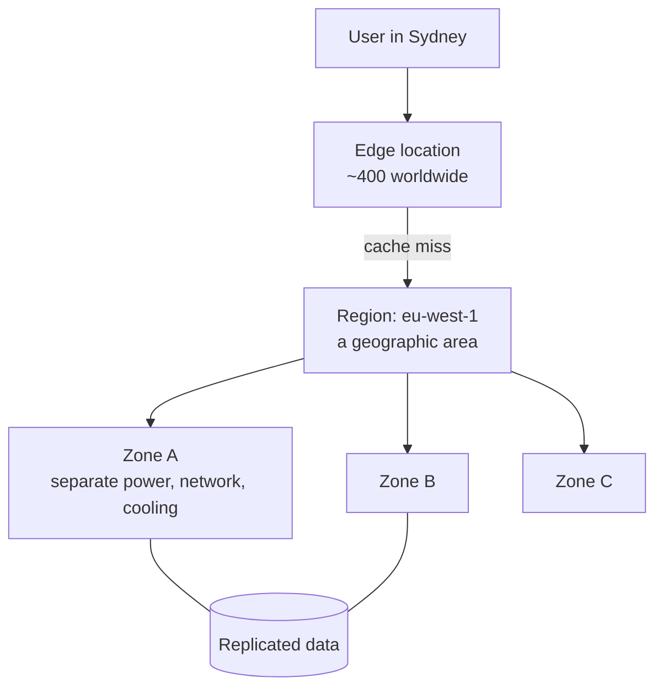
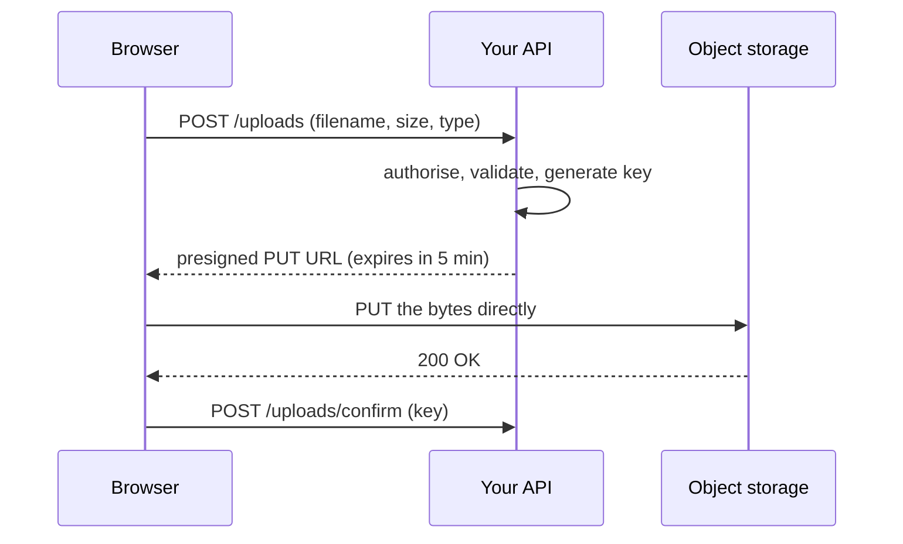

# Cloud-এর মূল কথা, Storage ও Delivery {#ch-cloud-fundamentals}

> যেকোনো provider-এর menu-কে চারটি primitive হিসেবে পড়ুন, সেগুলো চালানোর কোন অর্ধেক আপনার তা বলুন, আর user-এর file serve করুন এমনভাবে যাতে আপনার server byte-এর পথে না থাকে।

**এই অধ্যায়ে:** চারটি primitive আর সেগুলো কোথায় চলে · managed-service-এর মই আর shared responsibility-র রেখা · object storage আর presigned upload · bucket-এর সামনে একটি CDN · cache key, header আর invalidation

## 💡 মূল ধারণা

একটি cloud provider আপনাকে চারটি জিনিস ভাড়া দেয়: code চালানোর একটি জায়গা, byte রাখার একটি জায়গা, এদের মধ্যে একটি
network, আর কে কী করতে পারবে তা বলার একটি উপায়। Console-এর প্রতিটি service এই চারটির একটি। যা বদলায় তা হলো
_চালানোর কতটুকু আপনার_। নাম আলাদা, কিন্তু primitive একই।

Interviewer-রা নামের চেয়ে primitive নিয়ে বেশি ভাবেন। "User-এর upload কীভাবে serve করবেন?" প্রশ্নটি চায় object
storage, একটি signed URL আর তার সামনে একটি cache। আকারটা সহজ: আপনার application কখনো byte বহন করে না। এটা একটি
স্বল্পস্থায়ী URL দেয়, আর browser সরাসরি storage-এর সঙ্গে কথা বলে। এরপর CDN (user-এর কাছাকাছি একটি cache) সবাইকে
serve করে। আপনার server permission-এর সিদ্ধান্ত নেয়, megabyte বহন করে না।

## কীভাবে কাজ করে

### চারটি primitive

| Primitive    | আপনি কী ভাড়া নেন                            | মোটামুটি যে নামে ডাকা হয়                                       |
| ------------ | ------------------------------------------ | ------------------------------------------------------------ |
| **Compute**  | অন্য কারও CPU, সেকেন্ড হিসেবে                 | EC2 · Lambda · Cloud Run · Azure Functions · Vercel Functions |
| **Storage**  | একটি HTTP API-এর পেছনে টেকসই byte            | S3 · Cloud Storage · Azure Blob · R2 · Vercel Blob            |
| **Network**  | Routing, load balancing, edge caching       | CloudFront · Cloud CDN · Front Door · Cloudflare              |
| **Identity** | কে কী call করতে পারবে, আর কোন key দিয়ে      | IAM · Cloud IAM · Entra ID                                    |

একটি managed database হলো compute আর storage একসঙ্গে বিক্রি করা। এটা দাম ঠিক করার সিদ্ধান্ত, পঞ্চম কোনো primitive নয়।

### ভূগোল: region, zone, edge



**একটি request কীভাবে আপনার data-য় পৌঁছায়: হয় edge সেটা serve করে, নয়তো region।**

| স্তর        | কোন failure সামলায়                  | আপনি কী করবেন                                         |
| ---------- | --------------------------------- | ---------------------------------------------------- |
| **Zone**   | একটি data centre-এর বিদ্যুৎ চলে যাওয়া | দুই বা তার বেশি zone-এ চালান — সাধারণত একটি checkbox   |
| **Region** | পুরো একটি ভৌগোলিক এলাকা বন্ধ হয়ে যাওয়া | দ্বিতীয় একটি region, replicate করা data, আর সত্যিকারের DR plan |
| **Edge**   | কিছুই না — এটা একটি cache            | কিছুই না। এটা latency-র জন্য, availability-র জন্য নয়   |

বেশিরভাগ team-এর দরকার multi-zone, multi-region নয়। Multi-region খরচ দ্বিগুণ করে, আর প্রতিটি write-কে একটি
distributed-systems সমস্যা বানিয়ে ফেলে।

### Managed-service-এর মই

একই application পাঁচটি উচ্চতায় চলতে পারে: একটি virtual machine, একটি container service, একটি managed runtime, একটি
function, বা একটি managed product। মইয়ের প্রতিটি ধাপ ওপরে উঠলে চালানোর আরও বেশি দায় provider-এর হাতে যায়: প্রথমে OS,
তারপর runtime, তারপর scaling। সঙ্গে আপনার control-ও আরও কমে। Billing-ও বদলায়, uptime-এর জন্য টাকা দেওয়া থেকে
প্রতি invocation বা প্রতি ব্যবহারে টাকা দেওয়ার দিকে।

> ⚠️ ধাপ বদলায় _কে ঠিক করবে_, কখনো _কে দায়ী_ নয়। একটি managed database-এর connection ফুরিয়ে গেলে সেটা তবুও
> আপনার outage, আপনার pager আর আপনার customer।

### Shared responsibility-র রেখা

Provider **cloud-টি** সুরক্ষিত রাখে: ভবন, hardware, hypervisor, আর তার managed service-গুলোর ভেতরের অংশ। আপনি
সুরক্ষিত রাখেন **এর ভেতরে যা রাখেন**: আপনার data, আপনার access control, আপনার code, আর যে operating system আপনি
নিজের কাছে রাখার সিদ্ধান্ত নিয়েছেন। দুটি জিনিস প্রতিটি ধাপেই আপনার থাকে, আর প্রায় সব সত্যিকারের breach সেখানেই ঘটে:

- **আপনার data** — আপনি কী classify, encrypt, retain আর delete করেন
- **আপনার access control** — কার হাতে কোন key, আর সেটা কতটা সংকীর্ণ

### Identity: যে অংশটা একজন frontend-heavy engineer ছোঁন

Identity হলো policy-র একটি তালিকা: কোন principal (একজন user, role বা service) কোন resource-এ কোন action করতে পারবে।
তিনটি অভ্যাস আপনাকে যা জিজ্ঞেস করা হবে তার বেশিরভাগ cover করে:

- **Role, দীর্ঘস্থায়ী key নয়।** একটি deploy pipeline বা function একটি role নেয় আর এমন একটি session পায় যেটা
  expire হয়। CI-তে paste করা একটি key ততদিন বাঁচে, যতদিন না কেউ সেটা লক্ষ করে।
- **Least privilege।** Upload API একটি bucket-এ `users/*`-এর নিচে `PutObject` করতে পারে। এটা কিছু read,
  delete বা list করতে পারে না।
- **প্রতি environment-এ একটি account।** Production নিজের account-এ থাকলে development-এর কোনো ভুল সেখানে পৌঁছাতে
  পারে না। Bill-ও team অনুযায়ী ভাগ হয়ে যায়, এমন কোনো tagging convention ছাড়াই যেটা কেউ maintain করে না।

### Object storage: bucket, key আর object

Object storage হলো বড় blob-এর জন্য একটি টেকসই key-value store, যেটায় HTTP দিয়ে পৌঁছানো যায়। একটি **bucket** হলো
container, একটি region-এ বাঁধা। একটি **key** হলো object-এর পুরো identifier, যেমন `users/42/avatar.png`। একটি
**object** হলো byte আর metadata: content type, cache header আর tag।

Key দেখতে path-এর **মতো**, কিন্তু path নয়। Keyspace সমতল, আর `/` একটি সাধারণ character, যেটাকে tool-গুলো folder
হিসেবে আঁকে। "একটি folder" list করা আসলে একটি prefix scan, যেটা একবারে 1,000টি করে key-এর page পার হয়। Prefix যত
বড় হয়, এটা তত ধীর হয়।
কখনো listing-এর ওপর কোনো feature বানাবেন না।

> ⚠️ Object storage-এ আংশিক write নেই, append-ও নেই। হয় পুরো object replace করবেন, নয়তো সেটাকে ছেড়ে দেবেন। যা
> জায়গায় বসে edit হয়, সেটা database-এ থাকা উচিত, bucket-এ নয়।

### Upload-এর পথ

সরল design-এ file আপনার application server দিয়ে যায়। তখন একটি 200 MB upload-এ খরচ হয় আপনার 200 MB bandwidth,
আপনার memory আর আপনার request timeout। ভালো design একটি **presigned URL** দেয়। এটা একটি সাধারণ storage URL,
সঙ্গে একটি signature, যেটা কয়েক মিনিটের জন্য একটি key-তে একটি operation-এর অনুমতি দেয়।



**Byte কখনো আপনার server ছোঁয় না; শুধু permission-এর সিদ্ধান্ত ছোঁয়।**

**একটি presigned upload URL দেওয়া (AWS SDK for JavaScript v3):**

```typescript
import { S3Client, PutObjectCommand } from "@aws-sdk/client-s3";
import { getSignedUrl } from "@aws-sdk/s3-request-presigner";

const s3 = new S3Client({ region: "eu-west-1" });

interface UploadTicket { url: string; key: string; expiresIn: number }

export async function createUploadTicket(userId: string, contentType: string): Promise<UploadTicket> {
  // The server chooses the key. Never let the client name its own — that is how one user
  // overwrites another user's avatar.
  const key = `users/${userId}/${crypto.randomUUID()}`;

  const url = await getSignedUrl(
    s3,
    new PutObjectCommand({
      Bucket: "app-user-uploads",
      Key: key,
      ContentType: contentType, // signed in, so the browser cannot upload something else
    }),
    { expiresIn: 300 },
  );

  return { url, key, expiresIn: 300 };
}
```

Private download-ও একইভাবে কাজ করে। একটি file-এর জন্য একটি স্বল্পস্থায়ী `GET` sign করুন। যখন একসঙ্গে পুরো একসেট file
পড়ার যোগ্য হতে হবে, তখন একটি signed **cookie** ব্যবহার করুন, যেমন একটি video-র manifest আর তার segment-গুলো।

### Bucket-এর সামনে একটি CDN

Edge কীভাবে route করে আর কী offload করে, তা [Chapter ?? — Content Delivery Network](#ch-cdn)-এ আছে। এখানে প্রশ্ন
হলো আপনি কী configure করেন, আর প্রতিটি setting-এর মালিক কে। একটি miss-এ খরচ একটি origin request। সেই region-এর
পরের প্রতিটি user edge থেকে serve হয়।

**Origin।** এটাকে lock করুন যাতে শুধু CDN-ই এটা পড়তে পারে। Bucket সবার জন্য পড়ার যোগ্য হলে user-রা সরাসরি URL খুঁজে
পায়, cache এড়িয়ে যায়, আর আপনার signed-URL-এর নিয়মও এড়িয়ে যায়। প্রতিটি provider-এর একটি origin-only ব্যবস্থা আছে,
যেমন origin access control, signed origin request বা একটি shared secret header। একটি চালু করুন আর public read
বন্ধ করুন।

**Cache key।** Edge প্রতিটি response একটি key-এর নিচে রাখে। এই key-তে যা কিছু ঢুকতে দেবেন, তা copy-র সংখ্যা গুণ
করে বাড়ায়, আর প্রতিটি বাড়তি copy আরেকটি miss। সবসময় path আর `Accept-Encoding` রাখুন। শুধু সেই query parameter
রাখুন যেগুলো response বদলায়। Asset-এর জন্য cookie বাদ দিন। Key-তে একটি session cookie মানে শূন্য hit।

**Cache header — জিনিস কতক্ষণ বাঁচবে তা origin ঠিক করে, application code-এ:**

```typescript
// A content-hashed asset: the filename changes when the bytes change, so it can be cached forever.
const immutableAsset = { "cache-control": "public, max-age=31536000, immutable" };

// An HTML page or API response: the browser revalidates, the CDN serves it for 60 seconds,
// and for 5 minutes after that it serves stale while it refreshes in the background.
const page = { "cache-control": "public, max-age=0, s-maxage=60, stale-while-revalidate=300" };

// Anything user-specific must never reach a shared cache.
const dashboard = { "cache-control": "private, no-store" };
```

`max-age` browser-এর জন্য। `s-maxage` shared cache-এর জন্য, আর সেখানে এটা `max-age`-কে override করে।
`stale-while-revalidate` expiry-র সময়ের latency spike সরিয়ে দেয়: edge পুরোনো copy থেকে উত্তর দেয় আর request-এর
পেছনে refresh করে।

**Invalidation।** Purge করা ধীর, আর সাধারণত এর জন্য meter অনুযায়ী টাকা লাগে। এটা eventually consistent-ও: edge-গুলো
আলাদা আলাদা সময়ে আপডেট পায়। Deploy-এর সময় "সব invalidate করুন" cache খালি করে দেয় আর origin-কে ডুবিয়ে দেয়। তার বদলে
URL বদলান। `app.7f3c9a.js`-এর মতো hashed filename থাকলে নতুন build নতুন URL চায়, আর কেউ পুরোনো copy আর request
করে না। শুধু ছোট HTML entry point-এর একটি ছোট TTL (time to live) বা purge দরকার।

## কখন ব্যবহার করবেন

**Region বাছাই:**

| প্রশ্ন                                       | উত্তর যদি হয়…                                 | তাহলে                                              |
| ------------------------------------------- | -------------------------------------------- | -------------------------------------------------- |
| User-রা কোথায়?                              | একটি মহাদেশে কেন্দ্রীভূত                       | সেই মহাদেশ বাছুন, বাকিটা edge-এ cache করুন           |
| Data কি ব্যক্তিগত বা নিয়ন্ত্রিত?                 | হ্যাঁ, GDPR বা কোনো residency নিয়মের অধীনে        | Residency জেতে — latency একে override করে না        |
| Workload-এর কি কোনো বিশেষ service দরকার?       | হ্যাঁ                                           | আগে availability দেখুন; সব region-এ এটা থাকে না     |
| Workload-এ কি খরচই প্রধান?                     | হ্যাঁ, আর latency সহ্য করতে পারে (batch, archive) | সবচেয়ে সস্তা region একটি ন্যায্য উত্তর                |

**ধাপ বাছাই:** কাজটা করতে পারে এমন সবচেয়ে উঁচু ধাপ থেকে শুরু করুন। নিচে নামুন শুধু তখন, যখন নির্দিষ্ট কিছু আপনাকে
আটকায়, যেমন এমন একটি runtime যেটা platform-এ নেই।

**Data কোথায় থাকবে তা বাছাই:** upload, image, video আর export যায় object storage-এ। Build output যায় CDN-এর পেছনে
object storage-এ, hashed আর চিরকালের জন্য cached। যে record-এ আপনি query চালান, সেটা database-এর জায়গা, আর
ব্যক্তিগতকৃত যেকোনো কিছু origin-এ থাকে, একটি `private` cache header নিয়ে।

## সাধারণ ভুল

❌ **একটি availability zone-এ deploy করা।** দ্বিতীয় একটি zone-এর খরচ কম, আর availability-তে এর চেয়ে বড় লাভ আর
নেই। ✅ অন্তত দুটিতে চালান।

❌ **অভ্যাসবশে region বাছাই করা।** `us-east-1` tutorial-এর default, আর residency নিয়ম আছে এমন একটি ইউরোপীয়
product-এর জন্য ভুল উত্তর। ✅ আগে user, তারপর আইন, তারপর দাম দেখে বাছুন।

❌ **প্রতিদিনের কাজে root account বা দীর্ঘস্থায়ী key ব্যবহার করা।** Policy root-কে সীমিত করতে পারে না। এটাই প্রথম
credential যেটা একজন attacker খোঁজে। ✅ Expire হয় এমন session-সহ একটি scoped role ব্যবহার করুন।

❌ **Application দিয়ে upload proxy করা।** এতে bandwidth আর memory পোড়ে, আর বড় file-এ ভেঙে পড়ে। ✅ Presign করুন,
browser-কে সরাসরি upload করতে দিন, আর পরে confirm করুন।

❌ **সব cookie আর query string origin-এ forward করা।** প্রতিটি আলাদা value নিজের cache entry হয়ে যায়, আর hit rate
ধসে পড়ে। ✅ শুধু তা-ই রাখুন যা response বদলায়।

❌ **ব্যক্তিগতকৃত response-এ `s-maxage` দেওয়া।** CDN একজন user-এর dashboard পরের জনকে দিয়ে দেয়।
✅ Login-এর পেছনের যেকোনো কিছুর জন্য `private, no-store`।

## 🔑 মূল শিক্ষা

- প্রতিটি cloud service হলো compute, storage, network বা identity, কোনো এক মাত্রার managed হিসেবে বিক্রি করা।
- একটি zone একটি data-centre-এর failure সামলায়, একটি region একটি ভৌগোলিক failure সামলায়, আর edge কিছুই সামলায় না।
- Managed-service-এর মই বদলায় কে ঠিক করবে, কখনো কে দায়ী নয়; data আর access control আপনারই থাকে।
- Upload presign করুন, যাতে byte browser থেকে storage-এ যায় আর আপনার server শুধু permission-এর সিদ্ধান্ত নেয়।
- Origin-কে CDN-এর জন্য lock করুন, cache key ছোট রাখুন, আর invalidate না করে filename hash করুন।

## Interview-এর প্রশ্ন

**Q: একটি region আর একটি availability zone-এর পার্থক্য কী?**

Region হলো একটি ভৌগোলিক এলাকা। Zone হলো এর ভেতরে এক বা একাধিক data centre, আলাদা বিদ্যুৎ, cooling আর network-সহ,
দ্রুত replication-এর জন্য যথেষ্ট কাছাকাছি। একাধিক zone-এ ছড়িয়ে দিলে একটি data centre বন্ধ হওয়া থেকে সুরক্ষা
পাওয়া যায়, আর খরচ কম। একাধিক region-এ ছড়ালে খরচ হয় সবকিছুর দ্বিতীয় একটি copy, সঙ্গে একটি consistency সমস্যা।

**Q: কোনো provider-এর নাম না নিয়ে shared responsibility model ব্যাখ্যা করুন।**

Provider যা চালায় তা সুরক্ষিত রাখে: ভবন, hardware, network আর managed service-এর ভেতরের অংশ। আপনি এর ওপর যা রাখেন
তা সুরক্ষিত রাখেন: data, identity আর access, application code, আর যে OS আপনি রেখেছেন। Service কতটা managed, তার
সঙ্গে রেখাটা সরে, কিন্তু data আর access control কখনো এটা পার হয় না।

**Q: কখন আপনি managed service ব্যবহার করবেন না?**

যখন আপনার যা দরকার, এটা তা করতে পারে না। যেমন: এমন একটি runtime যেটা support করে না, এমন একটি process যেটা একটি
request-এর চেয়ে বেশি সময় বাঁচে, বা এমন একটি compliance নিয়ম যেটা দেখানো যায় এমন isolation চায়। খরচ যতটা শোনায়, তার
চেয়ে দুর্বল কারণ। নিজে চালাতে engineer-এর যে সময় লাগে, managed দাম সাধারণত তার চেয়ে কম। ব্যতিক্রম হলো এমন workload
যেটা বড়, স্থির আর অনুমানযোগ্য।

**Q: একটি web application-এ user-এর file upload কীভাবে সামলাবেন?**

Browser API-এর কাছে permission চায়। API user-কে authorise করে, server-এ key তৈরি করে, আর কয়েক মিনিটে expire হয় এমন
একটি presigned URL return করে। Browser সরাসরি storage-এ upload করে, তারপর key confirm করে যাতে API সেটা record করতে
পারে। Upload-এর size আর timeout-এর সমস্যা থাকে না, আর signature operation-টিকে একটি key-তে সীমিত রাখে।

**Q: একটি deploy-এর পর user-রা পুরোনো JavaScript পাচ্ছে। কী ভুল হলো, আর কীভাবে ঠিক করবেন?**

দুটি সম্ভাব্য কারণ আছে। Asset-এর filename বদলায়নি, তাই edge এখনো পুরোনো byte serve করছে। অথবা যে HTML এগুলোকে
reference করে, সেটা বেশি সময় cached থাকছে। Content hash করে asset filename-এ বসান, যাতে প্রতিটি build নতুন URL
তৈরি করে, আর সেগুলো চিরকালের জন্য cache করুন। HTML-কে একটি ছোট `s-maxage` দিন, আর শুধু সেটাকেই purge করুন।

## এরপর কী পড়বেন

- [Chapter ?? — Serverless Function](#ch-serverless-functions) — বেশিরভাগ frontend-heavy team যে ধাপে থাকে
- [Chapter ?? — Content Delivery Network](#ch-cdn) — edge কীভাবে route করে, offload করে আর origin-কে আড়াল করে
- [Chapter ?? — Platform Deploy ও Preview Environment](#ch-platform-deploys) — একটি deploy তার সামনের cached সবকিছুর সঙ্গে কী করে
