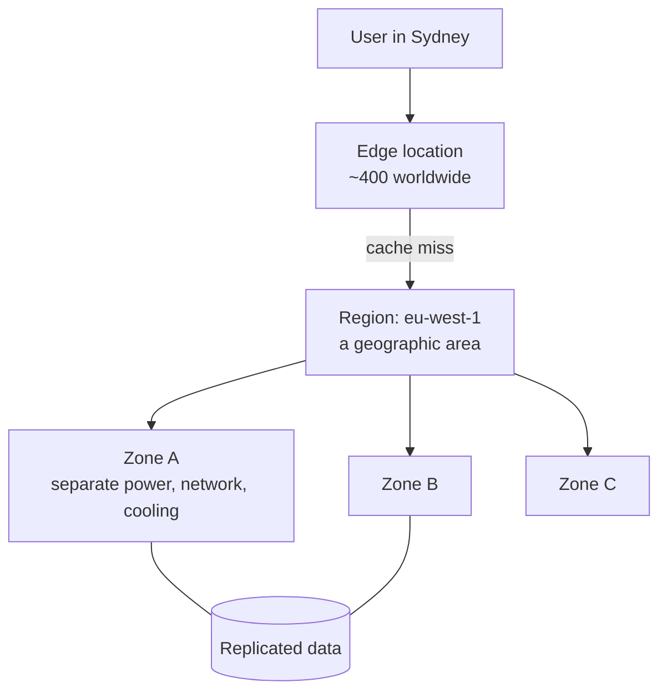
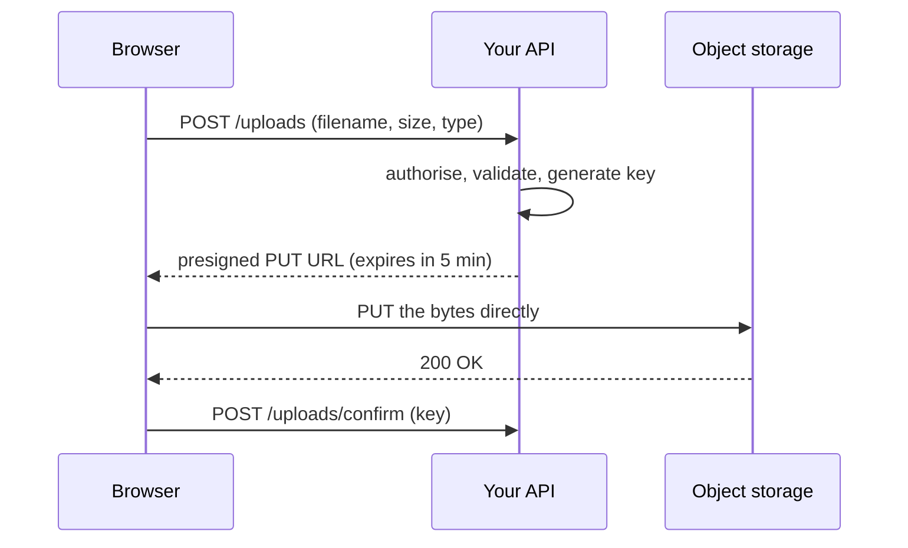

# Cloud-এর মূল কথা, Storage ও Delivery {#ch-cloud-fundamentals}

> যেকোনো provider-এর service-এর তালিকাকে চারটি মৌলিক উপাদান হিসেবে পড়ুন। সেগুলো চালানোর কোন অর্ধেক আপনার, তা বলতে পারুন। আর user-এর file এমনভাবে serve করুন, যাতে byte-গুলো আপনার server-এর ভেতর দিয়ে না যায়।

**এই অধ্যায়ে:** চারটি মৌলিক উপাদান আর সেগুলো কোথায় চলে · managed service-এর মই আর shared responsibility-র সীমারেখা · object storage আর presigned upload · bucket-এর সামনে একটি CDN · cache key, header আর invalidation

## 💡 মূল ধারণা

Cloud provider আপনাকে চারটি জিনিস ভাড়া দেয়: code চালানোর জায়গা, byte রাখার জায়গা, এ দুটির মাঝে network,
আর কে কী করতে পারবে তা বলার উপায়। Console-এর প্রতিটি service এই চারটির একটি। বদলায় শুধু _চালানোর কতটা দায়িত্ব
আপনার_। নাম আলাদা, কিন্তু মৌলিক উপাদান একই।

Interviewer-রা নামের চেয়ে মৌলিক উপাদান নিয়েই বেশি মাথা ঘামান। "User-এর upload কীভাবে serve করবেন?" প্রশ্নে চাওয়া
হয় object storage, signed URL আর তার সামনে একটি cache। কাঠামোটা সোজা: আপনার application কখনো byte বহন করে না।
Application শুধু অল্প সময়ের জন্য বৈধ URL দেয়, আর browser সরাসরি storage-এর সঙ্গে কথা বলে। এরপর সবাইকে serve করে
CDN (user-এর কাছাকাছি থাকা cache)। আপনার server-গুলো megabyte বহন করে না, শুধু অনুমতির সিদ্ধান্ত নেয়।

## কীভাবে কাজ করে

### চারটি মৌলিক উপাদান

| উপাদান    | কী ভাড়া নিচ্ছেন                         | মোটামুটি কী নামে ডাকা হয়                                      |
| ------------ | ------------------------------------- | ------------------------------------------------------------ |
| **Compute**  | অন্যের CPU, সেকেন্ড হিসেবে             | EC2 · Lambda · Cloud Run · Azure Functions · Vercel Functions |
| **Storage**  | HTTP API-র পেছনে টেকসই byte            | S3 · Cloud Storage · Azure Blob · R2 · Vercel Blob            |
| **Network**  | Routing, load balancing, edge caching | CloudFront · Cloud CDN · Front Door · Cloudflare              |
| **Identity** | কে কী call করতে পারবে, কোন key দিয়ে     | IAM · Cloud IAM · Entra ID                                    |

Managed database হলো compute আর storage একসঙ্গে বিক্রি করা। এটা দাম ঠিক করার সিদ্ধান্ত, পঞ্চম কোনো উপাদান নয়।

### ভূগোল: region, zone, edge



**Request কীভাবে আপনার data-য় পৌঁছায়: হয় edge serve করে, নয়তো region।**

| স্তর      | কোন ব্যর্থতা সামলায়              | আপনি কী করবেন                                         |
| ---------- | -------------------------------- | ---------------------------------------------------- |
| **Zone**   | একটি data centre-এর বিদ্যুৎ চলে যাওয়া | দুই বা তার বেশি zone-এ চালান — সাধারণত শুধু একটি checkbox |
| **Region** | পুরো একটি ভৌগোলিক এলাকা অচল হওয়া  | দ্বিতীয় একটি region, replicate করা data, আর সত্যিকারের DR plan |
| **Edge**   | কিছুই না — এটা cache মাত্র          | কিছুই না। এটা latency-র জন্য, availability-র জন্য নয় |

বেশিরভাগ team-এর দরকার multi-zone, multi-region নয়। Multi-region খরচ দ্বিগুণ করে, আর প্রতিটি write-কে
distributed-systems সমস্যা বানিয়ে ফেলে।

### Managed service-এর মই

একই application পাঁচটি উচ্চতায় চলতে পারে: virtual machine, container service, managed runtime, function, বা managed
product। মইয়ের প্রতিটি ধাপ ওপরে উঠলে চালানোর আরও বেশি অংশ provider-এর হাতে যায়: আগে OS, তারপর runtime, তারপর scaling।
সঙ্গে আপনার নিয়ন্ত্রণও আরও কমে। Billing-ও বদলায়: চালু থাকার সময়ের জন্য টাকা দেওয়া থেকে প্রতিটি invocation বা ব্যবহারের
জন্য টাকা দেওয়া।

> ⚠️ ধাপ বদলালে বদলায় _কে ঠিক করবে_, কিন্তু _দায় কার_ তা কখনো বদলায় না। Managed database-এর connection ফুরিয়ে গেলে
> outage তবু আপনার, pager আপনার, customer-ও আপনার।

### Shared responsibility-র সীমারেখা

Provider সুরক্ষিত রাখে **cloud-টা**: ভবন, hardware, hypervisor, আর তার managed service-গুলোর ভেতরের অংশ। আপনি সুরক্ষিত
রাখেন **তার ভেতরে যা রেখেছেন**: আপনার data, access control, code, আর যে operating system নিজের হাতে রাখার সিদ্ধান্ত
নিয়েছেন। মইয়ের প্রতিটি ধাপেই দুটি জিনিস আপনার থাকে, আর সত্যিকারের প্রায় সব breach ঘটে এখানেই:

- **আপনার data** — কী classify করবেন, encrypt করবেন, কতদিন রাখবেন, কখন মুছবেন
- **আপনার access control** — কার হাতে কোন key, আর সেটা কতটা সীমিত

### Identity: যে অংশে একজন frontend-heavy engineer হাত দেন

Identity হলো policy-র তালিকা: কোন principal (একজন user, একটি role বা একটি service) কোন resource-এর ওপর কোন action
করতে পারবে। তিনটি অভ্যাসেই আপনাকে যা জিজ্ঞেস করা হবে তার বেশিরভাগ ঢাকা পড়ে:

- **দীর্ঘস্থায়ী key নয়, role।** Deploy pipeline বা function একটি role নেয়, আর পায় এমন session যার মেয়াদ ফুরায়।
  CI-তে paste করা key টিকে থাকে, যতদিন না কারও চোখে পড়ে।
- **Least privilege।** Upload API একটি bucket-এ `users/*`-এর নিচে `PutObject` করতে পারবে। পড়তে, মুছতে বা কিছুর তালিকা
  দেখতে পারবে না।
- **প্রতিটি environment-এর জন্য একটি account।** Production নিজের account-এ থাকলে development-এর কোনো ভুল সেখানে পৌঁছাতে
  পারে না। Bill-ও team অনুযায়ী ভাগ হয়ে যায়, এমন কোনো tagging নিয়মের দরকার পড়ে না যা কেউ মেনে চলে না।

### Object storage: bucket, key আর object

Object storage হলো বড় blob রাখার টেকসই key-value store, যাতে HTTP দিয়ে পৌঁছানো যায়। **Bucket** হলো পাত্রটা, একটি
region-এ বাঁধা। **Key** হলো object-এর পুরো পরিচয়, যেমন `users/42/avatar.png`। **Object** হলো byte, সঙ্গে metadata:
content type, cache header আর tag।

Key **দেখতে** path-এর মতো, কিন্তু path নয়। Keyspace সমতল, আর `/` সাধারণ একটা অক্ষর, যাকে tool-গুলো folder হিসেবে
এঁকে দেখায়। "একটি folder"-এর তালিকা দেখা মানে আসলে prefix scan, যা একবারে 1,000টি key করে পাতা উল্টায়। Prefix
যত বড় হয়, এটা তত ধীর হয়।
তালিকা দেখার ওপর কখনো কোনো feature দাঁড় করাবেন না।

> ⚠️ Object storage-এ আংশিক write নেই, append-ও নেই। হয় পুরো object বদলে দেবেন, নয়তো হাত দেবেন না। যা জায়গায় বসে
> edit হয়, তার জায়গা database-এ, bucket-এ নয়।

### Upload-এর পথ

সাদামাটা design-এ file যায় আপনার application server-এর ভেতর দিয়ে। তখন 200 MB-র upload আপনার 200 MB bandwidth,
memory আর request timeout খেয়ে ফেলে। ভালো design দেয় একটি **presigned URL**। এটা সাধারণ storage URL, সঙ্গে
signature, যা কয়েক মিনিটের জন্য একটি key-তে একটিমাত্র কাজের অনুমতি দেয়।



**Byte-গুলো কখনো আপনার server ছোঁয় না; ছোঁয় শুধু অনুমতির সিদ্ধান্তটা।**

**Presigned upload URL দেওয়া (AWS SDK for JavaScript v3):**

```typescript
import { S3Client, PutObjectCommand } from "@aws-sdk/client-s3";
import { getSignedUrl } from "@aws-sdk/s3-request-presigner";

const s3 = new S3Client({ region: "eu-west-1" });

interface UploadTicket { url: string; key: string; expiresIn: number }

export async function createUploadTicket(userId: string, contentType: string): Promise<UploadTicket> {
  // The server chooses the key. Never let the client name its own — that is how one user
  // overwrites another user's avatar.
  const key = `users/${userId}/${crypto.randomUUID()}`;

  const url = await getSignedUrl(
    s3,
    new PutObjectCommand({
      Bucket: "app-user-uploads",
      Key: key,
      ContentType: contentType, // signed in, so the browser cannot upload something else
    }),
    { expiresIn: 300 },
  );

  return { url, key, expiresIn: 300 };
}
```

Private download-ও একইভাবে কাজ করে। একটি file-এর জন্য অল্প সময়ের `GET` sign করুন। একসঙ্গে পুরো একগুচ্ছ file পড়ার
সুযোগ দিতে হলে signed **cookie** ব্যবহার করুন, যেমন একটি video-র manifest আর তার segment-গুলো।

### Bucket-এর সামনে একটি CDN

Edge কীভাবে route করে আর কী কী বোঝা নামিয়ে নেয়, তা আছে [Chapter ?? — Content Delivery Network](#ch-cdn)-এ। এখানে প্রশ্ন
হলো, আপনি কী configure করবেন, আর প্রতিটি setting-এর মালিক কে। প্রতিটি miss-এর দাম একটি origin request। সেই region-এর পরের
প্রতিটি user-কে serve করা হয় edge থেকে।

**Origin।** এমনভাবে আটকে দিন যাতে শুধু CDN-ই সেটা পড়তে পারে। Bucket সবার জন্য পড়ার মতো খোলা থাকলে user-রা সরাসরি URL
খুঁজে পান, cache এড়িয়ে যান, আর আপনার signed-URL-এর নিয়মও এড়িয়ে যান। প্রতিটি provider-এর origin-only একটি ব্যবস্থা
আছে, যেমন origin access control, signed origin request, বা shared secret header। একটি চালু করুন, আর public read
বন্ধ করুন।

**Cache key।** Edge প্রতিটি response কোনো key-এর নিচে রাখে। যা কিছু ওই key-তে ঢুকতে দেবেন, copy-র সংখ্যা তত গুণ বাড়বে।
আর প্রতিটি বাড়তি copy মানে আরও একটি miss। Path আর `Accept-Encoding` সবসময় রাখুন। Query parameter রাখুন শুধু সেগুলো, যা
response বদলায়। Asset-এর জন্য cookie বাদ দিন। Key-তে একটিমাত্র session cookie থাকলেই hit শূন্য।

**Cache header — কোন জিনিস কতক্ষণ থাকবে, origin তা ঠিক করে application code-এ:**

```typescript
// A content-hashed asset: the filename changes when the bytes change, so it can be cached forever.
const immutableAsset = { "cache-control": "public, max-age=31536000, immutable" };

// An HTML page or API response: the browser revalidates, the CDN serves it for 60 seconds,
// and for 5 minutes after that it serves stale while it refreshes in the background.
const page = { "cache-control": "public, max-age=0, s-maxage=60, stale-while-revalidate=300" };

// Anything user-specific must never reach a shared cache.
const dashboard = { "cache-control": "private, no-store" };
```

`max-age` browser-এর জন্য। `s-maxage` shared cache-এর জন্য, আর সেখানে এটা `max-age`-কে ছাপিয়ে যায়।
`stale-while-revalidate` মেয়াদ শেষের মুহূর্তের latency spike দূর করে: edge পুরনো copy থেকে উত্তর দেয়, আর request-এর
পেছনে পেছনে refresh করে নেয়।

**Invalidation।** Purge করা ধীর, আর সাধারণত গুনে গুনে টাকা নেওয়া হয়। এটা eventually consistent-ও: একেক edge একেক সময়ে
ধরে ফেলে। Deploy-এর সময় "সব invalidate করো" দিলে cache খালি হয়ে যায়, আর origin-এ request-এর বন্যা নামে। তার বদলে URL
বদলান। `app.7f3c9a.js`-এর মতো hash করা filename থাকলে নতুন build নতুন URL চায়, আর পুরনো copy আর কেউ চায় না। Short TTL
(time to live) বা purge লাগে শুধু ছোট্ট HTML entry point-এর।

## কখন ব্যবহার করবেন

**Region বাছাই:**

| প্রশ্ন                                | উত্তর যদি হয়…                           | তাহলে                                               |
| --------------------------------------- | ------------------------------------------- | -------------------------------------------------- |
| User-রা কোথায়?                    | এক মহাদেশেই কেন্দ্রীভূত               | সেই মহাদেশ বাছুন, বাকিদের জন্য edge-এ cache করুন |
| Data কি ব্যক্তিগত বা নিয়ন্ত্রিত?      | হ্যাঁ, GDPR বা কোনো residency নিয়মের আওতায়         | Residency জেতে — latency এটাকে ছাপাতে পারে না      |
| Workload-এর কি বিশেষ কোনো service লাগে? | হ্যাঁ                                         | আগে দেখে নিন পাওয়া যায় কি না; সব region-এ থাকে না  |
| Workload-এ কি খরচটাই মুখ্য?         | হ্যাঁ, আর latency-তে আপত্তি নেই (batch, archive) | সবচেয়ে সস্তা region-ও ঠিক উত্তর               |

**ধাপ বাছাই:** কাজ চলে এমন সবচেয়ে উঁচু ধাপ থেকে শুরু করুন। নিচে নামুন শুধু তখনই, যখন সুনির্দিষ্ট কিছু আটকে দেয়, যেমন
এমন একটি runtime যা platform-এ নেই।

**Data কোথায় থাকবে:** upload, image, video আর export যায় object storage-এ। Build output যায় CDN-এর পেছনে object storage-এ,
hash করা আর চিরকালের জন্য cache করা। যে record query করেন, তার জায়গা database-এ। আর ব্যক্তিভেদে আলাদা যেকোনো কিছু থাকে
origin-এ, `private` cache header-সহ।

## সাধারণ ভুল

❌ **মাত্র একটি availability zone-এ deploy করা।** দ্বিতীয় zone-এর খরচ সামান্য, আর availability-তে এর চেয়ে বড় লাভ আর
নেই। ✅ অন্তত দুটিতে চালান।

❌ **অভ্যাসবশে region বাছা।** `us-east-1` tutorial-এর default, আর residency নিয়ম থাকা ইউরোপীয় product-এর জন্য ভুল উত্তর।
✅ আগে user, তারপর আইন, তারপর দাম দেখে বাছুন।

❌ **রোজকার কাজে root account বা দীর্ঘস্থায়ী key ব্যবহার করা।** Policy দিয়ে root-কে সীমিত করা যায় না। আক্রমণকারী সবার
আগে এই credential-ই খোঁজে। ✅ মেয়াদ ফুরানো session-সহ সীমিত role ব্যবহার করুন।

❌ **Upload application-এর ভেতর দিয়ে proxy করা।** এতে bandwidth আর memory পোড়ে, আর বড় file-এ ভেঙে পড়ে। ✅ Presign
করুন, browser-কে সরাসরি upload করতে দিন, তারপর নিশ্চিত করুন।

❌ **সব cookie আর query string origin-এ পাঠিয়ে দেওয়া।** প্রতিটি আলাদা value নিজের cache entry হয়ে যায়, আর hit rate ধসে
পড়ে। ✅ রাখুন শুধু সেটুকু, যা response বদলায়।

❌ **ব্যক্তিভেদে আলাদা response-এ `s-maxage` দেওয়া।** CDN একজন user-এর dashboard পরের জনের হাতে তুলে দেয়। ✅ Login-এর
পেছনের সবকিছুর জন্য `private, no-store`।

## 🔑 মূল শিক্ষা

- প্রতিটি cloud service হয় compute, storage, network, নয়তো identity, কোনো এক মাত্রার managed অবস্থায় বিক্রি করা।
- Zone একটি data centre-এর ব্যর্থতা সামলায়, region একটি ভৌগোলিক এলাকার, আর edge কিছুই সামলায় না।
- Managed service-এর মই বদলায় কে ঠিক করবে, দায় কার তা কখনো নয়; data আর access control আপনারই থাকে।
- Upload presign করুন, যাতে byte browser থেকে সরাসরি storage-এ যায়, আর আপনার server শুধু অনুমতির সিদ্ধান্ত নেয়।
- Origin শুধু CDN-এর জন্য খোলা রাখুন, cache key ছোট রাখুন, আর invalidate না করে filename hash করুন।

## Interview-এর প্রশ্ন

**Q: Region আর availability zone-এর মধ্যে তফাত কী?**

Region মানে একটি ভৌগোলিক এলাকা। Zone তার ভেতরের এক বা একাধিক data centre, যাদের বিদ্যুৎ, cooling আর network আলাদা, কিন্তু
দ্রুত replication-এর মতো কাছাকাছি। কয়েকটি zone-এ ছড়িয়ে রাখলে একটি data centre অচল হওয়া থেকে রক্ষা পাওয়া যায়, খরচও
কম। কয়েকটি region-এ ছড়াতে গেলে সবকিছুর দ্বিতীয় copy লাগে, সঙ্গে আসে consistency-র সমস্যা।

**Q: কোনো provider-এর নাম না নিয়ে shared responsibility model বুঝিয়ে বলুন।**

Provider সুরক্ষিত রাখে যা provider নিজে চালায়: ভবন, hardware, network আর managed service-এর ভেতরের অংশ। আপনি সুরক্ষিত রাখেন
যা তার ওপর বসিয়েছেন: data, identity আর access, application code, আর যে OS নিজের হাতে রেখেছেন। Service কতটা managed,
তার সঙ্গে সীমারেখা সরে। কিন্তু data আর access control কখনো সীমা পেরিয়ে ওপারে যায় না।

**Q: কখন managed service ব্যবহার করবেন না?**

যখন আপনার যা দরকার, সেটা ওই service পারে না। যেমন: এমন runtime যা support করে না, এমন process যা একটি request শেষ হওয়ার
পরেও চলে, বা এমন compliance নিয়ম যাতে দেখানোর মতো isolation লাগে। খরচ যতটা শক্ত কারণ মনে হয়, ততটা নয়। নিজে চালাতে
engineer-দের যে সময় লাগে, managed-এর দাম সাধারণত তার চেয়ে কম। ব্যতিক্রম হলো বড়, স্থির আর আগে থেকে বোঝা যায় এমন workload।

**Q: একটি web application-এ user-এর file upload কীভাবে সামলাবেন?**

Browser API-র কাছে অনুমতি চায়। API user-কে authorise করে, server-এই key বানায়, আর কয়েক মিনিটে মেয়াদ ফুরায় এমন
presigned URL ফেরত দেয়। Browser সরাসরি storage-এ upload করে, তারপর key-টা নিশ্চিত করে, যাতে API সেটা লিখে রাখতে পারে।
Upload-এর আকার আর timeout-এর সমস্যা থাকে না, আর signature কাজটাকে একটি key-তেই সীমিত রাখে।

**Q: Deploy-এর পরে user-রা পুরনো JavaScript পাচ্ছেন। কী ভুল হয়েছে, আর কীভাবে ঠিক করবেন?**

সম্ভাব্য কারণ দুটি। হয় asset-এর filename বদলায়নি, তাই edge এখনো পুরনো byte serve করছে। নয়তো যে HTML সেগুলোর reference
দেয়, সেটা খুব বেশিক্ষণ cache হচ্ছে। Asset-এর filename-এ content-এর hash বসান, যাতে প্রতিটি build নতুন URL বানায়, আর
সেগুলো চিরকালের জন্য cache করুন। HTML-কে ছোট `s-maxage` দিন, আর purge করুন শুধু এটাকেই।

## এরপর কী পড়বেন

- [Chapter ?? — Serverless Function](#ch-serverless-functions) — বেশিরভাগ frontend-heavy team যে ধাপে থাকে
- [Chapter ?? — Content Delivery Network](#ch-cdn) — edge কীভাবে route করে, বোঝা নামায় আর origin-কে আড়াল করে
- [Chapter ?? — Platform Deploy ও Preview Environment](#ch-platform-deploys) — একটি deploy তার সামনে cache হওয়া সবকিছুর কী করে
