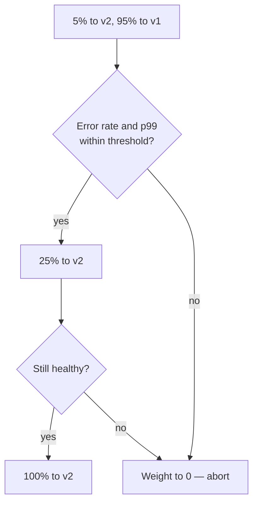

# Deployment Strategy, Rollback ও Feature Flag {#ch-deployment-strategies}

> একটি release-এর জন্য rolling, blue/green, canary আর feature flag-এর মধ্যে বেছে নিন। আর আগে থেকেই জানুন, এর কোন অংশ আর ফিরিয়ে নেওয়া যাবে না।

**এই অধ্যায়ে:** rolling, blue/green আর canary, আর প্রতিটির খরচ · feature flag দিয়ে deploy বনাম release · flag-এর ধরন আর flag debt · expand/contract আর একমুখী দরজা · rollback, নাকি fix forward

## 💡 মূল ধারণা

প্রতিটি deployment strategy আসলে একটি প্রশ্নের উত্তর দেয়: **নতুন version ভাঙা, তা টের পাওয়ার আগে কতজন user সেটা দেখবেন?**
Rolling-এর উত্তর: ক্রমশ বাড়তে থাকা অংশ। Blue/green-এর উত্তর: সবাই একসঙ্গে, তবে পুরনো version তখনো চলছে, তাই ফেরার
পথ শুধু pointer উল্টে দেওয়া। Canary-র উত্তর: পাঁচ শতাংশ, মেপে মেপে। ছোট blast radius (খারাপ release কত ভাগ user-এর
ক্ষতি করতে পারে) কিনতে হয় টাকা আর সময় দিয়ে। Interviewer এই লেনদেনটাই শুনতে চান।

Feature flag উত্তর দেয় অন্য প্রশ্নের। Strategy-গুলো server-এর মধ্যে **code** সরায়। Flag ঠিক করে প্রতিটি user-এর
জন্য **আচরণ**, এমন code-এর ভেতরে যা আগেই সব জায়গায় deploy হয়ে আছে। এতে **deploy** করা, engineering-এর ঘটনা, আর
**release** করা, product-এর ঘটনা, আলাদা হয়ে যায়।

বাকি অর্ধেক হলো ফেরার পথ, আর seniority ধরা পড়ে এখানেই। Rollback করা সহজ। **Rollback কী ফেরাতে পারবে না, সেটা জানাই
কঠিন অংশ।** Domain-কে আগের build-এর দিকে নতুন করে তাক করতে কয়েক সেকেন্ড লাগে। কিন্তু তাতে migration উল্টে যায় না,
পাঠানো email ফেরত আসে না, queue থেকে নেওয়া message-ও আবার queue-তে ফেরে না।

## কীভাবে কাজ করে

| Strategy         | Downtime  | বাড়তি খরচ           | Rollback                       | Blast radius      |
| ---------------- | --------- | -------------------- | ------------------------------ | ----------------- |
| **Recreate**     | ❌ হ্যাঁ     | নেই                 | আবার deploy — ধীর                 | সব user         |
| **Rolling**      | ✅ নেই    | সামান্য                | উল্টো দিকে roll — ধীর             | বাড়তে থাকা অংশ     |
| **Blue/green**   | ✅ নেই    | Deploy চলার সময় 2× | Pointer উল্টে দেওয়া — কয়েক সেকেন্ড      | সব user একসঙ্গে |
| **Canary**       | ✅ নেই    | সামান্য                | Weight শূন্যে নামানো — কয়েক সেকেন্ড  | Canary-র অংশ  |
| **Feature flag** | ✅ নেই    | Flag service       | Config বদল — কয়েক সেকেন্ড         | বেছে নেওয়া user      |

**Recreate** সবকিছু থামায়, তারপর নতুন version চালু করে। Batch job-এর জন্য চলে, user-এর সামনের কোনো service-এর জন্য কখনো
নয়। **Rolling** একবারে কয়েকটি করে instance বদলায়, আর Kubernetes ও ECS-এ এটাই default। বাড়তি কোনো infrastructure লাগে
না। কিন্তু roll চলার সময় দুটি version-ই traffic serve করে, তাই API-কে backward compatible হতে হয়। আর rollback মানে আরেকটি
ধীর roll।

**এমন rolling update, যা কখনো পূর্ণ capacity-র নিচে নামে না:**

```yaml
spec:
  replicas: 4
  strategy:
    type: RollingUpdate
    rollingUpdate:
      maxSurge: 1 # one extra pod above replicas during the roll
      maxUnavailable: 0 # never drop below 4 healthy pods
```

মানুষ `maxUnavailable: 0` দিতে ভুলে যায়। 25%-এর default deploy-এর মাঝপথে আপনার capacity-র এক-চতুর্থাংশ সরিয়ে দেয়।
Traffic-এর চূড়ার সময় এতে deploy নিজেই incident হয়ে দাঁড়ায়। Readiness probe (pod serve করতে পারে কি না তার একটি পরীক্ষা)-ও
সমান জরুরি। এটা না থাকলে traffic pod-এ পৌঁছায় container চালু হওয়ার মুহূর্তে, application serve করার মতো তৈরি হওয়ার পরে
নয়।

### Blue/green

দুটি পূর্ণ environment চালান, আর সব traffic একসঙ্গে সরিয়ে দিন। একটি traffic serve করে, অন্যটি rollback। বদলটা
configuration-এর এক লাইন: load balancer-এর target group, 0/100-এ উল্টে দেওয়া weighted DNS record, বা নতুন করে তাক করা
function alias। একে বেছে নেওয়ার কারণ instant rollback, কারণ পুরনো environment তখনো warm। খরচ দুটি। Deploy চলার সময়
দ্বিগুণ infrastructure-এর টাকা দিতে হয়। আর সব user একসঙ্গে সরে যান, তাই সূক্ষ্ম কোনো bug সঙ্গে সঙ্গে 100% traffic-এ
পৌঁছায়। Database, session store আর cache সবার ভাগের, এগুলোর দ্বিতীয় copy বানানো যায় না। Blue/green কঠিন হয়ে ওঠে এখানেই।

### Canary

Traffic-এর ছোট অংশ নতুন version-এ পাঠান, মাপুন, তারপর বাড়ান।

**প্রতিটি ধাপের মাঝের gate-ই একে ধীর rolling update না বানিয়ে canary বানায়:**



Canary-র blast radius সবচেয়ে ছোট, আর এটা আসল production traffic-এ পরীক্ষা করে, যা কোনো staging environment করে না। আবার
এটাই সবচেয়ে ধীর strategy। এর জন্য এমন metrics লাগে, যা দেখে সিদ্ধান্ত নেওয়া যায়: error rate, p99 latency, saturation,
আর checkout শেষ করার হারের মতো কোনো business metric।

> ⚠️ স্বয়ংক্রিয় বিশ্লেষণ ছাড়া canary আসলে বাড়তি কয়েকটি ধাপসহ ধীর rolling update। প্রতিটি ধাপকে আগের release-এর
> সঙ্গে তুলনা করুন, আর নিজে থেকেই abort করুন। কারণ ব্যর্থতা দেখা দেয় মানুষ নজর রাখা বন্ধ করার পরে।

## কখন ব্যবহার করবেন

| পরিস্থিতি                               | বেছে নিন                   | কেন                                            |
| --------------------------------------- | ------------------------ | ---------------------------------------------- |
| ভেতরের tool, downtime চলে       | Recreate                 | সবচেয়ে সহজ আর সবচেয়ে সস্তা                           |
| সাধারণ stateless service               | Rolling                  | আগে থেকেই আছে, বাড়তি infrastructure লাগে না               |
| Rollback-এর গতিই সবচেয়ে জরুরি              | Blue/green               | পুরনো environment তখনো চলছে            |
| বেশি traffic, ঝুঁকিপূর্ণ পরিবর্তন           | Canary                   | সবচেয়ে ছোট blast radius, মেপে মেপে                 |
| কয়েকটি sprint জুড়ে চলা feature       | Trunk-এ release flag    | দীর্ঘস্থায়ী branch নেই, কষ্টের merge-ও নেই       |
| চালু logic-এ ঝুঁকিপূর্ণ পরিবর্তন           | Feature flag আর canary | নিরাপদ build-এর ওপর প্রতিটি user-এর নিয়ন্ত্রণ         |
| এমন dependency, যা ধীরে ধীরে fail করতে পারে        | Kill switch              | সবচেয়ে দ্রুত প্রতিকার, deploy ছাড়াই     |
| এক লাইনের copy বদল                   | ❌ Flag নয়                | পরিবর্তনের চেয়ে flag-এর খরচ বেশি             |

## Feature flag — deploy বনাম release

Feature flag হলো **runtime-এর switch, যা ঠিক করে একটি request কোন code path-এ যাবে।** দুটি path-ই প্রতিটি server-এ
deploy করা থাকে, আর flag একটি বেছে নেয়। অসমাপ্ত feature তিন সপ্তাহ `main`-এ বসে থাকতে পারে, কোনো দীর্ঘস্থায়ী branch
ছাড়াই। Trunk-based development (সবাই ঘনঘন ছোট ছোট পরিবর্তন `main`-এ merge করে) এভাবেই চালানো সম্ভব হয়। খারাপ
feature কয়েক সেকেন্ডে বন্ধ করে দিতে পারেন এমন কেউ, যিনি engineering rota-তে নেই।

**নিরাপদ default-সহ flag evaluation:**

```typescript
interface EvaluationContext {
  userId: string;
  plan: "free" | "pro" | "enterprise";
}

interface FlagClient {
  /** Never throws. On any failure it returns the supplied default. */
  boolean(key: string, defaultValue: boolean, ctx: EvaluationContext): boolean;
}

function checkoutFlow(client: FlagClient, ctx: EvaluationContext): CheckoutFlow {
  // The default is the safe path. If the flag service is unreachable, users get the old flow.
  const useNewFlow: boolean = client.boolean("checkout-rewrite", false, ctx);
  return useNewFlow ? newCheckout(ctx) : legacyCheckout(ctx);
}
```

বেশিরভাগ মূল্য বহন করে দুটি খুঁটিনাটি। **Default হলো নিরাপদ path, আর evaluation কখনো throw করে না**, তাই flag service
অচল হলে হারায় শুধু একটি feature, পুরো site নয়। **Evaluation context নেয়**, তাই flag আগে staff-দের লক্ষ্য করতে পারে,
শতাংশ ধরে ছড়াতে পারে, বা experiment চালাতে পারে।

**Flag হলো এমন rollback, যার জন্য deploy লাগে না।** বন্ধ করা মানে configuration বদল, কয়েক সেকেন্ডের ব্যাপার। একে canary-র
সঙ্গে ব্যবহার করুন, canary-র বদলে নয়। Canary যাচাই করে **build**: memory leak নেই, ভাঙা dependency নেই, latency-র
অবনতি নেই। Flag যাচাই করে **feature**। Server-এ evaluate করুন, যাতে HTML ঠিকঠাক অবস্থায় পৌঁছায়। Browser-এ করলে page
উল্টে যায়, আর সেটা layout shift হিসেবে গোনা হয়।

> ⚠️ Cache করা page আর user-ভিত্তিক flag একসঙ্গে মানে correctness bug। হয় flag-এর value cache key-তে রাখুন, নয়তো
> response cache-ই করবেন না।

### Flag-এর চারটি ধরন

Code-এ দেখতে একই রকম, কিন্তু আয়ু একেবারে আলাদা। এদের গুলিয়ে ফেলা থেকেই flag debt শুরু হয়।

| ধরন            | কতদিন থাকে              | মালিক কে     | উদাহরণ                                         |
| --------------- | ---------------------- | --------------- | ----------------------------------------------- |
| **Release**     | কয়েক দিন থেকে কয়েক সপ্তাহ          | Engineering     | আধা-বানানো checkout শেষ না হওয়া পর্যন্ত লুকিয়ে রাখা      |
| **Kill switch** | চিরকাল            | On-call         | Recommendation-এর service ধীর হলে সেটা বন্ধ করা |
| **Experiment**  | Test যতদিন চলে | Product বা data | দুটি pricing page-এর A/B test                       |
| **Permission**  | চিরকাল            | Product         | শুধু Enterprise-এর জন্য audit log                        |

**Debt শুধু release flag।** Kill switch চিরকাল থাকার জন্যই বানানো। Permission flag আসলে entitlement, আর তার জায়গা
domain model-এ। এগুলোকে পরিষ্কার করার তালিকায় ফেললে রাত তিনটায় যে switch-টা চাইবেন, সেটাই মুছে ফেলবেন।

### Flag debt

সমস্যা কখনো প্রথম flag নয়। সমস্যা চল্লিশতমটা, যার নাম কেউ বলতে পারে না।

**Flag-এর ভেতরে flag path-এর সংখ্যা গুণ করে বাড়ায়; বরং একবারেই সিদ্ধান্ত নিন:**

```typescript
// ❌ Nested release flags. Four code paths, two of which nobody has ever run.
if (flags.newCheckout) {
  if (flags.newPaymentProvider) { /* ... */ } else { /* ... */ }
} else {
  if (flags.newPaymentProvider) { /* ... */ } else { /* ... */ }
}

// ✅ One decision, made once, at the edge of the module.
type CheckoutVariant = "legacy" | "rewrite";
const variant: CheckoutVariant = flags.newCheckout ? "rewrite" : "legacy";
```

- **প্রতিটি release flag তৈরির সময়েই মেয়াদের তারিখ দিন**, আর তারিখ পেরোলে build fail করান। Warning সবাই
  উপেক্ষা করে; লাল build কেউ করে না।
- **Flag পরীক্ষা করুন প্রতিটি request-এ একবার, handler-এর একদম শুরুতে**, যাতে একই request-এর দুই অর্ধেক ভিন্নমত না হয়।
- **যে sprint-এ feature ship হয়, সেই sprint-এই flag সরিয়ে ফেলুন**, backlog-এর কোনো ticket-এ ফেলে রাখবেন না।

> ⚠️ **যা বদলাতে থাকে:** flag vendor আর তাদের SDK ঘনঘন চেহারা বদলায়। OpenFeature হলো vendor-নিরপেক্ষ interface, যা এখন
> বেশিরভাগ vendor implement করে। টেকসই নীতি: **vendor-কে আপনার নিজের সরু interface-এর পেছনে মুড়ে রাখুন**, যাতে
> provider বদলানো মানে একটি file বদলানো, আর test-এ সাধারণ object দিলেই চলে।

## Expand/contract — আসল কঠিন অংশ

Schema-র পরিবর্তন backward compatible না হলে downtime-হীন প্রতিটি strategy ভেঙে পড়ে, কারণ দুটি version একসঙ্গে চলে।
Rollback-এর পথ খোলা রাখে এই expand/contract-ই।

❌ **ভাঙে — এটা apply হওয়ার মুহূর্তেই পুরনো version crash করে:**

```sql
ALTER TABLE users RENAME COLUMN email TO email_address;
```

✅ **Expand/contract, চারটি release-এ:** `email_address` যোগ করুন আর `email` রেখে দিন, এমন code-সহ যা দুটিতেই লেখে আর
পুরনোটা থেকে পড়ে। বিদ্যমান row-গুলো batch-এ batch-এ backfill করুন। এমন code deploy করুন, যা নতুন column থেকে পড়ে।
Rollback window বন্ধ হওয়ার পরে, পরের কোনো release-এ `email` drop করুন। Nullable column সরাসরি যোগ করা নিরাপদ।
Postgres-এ নতুন index write আটকে দেয়, যদি না `CREATE INDEX CONCURRENTLY` ব্যবহার করেন।

**নিয়মটা হলো:** deploy করা release-কে পুরনো আর নতুন দুটি schema-তেই কাজ করতে হবে, নইলে rollback করা যাবে না। Migration
চালান আলাদা, স্পষ্ট ধাপ হিসেবে, deploy-এর সময় নিজে থেকে নয়। তাহলে schema না সরিয়েই code পিছিয়ে যেতে পারে। এখানে
flag কোনো কাজে আসে না: flag বদলায় কোন code চলবে, কিন্তু drop করা column ফিরিয়ে আনতে পারে না।

## একমুখী দরজা

একমুখী দরজা হলো এমন পরিবর্তন, যা code rollback দিয়ে উল্টানো যায় না। Release-এর আগেই এগুলোর নাম বলুন।

| পরিবর্তন                         | Rollback-এর পরে টেকে?              | বরং যা করবেন                               |
| ------------------------------ | ------------------------------- | ------------------------------------------------ |
| Drop করা column বা table         | ❌ Data শেষ                  | Expand/contract — এক release পরে drop করুন            |
| Queue থেকে নেওয়া message   | ❌ আগেই acknowledge হয়ে গেছে          | Dead-letter queue আর replay                     |
| পাঠানো email বা webhook           | ❌ বেরিয়ে গেছে                   | Idempotency key, আর flag-এর পেছনে পাঠানোর gate   |
| Third-party-র কাছে তৈরি record      | ❌ তাদের system-এ আছে        | Idempotency key, যাতে retry duplicate না বানায়    |
| লম্বা `max-age`-সহ cache করা asset    | মেয়াদ শেষ না হওয়া পর্যন্ত serve হয়         | Content-hash করা filename; HTML-এ ছোট `s-maxage` |

**Rollback-এর গতি deployment model-এর বিষয়, incident response-এর নয়।** Pager বাজতে থাকার সময় এটা যোগ করা যায় না।
Pointer উল্টানো, target group বদলানো আর flag toggle করতে কয়েক সেকেন্ড লাগে। পুরনো image tag আবার deploy করতে লাগে
কয়েক মিনিট। আর migration-এর কোনো স্বয়ংক্রিয় উল্টো পথই নেই।

## Rollback, নাকি fix forward

দুটিই বৈধ। Fix forward (পিছিয়ে না গিয়ে নতুন fix ship করা) করুন দুটি ক্ষেত্রে। প্রথমটি একমুখী দরজা, কারণ rollback
করলে data আর code-এর মধ্যে অমিল থেকে যাবে। দ্বিতীয়টি হলো যখন কারণ জানেন, আর fix আরও দ্রুত ship হবে। বাকি সব ক্ষেত্রে
rollback করুন।
✅ **আগে rollback, পরে রোগ নির্ণয়।** খারাপ build immutable, আর নিজের URL-এ এখনো আছে, তাই পরে reproduce করতে পারবেন।

## সাধারণ ভুল

❌ **Database কী করছে তা না দেখে strategy বাছা।** ভাঙার মতো migration-সহ blue/green মানে downtime-হীন নয়। মানে দুটি
environment-সহ downtime।
✅ আগে migration-এর ক্রম ঠিক করুন, তারপর strategy বাছুন।

❌ **Flag-এর default value নতুন আচরণ।** Flag service timeout হয়, আর প্রতিটি user অপ্রকাশিত path পেয়ে যান।
✅ Default সবসময় নিরাপদ, বর্তমান আচরণ।

❌ **Test চলে শুধু default flag value দিয়ে।**
✅ প্রতিটি চালু release flag-এর দুটি path-ই test করুন। নইলে flag যাদের জন্য চালু হয়, তাদের কাছে test না করা branch
ship করছেন।

## 🔑 মূল শিক্ষা

- প্রতিটি strategy ছোট blast radius-এর বদলে খরচ আর জটিলতা নেয়, তাই সংজ্ঞা নয়, লেনদেনটার কথা বলুন।
- স্বয়ংক্রিয় metric বিশ্লেষণ ছাড়া canary স্রেফ ধীর rolling update।
- Feature flag code deploy করা আর feature release করাকে আলাদা করে, আর flag বন্ধ করা মানে deploy ছাড়াই rollback।
- Debt শুধু release flag; প্রতিটিকে মেয়াদের তারিখ দিন, আর kill switch বা permission flag কখনো পরিষ্কার করবেন না।
- Rollback আপনার code ফিরিয়ে আনে, তার পার্শ্বপ্রতিক্রিয়া নয়, তাই প্রতিটি release-কে পুরনো আর নতুন দুটি schema-তেই কাজ করতে হবে।

## Interview-এর প্রশ্ন

**Q: Blue/green আর canary-র তফাত বুঝিয়ে বলুন।**

Blue/green দুটি পূর্ণ environment চালায়, আর সব traffic একসঙ্গে সরিয়ে দেয়, সাধারণত load balancer-এর target group বা DNS
weight দিয়ে। এতে instant rollback পাওয়া যায়, দাম হলো দ্বিগুণ infrastructure, আর সব user একসঙ্গে নতুন version-এর মুখোমুখি
হন। Canary traffic-এর ছোট অংশ সরায়, error rate আর latency মাপে, তারপর বাড়ায়। এতে blast radius ছোট থাকে, দাম হলো
সময়, আর এমন metrics যা দেখে স্বয়ংক্রিয়ভাবে সিদ্ধান্ত নেওয়া যায়।

**Q: দশ মিনিট আগে আপনার deploy বেরিয়েছে, আর error বাড়ছে। ধাপে ধাপে বলুন কী করবেন।**

আগে rollback, যদি না release-এ এমন কোনো schema পরিবর্তন থাকে যা পুরনো code পড়তে পারে না। আগের build-এর দিকে আবার তাক
করতে কয়েক সেকেন্ড লাগে, আর খারাপ build debug করার জন্য হাতে থেকে যায়। তারপর দেখুন release এমন কী করেছে, যা rollback
উল্টায় না: migration, নেওয়া message, পাঠানো email, third-party record। আসল incident ওগুলোই। User-দের ব্যর্থতা থামার পরে
আসে রোগ নির্ণয়।

**Q: পরিবর্তনে schema migration থাকলে downtime-হীন deployment কীভাবে করবেন?**

Expand আর contract, আলাদা আলাদা release-এ। প্রথমে শুধু যোগ করার পরিবর্তনটা, যা চালু version উপেক্ষা করে। তারপর এমন code,
যা দুই জায়গাতেই লেখে আর পুরনোটা থেকে পড়ে, সঙ্গে batch-এ batch-এ backfill। তারপর এমন code, যা নতুন জায়গা থেকে পড়ে। আর
অনেক পরের কোনো release পুরনো column drop করে। Deploy করা প্রতিটি version-কে দুটি schema-তেই কাজ করতে হবে।

**Q: Canary deployment আর feature flag-এর মধ্যে তফাত কী?**

Canary নিয়ন্ত্রণ করে কোন **instance** traffic serve করবে, তাই এটা build যাচাই করে: memory leak নেই, latency-র অবনতি নেই।
Flag নিয়ন্ত্রণ করে কোন **user** নতুন আচরণ দেখবেন। এটা প্রতিটি request-এ evaluate হয়, আগেই সব জায়গায় deploy করা code-এর
ভেতরে। তাই flag feature যাচাই করে, আর নিখুঁতভাবে লক্ষ্য ঠিক করতে দেয়। Flag আরও দ্রুত rollback করে, কারণ বন্ধ করা মানে
configuration বদল। দুটি একে অন্যের পরিপূরক, বিকল্প নয়।

**Q: কখন জেনেশুনে বড় blast radius-এর strategy বেছে নেবেন?**

যখন exposure-এর চেয়ে rollback-এর গতি বেশি জরুরি, আর সেটাই blue/green-এর ক্ষেত্র: এমন পরিবর্তন, যার ওপর আপনার আস্থা
আছে, কিন্তু কয়েক সেকেন্ডে উল্টাতে হতে পারে, যেমন কেনাকাটার মৌসুমের চূড়ায় release। Canary ওই ঝুঁকিকে মিশ্র fleet-এর
এক ঘণ্টা জুড়ে ছড়িয়ে দেবে। আরেকটি ক্ষেত্র হলো protocol বা serialisation-এর পরিবর্তন, যেখানে fleet-এ দুটি version থাকাটাই
ব্যর্থতা।

## এরপর কী পড়বেন

- [Chapter ?? — Platform Deploy ও Preview Environment](#ch-platform-deploys) — pointer উল্টানো যে artefact model-এর ওপর নির্ভর করে
- [Chapter ?? — Metrics, Dashboard ও Alerting](#ch-metrics-and-dashboards) — যে signal বলে দেয় rollback দরকার
- [Chapter ?? — Branching, Review ও Repository Strategy](#ch-branching-and-review-workflow) — release flag যে trunk-based workflow সম্ভব করে
