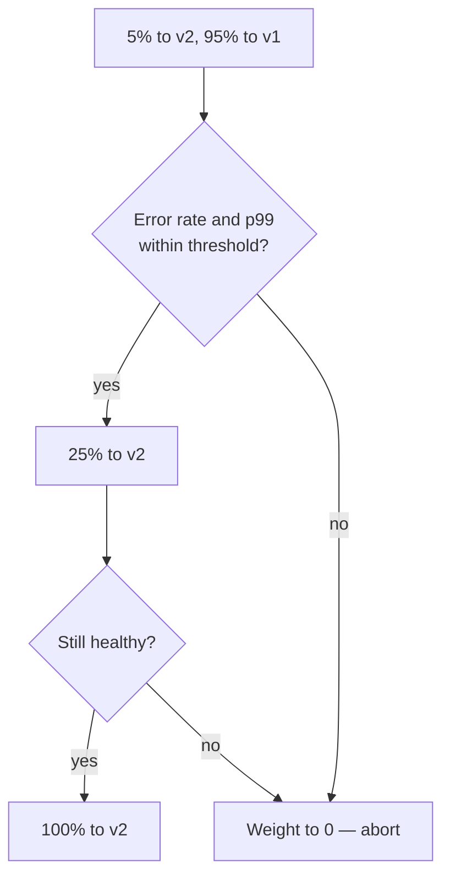

# Deployment Strategy, Rollback ও Feature Flag {#ch-deployment-strategies}

> একটি release-এর জন্য rolling, blue/green, canary আর feature flag-এর মধ্যে বাছাই করুন, আর আগে থেকেই জানুন এর কোন অংশ ফিরিয়ে আনা যাবে না।

**এই অধ্যায়ে:** rolling, blue/green আর canary, আর প্রতিটির খরচ · feature flag দিয়ে deploy বনাম release · flag-এর ধরন আর flag debt · expand/contract আর একমুখী দরজা · rollback নাকি fix forward

## 💡 মূল ধারণা

প্রতিটি deployment strategy একটি প্রশ্নের উত্তর দেয়: **নতুন version ভাঙা কি না তা জানার আগে কতজন user সেটা দেখেন?**
Rolling বলে, একটি বাড়তে থাকা অংশ। Blue/green বলে, সবাই একসঙ্গে, কিন্তু পুরোনো version তখনো চলে, তাই ফেরার পথ হলো
একটি pointer উল্টে দেওয়া। Canary বলে, পাঁচ শতাংশ, মেপে মেপে। আপনি টাকা আর সময় দিয়ে একটি ছোট blast radius (একটি
খারাপ release user-দের যে অংশের ক্ষতি করতে পারে) কেনেন। Interviewer এই trade-টাই উত্তর হিসেবে চান।

একটি feature flag অন্য একটি প্রশ্নের উত্তর দেয়। Strategy-গুলো server-এর মধ্যে **code** সরায়। একটি flag প্রতি
user-এর জন্য **behaviour** ঠিক করে, এমন code-এর ভেতরে যেটা আগে থেকেই সব জায়গায় deploy করা। এটা **deploy** করাকে,
অর্থাৎ একটি engineering ঘটনাকে, **release** করা থেকে, অর্থাৎ একটি product ঘটনা থেকে, আলাদা করে।

বাকি অর্ধেক হলো ফেরার পথ, আর seniority এখানেই বোঝা যায়। Rollback করা সহজ। **একটি rollback কী ফিরিয়ে আনবে না, তা
জানাটাই কঠিন অংশ।** একটি domain-কে আগের build-এর দিকে তাক করতে কয়েক সেকেন্ড লাগে। এটা একটি চালানো migration
ফেরায় না, পাঠানো email ফেরায় না, বা consume করা queue message ফেরায় না।

## কীভাবে কাজ করে

| Strategy         | Downtime  | বাড়তি খরচ               | Rollback                          | Blast radius          |
| ---------------- | --------- | ---------------------- | --------------------------------- | --------------------- |
| **Recreate**     | ❌ হ্যাঁ    | নেই                     | Redeploy — ধীর                     | সব user               |
| **Rolling**      | ✅ নেই     | কম                      | Roll forward — ধীর                 | বাড়তে থাকা অংশ          |
| **Blue/green**   | ✅ নেই     | Deploy-এর সময় 2×        | Pointer উল্টে দিন — কয়েক সেকেন্ড      | সব user একসঙ্গে         |
| **Canary**       | ✅ নেই     | কম                      | Weight শূন্যে নামান — কয়েক সেকেন্ড    | Canary-র অংশ            |
| **Feature flag** | ✅ নেই     | একটি flag service        | Config বদল — কয়েক সেকেন্ড           | বাছাই করা user          |

**Recreate** সবকিছু বন্ধ করে, তারপর নতুন version শুরু করে। এটা batch job-এর জন্য মানানসই, user-এর সামনের কোনো
service-এর জন্য কখনো নয়। **Rolling** একবারে কয়েকটি করে instance replace করে, আর Kubernetes ও ECS-এ এটাই default।
এর জন্য বাড়তি কোনো infrastructure লাগে না। কিন্তু roll চলার সময় দুটো version-ই traffic serve করে, তাই API-কে
backward compatible হতে হবে, আর rollback মানে আরেকটি ধীর roll।

**একটি rolling update, যেটা কখনো পূর্ণ capacity-র নিচে নামে না:**

```yaml
spec:
  replicas: 4
  strategy:
    type: RollingUpdate
    rollingUpdate:
      maxSurge: 1 # one extra pod above replicas during the roll
      maxUnavailable: 0 # never drop below 4 healthy pods
```

মানুষ `maxUnavailable: 0` ভুলে যায়। 25%-এর default deploy-এর মাঝখানে আপনার capacity-র এক চতুর্থাংশ সরিয়ে দেয়।
Peak traffic-এর সময় এটা একটি deploy-কে incident বানিয়ে ফেলে। একটি readiness probe (pod serve করতে পারে কি না তার
একটি check)-ও সমান জরুরি। এটা না থাকলে traffic একটি pod-এ পৌঁছায় container শুরু হওয়ার সময়, application serve
করতে পারার সময় নয়।

### Blue/green

দুটো সম্পূর্ণ environment চালান আর সব traffic একসঙ্গে switch করুন। একটি traffic serve করে, অন্যটি rollback।
Switch হলো configuration-এর একটি line: একটি load balancer-এর target group, 0/100-এ উল্টে দেওয়া weighted DNS record,
বা নতুন করে তাক করা একটি function alias। এটা বাছার কারণ হলো instant rollback, কারণ পুরোনো environment তখনো warm।
খরচ দুটো। Deploy-এর সময় আপনি দ্বিগুণ infrastructure-এর টাকা দেন। আর প্রতিটি user একসঙ্গে সরে যান, তাই একটি সূক্ষ্ম
bug সঙ্গে সঙ্গে traffic-এর 100%-এ পৌঁছায়। Database, session store আর cache shared, এগুলোর duplicate করা যায় না।
Blue/green এখানেই কঠিন হয়ে ওঠে।

### Canary

Traffic-এর একটি ছোট অংশ নতুন version-এ পাঠান, মাপুন, তারপর বাড়ান।

**প্রতিটি ধাপের মাঝের gate-ই এটাকে ধীর rolling update না বানিয়ে canary বানায়:**



Canary-র blast radius সবচেয়ে ছোট, আর এটা আসল production traffic-এর বিরুদ্ধে test করে, যা কোনো staging environment
করে না। এটা সবচেয়ে ধীর strategy-ও। এর জন্য সিদ্ধান্ত নেওয়ার মতো ভালো metrics দরকার: error rate, p99 latency,
saturation, আর checkout completion-এর মতো একটি business metric।

> ⚠️ স্বয়ংক্রিয় analysis ছাড়া একটি canary হলো বাড়তি ধাপসহ একটি ধীর rolling update। প্রতিটি ধাপকে আগের release-এর
> সঙ্গে তুলনা করুন আর স্বয়ংক্রিয়ভাবে abort করুন, কারণ failure দেখা দেয় মানুষ নজর রাখা বন্ধ করার পরে।

## কখন ব্যবহার করবেন

| পরিস্থিতি                                   | বাছুন                      | কেন                                              |
| ----------------------------------------- | ------------------------ | ------------------------------------------------ |
| Internal tool, downtime চলে                 | Recreate                 | সবচেয়ে সহজ আর সস্তা                                |
| সাধারণ stateless service                    | Rolling                  | Built in, বাড়তি infrastructure নেই                  |
| Rollback-এর গতিই সবচেয়ে গুরুত্বপূর্ণ             | Blue/green               | পুরোনো environment তখনো চলছে                        |
| বেশি traffic, বেশি ঝুঁকির পরিবর্তন               | Canary                   | সবচেয়ে ছোট blast radius, মাপা                       |
| কয়েকটি sprint জুড়ে একটি feature              | Trunk-এ release flag      | দীর্ঘস্থায়ী branch নেই, কষ্টকর merge নেই              |
| বিদ্যমান logic-এ ঝুঁকিপূর্ণ পরিবর্তন              | Feature flag আর canary    | একটি নিরাপদ build-এর ওপর প্রতি-user control          |
| এমন dependency যেটা ধীরে ধীরে fail করতে পারে    | Kill switch              | সবচেয়ে দ্রুত সামলানোর উপায়, কোনো deploy ছাড়াই         |
| এক line-এর copy বদল                        | ❌ Flag নয়                | পরিবর্তনের চেয়ে flag-এর খরচ বেশি                     |

## Feature Flag — Deploy বনাম Release

একটি feature flag হলো **একটি runtime switch, যেটা ঠিক করে একটি request কোন code path নেবে।** দুটো path-ই প্রতিটি
server-এ deploy করা থাকে, আর flag একটি বেছে নেয়। একটি অসমাপ্ত feature কোনো দীর্ঘস্থায়ী branch ছাড়াই তিন সপ্তাহ
`main`-এ বসে থাকতে পারে। এটাই trunk-based development (সবাই প্রায়ই ছোট ছোট পরিবর্তন `main`-এ merge করে)-কে কার্যকর
করে। একটি খারাপ feature কয়েক সেকেন্ডে বন্ধ করে দিতে পারেন এমন কেউ, যিনি engineering rota-য় নেই।

**নিরাপদ default-সহ একটি flag evaluation:**

```typescript
interface EvaluationContext {
  userId: string;
  plan: "free" | "pro" | "enterprise";
}

interface FlagClient {
  /** Never throws. On any failure it returns the supplied default. */
  boolean(key: string, defaultValue: boolean, ctx: EvaluationContext): boolean;
}

function checkoutFlow(client: FlagClient, ctx: EvaluationContext): CheckoutFlow {
  // The default is the safe path. If the flag service is unreachable, users get the old flow.
  const useNewFlow: boolean = client.boolean("checkout-rewrite", false, ctx);
  return useNewFlow ? newCheckout(ctx) : legacyCheckout(ctx);
}
```

দুটো খুঁটিনাটি বেশিরভাগ মূল্য বহন করে। **Default হলো নিরাপদ path, আর evaluation কখনো throw করে না**, তাই flag
service-এর outage-এ একটি feature হারায়, site নয়। **Evaluation একটি context নেয়**, তাই flag আগে staff-কে target করতে
পারে, শতাংশ ধরে rollout করতে পারে, বা একটি experiment চালাতে পারে।

**Flag হলো সেই rollback, যার জন্য deploy লাগে না।** এটা বন্ধ করা একটি configuration বদল, সেকেন্ডে মাপা হয়। এটা
canary-র সঙ্গে ব্যবহার করুন, canary-র বদলে নয়। Canary **build** যাচাই করে: memory leak নেই, ভাঙা dependency নেই,
latency regression নেই। Flag **feature** যাচাই করে। এটা server-এ evaluate করুন, যাতে HTML ঠিক অবস্থায় আসে।
Browser-এ করলে page উল্টে যায়, আর সেটা layout shift হিসেবে গণ্য হয়।

> ⚠️ একটি cached page আর একটি প্রতি-user flag মিলে একটি correctness bug। হয় flag-এর value cache key-তে রাখুন, নয়তো
> response একেবারেই cache করবেন না।

### Flag-এর চারটি ধরন

Code-এ এগুলো দেখতে একই রকম, কিন্তু আয়ু খুব আলাদা। এদের গুলিয়ে ফেলা থেকেই flag debt শুরু হয়।

| ধরন             | কতদিন থাকে             | মালিক কে          | উদাহরণ                                                |
| --------------- | ---------------------- | --------------- | ---------------------------------------------------- |
| **Release**     | কয়েক দিন থেকে কয়েক সপ্তাহ | Engineering     | আধা-বানানো checkout শেষ না হওয়া পর্যন্ত লুকিয়ে রাখা        |
| **Kill switch** | স্থায়ীভাবে               | On-call         | Recommendation-এর service ধীর হলে সেটা বন্ধ করা          |
| **Experiment**  | Test যতদিন চলে          | Product বা data | দুটো pricing page-এর A/B test                         |
| **Permission**  | স্থায়ীভাবে               | Product         | শুধু enterprise-এর জন্য audit log                      |

**শুধু release flag-ই debt।** একটি kill switch চিরকাল থাকার জন্যই। একটি permission flag আসলে একটি entitlement, আর
এর জায়গা domain model-এ। এগুলোকে clean-up-এর লক্ষ্য হিসেবে ধরলে রাত তিনটায় যে switch-টা আপনার দরকার ছিল, সেটাই
delete করে ফেলবেন।

### Flag debt

সমস্যা কখনো প্রথম flag নয়। সমস্যা চল্লিশতমটি, যেটার নাম কেউ বলতে পারে না।

**Nested flag path-এর সংখ্যা গুণ করে বাড়ায়; তার বদলে একবারেই সিদ্ধান্ত নিন:**

```typescript
// ❌ Nested release flags. Four code paths, two of which nobody has ever run.
if (flags.newCheckout) {
  if (flags.newPaymentProvider) { /* ... */ } else { /* ... */ }
} else {
  if (flags.newPaymentProvider) { /* ... */ } else { /* ... */ }
}

// ✅ One decision, made once, at the edge of the module.
type CheckoutVariant = "legacy" | "rewrite";
const variant: CheckoutVariant = flags.newCheckout ? "rewrite" : "legacy";
```

- **প্রতিটি release flag তৈরির সময়েই একটি মেয়াদ শেষের তারিখ দিন**, আর সেটা পার হলে build fail করান। Warning উপেক্ষা
  করা হয়; লাল build হয় না।
- **প্রতি request-এ একবার, handler-এর একেবারে শুরুতে flag check করুন**, যাতে একটি request-এর দুই অর্ধেক দ্বিমত না করে।
- **যে sprint-এ feature ship হয়, সেই sprint-এই flag সরিয়ে ফেলুন**, backlog-এর কোনো ticket-এ নয়।

> ⚠️ **যা বদলাতে থাকে:** flag vendor আর তাদের SDK প্রায়ই আকার বদলায়। OpenFeature হলো vendor-নিরপেক্ষ interface, যেটা
> এখন বেশিরভাগই implement করে। টেকসই নীতি: **vendor-কে আপনার নিজের একটি সংকীর্ণ interface-এর পেছনে wrap করুন**, যাতে
> provider বদলানো একটি file-এর কাজ হয় আর test একটি সাধারণ object পাঠাতে পারে।

## Expand/Contract — আসল কঠিন অংশ

Schema-র পরিবর্তন backward compatible না হলে প্রতিটি zero-downtime strategy ভেঙে পড়ে, কারণ দুটো version একসঙ্গে চলে।
Expand/contract-ই rollback-কে হাতের নাগালে রাখে।

❌ **ভাঙে — এটা apply হওয়ার মুহূর্তেই পুরোনো version crash করে:**

```sql
ALTER TABLE users RENAME COLUMN email TO email_address;
```

✅ **চারটি release জুড়ে expand/contract:** `email_address` যোগ করুন আর `email` রেখে দিন, এমন code-সহ যেটা দুটোতেই
write করে আর পুরোনোটা read করে। বিদ্যমান row-গুলো batch-এ backfill করুন। নতুন column read করে এমন code deploy
করুন। পরের কোনো release-এ, rollback window বন্ধ হওয়ার পরে, `email` drop করুন। একটি nullable column সরাসরি যোগ করা
নিরাপদ। Postgres-এ একটি নতুন index write আটকে দেয়, যদি না আপনি `CREATE INDEX CONCURRENTLY` ব্যবহার করেন।

**নিয়ম:** deploy করা release-কে পুরোনো আর নতুন দুটো schema-র সঙ্গেই কাজ করতে হবে, নইলে আপনি rollback করতে পারবেন না।
Migration-কে একটি আলাদা, স্পষ্ট ধাপ হিসেবে চালান, deploy-এর সময় স্বয়ংক্রিয়ভাবে নয়, যাতে schema না সরিয়েই code
পেছনে সরতে পারে। Flag এখানে সাহায্য করতে পারে না: এটা বদলায় কোন code চলবে, কিন্তু drop করা column ফেরত আনতে পারে না।

## একমুখী দরজা

একমুখী দরজা হলো এমন একটি পরিবর্তন, যেটা code rollback উল্টাতে পারে না। Release-এর আগেই এগুলোর নাম বলুন।

| পরিবর্তন                         | Rollback-এর পরেও টিকে থাকে?          | তার বদলে কী করবেন                                  |
| ------------------------------- | -------------------------------- | ------------------------------------------------ |
| Drop করা column বা table         | ❌ Data চলে গেছে                    | Expand/contract — এক release পরে drop করুন          |
| Queue থেকে consume করা message    | ❌ আগেই acknowledge হয়ে গেছে          | Dead-letter queue আর replay                        |
| পাঠানো email বা webhook           | ❌ এটা চলে গেছে                      | Idempotency key, আর একটি flag-এর পেছনে send gate     |
| Third-party-তে তৈরি record         | ❌ তাদের system-এ আছে                | Idempotency key, যাতে retry duplicate না করে        |
| Cached asset, দীর্ঘ `max-age`     | Expire না হওয়া পর্যন্ত serve হয়        | Content-hashed filename; HTML-এ ছোট `s-maxage`     |

**Rollback-এর গতি deployment model-এর বিষয়, incident response-এর নয়।** Pager বাজার সময় এটা যোগ করা যায় না। একটি
pointer উল্টে দেওয়া, একটি target-group switch আর একটি flag toggle কয়েক সেকেন্ড নেয়। একটি পুরোনো image tag আবার
deploy করতে কয়েক মিনিট লাগে। একটি migration-এর কোনো স্বয়ংক্রিয় উল্টো পথই নেই।

## Rollback নাকি Fix Forward

দুটোই বৈধ। দুটো ক্ষেত্রে fix forward (পেছনে না গিয়ে নতুন একটি fix ship করা) করুন। প্রথমটি একমুখী দরজা, কারণ
rollback করলে data আর code-এর মধ্যে অমিল থেকে যাবে। দ্বিতীয়টি, যখন আপনি কারণ জানেন আর fix দ্রুত ship হবে। নইলে
rollback করুন।
✅ **আগে rollback, পরে diagnose।** খারাপ build immutable আর তখনো নিজের URL-এ আছে, তাই পরে সেটা reproduce করা যায়।

## সাধারণ ভুল

❌ **Database কী করছে তা না দেখেই strategy বাছাই করা।** ভাঙনকারী migration-সহ blue/green zero downtime নয়। এটা দুটো
environment-সহ downtime।
✅ আগে migration-এর ক্রম ঠিক করুন, তারপর strategy বাছুন।

❌ **Flag-এর default value হলো নতুন behaviour।** Flag service timeout হয়, আর প্রতিটি user unreleased path পান।
✅ Default সবসময় নিরাপদ, বর্তমান behaviour।

❌ **Test শুধু default flag value দিয়ে চলে।**
✅ প্রতিটি চালু release flag-এর দুটো path-ই test করুন, নইলে যার জন্য এটা চালু হয়, তার কাছে একটি untested branch
ship করবেন।

## 🔑 মূল শিক্ষা

- প্রতিটি strategy ছোট blast radius-এর বিনিময়ে খরচ আর জটিলতা দেয়, তাই সংজ্ঞা নয়, trade-টির নাম বলুন।
- স্বয়ংক্রিয় metric analysis ছাড়া একটি canary শুধুই একটি ধীর rolling update।
- একটি feature flag code deploy করা আর feature release করাকে আলাদা করে, আর এটা বন্ধ করা এমন একটি rollback যার জন্য deploy লাগে না।
- শুধু release flag-ই debt; প্রতিটিকে একটি মেয়াদ শেষের তারিখ দিন, আর কখনো kill switch বা permission flag clean up করবেন না।
- একটি rollback আপনার code ফিরিয়ে আনে, এর side effect নয়, তাই প্রতিটি release-কে পুরোনো আর নতুন schema-র সঙ্গে কাজ করতে হবে।

## Interview-এর প্রশ্ন

**Q: Blue/green বনাম canary ব্যাখ্যা করুন।**

Blue/green দুটো সম্পূর্ণ environment চালায় আর সব traffic একসঙ্গে switch করে, সাধারণত একটি load balancer target group
বা একটি DNS weight দিয়ে। এটা instant rollback কেনে, দ্বিগুণ infrastructure আর প্রতিটি user একসঙ্গে নতুন version-এর
মুখোমুখি হওয়ার দামে। Canary traffic-এর একটি ছোট অংশ সরায়, error rate আর latency মাপে, তারপর বাড়ায়। এটা একটি ছোট
blast radius কেনে, সময় আর স্বয়ংক্রিয়ভাবে সিদ্ধান্ত নেওয়ার মতো ভালো metrics-এর দামে।

**Q: আপনার deploy দশ মিনিট আগে বের হয়েছে, আর error বাড়ছে। আপনি কী করবেন, ধাপে ধাপে বলুন।**

আগে rollback করুন, যদি না release-এ এমন schema পরিবর্তন থাকে যেটা পুরোনো code পড়তে পারে না। আগের build-এর দিকে
নতুন করে তাক করতে কয়েক সেকেন্ড লাগে, আর খারাপ build debug করার জন্য হাতে থাকে। তারপর দেখুন release এমন কী করেছে
যা rollback ফেরায় না: migration, consume করা message, পাঠানো email, third-party record। আসল incident ওগুলোই।
User-দের failure থামার পরে diagnosis আসে।

**Q: পরিবর্তনে একটি schema migration থাকলে zero-downtime deployment কীভাবে করবেন?**

Expand আর contract, আলাদা আলাদা release জুড়ে। প্রথমে শুধু যোগ করার পরিবর্তনটি, যেটা চলমান version উপেক্ষা করে।
তারপর এমন code যেটা দুই জায়গাতেই write করে আর পুরোনোটা read করে, সঙ্গে batch-এ backfill। তারপর এমন code যেটা নতুন
জায়গা read করে, আর শুধু পরে একটি release যেটা পুরোনো column drop করে। Deploy করা প্রতিটি version-কে দুটো schema-র
সঙ্গেই কাজ করতে হবে।

**Q: একটি canary deployment আর একটি feature flag-এর পার্থক্য কী?**

একটি canary নিয়ন্ত্রণ করে কোন **instance** traffic serve করবে, তাই এটা build যাচাই করে: memory leak নেই, latency
regression নেই। একটি flag নিয়ন্ত্রণ করে কোন **user** নতুন behaviour দেখবেন। এটা প্রতি request-এ evaluate হয়, এমন
code-এ যেটা আগে থেকেই সব জায়গায় deploy করা, তাই এটা feature যাচাই করে আর নিখুঁত targeting সম্ভব করে। Flag আরও দ্রুত
rollback হয়, কারণ একটি বন্ধ করা একটি configuration বদল। এরা একে অপরের পরিপূরক, বিকল্প নয়।

**Q: কখন আপনি ইচ্ছা করে বড় blast radius-এর strategy বাছবেন?**

যখন exposure-এর চেয়ে rollback-এর গতি বেশি গুরুত্বপূর্ণ, যেটা blue/green-এর ক্ষেত্র: এমন একটি পরিবর্তন যেটায় আপনি
ভরসা করেন কিন্তু কয়েক সেকেন্ডে ফেরাতে হতে পারে, যেমন retail peak-এর সময় একটি release। Canary সেই ঝুঁকিকে মিশ্র
fleet-এর এক ঘণ্টা জুড়ে ছড়িয়ে দিত। অন্য ক্ষেত্রটি হলো protocol বা serialisation-এর পরিবর্তন, যেখানে fleet-এ দুটো
version থাকাটাই নিজে failure।

## এরপর কী পড়বেন

- [Chapter ?? — Platform Deploy ও Preview Environment](#ch-platform-deploys) — pointer উল্টে দেওয়া যে artefact model-এর ওপর নির্ভর করে
- [Chapter ?? — Metrics, Dashboard ও Alerting](#ch-metrics-and-dashboards) — যে signal আপনাকে বলে rollback দরকার
- [Chapter ?? — Branching, Review ও Repository Strategy](#ch-branching-and-review-workflow) — release flag যে trunk-based workflow সম্ভব করে
