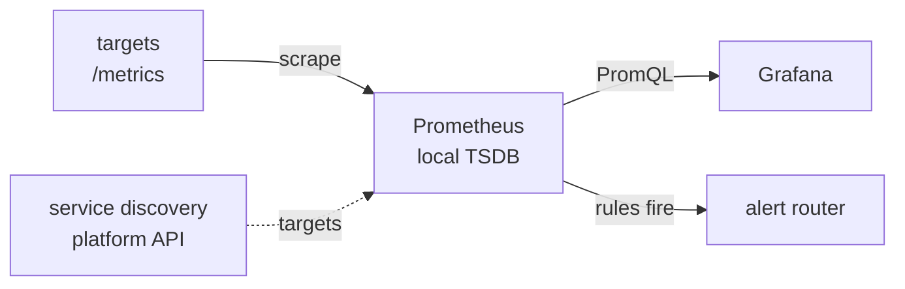

# Metrics, Dashboard ও Alerting {#ch-metrics-and-dashboards}

> এমন query লিখুন যা একটি আসল incident-এর প্রশ্নের উত্তর দেয়, এমন একটি dashboard বানান যার দিকে কেউ রাত তিনটায় হাত বাড়ায়, আর page করুন শুধু তখনই, যখন একজন মানুষকে কিছু করতেই হবে।

**এই অধ্যায়ে:** metric type আর যে query-গুলো গুরুত্বপূর্ণ · percentile আর cardinality · এমন dashboard যা একটি প্রশ্নের উত্তর দেয় · symptom আর burn rate-এর ওপর alert · টেকসই on-call

## 💡 মূল ধারণা

একটি metrics stack তিনটি আলাদা কাজ করে। একটি system সময়ের সঙ্গে সংখ্যা **সংগ্রহ আর store করে**। দ্বিতীয়টি সেগুলো
**query করে আর আঁকে**। তৃতীয়টি **ঠিক করে কখন একজন মানুষকে জাগাতে হবে**। Data-র মালিক collector। Dashboard আর
alert rule শুধু সেটা পড়ে।

বেশিরভাগ team যে collector-এ স্থির হয়, সেটা Prometheus। Grafana হলো আঁকার layer, আর এটা কোনো metric data store করে
না। এ কারণেই একটি dashboard container, database আর log-এর data একই time axis-এ রাখতে পারে। Alert-ও লেখা হয় PromQL-এ
(Prometheus-এর query language), তাই একটি খারাপ query খারাপ graph আর খারাপ page — দুটোই তৈরি করে।

> ⚠️ **যা বদলাতে থাকে:** Prometheus 3.8-এ native histogram stable হয়েছে, আর Grafana-র alerting version 8-এ নতুন করে
> বানানো হয়েছে। টেকসই নীতিগুলো হলো একটি text endpoint থেকে pull-ভিত্তিক সংগ্রহ, cardinality-র সঙ্গে বাড়া storage-এর
> খরচ, আর এমন একটি dashboard যা শুধু একটি client। API-র নাম আর default বদলাবে।

## কীভাবে কাজ করে

**Collector, rule আর alert, আর এদের মধ্যে data কোন দিকে যায়:**



**Prometheus pull করে। এটা receive করে না।** প্রতি interval-এ এটা প্রতিটি target-এর `/metrics` fetch করে আর sample-গুলো
store করে। আসল লাভ হলো, **একটি ব্যর্থ scrape নিজেই একটি signal**: `up` metric শূন্যে নেমে যায়। Push-এ "কোনো data নেই"
মানে হতে পারে একটি মৃত process, একটি ভাঙা collector, বা একটি হারানো packet। Pull তখনই কাজ করে, যখন server জানে কী
scrape করতে হবে, তাই এটা platform-এর API থেকে target **খুঁজে বের করে**।

### Metric Type

| Type | এতে কী থাকে | কীভাবে পড়বেন |
| ---- | ------------- | -------------- |
| **Counter** | একটি মোট সংখ্যা যা শুধু বাড়ে, restart-এ reset হয় | সবসময় `rate()` দিয়ে |
| **Gauge** | একটি value যা ওঠে আর নামে — memory, queue depth | সরাসরি |
| **Histogram** | প্রতিটি latency bucket-এর জন্য cumulative counter, সঙ্গে একটি sum আর একটি count | `histogram_quantile()` দিয়ে |

একটি target এগুলো plain text হিসেবে প্রকাশ করে। `le="0.5"`-এর মতো একটি histogram bucket সেই প্রতিটি request গোনে,
যাতে 0.5 s **বা তার কম** লেগেছে। Percentile হিসাব করা হয় query-র সময় bucket থেকে। এগুলো কখনো store করা হয় না।

❌ `http_requests_total` সরাসরি graph করলে এমন একটি line পাওয়া যায়, যা শুধু ওঠে আর restart-এ শূন্যে নামে।
✅ `rate(http_requests_total[5m])` প্রতি সেকেন্ডে request দেয়, আর reset-টাও সামলায়।

### যে Query-গুলো গুরুত্বপূর্ণ

`rate()`-এর window-কে কমপক্ষে চারটি scrape interval জুড়ে থাকতে হবে। 30 সেকেন্ডের scraping-এ `[1m]` লাফানো output দেয়,
তাই `[5m]` হলো নিরাপদ default।

**Error rate — production-এ সবচেয়ে বেশি ব্যবহৃত query:**

```text
sum(rate(http_requests_total{status=~"5.."}[5m]))
  /
sum(rate(http_requests_total[5m]))
```

হর হলো **মোট**, non-5xx-এর যোগফল নয়। এই অনুপাতের ওপর alert দিন, কখনো raw error count-এর ওপর নয়, কারণ traffic-এর
প্রতিটি স্তরে একটি count-এর মানে আলাদা।

**পুরো fleet জুড়ে p99 latency — আগে bucket-গুলো একসঙ্গে করুন:**

```text
histogram_quantile(0.99,
  sum by (le) (rate(http_request_duration_seconds_bucket[5m]))
)
```

❌ `avg(histogram_quantile(0.99, ...))` — percentile-এর average করলে ভুল সংখ্যা আসে
✅ `histogram_quantile(0.99, sum by (le) (...))` — distribution একসঙ্গে করুন, তারপর quantile চান

**Average নয়, percentile কেন।** 120 ms-এর একটি average একশো জনে একজন ব্যবহারকারীর চার সেকেন্ড অপেক্ষাকে লুকিয়ে
রাখতে পারে। p99 হলো আপনার সবচেয়ে অসন্তুষ্ট নিয়মিত ব্যবহারকারীদের অভিজ্ঞতা, আর তাঁরাই চলে যান।

### Cardinality-ই খরচ

Label value-এর প্রতিটি আলাদা সমন্বয় নিজেই একটি series। প্রতিটি active series-এর index memory-তে থাকে, তাই server-এর
memory ঠিক করে series-এর সংখ্যা, request-এর পরিমাণ নয়। User ID, request ID বা একটি পুরো URL রাখা একটিমাত্র label
একটি metric-কে লক্ষ লক্ষ series-এ পরিণত করে, আর শেষে out-of-memory kill।

জরুরি brake হলো scrape-এর সময় relabelling (label নতুন করে লেখা)। বিস্ফোরিত metric-টি `drop` করুন, নয়তো খারাপ
label-টি `labeldrop` করুন। একটি managed service-এ একই ভুল crash হিসেবে না এসে bill হিসেবে আসে।

### Recording Rule

একটি দামি expression একটি schedule-এ আগে থেকেই হিসাব করে রাখুন, তারপর সস্তা ফলাফলটি query করুন। এটা ব্যবহার করুন যখন
একটি panel ধীর, যখন একটি expression বারবার আসে, বা যখন একটি alert-কে দ্রুত evaluate হতে হবে।

**একটি recording rule, যা dashboard আর alert দুটোই পড়ে:**

```yaml
groups:
  - name: http
    interval: 30s
    rules:
      # Naming convention: level:metric:operation
      - record: job:http_errors:ratio5m
        expr: |
          sum by (job) (rate(http_requests_total{status=~"5.."}[5m]))
            /
          sum by (job) (rate(http_requests_total[5m]))
```

## কখন ব্যবহার করবেন

| প্রশ্ন | Tool | কেন |
| ------------ | -------- | --- |
| "এটা কি এখনই ভাঙা, আর ব্যবহারকারীরা কি ক্ষতিগ্রস্ত?" | একটি page | একজন মানুষকে এখনই কিছু করতে হবে |
| "এটা কি এই সপ্তাহে ভাঙবে?" | একটি warning ticket | জরুরি, কিন্তু রাত তিনটায় নয় |
| "এটা কেন ভাঙা?" | একটি dashboard | অনুসন্ধান আর রোগনির্ণয় |
| "এই একটি request কী করেছিল?" | Log আর trace | Metrics-এ প্রতি request-এর বিস্তারিত থাকে না |

### এমন Dashboard যা একটি প্রশ্নের উত্তর দেয়

একটি dashboard একটি নির্দিষ্ট প্রশ্নের উত্তর দেয়। "সব metrics" কোনোটারই উত্তর দেয় না।

**একটি service overview-এর layout:**

```text
Row 1  SERVICE HEALTH   stat panels: error rate · p99 · RPS · SLO burn
Row 2  GOLDEN SIGNALS   latency percentiles · traffic and errors
Row 3  SATURATION       CPU and memory · pool usage · queue depth
Row 4  DEPENDENCIES     collapsed by default — database · cache · downstream
```

প্রতি service-এ ত্রিশটি নয়, তিনটি dashboard রাখুন: overview, deep-dive আর business metrics। সবচেয়ে গুরুত্বপূর্ণ
panel-টি ওপরে-বাঁয়ে রাখুন। প্রতিটি panel-কে unit আর threshold দিন। বিশটি panel-এর নিচে থাকুন।

**Dashboard হলো code।** UI-তে click করে বানানো একটি dashboard-এর কোনো review নেই, কোনো history নেই, কোনো recovery
নেই। UI-তে বানান, JSON model export করুন, commit করুন, আর provisioning-কে সেটা প্রয়োগ করতে দিন। Panel-এ
`$__rate_interval` ব্যবহার করুন, `$__interval` নয়। Zoom in করলে `$__interval` scrape interval-এর চেয়ে ছোট হয়ে যায়,
আর তাতে একটি **ফাঁকা graph** আসে।

### কোন জিনিস একটি Page-এর যোগ্য

**প্রতিটি page-কে জরুরি, করণীয় আর বাস্তব হতে হবে।** তিনটির একটি না থাকলে সেটা page নয়।

| পরীক্ষা | ব্যর্থ হলে |
| ---- | ----------- |
| **জরুরি** — এখনই ঠিক করতে হবে, আগামীকাল নয় | এটাকে একটি ticket বানান |
| **করণীয়** — একজন মানুষ এ নিয়ে কিছু করতে পারেন | System ঠিক করুন, নয়তো response automate করুন |
| **বাস্তব** — সত্যিই কিছু একটা ভাঙা | Threshold ঠিক করুন, নয়তো alert delete করুন |

Monitoring-এর আসল failure mode হলো alert fatigue, coverage-এর অভাব নয়। একবার একটি team শিখে যায় যে বেশিরভাগ page
শুধু noise, আসল incident-এ সাড়া দেওয়া ধীর হয়ে যায়। কেউ সেটা দেখে না, কারণ dashboard-গুলো তখনও খুঁটিয়ে বানানো দেখায়।
একটি on-call shift-এ মোটামুটি দুটির বেশি page হলে ভাঙা হলো monitoring, system নয়।

**Cause-এর ওপর নয়, symptom-এর ওপর page করুন:**

| ✅ এর ওপর page করুন (ব্যবহারকারী ক্ষতিগ্রস্ত) | ❌ এর ওপর নয় (একটি cause) |
| ------------------------------- | -------------------- |
| SLO budget পুড়িয়ে ফেলা error rate | 90%-এ CPU |
| এক সেকেন্ডের বেশি p99 latency | একটি container restart হয়েছে |
| পাঁচ মিনিটে একটিও সফল login নেই | 80%-এ memory |

ব্যবহারকারীরা খুশি থাকলে বেশি CPU কোনো incident নয়। একটি cause সত্যিই ক্ষতি করলে symptom alert এমনিতেই fire করবে।
Cause metrics-এর জায়গা dashboard আর runbook-এ। রোগনির্ণয়ের জন্য এগুলো দরকার, কাউকে জাগানোর জন্য নয়। শুধু তিনটি
severity রাখুন: **critical** page করে, **warning** একটি ticket খোলে, **info** একটি log-এ যায়।

### Burn-Rate Alerting

একটি স্থির threshold একটি খারাপ পছন্দে বাধ্য করে। ছোট window প্রতিটি সামান্য ওঠানামায় page করে। বড় window একটি আসল
outage ধরতে দেরি করে। Burn-rate alerting নজর রাখে **error budget কত দ্রুত খরচ হচ্ছে** তার ওপর, আর fire করে শুধু
তখনই, যখন একটি ছোট window *আর* একটি বড় window দুটোই সীমা ছাড়ায়।

| Burn rate | Budget খরচ | কতক্ষণের মধ্যে ধরা পড়ে | Severity |
| --------- | --------------- | ------------- | -------- |
| **14.4×** | 1 ঘণ্টায় 2% | 2 মিনিট | Critical — page |
| **3×** | 1 দিনে 10% | 1 ঘণ্টা | Warning — ticket |

**একটি 99.9% SLO-র বিপরীতে একটি fast-burn alert:**

```yaml
# Fast burn — at this rate the whole month's budget is gone in about two days
- alert: ErrorBudgetBurnFast
  expr: |
    (job:http_errors:ratio5m{job="checkout"} > 14.4 * 0.001)
      and
    (job:http_errors:ratio1h{job="checkout"} > 14.4 * 0.001)
  for: 2m
  labels:
    severity: critical
  annotations:
    runbook: "https://runbooks.internal/checkout-errors"
```

ছোট window দ্রুত ধরে। বড়টি নিশ্চিত করে যে সমস্যাটা টানা চলছে। ত্রিশ সেকেন্ডের একটি spike page করে না, কারণ বড়
window নড়েনি। `for` duration একটি খারাপ scrape-এ alert-এর বারবার জ্বলা-নেভা আটকায়। প্রতিটি page বহন করে কী ভাঙা,
threshold-এর তুলনায় value, ব্যবহারকারীর ওপর প্রভাব, একটি runbook link আর ক্ষতিগ্রস্ত service-এ আগে থেকেই filter
করা একটি dashboard link।

### নীরবতার মানে হতে হবে ভাঙা

বাস্তবে alerting-এর সবচেয়ে সাধারণ ব্যর্থতা হলো এমন একটি alarm, যা পুরো একটি outage জুড়ে চুপ ছিল। App নিজে যে counter
পাঠায়, তার ওপর বসানো alarm-এর app মরে গেলে তুলনা করার কিছুই থাকে না। Metric-টি সীমা ছাড়ায় না, বরং অস্তিত্বই হারায়।
দুটি সমাধান, আর আপনার দুটোই দরকার:

- Rule-টি এমনভাবে configure করুন যাতে **data না থাকাটাই সীমা ছাড়ানো** ধরা হয়। Default খুব কমই আপনি যা চান তা।
- **App-এর বাইরে** থাকা কিছুর ওপরও alert দিন: load balancer-এর target health, edge-এ 5xx, বা একটি external
  prober। প্রতিটি instance মরে গেলেও এগুলো report করতে থাকে।

**Inhibition** (একটি বড় alert fire করার সময় অন্য alert-গুলো চুপ করানো) সবচেয়ে বেশি noise কমায়। `ClusterDown` fire
করার সময় এর ভেতরের প্রতিটি critical alert আটকে রাখা হয়।

### On-Call, Runbook আর Incident-পরবর্তী Review

একটি টেকসই rotation-এ কমপক্ষে ছয়জন থাকেন, একজন primary আর একজন secondary, আর escalation হয় resolution-এ নয়,
**acknowledgement**-এ। Handover লিখে রাখা হয়, আর একটি খারাপ রাতের পর ছুটি পাওনা হয়।

> ⚠️ যাঁকে জাগানো হলো, যে alert তাঁকে জাগিয়েছে সেটা delete বা retune করার অধিকার তাঁর থাকতে হবে। সেটা না থাকলে
> noise চিরকাল জমতেই থাকে, কারণ যাঁরা এর কষ্ট ভোগ করেন, তাঁদের কেউই এটা ঠিক করতে পারেন না।

যেকোনো alert-এর সবচেয়ে মূল্যবান field হলো runbook link। রাত তিনটায় কেউ গোড়া থেকে যুক্তি দিয়ে ভাবেন না।

একটি আসল incident-এর পর একটি **blameless** review লিখুন: একটি timeline, প্রভাব, অবদান রাখা কারণগুলো, আর তারিখসহ
মালিকানা দেওয়া কাজের একটি ছোট তালিকা। জিজ্ঞেস করুন "system এটা ঘটতে দিল কেন?", "কে এটা করেছে?" নয়। মাসে একবার,
fire করা প্রতিটি alert review করুন: এটা কি বাস্তব ছিল, করণীয় ছিল, একজন মানুষের দরকার ছিল?

## সাধারণ ভুল

| ভুল | পরিণতি | সমাধান |
| ------- | ----------- | --- |
| প্রতি instance-এর percentile-এর average করা | গাণিতিকভাবে ভুল একটি সংখ্যা | আগে `sum by (le)`, তারপর quantile |
| Label হিসেবে একটি user ID বা পুরো URL | Series বিস্ফোরিত হয়; server-এর memory ফুরিয়ে যায় | এটা log বা trace-এ রাখুন |
| Cause-এর ওপর page করা | অবিরাম noise, উপেক্ষিত page | Symptom-এর ওপর page করুন |
| Data না থাকাকে সুস্থ ধরা | App মরে গেলে নীরব ব্যর্থতা | Data না থাকাটাই সীমা ছাড়ানো |
| কোনো runbook নেই, বা কোনো মালিক team নেই | ধীর সাড়া, তারপর কিছুই ঠিক হয় না | প্রতিটি alert-এ একটি runbook link আর একটি `team` label |

## 🔑 মূল শিক্ষা

- সংগ্রহ, visualisation আর alerting আলাদা কাজ, আর dashboard tool কিছুই store করে না।
- একটি counter `rate()` দিয়ে পড়ুন, আর fleet-এর percentile হিসাব করার আগে histogram bucket-গুলো একসঙ্গে করুন।
- Cardinality একটি metrics server-এর memory আর খরচ ঠিক করে, তাই সীমাহীন value কখনো label হয় না।
- একটি page-কে জরুরি, করণীয় আর বাস্তব হতে হবে, আর এটা fire করবে ব্যবহারকারীর চোখে পড়া symptom-এ, যেমন SLO-র burn
  rate।
- Data না থাকাকে সীমা ছাড়ানো হিসেবে গণ্য করতে হবে, আর যে engineer-কে জাগানো হলো, তাঁকে alert-টি delete করতে পারতে
  হবে।

## Interview-এর প্রশ্ন

**Q: অনেকগুলো instance জুড়ে p99 latency কীভাবে হিসাব করবেন, আর সাধারণ ভুলটা কী?**

আগে histogram bucket-গুলো একসঙ্গে করুন, তারপর quantile হিসাব করুন:
`histogram_quantile(0.99, sum by (le) (rate(..._bucket[5m])))`। `sum by (le)` প্রতিটি bucket-কে instance-গুলো জুড়ে
যোগ করে, তাই quantile আসে একটি সম্মিলিত distribution থেকে। ভুলটা হলো প্রতি instance-এ এটা হিসাব করে average করা,
যা ভুল, কারণ percentile linear নয়।

**Q: একটি metrics server বেশি memory ব্যবহারের জন্য বারবার kill হচ্ছে। কী ঘটছে, আর আপনি কী করবেন?**

Memory traffic নয়, cardinality-কে অনুসরণ করে, কারণ প্রতিটি active series memory-তে index করা থাকে। প্রায় সবসময়
কেউ একজন user ID, request ID বা পুরো URL রাখা একটি label যোগ করেছেন। Scrape-এর সময় relabel করে metric-টি drop
করুন বা label-টি `labeldrop` করুন, তারপর সেই dimension-টি log বা trace-এ সরিয়ে নিন।

**Q: একটি ভালো alert কী দিয়ে তৈরি, আর cause-এর বদলে symptom-এর ওপর alert কেন দেবেন?**

এটা জরুরি, করণীয় আর বাস্তব। যেকোনো একটিতে ব্যর্থ হলে এটা হয় একটি ticket, একটি automation, নয়তো delete করার
জিনিস। Symptom হলো যা ব্যবহারকারীরা অনুভব করেন: error rate, p99, ব্যর্থ login। বেশি CPU-র মতো cause noise তৈরি করে।
ক্ষতিকর একটি cause এমনিতেই symptom হিসেবে দেখা দেয়, তাই cause metrics রোগনির্ণয়ের জন্য dashboard-এ থাকে।

**Q: Burn-rate alerting ব্যাখ্যা করুন।**

এটা একটি স্থির error rate-এর ওপর নয়, error budget কত দ্রুত খরচ হচ্ছে তার ওপর alert দেয়, আর দুটি window check করে।
শুধু ছোট window সামান্য ওঠানামায় page করে। শুধু বড় window ধীর। দুটোই সীমা ছাড়ালে তবেই fire করলে ত্রিশ সেকেন্ডের
spike উপেক্ষিত হয়, কিন্তু টানা চলা একটি ব্যর্থতা কয়েক মিনিটেই ধরা পড়ে। 14.4× burn page করে, আর 3× একটি ticket
খোলে।

**Q: Service পুরোপুরি বন্ধ থাকা সত্ত্বেও একটি alarm কখনো fire করেনি। কেন?**

প্রায় নিশ্চিতভাবে data না থাকার handling। Alarm-টি এমন একটি metric দেখছিল, যা app নিজেই পাঠায়, আর app মরে গেলে
metric-টি সীমা না ছাড়িয়ে উধাও হয়ে গেছে। অনুপস্থিতিকে সীমা ছাড়ানো হিসেবে configure করুন। App-এর বাইরের কিছুর ওপরও
alert দিন: load balancer health, edge-এ 5xx, বা একটি external prober।

**Q: কখন একটি dashboard ভুল tool?**

যখন প্রশ্নটার উত্তর জানা, কারণ তখন এটা একজন মানুষ নজর রাখবেন এমন কিছু না হয়ে একটি alert হওয়া উচিত। Dashboard হলো
অনুসন্ধানের জন্য, আর একটি alert fire করার পর রোগনির্ণয়ের জন্য। অন্য ক্ষেত্রটা হলো শুধু metrics আছে বলেই বানানো একটি
dashboard। ত্রিশটি না-পড়া dashboard coverage-এর ইঙ্গিত দেয়, আর চুপচাপ collector-এর ওপর বোঝা বাড়ায়।

## এরপর কী পড়বেন

- [Chapter ?? — Monitoring ও Observability-র মূল কথা](#ch-monitoring-fundamentals) — যে SLO আর error budget-এর ওপর এই alert-গুলো দাঁড়িয়ে আছে
- [Chapter ?? — Production-এ মাপা](#ch-measuring-in-production) — একই percentile-চিন্তা, আসল ব্যবহারকারীদের browser-এ প্রয়োগ করা
- [Chapter ?? — Deployment Strategy, Rollback ও Feature Flag](#ch-deployment-strategies) — page acknowledge হওয়ার পর কী ঘটে
