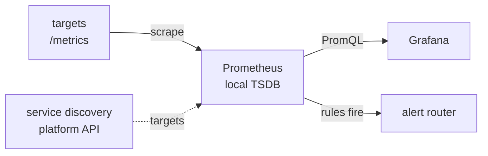

# Metrics, Dashboard ও Alerting {#ch-metrics-and-dashboards}

> এমন query লিখুন যা incident-এর আসল প্রশ্নের উত্তর দেয়। এমন dashboard বানান যা রাত তিনটায় কেউ খুলবে। আর page করুন শুধু তখনই, যখন কোনো মানুষকে কিছু করতেই হবে।

**এই অধ্যায়ে:** metric-এর ধরন আর যে query-গুলো কাজে লাগে · percentile আর cardinality · প্রশ্নের উত্তর দেওয়া dashboard · symptom আর burn rate দেখে alert · টিকে থাকার মতো on-call

## 💡 মূল ধারণা

Metrics stack তিনটি আলাদা কাজ করে। একটা system সময়ের সঙ্গে সংখ্যাগুলো **সংগ্রহ করে আর জমা রাখে**। দ্বিতীয়টি
সেগুলো **query করে আর আঁকে**। তৃতীয়টি **ঠিক করে কখন কোনো মানুষকে ঘুম থেকে তুলতে হবে**। Data-র মালিক collector।
Dashboard আর alert rule শুধু সেটা পড়ে।

বেশিরভাগ team collector হিসেবে Prometheus-কেই মান ধরে নেয়। Grafana আঁকার স্তর, নিজে কোনো metric data রাখে না।
এজন্যই একটি dashboard-এ container, database আর log-এর data একই সময়ের অক্ষে বসানো যায়। Alert-ও লেখা হয় PromQL-এ
(Prometheus-এর query language), তাই খারাপ query থেকে খারাপ graph আর খারাপ page দুটিই আসে।

> ⚠️ **যা বদলাতে থাকে:** Prometheus 3.8-এ native histogram stable হয়েছে, আর Grafana-র alerting version 8-এ নতুন
> করে বানানো হয়েছিল। টেকসই নীতিগুলো হলো: text endpoint থেকে pull করে সংগ্রহ, cardinality-র সঙ্গে বাড়া storage খরচ,
> আর dashboard যে শুধুই একটি client। API-র নাম আর default বদলাবে।

## কীভাবে কাজ করে

**Collector, rule আর alert, আর তাদের মধ্যে data কোন দিকে যায়:**



**Prometheus pull করে, data গ্রহণ করে না।** প্রতি interval-এ প্রতিটি target-এর `/metrics` থেকে data এনে sample-গুলো
জমা রাখে। আসল লাভটা হলো, **scrape fail করাটাই একটি signal**: `up` metric শূন্যে নেমে যায়। Push হলে "data নেই" মানে
মরে যাওয়া process, ভাঙা collector, নাকি হারানো packet, বোঝার উপায় থাকে না। Pull কাজ করে শুধু তখনই, যখন server জানে
কোথা থেকে scrape করবে। তাই platform-এর API থেকে target-গুলো **খুঁজে নেয়**।

### Metric-এর ধরন

| ধরন | কী রাখে | কীভাবে পড়বেন |
| ---- | ------------- | -------------- |
| **Counter** | মোট সংখ্যা, যা শুধু বাড়ে, restart হলে শূন্য হয় | সবসময় `rate()` দিয়ে |
| **Gauge** | এমন value, যা বাড়ে আর কমে, যেমন memory, queue depth | সরাসরি |
| **Histogram** | প্রতিটি latency bucket-এর জমা counter, সঙ্গে sum আর count | `histogram_quantile()` দিয়ে |

Target এগুলো সাধারণ text হিসেবে দেখায়। `le="0.5"`-এর মতো histogram bucket সেই সব request গোনে, যেগুলোতে 0.5 s
**বা তার কম** লেগেছে। Percentile হিসাব হয় query-র সময়, bucket থেকে। কখনো জমা রাখা হয় না।

❌ `http_requests_total` সরাসরি graph-এ বসালে এমন line পাবেন, যা শুধু ওঠে আর restart হলে শূন্যে পড়ে যায়।
✅ `rate(http_requests_total[5m])` দেয় প্রতি সেকেন্ডে request, আর reset-ও সামলায়।

### যে query-গুলো কাজে লাগে

`rate()`-এর window-তে অন্তত চারটি scrape interval থাকতে হবে। 30 সেকেন্ড পরপর scrape হলে `[1m]` এলোমেলো ওঠানামা দেয়,
তাই নিরাপদ default হলো `[5m]`।

**Error rate, production-এ সবচেয়ে বেশি চালানো query:**

```text
sum(rate(http_requests_total{status=~"5.."}[5m]))
  /
sum(rate(http_requests_total[5m]))
```

ভাগের নিচের সংখ্যাটা হলো **মোট**, non-5xx-এর যোগফল নয়। Alert দিন এই অনুপাতের ওপর, কাঁচা error count-এর ওপর কখনো
নয়। কারণ traffic-এর প্রতিটি মাত্রায় একই count-এর মানে আলাদা।

**পুরো fleet জুড়ে p99 latency: আগে bucket যোগ করুন:**

```text
histogram_quantile(0.99,
  sum by (le) (rate(http_request_duration_seconds_bucket[5m]))
)
```

❌ `avg(histogram_quantile(0.99, ...))` — percentile-এর গড় করলে ভুল সংখ্যা আসে
✅ `histogram_quantile(0.99, sum by (le) (...))` — আগে distribution জোড়া লাগান, তারপর quantile চান

**Average নয়, percentile কেন।** 120 ms-এর average লুকিয়ে রাখতে পারে যে প্রতি একশো জনে একজন চার সেকেন্ড অপেক্ষা
করছেন। p99 হলো আপনার সবচেয়ে অসন্তুষ্ট নিয়মিত user-দের অভিজ্ঞতা, আর চলে যান তাঁরাই।

### খরচটা আসে cardinality থেকে

Label value-গুলোর প্রতিটি আলাদা জোড় নিজেই একটি series। প্রতিটি চালু series-এর index থাকে memory-তে। তাই server-এর
memory ঠিক করে series-এর সংখ্যা, request-এর সংখ্যা নয়। User ID, request ID বা পুরো URL রাখা একটি label-ই একটি metric-কে
লাখ লাখ series বানিয়ে দেয়, আর শেষে out-of-memory-তে process মারা পড়ে।

জরুরি brake হলো scrape-এর সময় relabelling (label নতুন করে লেখা)। বিস্ফোরণ ঘটানো metric-টা `drop` করুন, অথবা খারাপ
label-টা `labeldrop` করুন। Managed service-এ একই ভুল crash হয়ে আসে না, আসে bill হয়ে।

### Recording rule

একটি দামি expression নির্দিষ্ট সময় পরপর আগেভাগে হিসাব করে রাখুন, তারপর সস্তা ফলটা query করুন। ব্যবহার করুন যখন কোনো
panel ধীর, যখন একই expression বারবার আসে, বা যখন একটি alert-কে দ্রুত evaluate হতে হয়।

**এমন recording rule, যা dashboard আর alert দুটিই পড়ে:**

```yaml
groups:
  - name: http
    interval: 30s
    rules:
      # Naming convention: level:metric:operation
      - record: job:http_errors:ratio5m
        expr: |
          sum by (job) (rate(http_requests_total{status=~"5.."}[5m]))
            /
          sum by (job) (rate(http_requests_total[5m]))
```

## কখন ব্যবহার করবেন

| প্রশ্ন | Tool | কেন |
| ------------ | -------- | --- |
| "এখনই কি ভেঙে আছে, আর user-রা কি ক্ষতিগ্রস্ত?" | Page | কোনো মানুষকে এখনই কিছু করতে হবে |
| "এই সপ্তাহে কি ভাঙবে?" | Warning ticket | জরুরি, কিন্তু রাত তিনটায় নয় |
| "কেন ভেঙেছে?" | Dashboard | খুঁজে দেখা আর রোগ নির্ণয় |
| "এই একটি request কী করেছিল?" | Log আর trace | Metrics-এ প্রতিটি request-এর খুঁটিনাটি থাকে না |

### প্রশ্নের উত্তর দেয় এমন dashboard

Dashboard একটি নির্দিষ্ট প্রশ্নের উত্তর দেয়। "সব metrics" কোনো প্রশ্নেরই উত্তর দেয় না।

**Service overview-এর layout:**

```text
Row 1  SERVICE HEALTH   stat panels: error rate · p99 · RPS · SLO burn
Row 2  GOLDEN SIGNALS   latency percentiles · traffic and errors
Row 3  SATURATION       CPU and memory · pool usage · queue depth
Row 4  DEPENDENCIES     collapsed by default — database · cache · downstream
```

প্রতিটি service-এর জন্য তিনটি dashboard রাখুন, ত্রিশটি নয়: overview, deep-dive আর business metrics। সবচেয়ে জরুরি
panel-টা রাখুন ওপরে বাঁয়ে। প্রতিটি panel-এ unit আর threshold দিন। বিশটির কম panel রাখুন।

**Dashboard-ও code।** UI-তে click করে বানানো dashboard-এর কোনো review নেই, history নেই, ফিরিয়ে আনার উপায়ও নেই।
UI-তে বানান, JSON model export করুন, commit করুন, আর provisioning-কে সেটা বসাতে দিন। Panel-এ `$__interval` নয়,
`$__rate_interval` ব্যবহার করুন। Zoom করলে `$__interval` scrape interval-এর চেয়েও ছোট হয়ে যায়, আর তখন **ফাঁকা graph**
আসে।

### Page পাওয়ার যোগ্য কোনটা

**প্রতিটি page-কে জরুরি, কাজে লাগানোর মতো আর সত্যি হতে হবে।** তিনটির একটি না থাকলে সেটা page নয়।

| পরীক্ষা | না মিললে |
| ---- | ----------- |
| **জরুরি** — এখনই ঠিক করতে হবে, কাল নয় | Ticket বানান |
| **কাজে লাগানোর মতো** — একজন মানুষ এ নিয়ে কিছু করতে পারেন | System ঠিক করুন, বা response automate করুন |
| **সত্যি** — সত্যিই কিছু ভেঙেছে | Threshold ঠিক করুন, বা alert-টা মুছে দিন |

Monitoring-এর আসল ব্যর্থতা হলো alert fatigue, coverage-এর ঘাটতি নয়। Team একবার শিখে ফেললে যে বেশিরভাগ page-ই
বাজে আওয়াজ, তখন সত্যিকারের incident-এও সাড়া দিতে দেরি হয়। কেউ টের পায় না, কারণ dashboard-গুলো তখনো পুরোদস্তুর
দেখায়। এক on-call shift-এ মোটামুটি দুটির বেশি page এলে ভাঙা আসলে monitoring, system নয়।

**Page করুন symptom দেখে, কারণ দেখে নয়:**

| ✅ এর ওপর page করুন (user-রা ক্ষতিগ্রস্ত) | ❌ এর ওপর নয় (এটা কারণ) |
| ------------------------------- | -------------------- |
| Error rate SLO budget খেয়ে ফেলছে | CPU 90% |
| p99 latency এক সেকেন্ডের বেশি | একটি container restart হয়েছে |
| পাঁচ মিনিটে একটিও সফল login নেই | Memory 80% |

CPU বেশি অথচ user-রা খুশি, সেটা incident নয়। কোনো কারণ সত্যিই ক্ষতি করলে symptom alert এমনিতেই বাজবে। কারণের
metrics-এর জায়গা dashboard আর runbook-এ। রোগ নির্ণয়ে এগুলো লাগে, কাউকে জাগাতে নয়। Severity রাখুন মাত্র তিনটি:
**critical** হলে page, **warning** হলে ticket, **info** যায় log-এ।

### Burn-rate alerting

নির্দিষ্ট threshold খারাপ একটি বাছাইয়ে বাধ্য করে। ছোট window প্রতিটি ছোট ঝাঁকুনিতে page করে। বড় window সত্যিকারের
outage ধরতে দেরি করে। Burn-rate alerting দেখে **error budget কত দ্রুত খরচ হচ্ছে**, আর বাজে শুধু তখন, যখন একটি ছোট
window *আর* একটি বড় window দুটিই সীমা ছাড়ায়।

| Burn rate | Budget খরচ | কতক্ষণে ধরা পড়ে | Severity |
| --------- | --------------- | ------------- | -------- |
| **14.4×** | 1 ঘণ্টায় 2% | 2 মিনিট | Critical — page |
| **3×** | 1 দিনে 10% | 1 ঘণ্টা | Warning — ticket |

**99.9% SLO-র বিপরীতে একটি fast-burn alert:**

```yaml
# Fast burn — at this rate the whole month's budget is gone in about two days
- alert: ErrorBudgetBurnFast
  expr: |
    (job:http_errors:ratio5m{job="checkout"} > 14.4 * 0.001)
      and
    (job:http_errors:ratio1h{job="checkout"} > 14.4 * 0.001)
  for: 2m
  labels:
    severity: critical
  annotations:
    runbook: "https://runbooks.internal/checkout-errors"
```

ছোট window দ্রুত ধরে ফেলে। বড়টা নিশ্চিত করে যে সমস্যাটা টানা চলছে। ত্রিশ সেকেন্ডের spike page করে না, কারণ বড়
window তখনো নড়েনি। `for` duration একবারের খারাপ scrape-এ alert-এর বারবার জ্বলা-নেভা থামায়। প্রতিটি page-এ থাকে কী
ভেঙেছে, threshold-এর তুলনায় value কত, user-দের ওপর প্রভাব, runbook link, আর ক্ষতিগ্রস্ত service-এ আগে থেকেই
filter করা dashboard link।

### নীরবতার মানে হতে হবে ভাঙা

বাস্তবে alerting-এর সবচেয়ে সাধারণ ব্যর্থতা হলো পুরো outage জুড়ে চুপ থাকা alarm। App নিজে যে counter পাঠায়,
তার ওপর বসানো alarm-এর app মরে গেলে তুলনা করার মতো কিছুই থাকে না। Metric-টা সীমা ছাড়ায় না, স্রেফ উধাও হয়ে যায়।
সমাধান দুটি, আর আপনার দুটিই দরকার:

- Rule এমনভাবে বসান, যাতে **data না থাকলে সেটাকে সীমা ছাড়ানো ধরা হয়**। Default প্রায় কখনোই আপনার কাঙ্ক্ষিত আচরণ নয়।
- এমন কিছুর ওপরও alert দিন, যা **app-এর বাইরে** থাকে: load balancer-এর target health, edge-এ 5xx, বা external
  prober। সব instance মরে গেলেও এগুলো খবর দিতে থাকে।

**Inhibition** (বড় কোনো alert বাজার সময় বাকিগুলো চুপ করিয়ে রাখা) আওয়াজ সবচেয়ে বেশি কমায়। `ClusterDown` বাজতে
থাকলে তার ভেতরের প্রতিটি critical alert আটকে রাখা হয়।

### On-call, runbook আর incident-পরবর্তী review

টেকসই একটি rotation-এ অন্তত ছয়জন লাগে, একজন primary আর একজন secondary। Escalation হয় **acknowledgement** না এলে,
resolution না এলে নয়। Handover লিখে রাখা হয়, আর একটি খারাপ রাতের পরে ছুটি পাওনা হয়।

> ⚠️ যাঁকে ঘুম থেকে তোলা হলো, যে alert তাঁকে জাগাল সেটা মুছে ফেলার বা নতুন করে tune করার অধিকার তাঁর থাকতে হবে।
> নইলে আওয়াজ চিরকাল জমতেই থাকে, কারণ যিনি ভোগেন তিনি ঠিক করতে পারেন না।

যেকোনো alert-এর সবচেয়ে মূল্যবান field হলো runbook link। রাত তিনটায় কেউ গোড়া থেকে যুক্তি সাজায় না।

সত্যিকারের incident-এর পরে **blameless** review লিখুন: timeline, প্রভাব, যে কারণগুলো ভূমিকা রেখেছে, আর মালিক ও
তারিখসহ কাজের ছোট তালিকা। জিজ্ঞেস করুন "system এটা ঘটতে দিল কেন?", "কে করেছে?" নয়। মাসে একবার, যত alert
বেজেছে সবগুলো ফিরে দেখুন: সত্যি ছিল কি, কাজে লাগানোর মতো ছিল কি, কোনো মানুষের দরকার ছিল কি?

## সাধারণ ভুল

| ভুল | ফল | সমাধান |
| ------- | ----------- | --- |
| প্রতিটি instance-এর percentile-এর গড় করা | গাণিতিকভাবে ভুল সংখ্যা | আগে `sum by (le)`, তারপর quantile |
| User ID বা পুরো URL-কে label বানানো | Series বিস্ফোরণ; server-এর memory ফুরায় | Log বা trace-এ রাখুন |
| কারণ দেখে page করা | অবিরাম আওয়াজ, কেউ page পাত্তা দেয় না | Symptom দেখে page করুন |
| Data না থাকাকে সুস্থ ধরা | App মরলে নিঃশব্দ ব্যর্থতা | Data না থাকলে সীমা ছাড়ানো ধরুন |
| Runbook নেই, বা মালিক team নেই | ধীর সাড়া, তারপর কিছুই ঠিক হয় না | প্রতিটি alert-এ runbook link আর `team` label |

## 🔑 মূল শিক্ষা

- সংগ্রহ, visualisation আর alerting আলাদা কাজ, আর dashboard tool কিছুই জমা রাখে না।
- Counter পড়ুন `rate()` দিয়ে। পুরো fleet-এর percentile বের করার আগে histogram bucket যোগ করুন।
- Metrics server-এর memory আর খরচ ঠিক করে cardinality, তাই সীমাহীন value কখনো label হয় না।
- Page-কে হতে হবে জরুরি, কাজে লাগানোর মতো আর সত্যি, আর বাজতে হবে user-রা দেখতে পান এমন symptom-এ, যেমন SLO burn rate।
- Data না থাকাকে সীমা ছাড়ানো ধরতে হবে, আর যে engineer-কে জাগানো হলো তাঁকে alert-টা মুছে ফেলার সুযোগ দিতে হবে।

## Interview-এর প্রশ্ন

**Q: অনেকগুলো instance জুড়ে p99 latency কীভাবে হিসাব করবেন, আর সাধারণ ভুলটা কী?**

আগে histogram bucket যোগ করুন, তারপর quantile বের করুন:
`histogram_quantile(0.99, sum by (le) (rate(..._bucket[5m])))`। `sum by (le)` প্রতিটি bucket-কে সব instance জুড়ে যোগ
করে, ফলে quantile আসে একটিমাত্র জোড়া লাগানো distribution থেকে। ভুলটা হলো প্রতিটি instance-এ আলাদা হিসাব করে তারপর
গড় করা। Percentile linear নয়, তাই এতে ভুল ফল আসে।

**Q: Metrics server বেশি memory খাওয়ার জন্য বারবার kill হচ্ছে। কী হচ্ছে, আর আপনি কী করবেন?**

Memory traffic-এর সঙ্গে নয়, cardinality-র সঙ্গে বাড়ে, কারণ প্রতিটি চালু series-এর index memory-তে থাকে। প্রায়
সবসময়ই কেউ এমন label যোগ করেছে, যাতে user ID, request ID বা পুরো URL আছে। Scrape-এর সময় relabel করে metric-টা
drop করুন বা label-টা `labeldrop` করুন। তারপর ওই dimension-টা log বা trace-এ সরিয়ে নিন।

**Q: ভালো alert কোনটা, আর কারণ নয়, symptom দেখে alert কেন দেবেন?**

ভালো alert জরুরি, কাজে লাগানোর মতো আর সত্যি। একটিতে ব্যর্থ হলে সেটা হয় ticket, নয় automation, নয়তো মুছে ফেলার
যোগ্য। Symptom হলো যা user-রা টের পান: error rate, p99, ব্যর্থ login। CPU বেশি হওয়ার মতো কারণ শুধু আওয়াজ বাড়ায়।
ক্ষতিকর কারণ এমনিতেই symptom হয়ে দেখা দেয়, তাই কারণের metrics রোগ নির্ণয়ের জন্য dashboard-এই থাকে।

**Q: Burn-rate alerting বুঝিয়ে বলুন।**

এটা নির্দিষ্ট error rate দেখে নয়, error budget কত দ্রুত খরচ হচ্ছে তা দেখে alert দেয়, আর দুটি window পরীক্ষা করে।
শুধু ছোট window থাকলে প্রতিটি ঝাঁকুনিতে page আসে। শুধু বড় window থাকলে ধরতে দেরি হয়। দুটিই সীমা ছাড়ালে তবেই বাজলে
ত্রিশ সেকেন্ডের spike উপেক্ষা হয়, কিন্তু টানা চলা ব্যর্থতা কয়েক মিনিটেই ধরা পড়ে। 14.4× burn হলে page, আর 3× হলে
ticket।

**Q: Service পুরোপুরি বন্ধ ছিল, তবু একটি alarm একবারও বাজেনি। কেন?**

প্রায় নিশ্চিতভাবে missing data সামলানোর সমস্যা। Alarm-টা এমন metric দেখছিল, যা app নিজেই পাঠায়। App মরে যাওয়ার
পরে metric-টা সীমা না ছাড়িয়ে উধাও হয়ে গেছে। Data না থাকাকে সীমা ছাড়ানো হিসেবে বসান। সঙ্গে app-এর বাইরের কিছুর ওপরও
alert দিন: load balancer health, edge-এ 5xx, বা external prober।

**Q: Dashboard কখন ভুল tool?**

যখন প্রশ্নের উত্তর আগে থেকেই জানা। তখন এটা হওয়া উচিত alert, কোনো মানুষ বসে বসে দেখবে এমন কিছু নয়। Dashboard
খুঁজে দেখার জন্য, আর alert বাজার পরে রোগ নির্ণয়ের জন্য। আরেকটি ক্ষেত্র হলো, metrics ছিল বলেই বানানো dashboard।
কেউ পড়ে না এমন ত্রিশটি dashboard দেখে মনে হয় সব ঢাকা আছে, অথচ চুপচাপ collector-এর বোঝা বাড়ায়।

## এরপর কী পড়বেন

- [Chapter ?? — Monitoring ও Observability-র মূল কথা](#ch-monitoring-fundamentals) — যে SLO আর error budget-এর ওপর এই alert-গুলো দাঁড়িয়ে
- [Chapter ?? — Production-এ মাপা](#ch-measuring-in-production) — একই percentile-ভাবনা, আসল user-দের browser-এ
- [Chapter ?? — Deployment Strategy, Rollback ও Feature Flag](#ch-deployment-strategies) — page acknowledge করার পরে কী হয়
