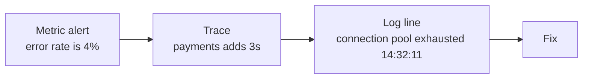

# Monitoring ও Observability-র মূল কথা {#ch-monitoring-fundamentals}

> একটি বাস্তব উদাহরণ দিয়ে monitoring আর observability-কে আলাদা করুন, আর এমন একটি SLO ঠিক করুন যার পেছনে একটি আসল error budget আছে।

**এই অধ্যায়ে:** monitoring বনাম observability · metrics, log আর trace · cardinality · golden signal · SLO আর error budget

## 💡 মূল ধারণা

Monitoring সেই প্রশ্নগুলোর উত্তর দেয়, যেগুলো আপনি আগে থেকেই ভেবে রেখেছিলেন। Observability হলো, যে প্রশ্নটা আপনি
ভাবেননি, সেটার উত্তর আপনি ইতিমধ্যে সংগ্রহ করা data থেকে দিতে পারেন কি না।

পার্থক্যটা শুধু চাপের মধ্যেই ধরা পড়ে। "Disk ভরে গেছে" হলো monitoring। কেউ একজন জানতেন disk-এর দিকে নজর রাখতে
হবে। "Checkout ধীর, কিন্তু শুধু Android ব্যবহারকারীদের জন্য, Germany-তে, যাদের basket-এ পঞ্চাশটির বেশি item আছে"
হলো observability। ওই dashboard কেউ বানায়নি। আপনার এত বিস্তারিত data দরকার, যাতে incident শুরু হওয়ার পর বেছে
নেওয়া dimension দিয়ে সেটা ভাগ করা যায়।

> Observability আপনার **data**-র একটি বৈশিষ্ট্য, কিনে আনার মতো কোনো product নয়। Code ship না করে যদি একটি নতুন
> প্রশ্ন করতে না পারেন, তাহলে আপনার কাছে এটা নেই।

## কীভাবে কাজ করে

তিন ধরনের data, একসঙ্গে ব্যবহার করা।

| Pillar | কীসের উত্তর দেয় | বেশি পরিমাণে খরচ | কতটা বিস্তারিত চলে |
| ------ | ------- | -------------- | -------------- |
| **Metrics** | কতগুলো, কত দ্রুত, কত ঘন ঘন? | সস্তা | কম রাখতেই হবে |
| **Log** | এই একটি ক্ষেত্রে ঠিক কী ঘটেছিল? | দামি | সীমাহীন |
| **Trace** | Service-গুলো জুড়ে সময় কোথায় গেল? | মাঝারি, sample করা | বেশি |



**Metric → trace → log — এটাই "production incident কীভাবে debug করবেন?"-এর উত্তর।** প্রতিটি ধাপ খোঁজের পরিধি
ছোট করে। এই শিকলকে কাজ করায় প্রতিটি log line আর প্রতিটি span-এ থাকা একটি shared **trace ID**, যাতে আপনি হাতে
timestamp মেলানোর বদলে তিনটির মধ্যে যাতায়াত করতে পারেন।

### Metrics আর Cardinality-র ফাঁদ

চারটি type প্রায় সবকিছু ঢেকে দেয়। একটি **counter** শুধু বাড়ে। একটি **gauge** দুই দিকেই যায়। একটি **histogram**
value-গুলোকে নির্দিষ্ট পরিসরে (bucket) গোনে। একটি **summary** process-এর ভেতরেই quantile (percentile) হিসাব করে।

⚠️ **Latency-র জন্য summary নয়, histogram ব্যবহার করুন।** একটি summary-র quantile প্রতিটি process-এর ভেতরেই আগে
থেকে গুটিয়ে ফেলা থাকে, আর পুরো fleet জুড়ে এদের একসঙ্গে মেলানো যায় না। Histogram-এর bucket যোগ করা যায়।

**Cardinality** হলো একটি metric যতগুলো আলাদা time series তৈরি করে, তার সংখ্যা। এটা প্রতিটি label-এর আলাদা আলাদা
মানের গুণফল। এটাই memory আর খরচ চালায়, আর একটি metrics backend মারা যাওয়ার সবচেয়ে সাধারণ কারণ এটাই।

```text
http_requests_total{method, status, endpoint}
  method 5 × status 8 × endpoint 20      →         800 series   ✅ fine

http_requests_total{method, status, endpoint, user_id}
  ... × user_id 2,000,000                → 1,600,000,000 series  ❌ outage
```

**কখনো metric label নয়:** user ID, request ID, session ID, email, query parameter-সহ একটি পুরো URL, একটি
timestamp। এদের জায়গা log আর trace-এ, যেগুলো সীমাহীন বিস্তারিতের জন্যই বানানো।

একটি AI feature দুটি label যোগ করে, যেগুলোর দিকে মানুষ হাত বাড়ায় কিন্তু বাড়ানো উচিত নয়: prompt আর retrieve করা
document-এর text। দুটোই সীমাহীন, আর প্রায়ই ব্যক্তিগত। এর span-গুলো বদলে কী record করে, তা আছে
[Chapter ?? — Observability ও Cost Engineering](#ch-observability)-এ।

### Log, Structured

❌ **Unstructured।** Query করতে ভঙ্গুর regex লাগে:

```text
2026-08-03 14:32:11 ERROR Payment failed for user 8891 amount 42.50
```

✅ **Structured।** Query করা যায়, আর অন্যগুলোর সঙ্গে যুক্ত করা যায়:

```json
{
  "timestamp": "2026-08-03T14:32:11Z",
  "level": "error",
  "message": "payment failed",
  "user_id": "8891",
  "trace_id": "1-5f9a2b3c-4d5e6f7a8b9c0d1e",
  "service": "payments"
}
```

চারটি level, ঠিকভাবে ব্যবহার করা। `ERROR` মানে একটি request fail করেছে আর হয়তো একজন মানুষকে কিছু করতে হবে। `WARN`
মানে কিছু একটা খারাপ হয়েছিল কিন্তু সামলানো গেছে। `INFO` গুরুত্বপূর্ণ business event-এর জন্য। `DEBUG` production-এ
বন্ধ থাকে।

**সবকিছু `ERROR` হলে, আসলে কোনোটাই error নয়।** যে team সফল retry-কে error হিসেবে log করে, তারা error graph দেখা বন্ধ
করে দেয়।

**Container log-এর একটি নিয়মকে আপসহীন করে দেয়: stdout আর stderr-এ লিখুন, কখনো container-এর ভেতরের কোনো file-এ
নয়।** যখন আপনি সেই file পড়তে চাইবেন, ততক্ষণে container চলে গেছে। Host-এর কিছু একটা দুটো stream সংগ্রহ করে
machine-এর বাইরে পাঠিয়ে দেয়।

### Trace আর Sampling

একটি trace একটি request-কে প্রতিটি service জুড়ে অনুসরণ করে। কাজের প্রতিটি একক হলো একটি **span**।

```text
Trace: checkout (1,240ms total)
└── api-gateway              1,240ms
    ├── auth-service            45ms
    ├── cart-service            80ms
    └── payment-service      1,100ms   ← the slow component
        └── payment provider    960ms   ← the actual cause
```

Metrics যা পারে না, trace তার উত্তর দেয়: latency-টা **কোন** component খেয়েছে।

| Sampling | কীভাবে | Tradeoff |
| -------- | --- | -------- |
| **Head-based** | প্রথম span-এই ঠিক করুন — ধরুন 5% রাখুন | সস্তা; বিরল error-টা ফেলে দিতে পারে |
| **Tail-based** | Trace সম্পূর্ণ হওয়ার পর ঠিক করুন | ✅ প্রতিটি error আর ধীর request রাখে; একটি buffer লাগে |

✅ দ্রুত সফল request-গুলো কঠোরভাবে sample করুন। **100% error আর ধীর request** রাখুন। শুধু ওই trace-গুলোই কেউ
খুলে দেখে।

## কখন ব্যবহার করবেন

### Golden Signal

প্রতি service-এ চারটি signal। আর কিছু না মাপলেও এগুলো মাপুন।

| Signal | প্রশ্ন | সাধারণ metric |
| ------ | -------- | -------------- |
| **Latency** | কত ধীর? | p50, p95, p99 duration |
| **Traffic** | চাহিদা কতটা? | প্রতি সেকেন্ডে request |
| **Error** | কত ঘন ঘন fail করে? | শতাংশ হিসেবে 5xx rate |
| **Saturation** | কতটা ভরা? | queue depth, pool usage, CPU |

⚠️ **সফল আর ব্যর্থ request-এর latency আলাদা করে মাপুন।** একটি দ্রুত 500 average latency-কে চমৎকার দেখায়, অথচ
service-টি পুরোপুরি ভেঙে আছে।

সম্পর্কিত দুটি কাঠামোর নাম জানা দরকার। **RED** (rate, errors, duration) request-চালিত service-এর জন্য। **USE**
(utilisation, saturation, errors) resource-এর জন্য।

### Average নয়, Percentile

```text
1,000 requests: 990 take 50ms, 10 take 5,000ms

Average  →    99.5ms   looks fine
p99      → 5,000ms     ten users had a terrible experience
```

p50-কে পড়ুন সাধারণ অভিজ্ঞতা হিসেবে, p95-কে যেখানে কষ্ট শুরু হয়, আর p99-কে আপনার সবচেয়ে বেশি ক্ষতিগ্রস্ত আসল
ব্যবহারকারী হিসেবে। Alert দিন p99-এ। স্বাভাবিক আচরণ বর্ণনা করতে p50 report করুন।

⚠️ **Percentile-এর average করা যায় না।** দুটি instance-এর p99 value-র গড় পুরো fleet-এর p99 নয়। আগে histogram-এর
bucket-গুলো যোগ করুন, তারপর quantile বের করুন।

### SLI, SLO আর Error Budget

| শব্দ | সংজ্ঞা | উদাহরণ |
| ---- | ---------- | ------- |
| **SLI** | মাপটা | 300 ms-এর মধ্যে serve হওয়া request-এর অংশ |
| **SLO** | আপনার internal লক্ষ্য | 30 দিনে 99.9% request 300 ms-এর মধ্যে |
| **SLA** | জরিমানাসহ একটি চুক্তি | 99.5% uptime, নইলে customer credit পাবেন |

✅ SLO সবসময় SLA-র চেয়ে **কঠোর** রাখুন। ফাঁকটাই আপনার নিরাপত্তার মার্জিন। কাউকে টাকা দিতে হওয়ার অনেক আগেই আপনি
সমস্যাটা ঠিক করতে চান।

SLO যদি 99.9% হয়, তাহলে 0.1% ব্যর্থতা *অনুমোদিত*। এই অনুমোদনটাই **error budget**: ত্রিশ দিনে মোটামুটি 43 মিনিট।
Budget বাকি থাকতে feature ship করুন আর ঝুঁকি নিন। Budget শেষ হলে reliability-র কাজ অগ্রাধিকার পায়।

প্রতি মাসের হিসাবে মুখস্থ রাখার মতো: 99% মানে 7.2 ঘণ্টা downtime, 99.9% মানে 43 মিনিট, 99.99% মানে 4.3 মিনিট,
99.999% মানে 26 সেকেন্ড। প্রতিটি বাড়তি নয়-এর খরচ মোটামুটি দশগুণ বেশি, আর 99.999%-এ recovery-র পথে কোনো মানুষই
থাকতে পারেন না।

> Error budget "আমাদের কতটা reliable হওয়া উচিত?" প্রশ্নটাকে তর্ক থেকে একটি সংখ্যায় পরিণত করে। এটা এটাও প্রমাণ করে
> যে 100% ভুল লক্ষ্য। এর পেছনে ছুটলে কিছুই ship করা হয় না।

### Frontend কোথায় আসে

ওপরের সবকিছু browser-এর প্রান্তেও খাটে, একটি পার্থক্যসহ। মাপটা হয় এমন device-এ, যেগুলো আপনার নিয়ন্ত্রণে নেই, তাই
এটা server metrics হিসেবে নয়, **field data** হিসেবে আসে। Core Web Vitals হলো SLI। INP-এর জন্য একটি p75 লক্ষ্য হলো
একটি SLO। Sampling আর cardinality-র সীমা একইভাবে খাটে। ভেতরে একটি ID-সহ URL একটি real-user monitoring tool-এ
label হিসেবে ঠিক ততটাই বিপজ্জনক, যতটা একটি metrics backend-এ।

এটা সংগ্রহ করার কলকব্জা Part IV-এর বিষয়: `web-vitals`, `PerformanceObserver`, attribution build আর beacon transport।
[Chapter ?? — Production-এ মাপা](#ch-measuring-in-production) দেখুন।

## সাধারণ ভুল

| ভুল | পরিণতি | সমাধান |
| ------- | ----------- | --- |
| Metric label হিসেবে user ID | Cardinality বিস্ফোরণ, বিশাল bill | এটা log আর trace-এ রাখুন |
| Average-এর ওপর alert | Tail চোখে পড়ে না | p99-এর ওপর alert দিন |
| Unstructured log, বা কোনো trace ID নেই | Regex, আর হাতে timestamp মেলানো | একটি `trace_id` বহন করা JSON |
| Container-এর ভেতরে file-এ log করা | File container-এর সঙ্গেই মরে যায় | stdout আর stderr, host-এর বাইরে পাঠানো |
| Production-এ `DEBUG` চালু | বিশাল log bill | Default `INFO`, level dynamically বদলান |

## 🔑 মূল শিক্ষা

- Monitoring জানা failure mode check করে। Observability এমন প্রশ্নের উত্তর দেয়, যা কেউ আশা করেনি, আর এটা আপনার
  data-র একটি বৈশিষ্ট্য, কিনে আনা কোনো tool নয়।
- Metrics বলে কিছু একটা ভুল হয়েছে, trace বলে কোথায়, আর log বলে কী। Shared trace ID-ই এদের যুক্ত করে।
- Metric label-কে সীমিত হতেই হবে। একটি label-এ একটি unique identifier মৃত metrics backend-এর সবচেয়ে সাধারণ কারণ।
- Percentile-এর average করা যায় না। এ কারণেই latency-র জায়গা summary নয়, histogram।
- Error budget ছাড়া একটি SLO শুধু একটি ইচ্ছা। Budget-ই reliability-কে খরচ করার একটি সিদ্ধান্তে পরিণত করে।

## Interview-এর প্রশ্ন

**Q: Monitoring আর observability-র পার্থক্য কী?**

Monitoring check করে, যে জিনিসগুলো ভাঙতে পারে বলে আপনি আগে থেকেই জানেন, সেগুলো ভেঙেছে কি না। কী মাপবেন তা আগে
থেকে ঠিক করেন, একটি dashboard বানান, আর alert set করেন। Observability হলো code ship না করে এমন একটি প্রশ্নের উত্তর
দেওয়া, যা আপনি আশা করেননি। পার্থক্যটা শুধু চাপের মধ্যে গুরুত্ব পায়। "Disk ভরে গেছে" monitoring সামলায়। "বড়
basket-ওয়ালা Germany-র Android ব্যবহারকারীদের জন্য checkout ধীর" শুধু observability সামলায়, কারণ ওই dashboard
কেউ বানায়নি। এটা data-র একটি বৈশিষ্ট্য: ভাগ করার মতো যথেষ্ট বিস্তারিত আর যথেষ্ট dimension। তাই সবকিছু আগে থেকেই
কয়েকটি counter-এ গুটিয়ে ফেললে এটা নষ্ট হয়, যে vendor-ই ব্যবহার করুন।

**Q: Cardinality কী, আর এটা কেন গুরুত্বপূর্ণ?**

Cardinality হলো একটি metric যতগুলো আলাদা time series তৈরি করে, তার সংখ্যা: এর সব label-এর আলাদা আলাদা মানের
গুণফল। এটা গুরুত্বপূর্ণ, কারণ storage-এর খরচ আর query-র performance বাড়ে cardinality-র সঙ্গে, request-এর পরিমাণের
সঙ্গে নয়। Method, status আর endpoint দিয়ে label করা একটি counter হয়তো কয়েকশো series তৈরি করে, যা ঠিক আছে। একটি
`user_id` label যোগ করলে প্রতি user-এ একটি series হয়। এতে backend-এর memory ফুরিয়ে যায়, আর বিশাল একটি bill আসে।
তাই label সীমিত হতেই হবে। Unique identifier বরং log আর trace-এ যায়, যেগুলো সীমাহীন বিস্তারিতের জন্যই design করা।

**Q: Average-এর বদলে percentile-এর ওপর alert কেন দেবেন?**

কারণ average tail-কে লুকিয়ে রাখে, আর tail-এই ব্যবহারকারীরা কষ্ট পান। যদি 990টি request-এ 50 millisecond লাগে আর
দশটিতে পাঁচ সেকেন্ড, তাহলে average 100 millisecond-এর নিচে, আর সুস্থ দেখায়। অথচ দশজন মানুষের অভিজ্ঞতা এত খারাপ
ছিল যে তাঁরা চলে যেতে পারেন। p99 সত্যিটা বলে। একটি সতর্কতা গুরুত্বপূর্ণ: instance-গুলো জুড়ে percentile-এর
average করা যায় না। ঠিক এ কারণেই latency-র জায়গা একটি histogram-এ। Quantile বের করার আগে এর bucket-গুলো যোগ করা
যায়।

**Q: SLI, SLO, SLA আর error budget ব্যাখ্যা করুন।**

SLI হলো মাপটা, যেমন 300 millisecond-এর মধ্যে সফলভাবে serve হওয়া request-এর অংশ। SLO হলো এর জন্য আপনার internal
লক্ষ্য, ধরুন চলমান ত্রিশ দিনে 99.9%। SLA হলো আর্থিক পরিণতিসহ customer-এর সঙ্গে একটি চুক্তি। এটা SLO-র চেয়ে ঢিলে
হওয়া উচিত, যাতে কাউকে টাকা দিতে হওয়ার আগে একটি মার্জিন থাকে। Error budget SLO থেকেই বেরিয়ে আসে। ত্রিশ দিনে
99.9% মানে মোটামুটি 43 মিনিট ব্যর্থতা অনুমোদিত, আর সেটা এমন একটি budget যা আপনি খরচ করতে পারেন। এর মূল্য যতটা
technical, ততটাই রাজনৈতিক। Budget বাকি থাকলে team ship করে। শেষ হয়ে গেলে reliability তর্কে জিতে যায়, কাউকে তর্কটা
করতেই হয় না।

**Q: আপনাকে এমন একটি service-এ observability যোগ করতে বলা হলো, যাতে কিছুই নেই। কোথা থেকে শুরু করবেন, আর ইচ্ছা করে কী করবেন না?**

আমি শুরু করি ওই একটি service-এর golden signal দিয়ে: সফল আর ব্যর্থ অনুযায়ী ভাগ করা latency, traffic, error rate আর
একটি saturation metric। আমি একটি trace ID বহন করা structured log যোগ করি। এই সমন্বয়ই পরে metric থেকে trace থেকে
log-এর পথ সম্ভব করে। তারপর এমন একটি SLO, যাতে কেউ সত্যিই রাজি হন, কারণ সেটাই ঠিক করে ওই সংখ্যাগুলোর কোনটা
গুরুত্বপূর্ণ। যা আমি ইচ্ছা করে করি না, তা হলো সবকিছু instrument করা। প্রতিটি metric একটি স্থায়ী cardinality আর
storage-এর খরচ বহন করে। একশোটি অব্যবহৃত dashboard তিনটি পড়া dashboard-এর চেয়ে খারাপ, কারণ সেগুলো এমন coverage-এর
ইঙ্গিত দেয় যা নেই। এরপর আসে trace, tail-based sample করা, যাতে error-গুলো টিকে থাকে।

## এরপর কী পড়বেন

- [Chapter ?? — Metrics, Dashboard ও Alerting](#ch-metrics-and-dashboards) — সংখ্যাগুলো কীভাবে সংগ্রহ আর query করা হয়, আর কীভাবে সেগুলো এমন page-এ পরিণত হয় যার ওপর একজন ক্লান্ত engineer কাজ করতে পারেন
- [Chapter ?? — Production-এ মাপা](#ch-measuring-in-production) — একই চিন্তা, browser-এ মাপা
