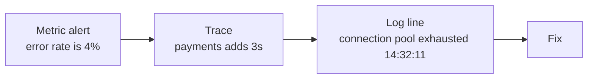

# Monitoring ও Observability-র মূল কথা {#ch-monitoring-fundamentals}

> বাস্তব উদাহরণ দিয়ে monitoring আর observability-র তফাত বুঝুন। তারপর এমন একটি SLO ঠিক করুন, যার পেছনে সত্যিকারের error budget আছে।

**এই অধ্যায়ে:** monitoring বনাম observability · metrics, log আর trace · cardinality · golden signal · SLO আর error budget

## 💡 মূল ধারণা

Monitoring সেই প্রশ্নগুলোর উত্তর দেয়, যেগুলো আপনি আগে থেকে ভেবে রেখেছিলেন। Observability মানে হলো, যে প্রশ্ন
আপনি কখনো ভাবেননি, সেটার উত্তরও এখন যে data জমা হচ্ছে তা থেকেই দিতে পারেন কি না।

তফাতটা চোখে পড়ে শুধু চাপের মুহূর্তে। "Disk ভরে গেছে" হলো monitoring। কেউ আগে থেকেই জানত disk-এর দিকে নজর
রাখতে হবে। "Checkout ধীর, কিন্তু শুধু জার্মানির Android user-দের জন্য, যাদের basket-এ পঞ্চাশটির বেশি item আছে" হলো
observability। এমন dashboard কেউ বানায়নি। আপনার দরকার এতটা খুঁটিনাটি data, যাতে incident শুরু হওয়ার পরে বেছে
নেওয়া dimension দিয়েও ভাগ করে দেখা যায়।

> Observability আপনার **data**-র গুণ, কিনে আনার মতো কোনো product নয়। নতুন code ship না করে যদি নতুন প্রশ্ন
> করতে না পারেন, তাহলে আপনার observability নেই।

## কীভাবে কাজ করে

তিন ধরনের data, একসঙ্গে ব্যবহার করতে হয়।

| স্তম্ভ | কীসের উত্তর দেয় | বেশি volume-এ খরচ | কতটা খুঁটিনাটি রাখা যায় |
| ------ | ------- | -------------- | -------------- |
| **Metrics** | কতগুলো, কত দ্রুত, কত ঘনঘন? | সস্তা | কম রাখতেই হবে |
| **Log** | ঠিক এই একটি ক্ষেত্রে কী ঘটেছিল? | দামি | যত খুশি |
| **Trace** | কোন কোন service-এ সময় খরচ হলো? | মাঝারি, sample করা | অনেক |



**"Production incident কীভাবে debug করবেন?" প্রশ্নের উত্তর হলো metric → trace → log।** প্রতিটি ধাপ খোঁজার
জায়গা ছোট করে আনে। Chain-টা কাজ করে shared **trace ID**-এর জোরে। প্রতিটি log line আর প্রতিটি span-এ সেটা থাকে,
তাই হাতে হাতে timestamp মেলাতে হয় না, তিনটির মধ্যে সরাসরি যাওয়া-আসা করা যায়।

### Metrics আর cardinality-র ফাঁদ

চার ধরনের metric দিয়েই প্রায় সব কাজ চলে। **Counter** শুধু বাড়ে। **Gauge** বাড়ে, কমেও। **Histogram** value-গুলোকে
আগে থেকে ঠিক করা range-এ (bucket) গুনে রাখে। **Summary** process-এর ভেতরেই quantile (percentile) হিসাব করে ফেলে।

⚠️ **Latency-র জন্য summary নয়, histogram ব্যবহার করুন।** Summary-র quantile প্রতিটি process-এর ভেতরেই গুটিয়ে
ফেলা হয়, তাই পুরো fleet জুড়ে সেগুলো জোড়া যায় না। Histogram-এর bucket যোগ করা যায়।

**Cardinality** হলো কোনো metric থেকে তৈরি হওয়া আলাদা আলাদা time series-এর সংখ্যা। প্রতিটি label-এর আলাদা
value-গুলোর সংখ্যা গুণ করলে এটা পাওয়া যায়। Memory আর খরচ এটাই ঠিক করে। আর metrics backend মরে যাওয়ার সবচেয়ে
সাধারণ কারণও এটাই।

```text
http_requests_total{method, status, endpoint}
  method 5 × status 8 × endpoint 20      →         800 series   ✅ fine

http_requests_total{method, status, endpoint, user_id}
  ... × user_id 2,000,000                → 1,600,000,000 series  ❌ outage
```

**এগুলো কখনো metric label হবে না:** user ID, request ID, session ID, email, query parameter-সহ পুরো URL,
timestamp। এদের জায়গা log আর trace-এ, যেগুলো সীমাহীন খুঁটিনাটির জন্যই বানানো।

AI feature এলে দুটি label রাখার লোভ হয়, যা রাখা উচিত নয়: prompt আর retrieve করা document-এর text। দুটিরই কোনো
সীমা নেই, আর প্রায়ই সেগুলোতে ব্যক্তিগত তথ্য থাকে। এর বদলে span-এ কী রাখা হয়, তা আছে
[Chapter ?? — Observability ও Cost Engineering](#ch-observability)-এ।

### Structured log

❌ **Unstructured।** Query করতে ভঙ্গুর regex লাগে:

```text
2026-08-03 14:32:11 ERROR Payment failed for user 8891 amount 42.50
```

✅ **Structured।** Query করা যায়, আর অন্য data-র সঙ্গে মেলানো যায়:

```json
{
  "timestamp": "2026-08-03T14:32:11Z",
  "level": "error",
  "message": "payment failed",
  "user_id": "8891",
  "trace_id": "1-5f9a2b3c-4d5e6f7a8b9c0d1e",
  "service": "payments"
}
```

চারটি level, ঠিকভাবে ব্যবহার করুন। `ERROR` মানে একটি request fail করেছে, আর হয়তো কোনো মানুষকে কিছু করতে হবে।
`WARN` মানে কিছু একটা খারাপ হয়েছিল, কিন্তু সামলানো গেছে। `INFO` গুরুত্বপূর্ণ business event-এর জন্য। `DEBUG`
production-এ বন্ধ থাকে।

**সবকিছুই যদি `ERROR` হয়, তাহলে আসলে কিছুই error নয়।** যে team সফল retry-কেও error হিসেবে log করে, তারা একসময়
error graph দেখাই বন্ধ করে দেয়।

**Container-এ log-এর এই নিয়মটা মানতেই হবে: stdout আর stderr-এ লিখুন, container-এর ভেতরের কোনো file-এ কখনো
নয়।** যতক্ষণে file-টা পড়তে চাইবেন, ততক্ষণে container আর নেই। Host-এর কোনো কিছু দুটি stream-ই সংগ্রহ করে machine-এর
বাইরে পাঠিয়ে দেয়।

### Trace আর sampling

Trace একটি request-কে প্রতিটি service-এর ভেতর দিয়ে অনুসরণ করে। কাজের প্রতিটি অংশ একেকটি **span**।

```text
Trace: checkout (1,240ms total)
└── api-gateway              1,240ms
    ├── auth-service            45ms
    ├── cart-service            80ms
    └── payment-service      1,100ms   ← the slow component
        └── payment provider    960ms   ← the actual cause
```

Metrics যা পারে না, trace তা বলে দেয়: latency খেয়েছে **কোন** component।

| Sampling | কীভাবে | লাভ-ক্ষতি |
| -------- | --- | -------- |
| **Head-based** | প্রথম span-এই ঠিক হয়, ধরুন 5% রাখা হবে | সস্তা; বিরল error-টাই ফেলে দিতে পারে |
| **Tail-based** | পুরো trace শেষ হলে ঠিক হয় | ✅ প্রতিটি error আর ধীর request রাখে; buffer লাগে |

✅ দ্রুত সফল request কড়াভাবে sample করুন। **error আর ধীর request-এর 100%** রাখুন। কেউ খুলে দেখে শুধু এই
trace-গুলোই।

## কখন ব্যবহার করবেন

### Golden signal

প্রতিটি service-এর জন্য চারটি signal। আর কিছু না মাপলেও এগুলো মাপুন।

| Signal | প্রশ্ন | সাধারণত কোন metric |
| ------ | -------- | -------------- |
| **Latency** | কতটা ধীর? | p50, p95, p99 duration |
| **Traffic** | চাহিদা কতটা? | প্রতি সেকেন্ডে request |
| **Errors** | কত ঘনঘন fail করে? | 5xx-এর হার, শতাংশে |
| **Saturation** | কতটা ভরা? | queue depth, pool usage, CPU |

⚠️ **সফল আর ব্যর্থ request-এর latency আলাদা করে মাপুন।** দ্রুত আসা 500 average latency-কে দারুণ দেখায়, অথচ
service-টা তখন পুরোপুরি অচল।

কাছাকাছি আরও দুটি কাঠামোর নাম জানা থাকা ভালো। **RED** (rate, errors, duration) request-নির্ভর service-এর জন্য।
**USE** (utilisation, saturation, errors) resource-এর জন্য।

### Average নয়, percentile

```text
1,000 requests: 990 take 50ms, 10 take 5,000ms

Average  →    99.5ms   looks fine
p99      → 5,000ms     ten users had a terrible experience
```

p50 মানে সাধারণ অভিজ্ঞতা, p95 মানে যেখান থেকে কষ্ট শুরু, আর p99 মানে সবচেয়ে বেশি ভোগা আসল user-রা। Alert দিন p99-এর
ওপর। স্বাভাবিক আচরণ বোঝাতে p50 জানান।

⚠️ **Percentile-এর গড় করা যায় না।** দুটি instance-এর p99-এর গড় পুরো fleet-এর p99 নয়। আগে histogram-এর bucket-গুলো
যোগ করুন, তারপর quantile বের করুন।

### SLI, SLO আর error budget

| শব্দ | মানে | উদাহরণ |
| ---- | ---------- | ------- |
| **SLI** | যা মাপা হচ্ছে | কত ভাগ request 300 ms-এর মধ্যে serve হলো |
| **SLO** | আপনার ভেতরের লক্ষ্য | 30 দিনে 99.9% request 300 ms-এর মধ্যে |
| **SLA** | জরিমানাসহ চুক্তি | 99.5% uptime, নইলে customer credit পাবে |

✅ SLO সবসময় SLA-র চেয়ে **কড়া** রাখুন। মাঝের ফাঁকটাই আপনার নিরাপত্তার জায়গা। কাউকে টাকা দিতে হওয়ার অনেক আগেই
আপনি সমস্যা ঠিক করতে বসে যেতে চান।

SLO যদি 99.9% হয়, তাহলে 0.1% fail করা *চলবে*। এই ছাড়টাই **error budget**: ত্রিশ দিনে মোটামুটি 43 মিনিট। Budget যতক্ষণ
বাকি আছে, feature ship করুন, ঝুঁকি নিন। Budget ফুরিয়ে গেলে reliability-র কাজ আগে।

প্রতি মাসের হিসাবগুলো মুখস্থ রাখার মতো: 99% মানে 7.2 ঘণ্টা downtime, 99.9% মানে 43 মিনিট, 99.99% মানে 4.3 মিনিট,
99.999% মানে 26 সেকেন্ড। প্রতিটি বাড়তি nine-এর খরচ মোটামুটি দশ গুণ বাড়ে। আর 99.999%-এ recovery-র পথে কোনো মানুষ
থাকারই সুযোগ নেই।

> "আমাদের কতটা reliable হওয়া উচিত?" নিয়ে তর্ক error budget থাকলে একটি সংখ্যা হয়ে যায়। এটা আরও দেখিয়ে দেয় যে 100%
> ভুল লক্ষ্য। ওটার পেছনে ছুটলে কিছুই ship করা হয় না।

### Frontend কোথায় আসে

ওপরের সবকিছুই browser-এর প্রান্তেও খাটে, তফাত শুধু একটি জায়গায়। মাপা হয় এমন device-এ, যা আপনার নিয়ন্ত্রণে নেই।
তাই data আসে server metrics হিসেবে নয়, **field data** হিসেবে। Core Web Vitals হলো SLI। INP-র জন্য p75 লক্ষ্য হলো
SLO। Sampling আর cardinality-র সীমাও একইভাবে খাটে। ID-সহ URL, real-user monitoring tool-এ label হিসেবে
ঠিক ততটাই বিপজ্জনক, যতটা metrics backend-এ।

এই data সংগ্রহ করার কলকবজা Part IV-এর বিষয়: `web-vitals`, `PerformanceObserver`, attribution build আর beacon
transport। দেখুন [Chapter ?? — Production-এ মাপা](#ch-measuring-in-production)।

## সাধারণ ভুল

| ভুল | ফল | সমাধান |
| ------- | ----------- | --- |
| User ID-কে metric label বানানো | Cardinality বিস্ফোরণ, বিশাল bill | Log আর trace-এ রাখুন |
| Average-এর ওপর alert | Tail চোখেই পড়ে না | p99-এর ওপর alert দিন |
| Unstructured log, বা trace ID নেই | Regex, আর হাতে হাতে timestamp মেলানো | `trace_id`-সহ JSON |
| Container-এর ভেতরে file-এ log | Container-এর সঙ্গে file-ও শেষ | stdout আর stderr, host-এর বাইরে পাঠানো |
| Production-এ `DEBUG` চালু | বিশাল log bill | Default `INFO`, level চলতে চলতেই বদলানো |

## 🔑 মূল শিক্ষা

- Monitoring জানা ব্যর্থতাগুলো পরীক্ষা করে। Observability এমন প্রশ্নের উত্তর দেয়, যা কেউ আশা করেনি। আর এটা
  আপনার data-র গুণ, কেনা কোনো tool নয়।
- Metrics বলে কিছু একটা গোলমাল, trace বলে কোথায়, আর log বলে কী। এদের জোড়া লাগায় shared trace ID।
- Metric label-এর সীমা থাকতেই হবে। Label-এ unique identifier রাখাই metrics backend মরে যাওয়ার সবচেয়ে সাধারণ কারণ।
- Percentile-এর গড় করা যায় না। এজন্যই latency রাখতে হয় histogram-এ, summary-তে নয়।
- Error budget ছাড়া SLO শুধুই ইচ্ছা। Budget থাকলেই reliability খরচের সিদ্ধান্ত হয়ে ওঠে।

## Interview-এর প্রশ্ন

**Q: Monitoring আর observability-র মধ্যে তফাত কী?**

Monitoring দেখে, যেগুলো ভাঙতে পারে বলে আপনি আগে থেকেই জানেন, সেগুলো ভেঙেছে কি না। কী মাপবেন তা আগেই ঠিক করেন,
dashboard বানান, alert বসান। Observability মানে code ship না করেই এমন প্রশ্নের উত্তর দেওয়া, যা আপনি আশা করেননি।
তফাতটা জরুরি হয় শুধু চাপের সময়। "Disk ভরে গেছে" monitoring সামলায়। কিন্তু "বড় basket নিয়ে জার্মানির Android
user-দের checkout ধীর" সামলাতে পারে শুধু observability, কারণ এই dashboard কেউ বানায়নি। এটা data-র গুণ: ভাগ করে
দেখার মতো যথেষ্ট খুঁটিনাটি আর যথেষ্ট dimension। তাই সবকিছু আগেভাগে গুটিয়ে কয়েকটি counter-এ ভরে ফেললে
observability নষ্ট হয়, vendor যে-ই হোক।

**Q: Cardinality কী, আর এটা কেন গুরুত্বপূর্ণ?**

একটি metric যতগুলো আলাদা time series তৈরি করে, সেই সংখ্যাটাই cardinality: সব label-এর আলাদা value-গুলোর গুণফল।
গুরুত্বপূর্ণ, কারণ storage খরচ আর query-র গতি বাড়ে cardinality-র সঙ্গে, request-এর সংখ্যার সঙ্গে নয়। Method,
status আর endpoint দিয়ে label করা একটি counter হয়তো কয়েকশো series বানায়, তাতে সমস্যা নেই। এর সঙ্গে একটি
`user_id` label যোগ করুন, প্রতিটি user-এর জন্য একটি করে series হয়ে যাবে। তাতে backend-এর memory ফুরিয়ে যায়, আর
বিশাল bill আসে। তাই label-এর সীমা থাকতেই হবে। Unique identifier যায় log আর trace-এ, যেগুলো সীমাহীন খুঁটিনাটির
জন্যই বানানো।

**Q: Average-এর বদলে percentile-এর ওপর alert কেন দেবেন?**

কারণ average tail-কে লুকিয়ে ফেলে, আর user-রা কষ্ট পান ওই tail-এই। ধরুন 990টি request-এ 50 millisecond লাগে, আর
দশটিতে পাঁচ সেকেন্ড। Average তখন 100 millisecond-এর নিচে, দেখতে সুস্থ। অথচ দশজন মানুষের অভিজ্ঞতা এত খারাপ ছিল যে
তাঁরা চলে যেতে পারেন। সত্যিটা বলে p99। তবে একটা সতর্কতা জরুরি: instance জুড়ে percentile-এর গড় করা যায় না। ঠিক এজন্যই
latency রাখতে হয় histogram-এ। Quantile হিসাব করার আগে তার bucket-গুলো যোগ করা যায়।

**Q: SLI, SLO, SLA আর error budget বুঝিয়ে বলুন।**

SLI হলো যা মাপা হচ্ছে, যেমন কত ভাগ request 300 millisecond-এর মধ্যে সফলভাবে serve হলো। SLO হলো তার জন্য আপনার
ভেতরের লক্ষ্য, ধরুন চলমান ত্রিশ দিনে 99.9%। SLA হলো customer-এর সঙ্গে চুক্তি, যার আর্থিক ফল আছে। SLA-কে SLO-র
চেয়ে ঢিলা রাখতে হয়, যাতে কাউকে টাকা দিতে হওয়ার আগে কিছুটা জায়গা থাকে। Error budget SLO থেকেই বেরিয়ে আসে। ত্রিশ
দিনে 99.9% মানে মোটামুটি 43 মিনিট fail করা চলে, আর এই budget খরচ করা যায়। এর মূল্য যতটা technical, ততটাই
রাজনৈতিক। Budget বাকি থাকলে team ship করে। ফুরিয়ে গেলে reliability জিতে যায়, তর্কটা কাউকে করতেই হয় না।

**Q: একটি service-এ কোনো observability নেই, আপনাকে যোগ করতে বলা হলো। কোথা থেকে শুরু করবেন, আর জেনেশুনে কী করবেন না?**

আমি শুরু করি ওই একটি service-এর golden signal দিয়ে: সফল আর ব্যর্থ আলাদা করে latency, traffic, error rate আর একটি
saturation metric। সঙ্গে trace ID-সহ structured log। এই জুটিই পরে metric থেকে trace, trace থেকে log-এ যাওয়ার
পথটা খুলে দেয়। তারপর এমন একটি SLO, যাতে কেউ সত্যিই রাজি, কারণ ওই সংখ্যাগুলোর কোনটা গুরুত্বপূর্ণ তা SLO-ই ঠিক
করে। জেনেশুনে যা করি না: সবকিছু instrument করা। প্রতিটি metric-এরই স্থায়ী cardinality আর storage খরচ আছে।
একশোটি অব্যবহৃত dashboard তিনটি পড়া dashboard-এর চেয়ে খারাপ, কারণ সেগুলো দেখে মনে হয় সব ঢাকা আছে। Trace আসে এর
পরে, tail-based sampling দিয়ে, যাতে error-গুলো টিকে যায়।

## এরপর কী পড়বেন

- [Chapter ?? — Metrics, Dashboard ও Alerting](#ch-metrics-and-dashboards) — সংখ্যাগুলো কীভাবে সংগ্রহ আর query করা হয়, আর সেগুলো থেকে কীভাবে এমন page তৈরি হয়, যা নিয়ে ক্লান্ত একজন engineer কাজ করতে পারেন
- [Chapter ?? — Production-এ মাপা](#ch-measuring-in-production) — একই ভাবনা, browser-এ মাপা
