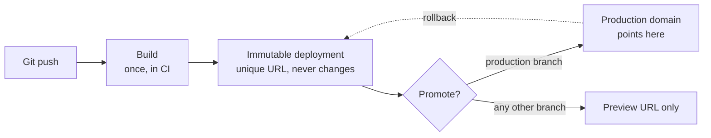

# Platform Deploy ও Preview Environment {#ch-platform-deploys}

> একটি platform deploy আপনার traffic-এর সঙ্গে আসলে কী করে, তা বুঝিয়ে বলুন। Domain কেন server নয়, একটি pointer, তা বলুন। আর প্রতিটি pull request-কে তার নিজের copy দিতে কী খরচ পড়ে, তা-ও।

**এই অধ্যায়ে:** immutable artefact · একবার build, একবার promote · code কোথায় চলে · version skew · প্রতিটি branch-এর জন্য একটি preview · data-র সমস্যা · preview আটকে রাখা

## 💡 মূল ধারণা

Platform deploy কোনো server update করে না। এটা **আপনার site-এর নতুন, immutable একটি copy build করে, তারপর pointer
সেদিকে সরিয়ে দেয়।** পুরনো copy তখনো আছে, তখনো তাতে পৌঁছানো যায়, তখনো সেটা traffic serve করতে পারে।

বাকি প্রতিটি feature আসে এই একটি design সিদ্ধান্ত থেকেই। Rollback দ্রুত, কারণ পুরনো build কখনো মোছা হয়নি। Preview
environment সস্তা, কারণ build মানে স্রেফ আরেকটি copy। Deploy-এ কোনো downtime নেই, কারণ বদলটা শুধু pointer সরানো,
restart নয়।

Deploy-কে যদি *server-এর file বদলে দেওয়া* হিসেবে বোঝেন, বাকি কিছুরই মানে দাঁড়ায় না। আর যদি বোঝেন *নতুন immutable
version প্রকাশ করে domain-কে নতুন করে তাক করা* হিসেবে, তাহলে বাকি সবকিছু এখান থেকেই বেরিয়ে আসে।

## কীভাবে কাজ করে

চারটি ধাপ, এই ক্রমে। User-রা কী দেখবেন, তা বদলায় শুধু শেষটা।



**Deploy artefact তৈরি করে; promotion আলাদা কাজ, যা ফিরিয়ে নেওয়া যায়।**

| ধাপ        | কী ঘটে                                              | ফিরিয়ে নেওয়া যায়?          |
| ------------ | --------------------------------------------------------- | -------------------- |
| **Build**    | Source compile হয়ে static asset আর server function হয় | না — আবার build করুন      |
| **Publish**  | Output জমা হয় অনন্য, স্থায়ী deployment URL-এর নিচে | না — তবে এতে ক্ষতি নেই   |
| **Promote**  | Production domain-কে ওই deployment-এর দিকে নতুন করে তাক করা হয়        | ✅ হ্যাঁ, সঙ্গে সঙ্গে     |
| **Serve**    | সদ্য promote করা build থেকে CDN তার cache ভরে      | ✅ হ্যাঁ, আগেরটাকে আবার promote করে |

**প্রতিটি deployment project-এর পুরো জীবনকাল নিজের URL ধরে রাখে:**

```bash
# The commit-specific URL — never changes, never re-points
https://acme-shop-9k2f3xq1p-acme.vercel.app

# The branch URL — always the latest build of that branch
https://acme-shop-git-checkout-rewrite-acme.vercel.app

# The production domain — a pointer, moved on promotion
https://acme-shop.com
```

> ⚠️ Bug report-এ paste করার জন্য commit URL-টাই ঠিক। Branch URL পরের push-এ নতুন build-এর দিকে সরে যায়। তাই সেখানে নেওয়া
> screenshot এক ঘণ্টা পরে আর reproduce না-ও হতে পারে।

### একবার build, artefact-টাই promote

এটাই সবচেয়ে জরুরি নিয়ম, আর interviewer-রা আসলে এটাই পরীক্ষা করেন। যে pipeline প্রতিটি environment-এর জন্য আবার build
করে, সেটা test করে একটি artefact, আর ship করে আরেকটি। Dependency resolution আর build timestamp আলাদা হয়, কখনো কখনো
lockfile-এর অবস্থাও।

✅ **একবার build করুন, একই deployment promote করুন:**

```bash
vercel build --prod                                         # one artefact, production variables
DEPLOY_URL=$(vercel deploy --prebuilt --prod --skip-domain)  # published, domain not moved yet
# ... run the smoke tests against $DEPLOY_URL ...
vercel promote "$DEPLOY_URL" --yes                           # re-aim production, no rebuild
```

সব জায়গায় "promotion"-এর মানে এটাই। Container registry, S3 artefact bucket আর platform deploy, সবাই আলাদা নামে একই কাজ
করে। Vercel-এ *preview* deployment promote করলে সেটা production variable দিয়ে আবার build হয়। এজন্যই ওপরের
artefact-টা production build হিসেবে stage করা হয়েছে।

## Code কোথায় চলে

"Edge" হলো জায়গা, কোনো technology নয়। একই handler তিন জায়গায় চলতে পারে, আর বাছাইটা হলো latency বনাম সক্ষমতার
লাভ-ক্ষতি।

| জায়গা               | চালু হয়            | Database-এ পৌঁছাতে পারে?                        | কীসের জন্য ব্যবহার করবেন                                        |
| ---------------------- | -------------------- | ----------------------------------------------- | ------------------------------------------------- |
| **CDN cache**          | ~0 ms                | না — এটা cache করা response                     | আগে থেকে render করা যায় এমন যেকোনো কিছু                 |
| **Edge runtime**       | ~5 ms, user-এর কাছে | শুধু HTTP দিয়ে, আর round trip লম্বা       | Redirect, auth check, A/B assignment, geo routing |
| **Regional function**  | ~100 ms cold, একবার   | ✅ হ্যাঁ, pool করা, একই region-এ                | আপনার data query করে এমন যেকোনো কিছু                   |

**এই table যে ভুলটা আটকায়:** database-নির্ভর route edge-এ সরালে সেটা *ধীর* হয়ে যায়। Handler 90 ms আগে চালু হয়,
তারপর প্রতিটি query-র জন্য Atlantic পার হতে 200 ms খরচ করে।

```typescript
// A route that reads the database — regional, not edge.
export const runtime = "nodejs";
export const preferredRegion = "fra1"; // same region as the Postgres primary

export async function GET(): Promise<Response> {
  const rows = await db.query<Product>("select id, name from products limit 20");
  return Response.json(rows, {
    // The CDN, not the function, is what makes this fast for a user in Sydney.
    headers: { "cache-control": "s-maxage=60, stale-while-revalidate=300" },
  });
}
```

> ⚠️ **যা বদলাতে থাকে:** runtime-এর নাম, region-এর identifier, আর সেগুলো বাছাইয়ের config syntax প্রায় প্রতিটি বড়
> framework release-এ বদলায়। টেকসই নীতিটা বদলায় না: **compute থাকবে তার data-র পাশে, আর বাকি সব জায়গায় CDN-ই সেটাকে
> কাছের মনে করায়।**

## Version skew — যে ব্যর্থতা কেউ আগে থেকে ভাবে না

একজন user আপনার site load করলেন। দশ মিনিট পরে আপনি deploy করলেন। Tab-টা তখনো খোলা, তখনো পুরনো JavaScript bundle
চালাচ্ছে, আর এখন এমন chunk চাইছে, যার নাম নতুন build বদলে দিয়েছে।

```text
Browser has: /_next/static/chunks/page-a1b2c3.js   (build N)
Server has:  /_next/static/chunks/page-d4e5f6.js   (build N+1)
                              ↓
                      404 → white screen
```

পুরনো deployment কখনো মোছা হয় না, তাই সমাধান caching নয়, routing। Client তাকে যে deployment থেকে serve করা হয়েছিল,
তার ID পাঠায়, আর platform ওই request-কে মিলে যাওয়া build-এ ফেরত পাঠায়। Vercel এটাকে বলে **skew protection**। সাধারণ
নাম **version pinning**।

✅ তবু API-র version রাখুন, আর একটি release-এর মধ্যে কোনো contract কখনো ভাঙবেন না। Skew protection-এর retention
window আছে। Backward-compatible API-র মেয়াদ ফুরায় না।

## প্রতিটি branch-এর জন্য একটি preview

Preview environment হলো **একটি branch-এর পূর্ণ deployment, নিজের URL-এ, যা branch merge হলে ফেলে দেওয়া হয়।** এর
প্রয়োজন, কারণ বিকল্পটা, মানে সবার ভাগের একটিমাত্র staging environment, লাইন তৈরি করে। একজনের আধা-শেষ migration
বাকি সবার review আটকে দেয়। আর যিনি ভেঙেছেন, debug করতে হয় সবসময় তাঁকেই নয়।

Preview সস্তা ওপরের কারণেই। Deployment হলো pointer-এর পেছনে immutable build, তাই দ্বিতীয় copy-র খরচ শুধু একটি build,
দ্বিতীয় environment নয়। প্রতিটি preview নিজের environment value পায়, তাই code না বদলেই একই code আলাদা database-এর দিকে
তাক করা যায়।

```typescript
type DeployEnv = "production" | "preview" | "development";

// Injected at build time by the platform; the names differ per provider.
export const deployEnv: DeployEnv =
  (process.env.VERCEL_ENV as DeployEnv | undefined) ?? "development";

// Use it to keep analytics, payments and email out of previews.
export const isRealTraffic: boolean = deployEnv === "production";
```

> ⚠️ এখানে `NODE_ENV === "production"` দিয়ে পাহারা বসালে কাজ হয় না। Preview **নিজেই** production build: minified,
> optimised, `NODE_ENV=production`। দুটিকে আলাদা করতে পারে শুধু platform-এর নিজের variable।

*Review*-এর জন্য preview staging-এর জায়গা নেয়। *Rehearsal*-এর জন্য নেয় না। যে release তিনটি service-কে একসঙ্গে মেলায়,
তার জন্য তবু এমন জায়গা লাগে, যেখানে তিনটিই candidate version চালাচ্ছে।

## Data-র সমস্যা

Preview আসলে কঠিন এখানেই, আর interview-ও যায় এদিকেই। Application-এর copy বিনা পয়সায়। Database-এর copy নয়।

| কৌশল                     | প্রতিটি preview কী পায়                | কীসের জন্য ভালো                      | সমস্যা                                        |
| ---------------------------- | ------------------------------------- | ----------------------------- | ------------------------------------------------ |
| **Shared preview database**  | একটি database, সব branch-এর জন্য            | ছোট team, read-heavy app  | একটি branch-এর migration বাকি সব preview ভেঙে দেয় |
| **Branched database**        | প্রতিটি branch-এর জন্য copy-on-write clone      | Migration আছে এমন যেকোনো কিছু      | এমন provider লাগে, যা branching support করে          |
| **Seeded ephemeral database**| নতুন খালি database, সঙ্গে seed script | নির্ধারিত ফলের test       | Seed data আসল data-র আকার থেকে সরে যায়                 |
| **Production, read-only**    | আসল data, write বন্ধ         | Data-র আকারের সঙ্গে জড়িত bug debug করা   | ❌ শুধু anonymise করা data আর audit trail থাকলে    |

✅ **Default হিসেবে branched বা seeded database নিন।** Shared database ঠিকঠাক চলে প্রথম migration পর্যন্ত, আর প্রথম
migration আসেই।

❌ **Write চালু রেখে কখনো preview-কে production database-এর দিকে তাক করবেন না।** Preview হলো এমন code, যার review এখনো
হয়নি। পুরো ব্যাপারটাই তো এটা।

Third-party service-এরও একই ব্যবস্থা লাগে। Payment-এর জন্য test-mode key আর email-এর জন্য catch-all inbox ব্যবহার
করুন। Analytics পুরোপুরি বন্ধ রাখুন, কারণ preview-এর traffic funnel নষ্ট করে দেয়। Webhook প্রতিটি URL-এর জন্য আলাদা
করে register করুন, নয়তো stub করুন।

## Preview আটকে রাখা

বেশিরভাগ platform-এ preview URL default-এ public। এটা আপনার অপ্রকাশিত কাজের এমন copy, যা আন্দাজ করা যায়, search
engine-এ index-ও হয়।

| নিয়ন্ত্রণ                     | কাকে আটকায়                                   | কখন ব্যবহার করবেন                                        |
| --------------------------- | --------------------------------------- | ----------------------------------------------- |
| **শুধু team-এর access**        | Organisation-এর বাইরের যে কাউকে          | সবসময়, ভিত্তি হিসেবে                          |
| **Password protection**     | Shared secret জানেন না এমন যে কাউকে         | Client বা বাইরের reviewer-এর সঙ্গে share করার সময়    |
| **Bypass token**            | কাউকে না — এটা access *দেয়*             | CI আর end-to-end test-কে ঢুকতে দেওয়ার জন্য          |
| **`x-robots-tag: noindex`** | Search engine                           | সবসময়। Search-এ ফাঁস হওয়া preview একটি incident |

> ⚠️ **যা বদলাতে থাকে:** header-এর নাম, protection-এর স্তর আর bypass-এর ব্যবস্থা platform ভেদে আলাদা, আর নামও বদলায়।
> টেকসই নীতি: **preview default-এ private। CI access পায় বাতিল করা যায় এমন token দিয়ে, protection বন্ধ করে কখনো নয়।**

## সাধারণ ভুল

❌ **Preview URL-কে ফেলে দেওয়ার জিনিস আর production deploy-কে "আসল" build ভাবা।**
✅ দুটি একই artefact হওয়া উচিত। যে deployment পাস করেছে, সেটাই promote করুন। Merge করে আবার build করবেন না।

❌ **Client-এর জন্য prefix দেওয়া build-time variable-এ secret রাখা।**
✅ Bundler যা inline করে, সবই browser-এ চলে যায়। Secret পড়ুন request-এর সময়, server code-এ।

❌ **ধরে নেওয়া যে deploy হলে CDN নিজে থেকেই purge হয়ে যায়।**
✅ Static asset-গুলো content-hash করা, তাই নিরাপদ। HTML আর API response-এর `s-maxage` মেয়াদ শেষ না হওয়া পর্যন্ত টিকে
থাকে। Deploy-এর পরে পুরনো page দেখা গেলে সাধারণত দায়ী cache header, ভাঙা build নয়।

❌ **প্রতিটি preview একই database-এ লেখে, তাই review environment বেশিরভাগ সময় ভাঙাই থাকে।**
✅ Database branch করুন, বা নতুন database seed করুন। লাইনে দাঁড়িয়ে থাকার খরচের তুলনায় সমাধানের খরচ অনেক কম।

❌ **Analytics dashboard-এ preview-এর traffic।**
✅ প্রতিটি third-party client চালু হবে কি না, তা ঠিক করুন platform-এর environment variable দেখে, `NODE_ENV` দেখে নয়।

❌ **Client-এর সঙ্গে preview link share করে ভুলে যাওয়া যে সেটা চালুই থাকে।**
✅ Password দিয়ে আটকান, নয়তো commit-নির্দিষ্ট এমন URL দিন, যা কখনো নতুন, review না হওয়া কাজের দিকে সরে যাবে না।

## 🔑 মূল শিক্ষা

- Deployment একটি immutable artefact, আর domain তার একটির দিকে তাক করা pointer। এজন্যই rollback সঙ্গে সঙ্গে হয়।
- একবার build করে একই artefact promote করুন; প্রতিটি environment-এ আবার build করলে এমন কিছু ship হয়, যা আপনি কখনো test করেননি।
- Edge-এ চালালে latency-তে লাভ, data-য় পৌঁছাতে ক্ষতি। তাই database-নির্ভর route-এর জায়গা database-এর region-এ।
- Preview আসলে production build, তাই environment চিনতে হবে platform variable দিয়ে, `NODE_ENV` দিয়ে নয়।
- Application-এর copy সস্তা, data-র copy নয়। Branch করুন বা seed করুন, আর production-এ কখনো লিখবেন না।

## Interview-এর প্রশ্ন

**Q: Deployment production-এ promote করলে আসলে কী ঘটে?**

কিছুই আবার build হয় না। Build আগে থেকেই immutable deployment হিসেবে আছে, নিজের স্থায়ী URL-সহ। Promotion production
domain-কে নতুন করে সেদিকে তাক করে। বদলটা atomic, তাই কোনো request আধা-update হওয়া site দেখে না। আগের deployment নিজের
URL-এ চালুই থাকে। এজন্যই rollback মানে redeploy নয়, শুধু pointer সরানো।

**Q: Route edge-এ সরালে সেটা কেন ধীর হয়ে যেতে পারে?**

Edge runtime চালু হয় user-এর কাছে, কিন্তু আপনার data থেকে অনেক দূরে। Sydney-র handler Frankfurt-এর database-এ query
করলে প্রতিটি round trip-এ মোটামুটি 250 ms খরচ হয়। যে 100 ms cold start বাঁচানো গেল, তার চেয়ে এটা অনেক বড়। Edge ঠিক সেই
কাজের জন্য, যাতে origin-এর data লাগে না, যেমন redirect, token check, geo routing আর A/B assignment। আপনার database পড়ে এমন
যেকোনো কিছুর জায়গা database-এর region-এ, আর সামনে থেকে ভৌগোলিক কাজটা করে CDN।

**Q: Deploy-এর ঠিক পরে একজন user সাদা screen দেখছেন, কিন্তু আপনি reproduce করতে পারছেন না। কী ঘটছে?**

প্রায় নিশ্চিতভাবে version skew। তাঁর tab আগের build থেকে load হয়েছিল, আর এখন এমন content-hash করা chunk চাইছে, যার
নাম নতুন build বদলে দিয়েছে। Request-টা 404 পায়, আর app hydrate করতে (server HTML-এ নিজের JavaScript জুড়ে দিতে) ব্যর্থ
হয়।
Platform-স্তরের সমাধান হলো client-কে যে deployment থেকে serve করা হয়েছিল, request-গুলোকে সেখানেই বেঁধে রাখা। টেকসই
সমাধান হলো একটি release-এর মধ্যে কখনো API contract না ভাঙা, সঙ্গে নতুন build এলে সেটা ধরে reload করার প্রস্তাব দেওয়া।

**Q: Preview environment এমন কী দেয়, যা staging environment দেয় না?**

প্রতিটি branch-এর জন্য আলাদা পরিসর। Staging সবার ভাগের resource, যার পেছনে লুকোনো লাইন থাকে। কারও একটি অসমাপ্ত
পরিবর্তন বাকি সবার review আটকে দেয়। কোনো ব্যর্থতার কারণ খুঁজতে আগে বের করতে হয়, কার পরিবর্তন এর জন্য দায়ী। Preview
প্রতিটি pull request-কে শুধু সেই branch থেকে build করা নিজের URL দেয়, তাই reviewer ঠিক একটি পরিবর্তনই দেখেন। কয়েকটি
service জুড়ে release-এর rehearsal-এর জন্য staging-এর জায়গা তবু থেকে যায়।

**Q: যে artefact test করেছেন, ঠিক সেটাই ship করেছেন, তা কীভাবে নিশ্চিত করবেন?**

একবার build করুন, সেটা deployment হিসেবে publish করুন, ওই deployment-এর নিজের URL-এ smoke test চালান, তারপর ID
দিয়ে সেটা promote করুন। Pipeline-এ build-এর ধাপ থাকবে ঠিক একটি। পরের প্রতিটি ধাপ input হিসেবে নেবে deployment
identifier, Git reference নয়। কোনো ধাপ যদি আবার build চালু করতে পারে, তাহলে guarantee আর থাকে না।

## এরপর কী পড়বেন

- [Chapter ?? — Deployment Strategy, Rollback ও Feature Flag](#ch-deployment-strategies) — pointer ফিরিয়ে আনা, যে পরিবর্তনে তা পারা যায় না, আর server-এর একটি অংশে নয়, user-দের একটি অংশে release করা
- [Chapter ?? — Cloud-এর মূল কথা, Storage ও Delivery](#ch-cloud-fundamentals) — এই সবকিছুর সামনে CDN কী cache করে
