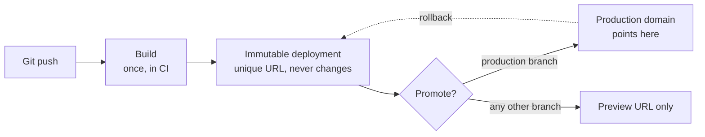

# Platform Deploy ও Preview Environment {#ch-platform-deploys}

> একটি platform deploy আসলে আপনার traffic-এর সঙ্গে কী করে, domain কেন server নয় বরং একটি pointer, আর প্রতিটি pull request-কে নিজের একটি copy দিতে কী খরচ হয় — এগুলো ব্যাখ্যা করতে শিখুন।

**এই অধ্যায়ে:** immutable artefact · একবার build, একবার promote · code কোথায় চলে · version skew · প্রতি branch-এ একটি preview · data-র সমস্যা · preview lock করা

## 💡 মূল ধারণা

একটি platform deploy কোনো server আপডেট করে না। এটা **আপনার site-এর একটি নতুন, immutable copy build করে, তারপর
একটি pointer সেটার দিকে সরিয়ে দেয়।** পুরোনো copy তখনো আছে, তখনো পৌঁছানো যায়, তখনো traffic serve করতে পারে।

বাকি প্রতিটি feature এই একটি design সিদ্ধান্ত থেকেই আসে। Rollback দ্রুত, কারণ পুরোনো build কখনো delete হয়নি। Preview
environment সস্তা, কারণ একটি build শুধু আরেকটি copy। Deploy-এ downtime নেই, কারণ switch হলো একটি pointer বদল,
restart নয়।

আপনি যদি deploy-কে *একটি server-এ file replace করা* হিসেবে বোঝেন, বাকি কিছুরই মানে দাঁড়ায় না। যদি এগুলোকে
*একটি নতুন immutable version publish করা আর একটি domain-কে নতুন করে তাক করা* হিসেবে বোঝেন, সবকিছু সেখান থেকেই আসে।

## কীভাবে কাজ করে

চারটি ধাপ, এই ক্রমে। শুধু শেষটি user-রা যা দেখে তা বদলায়।



**একটি deploy একটি artefact তৈরি করে; promotion আলাদা, ফিরিয়ে আনা যায় এমন একটি কাজ।**

| ধাপ          | কী ঘটে                                                       | ফিরিয়ে আনা যায়?          |
| ------------ | ----------------------------------------------------------- | ---------------------- |
| **Build**    | Source compile হয়ে static asset আর server function হয়        | না — আবার build করুন     |
| **Publish**  | Output একটি অনন্য, স্থায়ী deployment URL-এর নিচে রাখা হয়      | না — কিন্তু ক্ষতিকর নয়     |
| **Promote**  | Production domain-কে সেই deployment-এর দিকে নতুন করে তাক করা হয় | ✅ হ্যাঁ, সঙ্গে সঙ্গে        |
| **Serve**    | CDN নতুন promote করা build থেকে তার cache ভরে                  | ✅ হ্যাঁ, আগেরটা promote করে |

**প্রতিটি deployment project-এর পুরো জীবনজুড়ে নিজের URL রাখে:**

```bash
# The commit-specific URL — never changes, never re-points
https://acme-shop-9k2f3xq1p-acme.vercel.app

# The branch URL — always the latest build of that branch
https://acme-shop-git-checkout-rewrite-acme.vercel.app

# The production domain — a pointer, moved on promotion
https://acme-shop.com
```

> ⚠️ Bug report-এ paste করার জন্য commit URL-টিই ঠিক। পরের push-এ branch URL অন্য দিকে তাক করে, তাই সেটার ওপর
> তোলা একটি screenshot এক ঘণ্টা পরে আর reproduce করা নাও যেতে পারে।

### একবার build করুন, artefact promote করুন

এটাই সবচেয়ে গুরুত্বপূর্ণ নিয়ম, আর interviewer-রা আসলে এটাই পরীক্ষা করেন। যে pipeline প্রতি environment-এ আবার
build করে, সেটা একটি artefact test করে আর অন্য একটি ship করে। Dependency resolution আর build timestamp আলাদা হয়,
কখনো কখনো lockfile-এর অবস্থাও।

✅ **একবার build করুন, একই deployment promote করুন:**

```bash
vercel build --prod                                         # one artefact, production variables
DEPLOY_URL=$(vercel deploy --prebuilt --prod --skip-domain)  # published, domain not moved yet
# ... run the smoke tests against $DEPLOY_URL ...
vercel promote "$DEPLOY_URL" --yes                           # re-aim production, no rebuild
```

সব জায়গায় "promotion" মানে এটাই। Container registry, S3 artefact bucket আর platform deploy — সবাই আলাদা নামে
একই কাজ করে। Vercel-এ একটি *preview* deployment promote করলে সেটা production variable দিয়ে আবার build হয়। এজন্যই
ওপরের artefact-টি production build হিসেবে stage করা হয়েছে।

## Code কোথায় চলে

"Edge" একটি জায়গা, কোনো technology নয়। একই handler তিনটি জায়গায় চলতে পারে, আর বাছাইটা latency বনাম capability-র
একটি trade-off।

| জায়গা                  | শুরু হয়               | Database-এ পৌঁছাতে পারে?                          | কীসের জন্য ব্যবহার করবেন                              |
| ---------------------- | -------------------- | ----------------------------------------------- | ------------------------------------------------- |
| **CDN cache**          | ~0 ms                | না — এটা একটি cached response                     | যা কিছু আগে থেকে render করা যায়                      |
| **Edge runtime**       | ~5 ms, user-এর কাছে   | শুধু HTTP দিয়ে, আর round trip দীর্ঘ                 | Redirect, auth check, A/B assignment, geo routing |
| **Regional function**  | ~100 ms cold, একবার  | ✅ হ্যাঁ, pooled, একই region-এ                       | আপনার data-য় query চালায় এমন যেকোনো কিছু             |

**এই table যে ভুলটা ঠেকায়:** একটি database-নির্ভর route-কে edge-এ সরালে সেটা *ধীর* হয়। Handler 90 ms আগে শুরু
হয়, তারপর প্রতিটি query-র জন্য 200 ms খরচ করে Atlantic পার হতে।

```typescript
// A route that reads the database — regional, not edge.
export const runtime = "nodejs";
export const preferredRegion = "fra1"; // same region as the Postgres primary

export async function GET(): Promise<Response> {
  const rows = await db.query<Product>("select id, name from products limit 20");
  return Response.json(rows, {
    // The CDN, not the function, is what makes this fast for a user in Sydney.
    headers: { "cache-control": "s-maxage=60, stale-while-revalidate=300" },
  });
}
```

> ⚠️ **যা বদলাতে থাকে:** runtime-এর নাম, region identifier আর এগুলো বাছার config syntax প্রায় প্রতিটি বড় framework
> release-এ বদলায়। টেকসই নীতি বদলায় না: **compute তার data-র পাশে থাকে, আর CDN-ই বাকি সব জায়গায় এটাকে local মনে
> করায়।**

## Version Skew — যে failure কেউ আগে থেকে ভাবে না

একজন user আপনার site load করেন। দশ মিনিট পরে আপনি deploy করেন। Tab তখনো খোলা, তখনো পুরোনো JavaScript bundle
চালাচ্ছে, আর এখন এটা এমন একটি chunk request করে, যেটার নাম নতুন build বদলে দিয়েছে।

```text
Browser has: /_next/static/chunks/page-a1b2c3.js   (build N)
Server has:  /_next/static/chunks/page-d4e5f6.js   (build N+1)
                              ↓
                      404 → white screen
```

পুরোনো deployment কখনো delete হয় না, তাই সমাধান caching নয়, routing। Client তাকে যে deployment থেকে serve করা
হয়েছিল তার ID পাঠায়, আর platform সেই request-কে মিলে যাওয়া build-এ ফেরত পাঠায়। Vercel এটাকে বলে **skew
protection**। সাধারণ নাম হলো **version pinning**।

✅ তবুও API-কে version করুন, আর কখনো একটি release-এর মধ্যে contract ভাঙবেন না। Skew protection-এর একটি retention
window আছে। একটি backward-compatible API-র কোনো মেয়াদ নেই।

## প্রতি Branch-এ একটি Preview

একটি preview environment হলো **একটি branch-এর পুরো deployment, নিজের URL-এ, branch merge হলে ফেলে দেওয়া হয়।**
এটা আছে কারণ বিকল্পটির, অর্থাৎ একটি shared staging environment-এর, একটি queue আছে। একজনের অর্ধেক শেষ migration
বাকি সবার review আটকে দেয়, আর যে এটা ভেঙেছে, debug করতে হয় সবসময় তাকেই নয়।

ওপরের কারণেই preview সস্তা। একটি deployment হলো একটি pointer-এর পেছনে একটি immutable build, তাই দ্বিতীয় একটি
copy-র খরচ একটি build, দ্বিতীয় একটি environment নয়। প্রতিটি preview নিজের environment value পায়, তাই code না বদলেই
একই code অন্য একটি database-এর দিকে তাক করতে পারে।

```typescript
type DeployEnv = "production" | "preview" | "development";

// Injected at build time by the platform; the names differ per provider.
export const deployEnv: DeployEnv =
  (process.env.VERCEL_ENV as DeployEnv | undefined) ?? "development";

// Use it to keep analytics, payments and email out of previews.
export const isRealTraffic: boolean = deployEnv === "production";
```

> ⚠️ এখানে `NODE_ENV === "production"` দিয়ে guard করা কাজ করে না। একটি preview **আসলেই** একটি production build:
> minified, optimised, `NODE_ENV=production`। শুধু platform-এর নিজস্ব variable দুটিকে আলাদা করে চেনায়।

Preview *review*-এর জন্য staging-এর জায়গা নেয়। *Rehearsal*-এর জন্য নেয় না। যে release তিনটি service-কে সমন্বয়
করে, তার এখনো এমন একটি জায়গা দরকার যেখানে তিনটিই candidate version চালায়।

## Data-র সমস্যা

Preview আসলে এখানেই কঠিন, আর interview এখানেই যায়। Application-এর copy বিনামূল্যে। Database-এর copy নয়।

| কৌশল                         | প্রতিটি preview কী পায়                    | কীসের জন্য ভালো                    | সমস্যা                                            |
| ---------------------------- | ------------------------------------- | ----------------------------- | ------------------------------------------------ |
| **Shared preview database**  | একটি database, সব branch               | ছোট team, read-heavy app      | একটি branch-এর migration বাকি সব preview ভেঙে দেয় |
| **Branched database**        | প্রতি branch-এ একটি copy-on-write clone | Migration আছে এমন যেকোনো কিছু   | Branching support করে এমন provider দরকার          |
| **Seeded ephemeral database**| একটি নতুন খালি database আর একটি seed script | Deterministic test        | Seed data আসল আকার থেকে সরে যায়                    |
| **Production, read-only**    | আসল data, write বন্ধ                   | Data-নির্ভর একটি bug debug করা | ❌ শুধু anonymised data আর audit trail থাকলে        |

✅ **Default হিসেবে branched বা seeded database নিন।** Shared database প্রথম migration পর্যন্ত ঠিক থাকে, আর প্রথম
migration সবসময় আসে।

❌ **কখনো write চালু রেখে একটি preview-কে production database-এর দিকে তাক করবেন না।** Preview হলো এমন code, যেটা
এখনো review হয়নি। এর পুরো উদ্দেশ্যই এটা।

Third-party service-এরও একই ব্যবস্থা দরকার। Test-mode payment key আর email-এর জন্য একটি catch-all inbox ব্যবহার
করুন। Analytics পুরোপুরি বন্ধ করুন, কারণ preview traffic funnel নষ্ট করে। Webhook প্রতি URL-এ register করুন, বা
stub করুন।

## Preview Lock করা

বেশিরভাগ platform-এ একটি preview URL default হিসেবে public। এটা আপনার unreleased কাজের এমন একটি copy, যেটা আন্দাজ
করা যায় আর index করা যায়।

| Control                     | কী আটকায়                                    | কখন ব্যবহার করবেন                                  |
| --------------------------- | ----------------------------------------- | ----------------------------------------------- |
| **Team-only access**        | Organisation-এর বাইরের যে কাউকে              | সবসময়, ভিত্তি হিসেবে                              |
| **Password protection**     | Shared secret ছাড়া যে কাউকে                  | একজন client বা বাইরের reviewer-এর সঙ্গে share করার সময় |
| **Bypass token**            | কিছুই না — এটা access *দেয়*                   | CI আর end-to-end test-কে ঢুকতে দেওয়ার জন্য        |
| **`x-robots-tag: noindex`** | Search engine                             | সবসময়। Search-এ ফাঁস হওয়া একটি preview একটি incident |

> ⚠️ **যা বদলাতে থাকে:** header-এর নাম, protection tier আর bypass mechanism platform অনুযায়ী আলাদা, আর এগুলোর নাম
> বদলায়। টেকসই নীতি: **preview default হিসেবে private। CI একটি revoke করা যায় এমন token দিয়ে access পায়, কখনো
> protection বন্ধ করে নয়।**

## সাধারণ ভুল

❌ **Preview URL-কে ফেলে দেওয়ার জিনিস আর production deploy-কে "আসল" build ভাবা।**
✅ দুটি একই artefact হওয়া উচিত। যে deployment pass করেছে সেটাই promote করুন। Merge করে আবার build করবেন না।

❌ **Client-এর জন্য prefix দেওয়া একটি build-time variable-এ secret রাখা।**
✅ Bundler যা inline করে, তা browser-এ চলে যায়। Secret request-এর সময় server code-এ পড়ুন।

❌ **ধরে নেওয়া যে deploy-এর সময় CDN নিজে নিজে purge হয়।**
✅ Static asset content-hashed আর নিরাপদ। HTML আর API response তাদের `s-maxage` শেষ না হওয়া পর্যন্ত ধরে রাখে।
Deploy-এর পর একটি পুরোনো page সাধারণত একটি cache header-এর ব্যাপার, ভাঙা build নয়।

❌ **প্রতিটি preview একই database-এ write করে, তাই review environment বেশিরভাগ সময়ই ভাঙা থাকে।**
✅ Database branch করুন, বা নতুন একটি seed করুন। সমাধানের খরচ queue-এর খরচের চেয়ে অনেক কম।

❌ **Analytics dashboard-এ preview traffic।**
✅ প্রতিটি third-party client-কে platform-এর environment variable দিয়ে gate করুন, `NODE_ENV` দিয়ে নয়।

❌ **একজন client-এর সঙ্গে preview link share করে ভুলে যাওয়া যে এটা চালু থাকে।**
✅ এটাকে password দিয়ে সুরক্ষিত করুন, অথবা একটি commit-নির্দিষ্ট URL দিন, যেটা কখনো নতুন, review না হওয়া কাজের দিকে
তাক করবে না।

## 🔑 মূল শিক্ষা

- একটি deployment হলো একটি immutable artefact, আর একটি domain হলো সেরকম একটির দিকে pointer। এজন্যই rollback সঙ্গে সঙ্গে হয়।
- একবার build করে একই artefact promote করুন; প্রতি environment-এ আবার build করলে এমন কিছু ship হয় যা আপনি কখনো test করেননি।
- Edge execution latency-তে জেতে আর data access-এ হারে, তাই database-নির্ভর route database-এর region-এ থাকা উচিত।
- একটি preview হলো একটি production build, তাই environment চিনতে platform variable ব্যবহার করতে হবে, `NODE_ENV` নয়।
- Application-এর copy সস্তা, data-র copy নয়। Branch বা seed করুন, আর কখনো production-এ write করবেন না।

## Interview-এর প্রশ্ন

**Q: একটি deployment production-এ promote করলে আসলে কী ঘটে?**

কিছুই আবার build হয় না। Build আগে থেকেই একটি immutable deployment হিসেবে আছে, নিজের স্থায়ী URL-সহ। Promotion
production domain-কে সেটার দিকে নতুন করে তাক করে। Switch-টি atomic, তাই কোনো request আধা-আপডেট হওয়া site দেখে না।
আগের deployment নিজের URL-এ চালু থাকে, আর এটাই rollback-কে redeploy নয়, একটি pointer বদল বানায়।

**Q: একটি route-কে edge-এ সরালে সেটা কেন ধীর হতে পারে?**

Edge runtime user-এর কাছে শুরু হয়, কিন্তু আপনার data থেকে দূরে। Sydney-র একটি handler Frankfurt-এর একটি database-এ
query করলে প্রতি round trip-এ মোটামুটি 250 ms খরচ করে, যেটা বাঁচানো 100 ms cold start-কে ছাপিয়ে যায়। Edge ঠিক
সেই কাজের জন্য যেটার origin data লাগে না, যেমন redirect, token check, geo routing আর A/B assignment। আপনার
database পড়ে এমন যেকোনো কিছু database-এর region-এ থাকা উচিত, আর সামনে CDN ভৌগোলিক কাজটা করবে।

**Q: একজন user বলছেন deploy-এর ঠিক পরে একটি সাদা screen দেখছেন, কিন্তু আপনি reproduce করতে পারছেন না। কী ঘটছে?**

প্রায় নিশ্চিতভাবেই version skew। তাঁর tab আগের build থেকে load হয়েছিল, আর এমন একটি content-hashed chunk request
করছে, যেটার নাম নতুন build বদলে দিয়েছে। Request-টি 404 হয়, আর app hydrate হতে পারে না (server HTML-এর সঙ্গে
নিজের JavaScript যুক্ত করতে পারে না)।
Platform-স্তরের সমাধান হলো client-কে যে deployment থেকে serve করা হয়েছিল, request-গুলোকে সেটার সঙ্গে pin করা।
টেকসই সমাধান হলো একটি release-এর মধ্যে কখনো API contract না ভাঙা, সঙ্গে নতুন build ধরতে পারা আর reload করার
প্রস্তাব দেওয়া।

**Q: একটি preview environment আপনাকে এমন কী দেয় যা একটি staging environment দেয় না?**

প্রতি branch-এ isolation। Staging একটি shared resource, যার একটি লুকানো queue আছে। একটি অসমাপ্ত পরিবর্তন বাকি সবার
review আটকে দেয়। একটি failure diagnose করতে আগে বের করতে হয় কার পরিবর্তন এটা ঘটিয়েছে। Preview প্রতিটি pull
request-কে শুধু সেই branch থেকে build করা নিজের URL দেয়, তাই একজন reviewer ঠিক একটি পরিবর্তন দেখেন। কয়েকটি service
জুড়ে release rehearsal-এর জন্য staging-এর জায়গা এখনো আছে।

**Q: আপনি যে artefact test করেছেন, সেটাই যে ship করেছেন, তা কীভাবে নিশ্চিত করবেন?**

একটি build তৈরি করুন, সেটাকে একটি deployment হিসেবে publish করুন, সেই deployment-এর নিজের URL-এর বিরুদ্ধে smoke
test চালান, তারপর ID দিয়ে promote করুন। Pipeline-এ ঠিক একটি build ধাপ থাকা উচিত। পরের প্রতিটি ধাপ input হিসেবে
একটি deployment identifier নেবে, Git reference নয়। কোনো ধাপ যদি rebuild চালু করতে পারে, guarantee আর থাকে না।

## এরপর কী পড়বেন

- [Chapter ?? — Deployment Strategy, Rollback ও Feature Flag](#ch-deployment-strategies) — pointer পেছনে সরানো, যে পরিবর্তনে তা পারা যায় না, আর server-এর একটি অংশে নয় বরং user-দের একটি অংশে release করা
- [Chapter ?? — Cloud-এর মূল কথা, Storage ও Delivery](#ch-cloud-fundamentals) — এই সবকিছুর সামনে CDN কী cache করে
