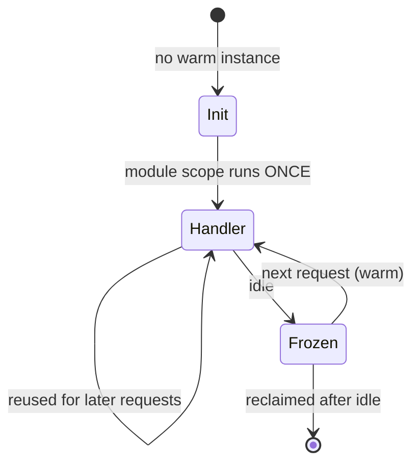

# Serverless Function {#ch-serverless-functions}

> আপনার deploy আর আপনার handler-এর মাঝখানে platform কী করে, তা জানুন। আর function-এর মাপ এমনভাবে ঠিক করুন, যাতে cold start কখনো কোনো user-এর কাছে না পৌঁছায়।

**এই অধ্যায়ে:** instance-এর জীবনচক্র · invocation-এর তিনটি ধরন · cold start আর তার আসল কারণ · concurrency আর bill · যে ভুলগুলো শুধু load-এর মধ্যেই দেখা দেয়

## 💡 মূল ধারণা

আপনি platform-কে একটা handler আর একটা trigger দেন। বাকি সবকিছু platform-এর: কখন process শুরু হবে, কয়টি চলবে, কখন
সেগুলো মেরে ফেলা হবে। এই একটি লেনদেনে আপনি এমন scaling পান যা কখনো configure করতে হয় না, আর এমন bill যা কেউ call না
করলে শূন্যে নেমে যায়।

কিন্তু এতে একটি জিনিস হারায়, যা দীর্ঘক্ষণ চলা server বিনা পয়সায় দেয়: এমন process, যা _আগে থেকেই চলছে_। এই
অধ্যায়ের প্রতিটি serverless ব্যর্থতা আসে ওই একটি ক্ষতি থেকেই।

## কীভাবে কাজ করে

### Instance-এর জীবনচক্র

প্রতিটি request-এর জন্য নতুন function instance তৈরি হয় না। Instance তৈরি হয়, অনেকগুলো request-এ ব্যবহৃত হয়, আর একসময়
মেরে ফেলা হয়। ওই boundary-র তুলনায় আপনার code কোথায় বসে আছে, তা-ই তার performance-এর প্রায় সবকিছু ঠিক করে।



**একবার init, অনেকবার handler call — warm instance কিছু ধরে রাখতে পারে শুধু module scope-এ।**

**দামি setup handler-এ নয়, module scope-এ রাখুন:**

```typescript
import { S3Client } from "@aws-sdk/client-s3";

// Module scope: runs once per instance, during init. Reused by every later request.
const s3 = new S3Client({ region: process.env.AWS_REGION });
let cachedApiKey: string | null = null;

export async function handler(event: { key: string }): Promise<Response> {
  // Handler scope: runs on every request. Keep it to the work only.
  cachedApiKey ??= await loadSecret("payments/api-key"); // fetched once, not per call
  const object = await s3.send(getObject(event.key));
  return Response.json({ ok: true, size: object.ContentLength });
}
```

> ⚠️ Module scope হলো **cache, storage নয়**। Instance যেকোনো মুহূর্তে মারা যেতে পারে, আর দ্বিতীয় instance কখনো প্রথমটির
> variable দেখতে পায় না। সেখানে client বা secret cache করুন। কিন্তু কোনো counter, session, বা হারালে মন
> খারাপ হবে এমন কিছু কখনো রাখবেন না।

### Invocation-এর তিনটি ধরন

কে retry করবে, আর কতবার, তা ঠিক করে trigger। এখানে ভুল হলেই event হারিয়ে যায়।

| ধরন                | কী থেকে চালু হয়                       | Caller অপেক্ষা করে? | Retry                                | আপনাকে যা সামলাতে হবে             |
| -------------------- | ---------------------------------- | ------------- | -------------------------------------- | --------------------------- |
| **Synchronous**      | HTTP request, সরাসরি SDK call       | হ্যাঁ           | নেই — error caller-এর কাছে ফেরত যায় | Error response          |
| **Asynchronous**     | Object upload, pub/sub, schedule    | না            | নিজে থেকেই, সাধারণত দুবার, তারপর বাদ  | Idempotency আর dead-letter queue |
| **Queue-polled**     | Queue বা change stream            | না            | যতক্ষণ না acknowledge হয় বা queue হাল ছেড়ে দেয় | Batch-এর আংশিক ব্যর্থতা       |

মানুষকে অবাক করে asynchronous ধরনটাই। Platform মূল caller-কে না জানিয়েই আপনার handler আবার চালায়। যে handler idempotent
নয় (দুবার চালালেও নিরাপদ নয়), সেটা card থেকে দুবার টাকা কেটে নেবে।

**পুরো batch নয়, batch-এর শুধু ব্যর্থ message-গুলো জানান:**

```typescript
interface QueueRecord { messageId: string; body: string }
interface BatchResponse { batchItemFailures: { itemIdentifier: string }[] }

export async function handler(event: { Records: QueueRecord[] }): Promise<BatchResponse> {
  const failures: { itemIdentifier: string }[] = [];

  for (const record of event.Records) {
    try {
      await process(JSON.parse(record.body));
    } catch {
      // Without this, one bad message re-delivers all ten and the good nine run twice.
      failures.push({ itemIdentifier: record.messageId });
    }
  }
  return { batchItemFailures: failures };
}
```

### Cold start

Cold start হলো ওপরের init ধাপটা, যখন সেটা চলে কোনো user অপেক্ষা করার সময়। এটা কোনো একক সংখ্যা নয়, কয়েকটি অংশের যোগফল।
আর তার কিছু অংশই শুধু আপনার হাতে।

| Cold start-এর অংশ        | সাধারণ খরচ      | আপনি কি বদলাতে পারেন?                              |
| ----------------------------- | ----------------- | ----------------------------------------------- |
| Platform sandbox তৈরি করে  | 50–200 ms         | না — pre-warming এড়াতে পারে, কিছুই এটা ছোট করে না   |
| Runtime চালু হয়                  | 5 ms–1 s          | হ্যাঁ: হালকা runtime, বা isolate-ভিত্তিক runtime  |
| আপনার bundle load হয়          | আকারের অনুপাতে | হ্যাঁ: bundle করুন, tree-shake করুন, ভারী SDK বাদ দিন   |
| আপনার module scope চলে         | আপনি যা লিখেছেন  | হ্যাঁ: এই অংশটাই মানুষ ভুলে যায়            |
| Private network জোড়া লাগানো     | সবকিছু ছাপিয়ে যেতে পারে      | হ্যাঁ: দরকার না হলে জোড়া লাগাবেন না       |

**সত্যিই যা কাজে দেয়, মোটামুটি প্রভাবের ক্রমে:**

- **Function bundle করুন।** 40 MB-র `node_modules` tree load করতে handler চালানোর চেয়ে বেশি খরচ হয়।
- **Module scope-এ কম কাজ করুন।** Init-এর সময় পরপর তিনটি secret আনলে সেই সময়টা প্রতিটি cold start-এ যোগ হয়।
- **Function-কে private network-এ বসাবেন না**, যদি না তার ভেতরের কিছুর কাছে পৌঁছাতেই হয়।
- Latency-সংবেদনশীল পথের জন্য **instance pre-warm করুন**। এতে কাজ হয়, আর অলস capacity-র জন্য টাকা দিতে হয়।

> ✅ Tune করার আগে মাপুন। একই request কয়েকবার পাঠান, আর প্রথমটির সঙ্গে বাকিগুলোর তুলনা করুন। মাঝের ফাঁকটাই আপনার cold
> start। প্রায়ই এটা পাশের database query-র চেয়েও ছোট।

### Concurrency আর bill

পুরনো ধাঁচের model-এ **একটি instance একবারে একটি request** নেয়। একসঙ্গে দশটি request মানে দশটি instance। প্রথম spike-এ
এর মানে দশটি cold start আর দশটি database connection।

নতুন model-গুলো এটা বদলায়। Isolate-ভিত্তিক runtime (এক process-এর ভেতরে অনেক ছোট sandbox) আর "fluid" ধাঁচের
function একসঙ্গে আসা request-গুলোর জন্য একই instance আবার ব্যবহার করে। যে handler-এর বেশিরভাগ সময় I/O-র অপেক্ষায়
কাটে, তার খরচ তখন অনেক কমে যায়। সমস্যা হলো, চলমান কাজগুলো এখন একটির ওপর আরেকটি পড়ে। একই সময়ে চলা request-গুলোর মধ্যে
module-scope-এর state ভাগাভাগি হয়।

> ⚠️ **যা বদলাতে থাকে:** এখানে প্রকাশিত প্রতিটি সীমা বদলায়। Duration, memory-র সর্বোচ্চ সীমা, concurrency model আর
> দামের একক, সবই গত দুই বছরে বদলেছে, আর vendor-রা কোনোটাতেই একমত নয়। AWS Lambda-র সীমা 15 মিনিট আর 10 GB। Vercel
> Functions-এ duration ঠিক হয় প্রতিটি route-এর জন্য `vercel.json`-এ, আর memory প্রতিটি project-এর জন্য। Cloudflare
> Workers wall time নয়, CPU time-এর জন্য bill করে, আর default হলো তার 30 সেকেন্ড। টেকসই নীতি: **কোনো সীমা ধরে design
> করার আগে আপনার platform-এর বর্তমান সীমা দেখে নিন, আর এমন request path কখনো design করবেন না, যার দরকার সর্বোচ্চ
> সীমার কাছাকাছি কোনো সংখ্যা।**

## কখন ব্যবহার করবেন

| Workload                                     | Serverless function? | কেন                                                     |
| -------------------------------------------- | -------------------- | ------------------------------------------------------- |
| হঠাৎ হঠাৎ বাড়ে বা কম volume-এর HTTP API                  | ✅ হ্যাঁ                | অলস অবস্থায় কোনো খরচ নেই, fleet-এর মাপও ঠিক করতে হয় না           |
| কোনো event-এ সাড়া দেওয়া — upload, webhook, cron  | ✅ হ্যাঁ                | Trigger-টাই পুরো design                          |
| স্থির, বেশি, আগে থেকে বোঝা যায় এমন traffic             | ⚠️ তুলনা করুন           | নির্দিষ্ট একটা বিন্দুর পরে reserved server প্রায়ই সস্তা |
| লম্বা কাজ — video encoding, বড় report     | ❌ না                 | Duration-এর সীমায় ঠেকবে; job runner ব্যবহার করুন        |
| বড় মাপে স্থায়ী connection — WebSocket  | ❌ না                 | Model ধরে নেয় request একসময় শেষ হবে                          |
| যেকোনো কিছু, যার warm local cache লাগে           | ❌ না                 | Instance কোনো সতর্কতা ছাড়াই মরে যায়; shared cache ব্যবহার করুন         |

## সাধারণ ভুল

❌ **Handler-এর ভেতরে database connection খোলা।** একসঙ্গে চলা একশোটি instance একশোটি connection খোলে, আর database-এর
pool ফুরিয়ে যায়। ✅ Client বানান module scope-এ। Function আর database-এর মাঝে connection pooler বসান।

❌ **ধরে নেওয়া যে event একবারই আসে।** Asynchronous আর queue trigger retry করে, তাই guarantee হলো at-least-once। ✅
Handler idempotent বানান। কাজটাকে event ID দিয়ে চিহ্নিত করুন, আর একই ID আবার এলে উপেক্ষা করুন।

❌ **Timeout সর্বোচ্চ সীমায় রেখে দেওয়া।** তখন upstream-এর আটকে যাওয়া একটি call পনেরো মিনিটের bill তোলে। পুরো সময়টা
concurrency-ও আটকে রাখে। ✅ Timeout রাখুন বাস্তবসম্মত সবচেয়ে খারাপ অবস্থার একটু ওপরে। ভেতরের HTTP client-এ আরও ছোট
timeout দিন।

❌ **Secret সাধারণ environment variable-এ রাখা।** Console-এ ঢোকার অনুমতি থাকা যে কেউ সেগুলো পড়তে পারে, আর সেগুলো log-এ
গিয়ে পড়ে। ✅ Init-এর সময় secret store থেকে আনুন, আর module scope-এ cache করুন।

❌ **সরু role একবার fail করেছিল বলে সবচেয়ে চওড়া role জুড়ে দেওয়া।** ✅ নির্দিষ্ট resource-এর ওপর নির্দিষ্ট action-এর
অনুমতি দিন। যে function শুধু একটি bucket prefix পড়ে, তার role-এ সেটাই লেখা থাকা উচিত।

❌ **সাধারণ string log করা।** পরে কিছুই সেগুলো query করতে পারে না। ✅ Request ID-সহ structured JSON log করুন, যাতে একটি
ধীর request যত function ছুঁয়েছে, সবগুলোর মধ্য দিয়ে তাকে trace করা যায়।

## 🔑 মূল শিক্ষা

- একটি instance তার module scope চালায় একবার, আর handler চালায় অনেকবার। পুরো performance model ওই boundary-তেই।
- Retry-র নিয়ম ঠিক করে trigger, তাই আপনার handler-কে idempotent হতে হবে কি না, সেটাও trigger-ই ঠিক করে।
- Cold start হলো platform-এর সময় আর আপনার bundle-এর যোগফল। ঠিক করার দায়িত্ব আপনার শুধু দ্বিতীয় অংশটুকুর।
- প্রতিটি একসঙ্গে আসা request-এর জন্য একটি instance, এটাই database connection ফুরিয়ে দেয়। Pool রাখুন function-এর বাইরে।
- Serverless server চালানোর ঝামেলা সরায়, কিন্তু operation নিয়ে ভাবার দায় সরায় না। Timeout, concurrency আর retry এখনো আপনার।

## Interview-এর প্রশ্ন

**Q: Cold start-এ আসলে কী ঘটে, আর কোন অংশগুলোতে আপনি প্রভাব ফেলতে পারেন?**

Handler call হওয়ার আগে platform sandbox তৈরি করে, runtime চালু করে, আপনার bundle load করে, আর আপনার module-scope
code চালায়। প্রথম দুটি platform-এর, আর সেগুলো এড়ানো যায় শুধু pre-warming দিয়ে। শেষ দুটি আপনার। Load-এর সময় ঠিক করে
bundle-এর আকার। Module scope-এ যা কিছু করেন, যেমন secret আনা, client বানানো বা config পড়া, তা প্রতিটি cold start-এ যোগ
হয়। আর private network জোড়া লাগানোর খরচ প্রায়ই এই সবকিছু মিলিয়েও বেশি।

**Q: Serverless function database-কে কেন ভেঙে ফেলে, আর আপনি কী করবেন?**

পুরনো ধাঁচের model-এ প্রতিটি instance একটি করে request চালায়, তাই concurrency আর connection-এর সংখ্যা একসঙ্গে বাড়ে।
কয়েকশো instance-এর একটি spike কয়েকশো connection খোলে, আর database নতুন connection নিতে অস্বীকার করে। সমাধানগুলো একটির
ওপর আরেকটি বসে। Client module scope-এ বানান, যাতে request-গুলোর মধ্যে আবার ব্যবহার হয়। Database-এর সামনে connection
pooler বসান, আর function-এর concurrency-র সীমা বেঁধে দিন। Workload হঠাৎ হঠাৎ বাড়লে HTTP-ভিত্তিক data API বেছে নিন।

**Q: File upload হলে একটি function চালু হয়, আর মাঝে মাঝে একই file দুবার process করে। কেন?**

Asynchronous trigger ব্যর্থ হলে retry করে, আর delivery-র guarantee হলো at-least-once। যে handler সফল হয়েছিল কিন্তু
response দিতে গিয়ে timeout হয়েছে, সেটাও আবার call হয়। সমাধান idempotency, বাড়তি retry নয়। Event থেকে key বানান,
কাজ শুরুর আগে সেটা লিখে রাখুন, আর একই key আবার এলে কিছুই করবেন না। Dead-letter queue যোগ করুন, যাতে প্রতিটি retry-তে
ব্যর্থ event-গুলো চুপচাপ হারিয়ে না গিয়ে চোখে পড়ে।

**Q: কখন function-এর বদলে দীর্ঘক্ষণ চলা একটি server বেছে নেবেন?**

যখন request শেষ হয় না, যেমন WebSocket, server-sent events বা streaming session। অথবা যখন কাজটা একটি request-এর
চেয়ে বেশি সময় চলে, যেমন video encoding বা বড় export। আবার যখন traffic এতটা স্থির আর বেশি যে প্রতিটি invocation-এর
দামের চেয়ে reserved capacity সস্তা পড়ে। কিংবা যখন process-টা সত্যিই এমন warm in-memory cache থেকে লাভবান হয়, যা
request-এর পর request টিকে থাকে।

**Q: Function-এর environment variable থেকে secret দূরে রাখবেন কীভাবে?**

Secret রাখুন managed secret store-এ, আর function-এর role-কে অনুমতি দিন শুধু দরকারি নির্দিষ্ট secret-টা পড়ার।
Init-এর সময় একবার এনে module scope-এ রাখুন, যাতে প্রতিটি request-এ আবার আনতে না হয়। তখন rotation হয় store-এ, redeploy
করে নয়। Value-টা deployment configuration, console বা কোনো log line-এ কখনো দেখা যায় না।

## এরপর কী পড়বেন

- [Chapter ?? — Cloud-এর মূল কথা, Storage ও Delivery](#ch-cloud-fundamentals) — managed service-এর মইয়ে function কোথায় বসে
- [Chapter ?? — Platform Deploy ও Preview Environment](#ch-platform-deploys) — edge আর regional execution-এর মধ্যে বাছাই
- [Chapter ?? — Monitoring ও Observability-র মূল কথা](#ch-monitoring-fundamentals) — দেখার মতো কোনো server না থাকলে কী log করবেন আর কী মাপবেন
