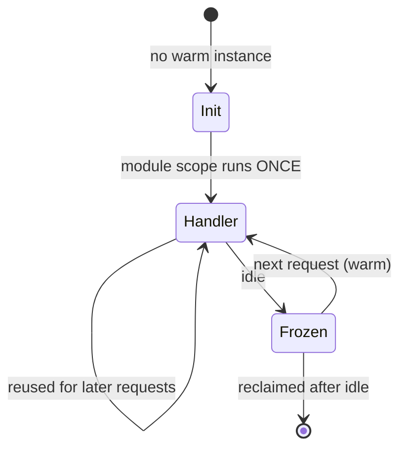

# Serverless Function {#ch-serverless-functions}

> আপনার deploy আর আপনার handler-এর মাঝে platform কী করে তা জানুন, আর একটি function-কে এমনভাবে সাজান যাতে cold start কখনো কোনো user পর্যন্ত না পৌঁছায়।

**এই অধ্যায়ে:** instance-এর lifecycle · invocation-এর তিনটি রূপ · cold start আর আসলে কী সেটা ঘটায় · concurrency আর bill · যে ভুলগুলো শুধু load-এর মধ্যে দেখা দেয়

## 💡 মূল ধারণা

আপনি platform-কে একটি handler আর একটি trigger দেন। বাকি সবকিছুর মালিক platform: কখন একটি process শুরু হবে, কতগুলো
চলবে, কখন সেগুলো kill হবে। এই একটি বিনিময়ে আপনি এমন scaling পান যেটা কখনো configure করতে হয় না, আর এমন একটি bill
যেটা কেউ call না করলে শূন্যে নেমে যায়।

এটা সেই জিনিসটাও কেড়ে নেয়, যেটা একটি দীর্ঘস্থায়ী server বিনামূল্যে দেয়: এমন একটি process, যেটা _আগে থেকেই চলছে_।
এই অধ্যায়ের প্রতিটি serverless failure mode এই একটি হারানো থেকেই আসে।

## কীভাবে কাজ করে

### Instance-এর lifecycle

একটি function instance প্রতি request-এ তৈরি হয় না। এটা তৈরি হয়, অনেক request-এ ব্যবহার হয়, আর শেষে kill হয়। সেই
boundary-র তুলনায় আপনার code কোথায় বসে আছে, তা-ই এর performance-এর প্রায় সবকিছু ঠিক করে।



**একবার init, অনেকবার handler call — module scope-ই একমাত্র জায়গা যেখানে একটি warm instance কিছু ধরে রাখতে পারে।**

**ব্যয়বহুল setup module scope-এ রাখুন, handler-এ নয়:**

```typescript
import { S3Client } from "@aws-sdk/client-s3";

// Module scope: runs once per instance, during init. Reused by every later request.
const s3 = new S3Client({ region: process.env.AWS_REGION });
let cachedApiKey: string | null = null;

export async function handler(event: { key: string }): Promise<Response> {
  // Handler scope: runs on every request. Keep it to the work only.
  cachedApiKey ??= await loadSecret("payments/api-key"); // fetched once, not per call
  const object = await s3.send(getObject(event.key));
  return Response.json({ ok: true, size: object.ContentLength });
}
```

> ⚠️ Module scope একটি **cache, storage নয়**। Instance যেকোনো মুহূর্তে kill হতে পারে, আর দ্বিতীয় একটি instance কখনো
> প্রথমটির variable দেখে না। সেখানে একটি client বা একটি secret cache করুন। কখনো counter, session, বা হারালে আপনার
> খারাপ লাগবে এমন কিছু রাখবেন না।

### Invocation-এর তিনটি রূপ

Trigger ঠিক করে কে retry করবে, আর কতবার। এটা ভুল করলেই event হারিয়ে যায়।

| রূপ                  | কী দিয়ে trigger হয়                    | Caller কি অপেক্ষা করে? | Retry                                       | আপনাকে যা সামলাতে হবে           |
| -------------------- | ---------------------------------- | ------------------- | ------------------------------------------- | ------------------------------ |
| **Synchronous**      | HTTP request, সরাসরি SDK call         | হ্যাঁ                  | নেই — error caller-এর কাছে ফেরত যায়          | Error response                 |
| **Asynchronous**     | Object upload, pub/sub, schedule    | না                   | স্বয়ংক্রিয়, সাধারণত দুবার, তারপর বাদ             | Idempotency আর একটি dead-letter queue |
| **Queue-polled**     | একটি queue বা change stream          | না                   | Acknowledge হওয়া পর্যন্ত, বা queue হাল ছাড়া পর্যন্ত | Batch-এর আংশিক failure          |

Asynchronous রূপটিই মানুষকে অবাক করে। Platform মূল caller-কে না জানিয়েই আপনার handler retry করে। যে handler
idempotent নয় (দুবার চালালে নিরাপদ নয়), সেটা একটি card-এ দুবার charge করবে।

**একটি batch-এ শুধু fail হওয়া message-গুলো report করুন, পুরো batch নয়:**

```typescript
interface QueueRecord { messageId: string; body: string }
interface BatchResponse { batchItemFailures: { itemIdentifier: string }[] }

export async function handler(event: { Records: QueueRecord[] }): Promise<BatchResponse> {
  const failures: { itemIdentifier: string }[] = [];

  for (const record of event.Records) {
    try {
      await process(JSON.parse(record.body));
    } catch {
      // Without this, one bad message re-delivers all ten and the good nine run twice.
      failures.push({ itemIdentifier: record.messageId });
    }
  }
  return { batchItemFailures: failures };
}
```

### Cold start

Cold start হলো ওপরের init ধাপটি, যেটা একজন user অপেক্ষা করার সময় ঘটে। এটা একটি সংখ্যা নয়। এটা একটি যোগফল, আর এর
শুধু কিছু অংশ আপনার।

| Cold start-এর অংশ               | সাধারণ খরচ           | আপনি কি এটা বদলাতে পারেন?                         |
| ----------------------------- | ------------------ | ----------------------------------------------- |
| Platform একটি sandbox provision করে | 50–200 ms        | না — pre-warming এটা এড়ায়, কিছুই এটা ছোট করে না   |
| Runtime boot হয়               | 5 ms–1 s           | হ্যাঁ: হালকা একটি runtime, বা isolate-ভিত্তিক একটি   |
| আপনার bundle load হয়           | Size-এর সমানুপাতিক   | হ্যাঁ: bundle করুন, tree-shake করুন, ভারী SDK বাদ দিন |
| আপনার module scope চলে          | আপনি যা লিখেছেন       | হ্যাঁ: এই অংশটাই মানুষ ভুলে যায়                     |
| Private network attachment     | সবকিছু ছাপিয়ে যেতে পারে | হ্যাঁ: দরকার না হলে attach করবেন না                 |

**যা আসলে সাহায্য করে, মোটামুটি প্রভাবের ক্রমে:**

- **Function-টি bundle করুন।** একটি 40 MB `node_modules` tree load করতে handler চালানোর চেয়ে বেশি খরচ হয়।
- **Module scope-এ কম কাজ করুন।** Init-এর সময় তিনটি secret একটার পর একটা fetch করলে প্রতিটি cold start-এ সেই সময় যোগ হয়।
- **Function-কে private network-এ রাখবেন না**, যদি না এর ভেতরের কিছুতে পৌঁছানো বাধ্যতামূলক হয়।
- **Instance pre-warm করুন**, latency-সংবেদনশীল কোনো path-এর জন্য। এটা কাজ করে, আর আপনি অলস capacity-র জন্য টাকা দেন।

> ✅ Tune করার আগে মাপুন। একই request কয়েকবার পাঠান, আর প্রথমটিকে বাকিগুলোর সঙ্গে তুলনা করুন। পার্থক্যটাই আপনার
> cold start। এটা প্রায়ই পাশের database query-র চেয়ে ছোট।

### Concurrency আর bill

পুরোনো model দেয় **একটি instance-এ একবারে একটি request**। একসঙ্গে দশটি request মানে দশটি instance। প্রথম spike-এ
এর মানে দশটি cold start আর দশটি database connection।

নতুন model-গুলো এটা বদলায়। Isolate-ভিত্তিক runtime (একটি process-এর ভেতরে অনেক ছোট sandbox) আর "fluid" ধাঁচের
function একসঙ্গে চলা request-গুলোতে একটি instance পুনরায় ব্যবহার করে। যে handler-এর সময় I/O-র অপেক্ষায় কাটে,
তার খরচ তখন অনেক কমে যায়। সমস্যা হলো, চলমান কাজ এখন একে অপরের ওপর পড়ে। Module-scope state একই সময়ে চলা
request-গুলোর মধ্যে shared থাকে।

> ⚠️ **যা বদলাতে থাকে:** এখানে প্রকাশিত প্রতিটি limit বদলায়। Duration, memory-র সর্বোচ্চ সীমা, concurrency model আর
> pricing unit — সবই গত দুই বছরে বদলেছে, আর vendor-রা সবগুলো নিয়েই একমত নয়। AWS Lambda-র সীমা 15 মিনিট আর 10 GB।
> Vercel Functions `vercel.json`-এ route অনুযায়ী duration আর project অনুযায়ী memory ঠিক করে। Cloudflare Workers
> wall time নয়, CPU time-এর bill করে, আর default হিসেবে এর 30 সেকেন্ড দেয়। টেকসই নীতি: **কোনো limit-এর চারপাশে
> design করার আগে আপনার platform-এর বর্তমান limit দেখুন, আর কখনো এমন request path design করবেন না যেটার সীমার
> কাছাকাছি কোনো সংখ্যা লাগে।**

## কখন ব্যবহার করবেন

| Workload                                        | Serverless function? | কেন                                                        |
| ----------------------------------------------- | -------------------- | --------------------------------------------------------- |
| হঠাৎ বাড়ে এমন বা কম volume-এর HTTP API              | ✅ হ্যাঁ                | অলস অবস্থায় আপনি কিছুই দেন না, আর কখনো fleet-এর size ঠিক করেন না |
| একটি event-এ সাড়া দেওয়া — upload, webhook, cron    | ✅ হ্যাঁ                | Trigger-ই পুরো design                                       |
| স্থির, বেশি, অনুমানযোগ্য traffic                      | ⚠️ তুলনা করুন         | একটি নির্দিষ্ট বিন্দুর পরে reserved server প্রায়ই সস্তা          |
| দীর্ঘ job — video encoding, বড় report              | ❌ না                 | এটা duration-এর সীমায় ধাক্কা খাবে; একটি job runner ব্যবহার করুন |
| Scale-এ persistent connection — WebSockets       | ❌ না                 | Model ধরে নেয় যে একটি request শেষ হয়                          |
| Warm local cache দরকার এমন যেকোনো কিছু              | ❌ না                 | Instance কোনো সতর্কতা ছাড়াই মরে; একটি shared cache ব্যবহার করুন |

## সাধারণ ভুল

❌ **Handler-এর ভেতরে database connection খোলা।** একশোটি একসঙ্গে চলা instance একশোটি connection খোলে, আর database-এর
pool শেষ করে ফেলে। ✅ Client module scope-এ তৈরি করুন। Function আর database-এর মাঝে একটি connection pooler রাখুন।

❌ **ধরে নেওয়া যে একটি event একবারই আসে।** Asynchronous আর queue trigger retry করে, তাই guarantee হলো
at-least-once। ✅ Handler-কে idempotent করুন। কাজটিকে একটি event ID দিয়ে key করুন, আর পুনরাবৃত্তি উপেক্ষা করুন।

❌ **Timeout সর্বোচ্চে রেখে দেওয়া।** তখন একটি আটকে থাকা upstream call পনেরো মিনিটের bill করে। পুরো সময়টা এটা
concurrency-ও ধরে রাখে। ✅ Timeout বাস্তবসম্মত সবচেয়ে খারাপ অবস্থার একটু ওপরে রাখুন। এর ভেতরের HTTP client-এ আরও
ছোট একটি দিন।

❌ **সাধারণ environment variable-এ secret রাখা।** Console access আছে এমন যে কেউ এগুলো পড়তে পারে, আর এগুলো log-এ
গিয়ে পড়ে। ✅ Init-এর সময় একটি secret store থেকে fetch করুন আর module scope-এ cache করুন।

❌ **সংকীর্ণ role একবার fail করেছিল বলে সবচেয়ে বিস্তৃত role attach করা।** ✅ নির্দিষ্ট resource-এ নির্দিষ্ট action-এর
অনুমতি দিন। যে function একটি bucket prefix পড়ে, তার সেটাই বলা উচিত।

❌ **সাধারণ string log করা।** পরে কিছুই এগুলোতে query চালাতে পারে না। ✅ একটি request ID-সহ structured JSON log করুন,
যাতে একটি ধীর request-কে সে যতগুলো function ছুঁয়েছে, সবগুলোর মধ্য দিয়ে trace করা যায়।

## 🔑 মূল শিক্ষা

- একটি instance তার module scope একবার চালায়, আর handler অনেকবার। এই boundary-ই পুরো performance model।
- Trigger retry-র নিয়ম ঠিক করে, তাই এটাই ঠিক করে আপনার handler-কে idempotent হতে হবে কি না।
- Cold start হলো platform-এর সময় আর আপনার bundle-এর যোগফল। শুধু দ্বিতীয় অর্ধেকটা ঠিক করা আপনার কাজ।
- প্রতি concurrent request-এ একটি instance — এটাই database connection শেষ করে ফেলে। Function-এর বাইরে pool করুন।
- Serverless server management সরায়, operational চিন্তা নয়। Timeout, concurrency আর retry এখনো আপনার।

## Interview-এর প্রশ্ন

**Q: Cold start-এ আসলে কী ঘটে, আর কোন অংশগুলোতে আপনি প্রভাব ফেলতে পারেন?**

Handler call হওয়ার আগে platform একটি sandbox provision করে, runtime শুরু করে, আপনার bundle load করে, আর আপনার
module-scope code চালায়। প্রথম দুটো platform-এর, আর শুধু pre-warming এগুলো এড়ায়। শেষ দুটো আপনার। Bundle size
load time ঠিক করে। Module scope-এ আপনি যা-ই করেন, যেমন secret fetch করা, client তৈরি করা বা config পড়া, তা প্রতিটি
cold start-এ যোগ হয়। একটি private network attach করার খরচ প্রায়ই এই সবকিছুর যোগফলের চেয়েও বেশি।

**Q: Serverless function কেন database ভেঙে ফেলে, আর এ নিয়ে আপনি কী করেন?**

পুরোনো model প্রতি instance-এ একটি request চালায়, তাই concurrency আর connection-এর সংখ্যা একসঙ্গে বাড়ে। কয়েকশো
instance-এর একটি spike কয়েকশো connection খোলে, আর database নতুনগুলো প্রত্যাখ্যান করে। সমাধানগুলো একটার ওপর
আরেকটা যোগ হয়। Client module scope-এ তৈরি করুন, যাতে request-গুলোর মধ্যে এটা পুনরায় ব্যবহার হয়। Database-এর
সামনে একটি connection pooler রাখুন, আর function-এর concurrency-র সীমা দিন। Workload হঠাৎ হঠাৎ বাড়লে একটি
HTTP-ভিত্তিক data API বেছে নিন।

**Q: একটি function file upload-এ চলে, আর মাঝে মাঝে একই file দুবার process করে। কেন?**

Asynchronous trigger failure-এ retry করে, আর delivery guarantee হলো at-least-once। যে handler সফল হয়েছিল কিন্তু
response-এ timeout হয়েছিল, সেটাও আবার call হয়। সমাধান হলো idempotency, আরও retry নয়। Event থেকে একটি key বের
করুন, কাজ করার আগে সেটা record করুন, আর পুনরাবৃত্তিতে যেন কিছুই না হয় তা নিশ্চিত করুন। একটি dead-letter queue
যোগ করুন, যাতে প্রতিটি retry-তে fail হওয়া event চুপচাপ বাদ না পড়ে দেখা যায়।

**Q: কখন আপনি function-এর বদলে একটি দীর্ঘস্থায়ী server বাছবেন?**

যখন request শেষ হয় না, যেমন WebSockets, server-sent events বা একটি streaming session-এ। অথবা যখন কাজ একটি
request-এর চেয়ে বেশি সময় বাঁচে, যেমন video encoding বা একটি বড় export। এছাড়া যখন traffic যথেষ্ট স্থির আর বেশি যে
reserved capacity প্রতি-invocation pricing-কে হারিয়ে দেয়। অথবা যখন process সত্যিই এমন একটি warm in-memory cache
থেকে লাভবান হয়, যেটা request-গুলোর মাঝে টিকে থাকে।

**Q: একটি function-এর environment variable থেকে secret কীভাবে দূরে রাখবেন?**

এগুলো একটি managed secret store-এ রাখুন, আর function-এর role-কে শুধু তার দরকারি নির্দিষ্ট secret পড়ার অনুমতি দিন।
Init-এর সময় একবার fetch করুন আর module scope-এ ধরে রাখুন, যাতে প্রতি request-এ আবার fetch না হয়। তখন rotation
হয় store-এ, redeploy-এ নয়। Value কখনো deployment configuration, console বা কোনো log line-এ দেখা যায় না।

## এরপর কী পড়বেন

- [Chapter ?? — Cloud-এর মূল কথা, Storage ও Delivery](#ch-cloud-fundamentals) — managed-service-এর মইয়ে function কোথায় বসে
- [Chapter ?? — Platform Deploy ও Preview Environment](#ch-platform-deploys) — edge আর regional execution-এর মধ্যে বাছাই
- [Chapter ?? — Monitoring ও Observability-র মূল কথা](#ch-monitoring-fundamentals) — দেখার মতো কোনো server না থাকলে কী log আর measure করবেন
