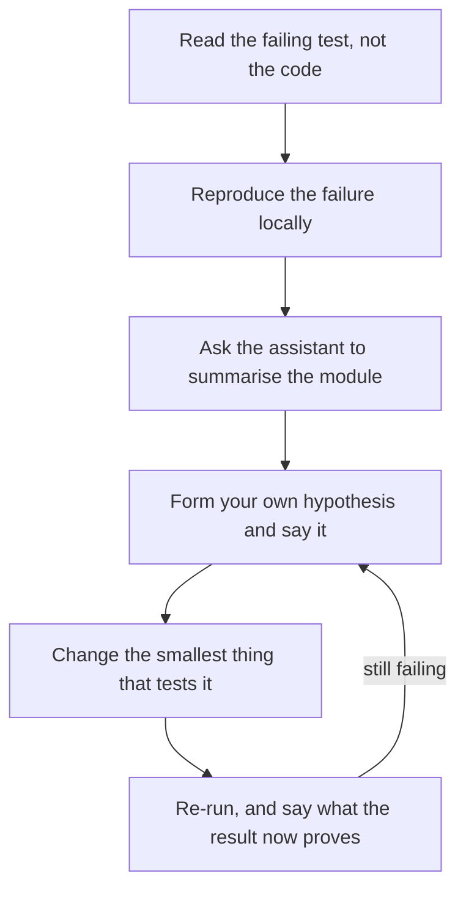

# AI-সহায়িত Interview {#ch-ai-assisted-interview}

> ঘরে assistant ব্যবহার করুন, কিন্তু যে জিনিসের ওপর আসলে আপনাকে নম্বর দেওয়া হচ্ছে, সেটা assistant-এর হাতে তুলে দেবেন না।

**এই অধ্যায়ে:** দুই রকম ঘর, আর আপনি কোনটায় আছেন তা জানার উপায় · assisted round যে চারটি অক্ষে নম্বর দেয় · generate হওয়া code জোরে জোরে যাচাই করা · ঘড়ির চাপে prompt-এর পরিচ্ছন্নতা · যে ঘরে AI নিষিদ্ধ

## 💡 মূল ধারণা

Assistant ব্যবহারের অনুমতি থাকলে code আর প্রমাণ থাকে না। ঘরের সবাই জানেন, model চালু function লিখে দিতে পারে, তাই
function লিখে ফেলায় কিছুই প্রমাণ হয় না। নম্বর দেওয়ার মতো যা বাকি থাকে, তা হলো **code নিয়ে আপনার বিচারবুদ্ধি**: কী চাইলেন, কী
ফিরিয়ে দিলেন, আর কীভাবে যাচাই করলেন।

বেশির ভাগ candidate যে অভ্যাস নিয়ে আসেন, এটা তার উল্টো। Assistant ছাড়া round-এ artefact (আপনি যে code লেখেন) নিজেই উত্তর,
তাই আপনি চুপ করে type করে যান। Assisted round-এ artefact-টাই *সস্তা* অংশ, আর চুপ করে থাকাটাই ব্যর্থতা। যে একমাত্র জিনিসটা
মাপা হচ্ছিল, সেটাই আপনি সরিয়ে দিয়েছেন। নথিভুক্ত প্রত্যাখ্যানের ধরনও ঠিক এটাই। যে candidate-রা নিজের বোঝাপড়া না দেখিয়ে
model-এর ওপর ভর দেন, তাঁরা fail করেন। যাঁরা পাস করেন, তাঁরা model ব্যবহার করেন স্পষ্টভাবে বাঁধা ছোট ছোট কাজে, আর design
রাখেন নিজের হাতে।

তাই পুরো ঘণ্টার নিয়ম এক বাক্যে। **Design আপনার, type করা assistant-এর, আর কোনটা কার, সেটা আপনি জোরে বলবেন।**

## কীভাবে কাজ করে

### দুই রকম ঘর, আর কোনটা পাবেন তা আপনি বাছেন না

মোটামুটি 38% মার্কিন company এখন technical interview-এ AI ব্যবহার করতে দেয়, আর 62% এখনো নিষেধ করে। তাই দুটির জন্যই তৈরি
হয়ে যেতে হবে। Company-র engineering-এর বাইরের ভাবমূর্তি দেখে বোঝা যায় না আপনি কোন ঘরে আছেন। নিয়মটা সাধারণত ঠিক হয় প্রতিটি
loop ধরে, কখনো কখনো প্রতিটি interviewer ধরে।

প্রথম মিনিটেই জিজ্ঞেস করুন, আর নির্দিষ্ট করে জিজ্ঞেস করুন, কারণ "অনুমতি আছে" কথাটার নিচে তিনটি একেবারে আলাদা ঘর লুকিয়ে থাকে।

| যা জিজ্ঞেস করবেন | কেন এতে আপনার পরিকল্পনা বদলায় |
| ------------ | ------------------------ |
| "Assistant ব্যবহার করা যাবে? ব্যবহারের সময় screen share করতে পারি?" | অনুমতি থাকলেও চুপচাপ ব্যবহার করলে মনে হয় আপনি লুকোচ্ছেন |
| "Autocomplete, chat, নাকি এমন agent যা file edit করতে পারে?" | Autocomplete-এ ধারাবিবরণী লাগে না। Agent হলে প্রতিবার চালানোর আগে উদ্দেশ্যটা বলতে হয় |
| "কোনো block generate হলে সেটা কি বলে দেব?" | বেশির ভাগ interviewer এটাই চান। অন্য কিছু না বললে ধরে নিন উত্তর হ্যাঁ |
| "Docs-এর জন্য internet ব্যবহার করা যাবে?" | কিছু loop model নিষেধ করে কিন্তু MDN দেখতে দেয়। তাতে আধা মনে থাকা API আপনি কীভাবে সামলাবেন, সেটা বদলে যায় |

> ⚠️ Round assistant ছাড়া হওয়ার কথা, অথচ shared editor-এ assistant চালু অবস্থায় আসতে পারে। তেমন হলে সেটা বলুন, আর ওঁদের
> সামনেই বন্ধ করে দিন। কিছু না বলে suggestion আসতে দেওয়াই এই অধ্যায়ের একমাত্র ভুল, যা শুধু নম্বর কাটে না, পুরো loop শেষ
> করে দেয়।

### Assisted round যে চারটি অক্ষে নম্বর দেয়

অন্তত একটি বড় নিয়োগকর্তা এখন candidate-দের interview চলার মাঝখানে model বদলাতে দেয়। Round-টায় নম্বর দেওয়া হয় নাম দেওয়া
চারটি অক্ষে। এই চারটিকে checklist হিসেবে নিন: কী কী চোখে পড়ার মতো করে দেখাতে হবে। Rubric (নম্বর দেওয়ার নির্দেশিকা)
interviewer-কে ঠিক এগুলোই লিখে রাখতে বলে।

| অক্ষ | Assistant ছাড়া যেমন দেখায় | Assistant থাকলে যেমন দেখায় |
| ---- | ----------------------------- | ------------------------------------ |
| **Problem solving** | কাজ করে এমন একটি পদ্ধতিতে পৌঁছান | চাওয়ার আগেই ছোট কাজটার সীমা ঠিক করেন, আর বলতে পারেন কেন ভাগ করার জায়গা ওটাই |
| **Code quality** | পরিষ্কার code লেখেন | Generate হওয়া block কারণ দেখিয়ে ফিরিয়ে দেন: খারাপ boundary, গিলে ফেলা error, ভুল default |
| **যাচাই** | Happy path আর একটি edge case test করেন | যতক্ষণ না কোন input-এ ভাঙে তা বলতে পারছেন, ততক্ষণ generate হওয়া code-কে ভুল ধরে নেন |
| **Communication** | নিজের ভাবনার ধারাবিবরণী দেন | Prompt পাঠানোর *আগেই* সেটা বলেন, যাতে interviewer শুধু output নয়, উদ্দেশ্যটাও শোনেন |

ডান দিকের column-জুড়ে ধরনটা এক: **প্রতিটি অক্ষ stack-এর এক ধাপ ওপরে উঠে যায়।** জিনিসটা বানানোর জন্য আর নম্বর পান না।
নম্বর পান সেটা নির্দিষ্ট করে বলা আর যাচাই করার জন্য।

### Code-comprehension round

অন্তত একটি বড় নিয়োগকর্তা 2026-এর নিয়োগ মৌসুমে নতুন ধরনের একটি round যোগ করেছে। এটা মোটেই "একটি function লিখুন" নয়। আপনাকে
আগে থেকে লেখা একটি codebase দেওয়া হয়, আর বলা হয় সেটা পড়তে, debug করতে আর optimise করতে, হাতের কাছে assistant থাকে। এটা
ধাঁধার চেয়ে চাকরির প্রথম সপ্তাহের অনেক কাছাকাছি। আর এতে পুরস্কার পায় কাজের একেবারে আলাদা একটি ক্রম।



**Code-comprehension round কোন ক্রমে সামলাবেন। Assistant ব্যবহার হয় তৃতীয় ধাপে: failure reproduce করার পরে, আর কোনো
hypothesis-এ নিজেকে বেঁধে ফেলার আগে।**

এই ক্রমের দুটি জিনিস সমাধানের চেয়েও বেশি জরুরি। **পড়ার আগে reproduce করলে** যে file-টা প্রথমে খুলে ফেলেছিলেন, সেটা আপনাকে
ভুল দিকে টেনে নিতে পারে না। আর **সমাধান না চেয়ে সারসংক্ষেপ চাইলে** model-কে সেই কাজে লাগানো হয়, যে কাজে model সত্যিই ভালো: অচেনা
400 line কী করে, তা বলে দেওয়া। Diagnosis, মানে যে অংশে নম্বর ওঠে, সেটা আপনার হাতেই থাকে।

### Generate হওয়া code জোরে জোরে যাচাই করা

এই round আসলে এই কারিগরি নিয়েই। "এই call-এ retry যোগ করো" বললে assistant যে block দেবে, তা নিচে আছে। ঠিক যেভাবে আসে,
সেভাবেই লেখা।

**Assistant যা দিয়েছে, কোনো বদল ছাড়া:**

```typescript
async function retry<T>(fn: () => Promise<T>, attempts: number = 3): Promise<T> {
  for (let i = 0; i < attempts; i++) {
    try {
      return await fn();
    } catch (error) {
      await new Promise((resolve) => setTimeout(resolve, 2 ** i * 1000));
    }
  }
  throw new Error("Retry failed");
}
```

এটা compile হয়, পড়তেও ভালো, আর এতে চারটি ত্রুটি আছে। এই ক্রমে সেগুলো বলাই উত্তর:

1. **এটা প্রতিটি error-এ retry করে।** 400 বা validation failure কখনো সফল হবে না, তাই এটা একটি দ্রুত ব্যর্থতাকে তিনটি ধীর
   ব্যর্থতা বানিয়ে ফেলে। Retry ঠিক শুধু *ক্ষণস্থায়ী* গোলমালের জন্য।
2. **এটা কারণটা হারিয়ে ফেলে।** Caller পান `Retry failed`, আর timeout আর খারাপ payload-এর মধ্যে তফাত করতে পারেন না। রাত তিনটায়
   ঠিক এই তফাতটাই log-এ দেখতে চাইবেন।
3. **শেষ চেষ্টার পরেও এটা ঘুমায়।** চার সেকেন্ড অপেক্ষা, তারপর যা-ই হোক throw করে।
4. **কোনো jitter নেই** (ছোট এলোমেলো delay)। প্রতিটি client একই সময়সূচি ধরে পিছু হটে, তাই outage শেষ হয় সবার একসঙ্গে হুড়মুড়
   করে ঢুকে পড়ায়। দেখুন [Chapter ?? — Rate Limiting](#ch-rate-limiting)।

সমাধান তালিকা থেকেই বেরিয়ে আসে। একটি predicate (যে function true বা false return করে) নিন, যা বলে error-টা ক্ষণস্থায়ী কি না।
না হলে loop থেকে বেরিয়ে যান। শেষ চেষ্টায় ঘুম বাদ দিন। Delay-তে jitter যোগ করুন। শেষ error-টা `cause` হিসেবে পাঠিয়ে দিন।
পাঁচটি ছোট edit, আর প্রতিটির উৎস আপনার জোরে বলা একেকটি বাক্য।

খেয়াল করুন, ধারাবিবরণীটা কী করল। একবারও "এটা ভুল" বলেনি। প্রতিবার বলেছে **কোন input-এ এটা ভাঙে**। অনুশীলন করার বাক্যের
ছাঁচ এটাই: *"এটা ঠিক আছে, যদি না error-টা 400 হয়। তখন fail করতে আমরা সাত সেকেন্ড অপেক্ষা করি।"* Interviewer এটা যাচাইয়ের
লক্ষণ হিসেবে লিখে নিতে পারেন। "একটু গোলমেলে লাগছে", এতে কেউ নম্বর দিতে পারেন না।

### ঘড়ির চাপে prompt-এর পরিচ্ছন্নতা

সময়ের চাপে লোভ হয় পুরো সমস্যাটা বলে দিয়ে আশায় বসে থাকতে। তাতে বড় একটি block আসে, যা আপনাকে পড়তে হয়। আর পড়তে যত সময়
লাগে, নিজে লিখলে তার চেয়ে কম লাগত।

| ❌ যে prompt সময় খায় | ✅ যে prompt সময় বাঁচায় | কেন |
| ---------------------------- | --------------------------- | --- |
| "এই problem solve করার একটি function লেখো" | "Nullable cursor-সহ paginated response-এর type লেখো" | ছোট, যাচাই করা যায়, আর এই অংশে নম্বর দেওয়া হচ্ছে না |
| "এটা কি ঠিক আছে?" | "কোন input দিলে এটা ভুল উত্তর return করে?" | প্রথমটা সম্মতি ডেকে আনে, দ্বিতীয়টা পাল্টা উদাহরণ |
| Problem-এর বর্ণনা paste করা | Fail করা test আর error paste করা | Test-এ কোনো অস্পষ্টতা নেই, আপনার গদ্যে আছে |
| "Bug-টা ঠিক করো" | "এই module কী করে, পাঁচ line-এ সারসংক্ষেপ দাও" | Diagnosis আপনার হাতে থাকে, আর নম্বর ওখানেই |

দুটি সীমা মেনে চলুন। **File নয়, একটি function চান।** প্রতিটি line আপনাকে জোরে পড়তে হবে, তাই মোটামুটি পনেরো line-এর বেশি
হলে কিছুই ঠিকমতো যাচাই করতে পারবেন না। আর **দুবার চেষ্টা, তারপর নিজে লিখুন।** Interviewer-এর সামনে model-এর সঙ্গে তর্ক
করলে ঘড়ির সময় নষ্ট হয়। তাতে এটাও মনে হয় যে কাজটা আপনি নিজে সোজাসুজি করতে পারেন না।

> ⚠️ যে line ব্যাখ্যা করতে পারবেন না, তা কখনো editor-এ ঢুকতে দেবেন না। Interviewer-রা ঠিক এখানেই খোঁচা দেন। Generate হওয়া
> কোনো line বেছে নিয়ে জিজ্ঞেস করেন, এটা এখানে কেন। "Assistant-টা যোগ করেছে" মানে প্রত্যাখ্যান, আর এই ধরনের round-এ এটাই
> সবচেয়ে সাধারণ প্রত্যাখ্যান।

### যে ঘরে AI নিষিদ্ধ

62% company-তে round এখনো এটাই। ঝুঁকি জ্ঞানের অভাব নয়। ঝুঁকি হলো ক্ষয়: ব্যবহার না করায় দক্ষতা ফিকে হয়ে যাওয়া। এক বছর ধরে
আপনার লেখা প্রতিটি line যদি Tab চেপে এসে থাকে, assistant ছাড়া ঘণ্টাটা সেটা ধরে ফেলবে।

| যা বদলায় | যা বদলায় না |
| ------------ | ------------- |
| API-গুলো মাথায় রাখতে হয়: array method, `Map`, `Promise`-এর combinator | শুরুর আগে problem-টা নিজের ভাষায় আবার বলা |
| Typo আর syntax-এর ভুলে সত্যিকারের কয়েক সেকেন্ড যায় | Type করার আগে পদ্ধতির ধারাবিবরণী |
| Edge case বাছতে হয় নিজেকেই, কোনো prompt সেগুলো মনে করিয়ে দেয় না | নিজের code কোন input-এ ভাঙবে, তা নাম ধরে বলা |

প্রস্তুতিটা একঘেয়ে, আর কাজ করে: **সপ্তাহে একটি problem অনুশীলন করুন, autocomplete পুরোপুরি বন্ধ রেখে।** Tutorial নয়, নতুন
বিষয়ও নয়। আগে সমাধান করেছেন এমন একটি problem বাছুন, আর কোনো প্রস্তুতি ছাড়া type করুন। যে পেশিটা আপনি সচল রাখছেন, তা হলো
মনে করতে পারা। আর assistant চুপিচুপি আপনার কাছ থেকে কেড়ে নিতে পারে শুধু এটাই।

## কখন ব্যবহার করবেন

Assisted ঘণ্টার ভেতরে সিদ্ধান্তটা হলো, কোন অংশগুলো ছেড়ে দেবেন। এই ভাগাভাগিতে ভালো নম্বর ওঠে।

| Round-এর কাজ | কে করবে | কেন |
| ----------------- | ----- | --- |
| Type, interface, fixture data | Assistant | সস্তা, এক নজরে যাচাই করা যায়, এখানে লক্ষণ নেই |
| যে boilerplate আপনি একশোবার লিখেছেন | Assistant | যে অংশে নম্বর, তার জন্য ঘড়ির সময় খালি হয় |
| মূল algorithm বা data structure | নিজে | মাপা হচ্ছে ঠিক এটাই। ছেড়ে দিলে প্রমাণটাই চলে যায় |
| Test case | Assistant, তারপর ছাঁটাই | এমন case দেবে যা আপনার চোখ এড়িয়ে যেত, সঙ্গে দুটি অর্থহীনও |
| যেকোনো design বা লাভ-ক্ষতির সিদ্ধান্ত | নিজে, জোরে বলে | "Model এই architecture সাজেস্ট করেছে" কোনো উত্তর নয় |
| অচেনা code পড়া | Assistant, শুধু সারসংক্ষেপের জন্য | Assistant-এর diagnosis একটি hypothesis, সিদ্ধান্ত নয় |

## সাধারণ ভুল

❌ **চুপচাপ prompt পাঠানো, তারপর ফলটা পড়া।**
✅ কী চাইতে যাচ্ছেন আর কেন, বলুন, তারপর পাঠান। Interviewer-এর উদ্দেশ্যটা শোনা দরকার, নইলে মনে হয় problem-টা model-ই
solve করছে।

❌ **পনেরো line-এর বেশি block বিশ্বাসযোগ্য দেখাচ্ছে বলেই মেনে নেওয়া।**
✅ মুছে ফেলুন, আর ছোট টুকরো চান। যে block line ধরে ধরে ব্যাখ্যা করতে পারবেন না, সেটা অগ্রগতি নয়, বোঝা।

❌ **Bug নিয়ে assistant-এর ব্যাখ্যাকেই diagnosis ধরে নেওয়া।**
✅ আগে failure reproduce করুন, আর সারসংক্ষেপ দিয়ে সেটা কোথায় তা খুঁজুন। যে code model চালায়নি, তা নিয়েও model আত্মবিশ্বাসী।

❌ **কড়াকড়ির প্রমাণ হিসেবে ঘোষণা করা যে আপনি AI ব্যবহার করেন না।**
✅ যে প্রশ্ন করা হয়েছে, তার উত্তর দিন। 2026–27-এর loop-এ এটা নীতিনিষ্ঠ নয়, পিছিয়ে থাকা শোনায়, ঠিক যেমন debugger ব্যবহার
করতে অস্বীকার করলে শোনাত।

> ⚠️ **যা বদলাতে থাকে:** interview-এর নিয়ম tool-এর চেয়েও দ্রুত বদলাচ্ছে। 38/62-এর ভাগ, নম্বর দেওয়ার চারটি অক্ষ আর
> code-comprehension round হলো 2026–27-এর ছবি, 2028-এর মধ্যে অন্যরকম দেখাবে। টেকসই নীতি সেটাই, যা নড়েনি: **interviewer
> নম্বর দিচ্ছেন আপনার বিচারবুদ্ধিকে। Assistant শুধু বদলে দেয়, কোন স্তরে সেই বিচারবুদ্ধি চোখে পড়তে হবে।**

## 🔑 মূল শিক্ষা

- Assistant-এর অনুমতি থাকলে code আর প্রমাণ নয়। নম্বর দেওয়ার মতো বাকি থাকে শুধু code নিয়ে আপনার যুক্তি।
- প্রথম মিনিটেই জিজ্ঞেস করুন AI ব্যবহার করা যাবে কি না, আর "যাবে" মানে ঠিক কতটুকু। উত্তর company নয়, loop ধরে বদলায়।
- Generate হওয়া code যাচাই করুন কোন input-এ ভাঙে তা বলে, "ভুল মনে হচ্ছে" বলে নয়।
- যে line ব্যাখ্যা করতে পারবেন না, তা কখনো editor-এ ঢুকতে দেবেন না। এমন একটি line নিয়ে প্রশ্নই সাধারণ খোঁচা।
- Assistant ছাড়া round-ই এখনো বেশি, তাই সপ্তাহে একটি problem autocomplete বন্ধ রেখে অনুশীলন করুন।

## Interview-এর প্রশ্ন

**Q: এই round-এ আমরা AI assistant ব্যবহার করতে দিই। আপনি কীভাবে ব্যবহার করবেন?**

উৎসাহ নয়, ভাগাভাগিটা দিয়ে উত্তর দিন। Type, fixture আর boilerplate যাবে assistant-এর কাছে। মূল algorithm আর প্রতিটি design-এর
সিদ্ধান্ত থাকবে আপনার কাছে। যোগ করুন, কোনো block generate হলে আপনি সেটা বলবেন, আর ঢোকানোর আগে সেটা ধরে ধরে ব্যাখ্যা করবেন।
ওই এক বাক্যেই, কোনো code লেখার আগেই, নম্বরের চারটি অক্ষের তিনটি ঢাকা পড়ে যায়।

**Q: Assistant এইমাত্র আপনাকে কুড়ি line দিল। এরপর কী করবেন?**

জোরে পড়ুন, style নয়, input মাথায় রেখে। কোন case-এ ভাঙে, তা বলুন, যেমন খালি array, ক্ষণস্থায়ী নয় এমন error, বা duplicate key।
তারপর হয় সেই case ঠিক করুন, নয়তো block মুছে ছোট কিছু চান। "এটা ঠিক আছে, যদি না X হয়", এটাই interviewer যাচাই হিসেবে লিখে
রাখতে পারেন।

**Q: Code-comprehension round সাধারণ coding round থেকে কীভাবে আলাদা?**

Artefact আগে থেকেই আছে, তাই code লেখার জন্য কোনো নম্বর নেই। মাপা হয়, অচেনা code-এ আপনি কীভাবে পথ খুঁজে নেন। পড়ার আগে failure
reproduce করুন। Assistant ব্যবহার করুন module-এর সারসংক্ষেপের জন্য, সমাধানের জন্য নয়। একটি hypothesis বলুন, আর সেটা যাচাই
করতে সবচেয়ে ছোট জিনিসটা বদলান। সমাধান প্রায়ই এক line, আর সেই line আসল কথা নয়।

**Q: অনুমতি থাকা সত্ত্বেও কখন assistant ব্যবহার করতে রাজি হবেন না?**

যখন ছোট কাজটা *নিজেই* interview। Round যদি হয় "একটি LRU cache implement করুন", তাহলে সেটা generate করলে পুরো ঘণ্টার একমাত্র
লক্ষণটাই মুছে যায়। তাই ওটা নিজে লিখুন, আর assistant-কে বরং test fixture-এর কাজে লাগান। লাভ-ক্ষতির যেকোনো প্রশ্নেও একই কথা।
যে architecture আপনি নিজে সমর্থন করতে পারেন না, তার চেয়ে সহজ এমন একটি ভালো, যা পারেন।

## এরপর কী পড়বেন

- [Chapter ?? — ব্যাখ্যা করা ও জোরে জোরে ভাবা](#ch-thinking-aloud) — ধারাবিবরণীর যে কৌশলের মান এই অধ্যায় আরও উঁচুতে তোলে,
  প্রথম পাঁচ মিনিটে কী বলবেন তা সহ
- [Chapter ?? — Interview-এ AI](#ch-ai-in-interviews) — AI যুগের loop-এর বাকি অর্ধেক: senior round যে চারটি AI *প্রশ্ন* করে, আর
  প্রতিটি যে সংখ্যায় গিয়ে শেষ হয়
- [Chapter ?? — লিখিত Communication](#ch-written-communication) — যাচাইয়ের একই সহজাত বোধ, অন্য কারও pull request review
  করার সময়
