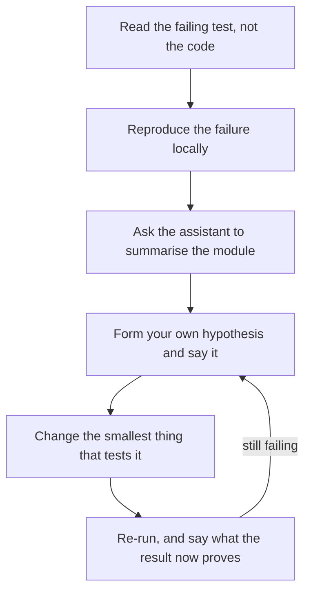

# AI-সহায়িত Interview {#ch-ai-assisted-interview}

> Room-এ একটি assistant ব্যবহার করুন, কিন্তু যেটার ওপর আসলে আপনাকে নম্বর দেওয়া হচ্ছে, সেটা তার হাতে তুলে দেবেন না।

**এই অধ্যায়ে:** দুই ধরনের room, আর আপনি কোনটায় আছেন তা কীভাবে জানবেন · assisted round যে চারটি অক্ষে নম্বর দেয় · generate করা code মুখে বলে যাচাই করা · ঘড়ির চাপে prompt-এর পরিচ্ছন্নতা · যে room-এ AI নিষিদ্ধ

## 💡 মূল ধারণা

Assistant ব্যবহারের অনুমতি থাকলে code আর প্রমাণ থাকে না। Room-এর সবাই জানেন model একটি কাজ করা function বানিয়ে
দিতে পারে, তাই একটা বানালে কিছুই প্রমাণ হয় না। নম্বর দেওয়ার মতো যা বাকি থাকে, তা হলো **code নিয়ে আপনার বিচারবুদ্ধি**:
আপনি কী চাইলেন, কী বাদ দিলেন, আর কীভাবে যাচাই করলেন।

বেশিরভাগ candidate যে অভ্যাস নিয়ে আসেন, এটা তার উল্টো। Assistant ছাড়া round-এ artefact (আপনার বানানো code) নিজেই
উত্তর, তাই আপনি চুপ করে type করেন। Assisted round-এ artefact হলো *সস্তা* অংশ, আর চুপ থাকাটাই ব্যর্থতা। যে একমাত্র
জিনিস মাপা হচ্ছে, সেটাই আপনি সরিয়ে ফেলেছেন। বাদ পড়ার যে pattern নথিভুক্ত, সেটা ঠিক এটাই। যে candidate-রা নিজেদের
বোঝাপড়া না দেখিয়ে model-এর ওপর ভর দেন, তাঁরা fail করেন। যাঁরা pass করেন, তাঁরা এটা স্পষ্টভাবে সংজ্ঞায়িত subtask-এর
জন্য ব্যবহার করেন, আর design নিজের হাতে রাখেন।

তাই পুরো ঘণ্টার নিয়ম এক বাক্যে। **Design আপনার, typing assistant-এর, আর কোনটা কার, তা আপনি মুখে বলে দেন।**

## কীভাবে কাজ করে

### দুই ধরনের room, আর কোনটা পাবেন তা আপনি বাছেন না

এখন US-এর মোটামুটি 38% company technical interview-এ AI ব্যবহারের অনুমতি দেয়, আর 62% এখনো নিষেধ করে। তাই দুটোর
জন্যই তৈরি হয়ে যেতে হবে। Company-র বাইরের engineering brand দেখে বোঝা যায় না আপনি কোন room-এ আছেন। Policy সাধারণত
প্রতিটি loop-এর জন্য আলাদাভাবে ঠিক হয়, কখনো কখনো প্রতিটি interviewer-এর জন্য।

প্রথম মিনিটেই জিজ্ঞেস করুন, আর নির্দিষ্ট করে জিজ্ঞেস করুন, কারণ "অনুমতি আছে" তিনটি একেবারে আলাদা room বোঝাতে পারে।

| আপনি যা জিজ্ঞেস করবেন | এটা আপনার পরিকল্পনা কেন বদলায় |
| ------------ | ------------------------ |
| "Assistant ব্যবহার করা যাবে কি, আর ব্যবহারের সময় কি screen share করতে পারি?" | চুপচাপ ব্যবহার লুকোনোর মতো দেখায়, অনুমতি থাকলেও |
| "Autocomplete, chat, নাকি এমন agent যা file edit করতে পারে?" | Autocomplete-এর জন্য narration লাগে না; agent হলে প্রতিটি run-এর আগে আপনার উদ্দেশ্য বলতে হয় |
| "কোনো block generate করা হলে সেটা কি বলে দেব?" | বেশিরভাগ interviewer এটাই চান; অন্য কিছু না বলা হলে ধরে নিন হ্যাঁ |
| "Docs-এর জন্য internet ব্যবহার করা যাবে?" | কিছু loop model নিষেধ করে কিন্তু MDN-এর অনুমতি দেয়, এতে আধা-মনে-থাকা একটি API কীভাবে সামলাবেন তা বদলায় |

> ⚠️ Round assistant ছাড়া হওয়ার কথা থাকলেও shared editor-এ assistant চালু অবস্থায় থাকতে পারে। তেমন হলে সেটা বলুন,
> আর তাঁদের সামনেই বন্ধ করুন। কিছু না বলে suggestion আসতে দেওয়াই এই অধ্যায়ের একমাত্র ভুল, যা নম্বর কাটার বদলে পুরো
> loop শেষ করে দেয়।

### Assisted round যে চারটি অক্ষে নম্বর দেয়

অন্তত একটি বড় employer এখন candidate-দের interview-এর মাঝখানে model বদলাতে দেয়। তারা round-টিকে চারটি নির্দিষ্ট অক্ষে
নম্বর দেয়। এই চারটিকে একটি checklist হিসেবে নিন: কী কী দৃশ্যমান করতে হবে। Rubric (নম্বর দেওয়ার নির্দেশিকা) interviewer-কে
ঠিক এগুলোই লিখে রাখতে বলে।

| অক্ষ | Assistant ছাড়া কেমন দেখায় | Assistant থাকলে কেমন দেখায় |
| ---- | ----------------------------- | ------------------------------------ |
| **সমস্যা সমাধান** | আপনি একটি কাজ করা পদ্ধতিতে পৌঁছান | চাওয়ার আগেই subtask-এর পরিসর ঠিক করেন, আর বলতে পারেন কেন সেটাই সঠিক ভাগ |
| **Code-এর মান** | আপনি পরিষ্কার code লেখেন | একটি generate করা block কারণ বলে বাদ দেন — খারাপ boundary, চেপে যাওয়া error, ভুল default |
| **যাচাই** | আপনি happy path আর একটি edge case test করেন | যতক্ষণ না যে input-এ ভাঙে তার নাম বলছেন, ততক্ষণ ধরে নেন generate করা code ভুল |
| **Communication** | আপনি আপনার চিন্তা বলে যান | Prompt পাঠানোর *আগেই* সেটা বলেন, যাতে interviewer শুধু output নয়, উদ্দেশ্যটাও শোনেন |

ডান দিকের column-এর pattern: **প্রতিটি অক্ষ stack-এ এক ধাপ ওপরে উঠে যায়।** জিনিসটা বানানোর জন্য আর আপনাকে নম্বর
দেওয়া হয় না। নম্বর দেওয়া হয় সেটা নির্দিষ্ট করা আর যাচাই করার জন্য।

### Code-comprehension round

অন্তত একটি বড় employer 2026-এর cycle-এর জন্য নতুন ধরনের একটি round যোগ করেছে। এটা মোটেই "একটি function লিখুন" নয়।
আপনাকে একটি বিদ্যমান codebase দেওয়া হয়, আর সেটা পড়তে, debug করতে আর optimise করতে বলা হয়, সঙ্গে একটি assistant
থাকে। এটা ধাঁধার চেয়ে চাকরির প্রথম সপ্তাহের বেশি কাছাকাছি। এখানে কাজের একেবারে আলাদা একটি ক্রম পুরস্কৃত হয়।



**Code-comprehension round যে ক্রমে করবেন। Assistant ব্যবহার হয় তৃতীয় ধাপে — failure reproduce করার পরে, আর কোনো
hypothesis-এ স্থির হওয়ার আগে।**

ওই ক্রমের দুটো জিনিস fix-এর চেয়েও বেশি গুরুত্বপূর্ণ। **পড়ার আগে reproduce করা** আপনাকে সেই file দ্বারা চালিত হওয়া
থেকে বাঁচায়, যেটা আপনি ঘটনাচক্রে প্রথমে খুলেছেন। আর **fix নয়, summary চাওয়া** model-কে সেই কাজে লাগায়, যাতে সে সত্যিই
ভালো: 400টি অচেনা line কী করে তা জানানো। Diagnosis, যেটার জন্য নম্বর দেওয়া হয়, আপনার হাতেই থাকে।

### Generate করা code মুখে বলে যাচাই করা

Round-টা আসলে এই দক্ষতা নিয়েই। "এই call-এ retry যোগ করো" বললে একটি assistant যে block দেবে, তা এখানে। এটা ঠিক যেভাবে
আসে, সেভাবেই লেখা।

**Assistant যা দিল, কোনো পরিবর্তন ছাড়া:**

```typescript
async function retry<T>(fn: () => Promise<T>, attempts: number = 3): Promise<T> {
  for (let i = 0; i < attempts; i++) {
    try {
      return await fn();
    } catch (error) {
      await new Promise((resolve) => setTimeout(resolve, 2 ** i * 1000));
    }
  }
  throw new Error("Retry failed");
}
```

এটা compile হয়, পড়তে ভালো লাগে, আর এতে চারটি defect আছে। এই ক্রমে সেগুলো বলাই উত্তর:

1. **এটা প্রতিটি error-এ retry করে।** একটি 400 বা validation failure কখনো সফল হবে না, তাই এটা একটি দ্রুত failure-কে
   তিনটি ধীর failure-এ পরিণত করে। Retry শুধু *ক্ষণস্থায়ী* (transient) fault-এর জন্য সঠিক।
2. **এটা কারণটা হারিয়ে ফেলে।** Caller পায় `Retry failed`, আর timeout আর খারাপ payload-এর পার্থক্য বুঝতে পারে না।
   রাত 3টায় আপনার ঠিক ওই পার্থক্যের log line-টাই দরকার হবে।
3. **শেষ চেষ্টার পরেও এটা ঘুমায়।** চার সেকেন্ড অপেক্ষা, তারপর এমনিতেও throw করে।
4. **কোনো jitter নেই** (একটি ছোট random বিলম্ব)। প্রতিটি client একই সময়সূচিতে back off করে, তাই একটি outage শেষ হয়
   একসঙ্গে সবার হুড়োহুড়িতে। দেখুন [Chapter ?? — Rate Limiting](#ch-rate-limiting)।

Fix তালিকা থেকেই আসে। একটি predicate (এমন function যা true বা false return করে) নিন, যা বলে একটি error ক্ষণস্থায়ী কি না।
না হলে loop থেকে বেরিয়ে আসুন। শেষ চেষ্টায় sleep বাদ দিন। বিলম্বে jitter যোগ করুন। শেষ error-টা `cause` হিসেবে পাঠিয়ে
দিন। এই হলো পাঁচটি ছোট edit, প্রত্যেকটি আপনার মুখে বলা একটি বাক্যের সঙ্গে মেলানো যায়।

খেয়াল করুন narration কী করল। এটা কখনো "এটা ভুল" বলেনি। প্রতিবার এটা **যে input-এ ভাঙে** তার নাম বলেছে। এই বাক্যের
pattern-টাই অনুশীলন করবেন: *"error 400 না হলে এটা ঠিক আছে। হলে আমরা fail করতে সাত সেকেন্ড অপেক্ষা করি।"* একজন
interviewer এটা যাচাইয়ের signal হিসেবে লিখে রাখতে পারেন। "একটু গোলমেলে লাগছে" এমন কিছু নয়, যাতে কেউ নম্বর দিতে পারে।

### ঘড়ির চাপে prompt-এর পরিচ্ছন্নতা

সময়ের চাপে লোভ হয় পুরো সমস্যাটা বর্ণনা করে আশায় থাকার। এতে একটি বড় block আসে, যেটা তারপর আপনাকে পড়তে হয়। সেটা পড়তে
যত সময় লাগে, নিজে লিখতে তার চেয়ে কম লাগত।

| ❌ যে prompt আপনার সময় নষ্ট করে | ✅ যে prompt আপনাকে সময় এনে দেয় | কেন |
| ---------------------------- | --------------------------- | --- |
| "এই সমস্যা সমাধানের একটি function লেখো" | "Nullable cursor-সহ একটি paginated response-এর type লেখো" | ছোট, যাচাই করা যায়, আর এই অংশে নম্বর দেওয়া হয় না |
| "এটা কি ঠিক?" | "কোন input-এ এটা ভুল উত্তর return করে?" | প্রথমটা সম্মতি ডেকে আনে; দ্বিতীয়টা একটি counterexample |
| সমস্যার বর্ণনা paste করে | Failing test আর error paste করে | Test-এ কোনো অস্পষ্টতা নেই; আপনার লেখায় আছে |
| "Bug-টা fix করো" | "এই module কী করে, পাঁচ line-এ summary দাও" | Diagnosis আপনার হাতে রাখে, যেটাতেই নম্বর |

দুটো সীমা মেনে চলুন। **একটি function চান, পুরো file নয়।** প্রতিটি line আপনাকে মুখে পড়ে শোনাতে হবে, তাই মোটামুটি
পনেরো line-এর বেশি কিছু আপনি ঠিকভাবে যাচাই করবেন না। আর **দুবার চেষ্টা, তারপর নিজে লিখুন।** Interviewer-এর সামনে
একটি model-এর সঙ্গে তর্ক করা সময় নষ্ট করে। এতে এটাও মনে হয় যে আপনি কাজটা সোজাসুজি করতে পারেন না।

> ⚠️ যে line ব্যাখ্যা করতে পারবেন না, তা কখনো editor-এ ঢুকতে দেবেন না। Interviewer-রা ঠিক এখানেই খোঁচান। তাঁরা একটি
> generate করা line বেছে নিয়ে জিজ্ঞেস করেন সেটা কেন আছে। "Assistant ওটা যোগ করেছে" মানেই বাদ, আর এই format-এ এটাই
> সবচেয়ে সাধারণ কারণ।

### যে room-এ AI নিষিদ্ধ

62% company-তে round এখনো এটাই। ঝুঁকিটা জ্ঞানের নয়। ঝুঁকি হলো ক্ষয়: ব্যবহারের অভাবে একটি দক্ষতা ফিকে হয়ে যাওয়া। গত
এক বছরে আপনার লেখা প্রতিটি line যদি Tab চেপে এসে থাকে, assistant ছাড়া ঘণ্টাটা সেটা ধরে ফেলবে।

| যা বদলায় | যা বদলায় না |
| ------------ | ------------- |
| API-গুলো মাথায় রাখতে হয় — array method, `Map`, `Promise` combinator | শুরু করার আগে সমস্যাটা আবার বলা |
| Typo আর syntax-এ সত্যিকারের সেকেন্ড খরচ হয় | Type করার আগে পদ্ধতিটা বলে যাওয়া |
| কোনো prompt-এর সাহায্য ছাড়াই edge case বাছতে হয় | যে input-এ আপনার নিজের code ভাঙবে, তার নাম বলা |

প্রস্তুতিটা একঘেয়ে, আর এটা কাজ করে: **সপ্তাহে একটি সমস্যা autocomplete পুরোপুরি বন্ধ রেখে অনুশীলন করুন।** Tutorial
নয়, নতুন topic নয়। এমন একটি সমস্যা বেছে নিন যা আগেই সমাধান করেছেন, আর কিছু না দেখে type করুন। আপনি যে পেশি ধরে
রাখছেন তা হলো মনে করতে পারা, আর এটাই একমাত্র পেশি যা একটি assistant চুপচাপ আপনার কাছ থেকে কেড়ে নিতে পারে।

## কখন ব্যবহার করবেন

একটি assisted ঘণ্টার ভেতরে সিদ্ধান্ত হলো কোন অংশগুলো অন্যকে দেবেন। যে ভাগে ভালো নম্বর আসে, তা এই।

| Round-এর কাজ | কে করবে | কেন |
| ----------------- | ----- | --- |
| Type, interface, fixture data | Assistant | সস্তা, এক নজরে যাচাই করা যায়, এটা signal নয় |
| যে boilerplate আপনি একশোবার লিখেছেন | Assistant | যে অংশে নম্বর, তার জন্য সময় বাঁচায় |
| মূল algorithm বা data structure | নিজে | মাপা হচ্ছে ঠিক এটাই; অন্যকে দিলে প্রমাণটাই সরে যায় |
| Test case | Assistant, তারপর ছাঁটাই | এটা এমন case দেবে যা আপনি মিস করতেন, আর দুটো দেবে যা অর্থহীন |
| যেকোনো design বা trade-off সিদ্ধান্ত | নিজে, মুখে বলে | "Model এই architecture suggest করেছে" কোনো উত্তর নয় |
| অচেনা code পড়া | Assistant, শুধু summary-র জন্য | এর diagnosis একটি hypothesis, কোনো সিদ্ধান্ত নয় |

## সাধারণ ভুল

❌ **চুপচাপ prompt করা, তারপর ফলাফল পড়া।**
✅ কী চাইতে যাচ্ছেন আর কেন, তা বলুন, তারপর পাঠান। Interviewer-কে উদ্দেশ্যটা শুনতে হবে, নইলে round-টা দেখায় যেন
model সমস্যাটা সমাধান করছে।

❌ **পনেরো line-এর বেশি একটি block মেনে নেওয়া, কারণ সেটা বিশ্বাসযোগ্য দেখায়।**
✅ সেটা মুছে দিন আর ছোট একটি অংশ চান। যে block আপনি line ধরে ধরে ব্যাখ্যা করতে পারবেন না, তা অগ্রগতি নয়, একটি বোঝা।

❌ **একটি bug নিয়ে assistant-এর ব্যাখ্যাকেই diagnosis ধরে নেওয়া।**
✅ আগে failure reproduce করুন, আর summary দিয়ে সেটা কোথায় তা খুঁজুন। যে code model চালায়নি, তা নিয়েও সে আত্মবিশ্বাসী।

❌ **কঠোরতার signal হিসেবে ঘোষণা করা যে আপনি AI ব্যবহার করেন না।**
✅ যে প্রশ্ন করা হয়েছে, তার উত্তর দিন। 2026–27-এর একটি loop-এ এটা নীতিনিষ্ঠ নয়, পিছিয়ে থাকা হিসেবে পড়া হয়, ঠিক যেমন
debugger ব্যবহার করতে অস্বীকার করলে পড়া হতো।

> ⚠️ **যা বদলাতে থাকে:** interview policy tool-গুলোর চেয়েও দ্রুত বদলাচ্ছে। 38/62 ভাগ, নম্বর দেওয়ার চারটি অক্ষ আর
> code-comprehension round হলো 2026–27-এর ছবি, আর 2028-এর মধ্যে অন্যরকম দেখাবে। টেকসই নীতি সেটাই, যা নড়েনি:
> **interviewer আপনার বিচারবুদ্ধিকে নম্বর দিচ্ছেন। Assistant শুধু বদলায় কোন স্তরে সেই বিচারবুদ্ধি দৃশ্যমান হতে হবে।**

## 🔑 মূল শিক্ষা

- Assistant-এর অনুমতি থাকলে code আর প্রমাণ নয়। নম্বর দেওয়ার মতো বাকি থাকে শুধু code নিয়ে আপনার যুক্তি।
- প্রথম মিনিটেই জিজ্ঞেস করুন AI-এর অনুমতি আছে কি না, আর "অনুমতি" কতটুকু বোঝায়। উত্তর company ভেদে নয়, loop ভেদে
  বদলায়।
- Generate করা code যাচাই করুন যে input-এ ভাঙে তার নাম বলে, ভুল দেখাচ্ছে বলে নয়।
- যে line ব্যাখ্যা করতে পারবেন না, তা কখনো editor-এ ঢুকতে দেবেন না। ঠিক এমন line নিয়ে প্রশ্নই সাধারণ খোঁচা।
- Assistant ছাড়া round এখনো সংখ্যাগরিষ্ঠ, তাই সপ্তাহে একটি সমস্যা autocomplete বন্ধ রেখে অনুশীলন করুন।

## Interview-এর প্রশ্ন

**Q: এই round-এ আমরা AI assistant-এর অনুমতি দিই। আপনি এটা কীভাবে ব্যবহার করবেন?**

উত্সাহ দিয়ে নয়, ভাগটা দিয়ে উত্তর দিন। Type, fixture আর boilerplate যায় assistant-এর কাছে। মূল algorithm আর প্রতিটি
design সিদ্ধান্ত থাকে আপনার কাছে। যোগ করুন যে কোনো block generate হলে আপনি সেটা বলবেন, আর ঢোকানোর আগে সেটা ধরে ধরে
ব্যাখ্যা করবেন। কোনো code লেখার আগেই ওই একটি বাক্য নম্বরের চারটি অক্ষের তিনটি ছুঁয়ে যায়।

**Q: Assistant এইমাত্র আপনাকে বিশ line দিল। এরপর কী করবেন?**

Style নয়, input ধরে মুখে পড়ুন। যে case-এ ভাঙে তার নাম বলুন, যেমন একটি খালি array, একটি non-transient error বা একটি
duplicate key। তারপর হয় সেই case-টা fix করুন, নয়তো block-টা মুছে ছোট কিছু চান। "X না হলে এটা ঠিক আছে" বলাটাই
একজন interviewer যাচাই হিসেবে লিখে রাখতে পারেন।

**Q: Code-comprehension round একটি সাধারণ coding round থেকে কীভাবে আলাদা?**

Artefact আগে থেকেই আছে, তাই code বানানোর জন্য কোনো নম্বর নেই। এটা মাপে অচেনা code-এ আপনি কীভাবে পথ খুঁজে নেন। পড়ার
আগে failure reproduce করুন। Assistant-কে fix-এর জন্য নয়, module-এর summary-র জন্য ব্যবহার করুন। একটি hypothesis বলুন,
আর সবচেয়ে ছোট যে পরিবর্তন সেটা test করে, সেটা করুন। Fix প্রায়ই এক line-এর, আর line-টা আসল কথা নয়।

**Q: অনুমতি থাকা সত্ত্বেও কখন আপনি assistant ব্যবহার করতে অস্বীকার করবেন?**

যখন subtask-টাই *আসলে* interview। Round যদি হয় "একটি LRU cache implement করুন", তাহলে সেটা generate করলে ঘণ্টার
একমাত্র signal-টাই চলে যায়। তাই আপনি নিজে লেখেন, আর assistant-কে বরং test fixture-এর জন্য ব্যবহার করেন। যেকোনো
trade-off প্রশ্নেও একই কথা। যে architecture আপনি নিজে defend করতে পারেন না, তা এমন একটি সরল architecture-এর চেয়েও
খারাপ, যেটা পারেন।

## এরপর কী পড়বেন

- [Chapter ?? — ব্যাখ্যা করা ও জোরে জোরে ভাবা](#ch-thinking-aloud) — যে narration কৌশলের মান এই অধ্যায় আরও
  উঁচুতে তোলে, প্রথম পাঁচ মিনিটে কী বলবেন তা সহ
- [Chapter ?? — Interview-এ AI](#ch-ai-in-interviews) — AI যুগের loop-এর অন্য অর্ধেক: একটি senior round AI নিয়ে যে
  চারটি *প্রশ্ন* করে, আর যে সংখ্যা প্রত্যেকটি শেষ করে
- [Chapter ?? — লিখিত Communication](#ch-written-communication) — অন্য কারও pull request review করায় সেই একই যাচাইয়ের
  প্রবৃত্তি
